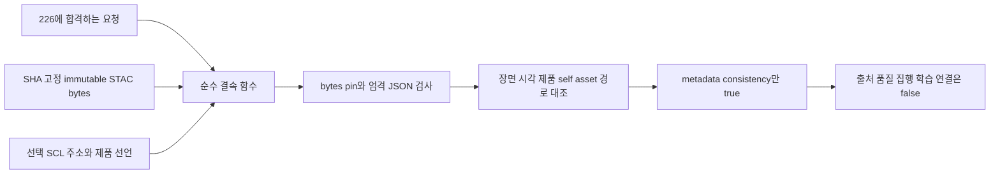

# 246 — 고정 STAC 문서와 장면·시각·제품·SCL 주소의 선언 결속

- updated_at: 2026-10-18 Root 독립 읽기 검토·기록된 45시험 완료 기준
- source_commit: 신규 helper SHA `16a1d8684e47b2d7f1cb63e062f9fe1e2831f10eb4bd68eedae6e6ee7e788b4a`
- evidence_paths: [완료 구현 문서](../implementation/246_survey_stac_source_binding.md), [Root 검토·시험 receipt](../../evidence/integration/survey246-root-review-20261018.json), [보존된 시험 로그](../../evidence/integration/survey246-root-regression-20261018.log)
- confidence: 순수 선언 검증·합성 시험·정적 검토에 높음. 현재 공급자 실문서 호환성과 출처 진위는 미검증.
- status: **TESTED_SYNTHETIC / IMPLEMENTED_UNVERIFIED**. Root 검토에서 필수 제품 수정 미발견. 실제 runner/consumer 연결은 PLANNED·집행/학습 gate false.

## 1. 쉬운 설명

**SHA로 고정한 STAC 문서가 요청한 장면·관측시각·제품·SCL 주소를 서로 맞게 선언하는지 확인하는 순수 함수다.**

서류 여러 장의 이름·날짜·품목·주소가 일치하는지 대조하는 일과 같다. 서류끼리 맞아도 발급 기관이 진짜인지, 그 주소의 물건 상태가 좋은지까지 증명하지는 않는다. STAC는 시공간 자산 카탈로그이며 여기서는 원격 검색을 수행하지 않고 호출자가 메모리로 전달한 bytes만 검사한다.

기존226의 원문 장면 ID를 바꾸거나 baseline을 추정해 보충하지 않는다. 실제 수집기의 STAC와 SCL 읽기, 독립 정답·영상 품질·학습 승인으로 연결한 기능도 아니다.

## 2. 이론과 좁은 수락 정책

세 가지 결속을 구분한다. 첫째는 전달한 원문 bytes와 요청 stac_ref SHA가 같은가다. 둘째는 원문과 요청의 장면·시각·제품·URL 선언이 같은가다. 셋째인 공식 출처의 진위·실자산 상태는 이 함수의 범위 밖이다. 호출자가 모든 입력을 함께 위조하는 경우를 막는 인증이 아니다.

정책 `PC_SENTINEL2_L2A_SCL20_V1`은 STAC1.0.0 Feature·sentinel-2-l2a·정확한 self 링크·대문자 SCL 키·정해진 Sentinel 두 호스트와20m 경로만 허용한다. 다른 정상 공급자 형식도 거부될 수 있다. 실제 공급자 현재 스키마 전체의 호환성을 확인한 결과가 아니다.

signed query가 있으면 제거해 통과시키지 않고 거부한다. URL userinfo·port·fragment·percent escape·경로 별칭 등도 거부한다. 원문 ID에 baseline이 없으면 그대로 두고 별도 .SAFE 제품 URI의 실제 baseline과 나머지 구성 요소를 비교한다. baseline이 있는 ID는 그것도 정확히 일치해야 한다.

시각도 정밀도를 숨기지 않는다. `02:13:51.000Z`와 `02:13:51Z`는 같은 시각이지만 `02:13:51.024Z`는 초 단위 요청과 다르다. .024초를 반올림하거나 삭제하지 않아 `SURVEY_STAC_TIME_MISMATCH`로 차단한다. 이 좁은 정책과 현재 실STAC의 조합은 아직 검증하지 않았다.

## 3. 코드·데이터 동작

[bare_survey_stac_binding.py](../../backend/app/data/bare_survey_stac_binding.py)의 `validate_survey_stac_binding(request, raw_stac, selected_asset)`가 입력이다. immutable bytes만 받고 경로를 열지 않는다. 원문1MiB·깊이32·JSON 순회25,000노드 제한, 파싱 전 SHA 확인, 중복 키·BOM/NUL·UTF8·비유한 수·surrogate 거부를 적용한다.

결과는 frozen dataclass와 canonical JSON이며 `to_dict()`는 독립 사본이다. 입력이나 반환 사본을 바꿔 결과를 변경할 수 없다. 오류는 고정 `SURVEY_STAC_*` 코드이고 URL·토큰·입력·내부 파싱 예외를 새로 노출하지 않는다.

성공 상태는 `PINNED_STAC_METADATA_BOUND`, `metadata_consistency_verified=true`다. source_authenticity/remote_asset/raster_header/quality/independent_ground_truth/scientific_accuracy/execution/collection/ledger/training/registry/target_consumer는 false다.

호출자는 bytes를 어떻게 읽고 고정했는지, 파일 identity·성장·교체와 전체 I/O 예산, 원격 출처 신뢰를 별도로 책임져야 한다. stac_ref의 다른 근거 경로와 대소문자 alias는 거부하지만 실파일 symlink/hardlink 동일성은 검사하지 않는다. 기존 수집기는 저장 시 signed query를 제거할 수 있으므로 저장문서를 전송 당시 원격 응답 원바이트로 단정하지 않는다.

## 4. 시험과 Root 검토의 증거

신규13개+기존32개로 **유효 집합45개**다. 초기77개는 기존 TestCase 직접 import로32개가 중복 발견된 값이며 최종 집합으로 사용하지 않는다. 담당45 PASS0.216초는 문서의 역사다. 당시 stdout뿐이던 로그 보존 공백을 마감하기 위해 Root가 같은45개를 단1회 기록 실행했다.

[Root 로그](../../evidence/integration/survey246-root-regression-20261018.log)는 **45 PASS / unittest0.309초**이고 receipt의 외부 실행 구간은1.265초다. 이전45와 합산하지 않는다. 로그 SHA는 `1e6c3adc34d8dc90715e4c2933a2147fe705273c8c362b12ab94d28e721610d7`다.

[신규 시험](../../tests/test_bare_survey_stac_binding.py)은 합성 bytes·파일/소켓 접근 차단·입출력 사본 분리·기존226 출력 동등·두호스트·ID/제품·소수초·URL·역할·자원 경계·false gate를 확인한다. Root는 신규3파일을 읽어 필수 제품 수정 미발견으로 인계했고3파일 SHA는 전후 같았다. 이는 현재 공급자의 실응답·인증·영상품질·최대 자원 성능시험이 아니다.

노드 검사는 파싱 후라 모든 순간 메모리 할당을 사전에 보장하지 않는다. 원문1MiB가 전체16GiB JSON 작업 예산이나 원격 COG 예산을 대신하지 않는다. Root 실행의 HTTP·collector·native·운영source/원장 읽기는0이다.

## 5. 다음 단계와 화면 영향

216의 실제 SURVEY runner와 후속 소비자 연결은 미구현이다. 고정 bytes 취득·파일 변경 방지·전체 자원 계상·공급자 실호환·출처 신뢰·정확한 오류 전달과 별도 승인 계약이 필요하다. 순수 내부 함수가 API/UI에 연결되지 않아 이번 단위의 프론트·서버·브라우저 확인은 필요하지 않았다. 235/249 수집의 성패나 품질 결과를 이 함수의 증거로 대신하지 않는다.

## 6. 발표 대본

### 1분

“요청한 장면과 고정 STAC 문서의 시각·제품·SCL 주소가 맞는지 대조하는 함수를 추가했습니다. 지문이 맞고 선언끼리 일치하는지만 확인합니다. 실제 공식문서의 진위나 영상 품질을 인증하지 않으며 수집·학습과도 연결하지 않았습니다. 합성45개 시험과 Root 정적검토를 완료했고, signed query와 .024초 같은 정밀도 차이는 임의 수정하지 않고 거부합니다.”

### 5분

“기존226은 장면 선언을 검사했고246은 고정 원문 bytes를 선언과 결속합니다. 문서를 읽어 오는 동작은 호출자의 책임이며 이 함수는 파일·HTTP를 열지 않습니다. SHA와 엄격JSON, 정확ID·UTC시각·.SAFE제품·self링크·SCL asset를 비교합니다. 범위는 고정PC/Sentinel/SCL20m 정책으로 좁고 다른 정상경로도 미지원일 수 있습니다. 원문 소수초가 .024면 정밀도를 버리지 않고 차단합니다. 성공해도 metadata consistency만true이며출처·품질·집행·학습은false입니다.45시험은같은집합을Root가기록한것이므로90개로더하지않습니다. 실제원문호환성과runner연결은후속입니다.”

### 10분 구성

1.0~2분:서류일치비유와진위/품질분리.
2.2~4분:bytes SHA·엄격JSON·ID제품·시각결속.
3.4~6분:좁은URL/SCL정책·signedquery·소수초차단.
4.6~8분:45시험/중복77정정·Root기록로그와실호환한계.
5.8~10분:원문취득·전체자원/신뢰·216runner·falsegate/Q&A.

## 7. FAQ

**1.실제STAC에서가져왔나요?** 합성bytes시험입니다. 함수는파일·HTTP를읽지않습니다.

**2.SHA가맞으면공식문서인가요?** 선택한bytes와요청pin이같다는뜻이며공식출처인증이아닙니다.

**3.signedquery를지워통과시키나요?** 거부합니다. 숨겨진원문을복원하거나수정하지않습니다.

**4..024초는무시해도되지않나요?** 현재정책은정확시각비교이므로반올림없이차단합니다.실공급자호환성은후속입니다.

**5.45개를두번해90개인가요?** 같은45집합입니다. Root기록시험은로그보존과동일판검증이며합산하지않습니다.

**6.이제나지수집이나학습을하나요?** runner/consumer는미연결입니다.영상품질·원장·집행·Registry·학습gate모두false입니다.
