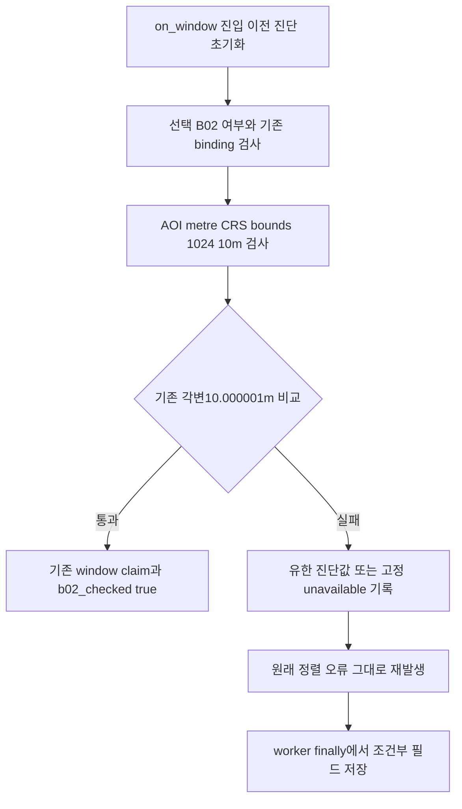

# 255·256 — B02 정렬 실패를 설명할 수치를 안전하게 남기는 진단

- updated_at: 2026-10-18 255 최종 시험·256 Root 독립 검토 완료 기준
- source_commit: guard `a90ba9a70bb0b0eecf529a10961e12edd1d9519b881913eed2e997c52c182071`, coordinator `971c474b1c8217b1be958b61532ccf55e646804a083a045d2cda74a4a9d2bd09`
- evidence_paths: [255 구현](../implementation/255_b02_alignment_failure_diagnostics.md), [256 독립 검토](../implementation/256_alignment_diagnostic_root_review.md), [freeze255](../../evidence/integration/alignment255-20261018/freeze255.json), [최소 diff](../../evidence/integration/alignment255-20261018/patch255.diff), [최종 관련 시험](../../evidence/integration/alignment255-20261018/regression.log), [Root16핀검사](../../evidence/integration/alignment255-root-review-20261018.json)
- confidence: 코드·합성 시험·독립 검토에 높음. 다음 실제 수집의 새 진단 관측은 미검증.
- status: **TESTED_SYNTHETIC / IMPLEMENTED_UNVERIFIED**. CLI 의존 제품 적용·독립 정적 검토 완료. 실제 진단 운영 관측0·실수집/학습 승인 없음.

## 1. 쉬운 설명

**다음에 선택 B02 창의 위치가 계획과 달라 차단되면, 어느 변이 얼마나 다른지 설명할 숫자를 worker 결과에 남긴다.**

기존 보호장치는 “문이 맞지 않는다”는 경고를 냈지만 어느 쪽이 몇 cm 다른지는 적지 않았다. 이번에는 차단 판단을 그대로 두고 계획 위치·실제 위치·차이·허용치 초과량을 기록한다. 안전장치를 느슨하게 하거나 실패를 성공으로 바꾸는 기능이 아니다.

249에서 실제 B02 경계와 transform을 저장하지 않아 정확한 오차를 모른다는 사실은 변하지 않는다. 255가 과거 값을 복원하거나 SCL/Esri 범위로 대신 계산한 일은 없다. 이 기능으로 나지나 적격 패치가 늘어난 것도 아니다.

## 2. 이론: 위치 검사와 품질·진단을 분리

B02는 Sentinel-2의 청색 밴드이며 이 경로에서는 선택 영상의 실제 10m 격자를 확인하는 기준이다. 계획 native1024 사각형과 실제 B02 창의 `[left,bottom,right,top]`를 같은 metre CRS에서 비교한다. 각 변의 기존 허용치는 **10.000001m**다.

각 변에 대해 다음 값을 기록한다.

- signed delta = actual − planned.
- absolute delta = |actual − planned|.
- excess = max(0, absolute delta − 10.000001).

예를 들어 시험의 수평11m 이동은 left/right delta가11m,절댓값11m,허용치 초과량약0.999999m다. 이것은 합성 예시이며249의 실제 오차가 아니다. 음의 left delta는왼쪽,음의 bottom delta는아래쪽 차이를뜻한다. 원격 COG 전체 bbox의 차이가 아니라 선택된 crop의 각 변 비교다.

SCL 예비 유효율이 좋아도 실제 영상의 위치가 다르면 다른 땅을 평가할 수 있다. 따라서 예비 품질 통과와 B02 정렬, 최종10m 품질·나지·학습 승인은 별도 조건이다.

## 3. 코드·데이터 흐름

[DeficitCandidateLiveGuard](../../backend/app/data/deficit_candidate_guard.py)의 순서는 기존 binding→AOI/CRS/bounds→1024/grid→정렬 비교→windows.claim→b02_checked다. 비교 실패 때만 `_record_alignment_failure`를 호출한다. 선행 규격 검사에서 실패하면 이 정렬 진단을 만들지 않는다.

[collect_deficit_guarded.py](../../scripts/collect_deficit_guarded.py)의 worker finally는 진단이 있을 때만 `worker-result.json`에 `b02_alignment_diagnostic`을 추가한다. batch summary·run result·aggregate·API/UI에 연결하지 않는다. 원격 파일을 진단 때문에 다시 열지 않으며 이미 callback으로 받은 geometry를 사용한다. hook은 `window_geometry_guard` 단계로 픽셀 `src.read()` 전이다.

`alignment_diagnostic()`는 deepcopy다. 원래 geometry나 URL을 보관하지 않고, 반환 사본 수정이 내부 진단을 바꾸지 않는다. 매 callback 진입에 초기화하므로 다음 성공·SCL·다른 asset에는 이전 실패 진단이 남지 않는다. 전체 실패 이력을 누적하는 저장소가 아니다.

## 4. 작은 고정 진단 계약과 실패 처리

| 필드 | 내용 |
|---|---|
| schema_version/code/stage |1 / CENTER_B02_ALIGNMENT_SHORTFALL / window_geometry_guard|
| available |수치 생성 가능 여부|
| crs |정규화한 EPSG 정수 표기 또는 PROJECTED_METRE_CRS_UNIDENTIFIED|
| tolerance_m |기존10.000001|
| planned_bounds_m/actual_bounds_m |같은 metre CRS의각4숫자|
| delta_actual_minus_planned_m/abs_delta_m |부호 있는 차이/절댓값각4숫자|
| excess_over_tolerance_m |허용치를넘은양각4숫자|
| requested_side/window_width/window_height |앞선규격검사를통과한1024|
| window_transform |앞선검사에합격한Affine6숫자사본|

유한값만 기록한다. 유한값끼리 빼도 overflow가 나거나 EPSG formatting에 실패하면 `available=false`,고정 `reason=ALIGNMENT_DIAGNOSTIC_UNAVAILABLE`만 남긴다. EPSG를 모르면 임의 WKT/이름을 복사하지 않는다. URL·토큰·scene ID·파일 경로·원 geometry·임의 예외 문자열은 진단에 싣지 않는다.

진단 helper 자체가 예상 밖 예외를 내면 진단을 생략하고 원래 정렬 오류를 다시 발생시킨다. 진단 생성 실패가 보호를 가리거나 통과시키지 않는다. 성공·미관측·다른 asset·선행 grid/binding 오류에서 필드는 없을 수 있으므로 **진단 부재는 성공 증거가 아니다**. 기존 live_b02_checked·오류·정산 상태를 함께 읽는다.

finally의 기존 파일 쓰기 자체가 실패하면 미확정 정산 보호를 유지한다. 다중 파일 원자적 journal이나 저장 매체 전체 실패까지 해결하는 기능이 아니다.

## 5. 시험 근거와 원판 보존

수정 전 제품2개·기존시험2개 원바이트를 [original](../../evidence/integration/alignment255-20261018/original)과baseline에 SHA로 보존했다. 제품guard·coordinator,두시험,새문서의 최소 diff다.246보호파일도 별도 지문으로 확인했다.

**관련54 PASS / 17.982초 / exit0**에 신규5개와 집중6개가 겹쳐 포함된다. 합산하지 않는다. 집중6 PASS3.640초는 앞선 범위다. 기존 rasterio PendingDeprecationWarning은 있었고 실패·skip은 없었다. 전체 프로젝트 회귀라고 확대하지 않는다.

- 합성±11m에서 signed/absolute/excess와 사본 분리를 확인했다. 다음 성공·다른 callback의 stale 진단 삭제도 시험했다.
- fake bounds로±10.000001 경계를 허용했다. 실제 큰 좌표의 부동소수점 뺄셈은 기존 동작이며 tolerance를 바꾸지 않았다.
- NaN/Infinity·유한뺄셈overflow·formatting/진단helper예외도 원래 차단을 유지했다.
- fake raster header callback 실패 뒤 pixel `dataset.read` 호출0, b02_checked=false를 확인했다.
- 오프라인 Temp worker에서 진단 finally 저장·materialize0·신규패치0·합성97바이트 정산과 oldpending2개·기존source prefix 보존·잠금해제를 확인했다.
- 성공 fakeworker에는 새 필드가 없고 기존 정산/finally실패·2worker·부모256과scene/split/support회귀도 통과했다.

97바이트는 Temp 합성 계측값이며 실제 수집 비용이 아니다. 운영source/ledger/model·실래스터 읽기,HTTP,실collector,native QA는 실행하지 않았다.

## 6. 256 Root 독립 검토와 현재 사용 범위

freeze는 최초 “독립검토대기” 기록을 유지하고, 후속256과Rootreceipt가 검토 완료를 증명한다. Root16핀검사는 모두true였으며 원판·시험로그·246보호와최종판이 맞았다. 정렬식·claim순서·부모256·정산식을 바꾸지 않았고 필수제품수정은 발견하지 않았다. Root는 같은54시험을 반복하지 않았다.

변경된 두CLI 의존제품은 main에 있지만 **다음collector에는새코드지문을다시고정해야 한다**. old249approval은 예전코드핀이라 재사용하지 않는다. 최신source·원장·계획·실process/lock·전체지원·예산검사와Root단일실행판단이별도다.

API와Frontend는 내부worker진단을 소비하지 않아 재시작·화면수정은 필요하지 않았다. 현재 사용자가 보는 재고·예산·과거검토경고는 [253/254 후속](235_239_245_247_248_249_ZERO_PATCH_AND_CONTINUATION.md#14-253254-후속--현재-source-재결속과-실제-api화면-완료)의 실제 관측이다. 그 화면이 새 진단을 표시하거나B02오차를재검사한것은아니다.

새 진단을 실제 운영실패에서 관측한 횟수는0이다. 다음 실행이 성공하면 진단필드가 없을 수 있고, 실패해도 해당정렬비교까지도달하지않으면없을수있다. 현249의정확한실패경계·몇m오차는여전히모른다.

## 7. 발표 대본

### 1분

“249에서 B02 정렬 오류는 확인했지만 실제 경계와 오차를 저장하지 않아 어느 변이 문제인지 모릅니다. 255는 다음 같은 실패 때 계획과 실제 경계, 차이, 허용치 초과량을 worker 결과에 기록합니다. 기존 10.000001m 검사와 차단은 그대로입니다. 관련 54개 시험과 Root 독립 검토를 마쳤지만 실제 새 진단 관측은 아직 없고, 과거 오차를 복원한 것도 아닙니다.”

### 5분

“먼저 SCL 품질과 B02 위치 검사가 다른 조건임을 설명합니다. 기존 binding·AOI·CRS·1024·10m 검사가 끝난 뒤 각 경계 차이를 비교하며 실패 때만 진단합니다. 계획·실제 경계와 부호 있는 차이·절댓값·초과량·transform을 유한 숫자로 기록하고 URL이나 토큰을 싣지 않습니다. 만들 수 없으면 고정 unavailable로 남기되 원래 차단을 유지합니다. 오프라인 Temp worker는 97바이트 정산과 기존 예약 보존을 검증했고 픽셀 read는 0이었습니다. 관련 54개 시험과 Root 16핀 검토는 완료했습니다. 그러나 API/UI에는 노출하지 않고 실제 다음 실행 진단은 미검증입니다. 다음 collector는 새 코드 지문과 최신 원장·계획을 다시 확정해야 하며 old249 승인을 재사용하지 않습니다.”

### 10분 구성

1. 0~2분: 문이 맞지 않는 비유와 249 진단 공백.
2. 2~4분: 기존 검사 순서·10.000001m·부호/초과량 수식.
3. 4~6분: 조건부 worker 필드·유한값·EPSG·실패 보존·미관측 의미.
4. 6~8분: 54개 시험·Temp 97B/픽셀 0·원판 SHA 보존·16핀 독립 검토.
5. 8~10분: 실운영 진단 미검증·다음 코드 지문·API/UI 경계·질의응답.

완료 diff와 저장 시험을 읽는 시연만 한다. 진단을 보여 주려고 실패 수집·native·HTTP를 재실행하지 않는다.

## 8. FAQ

**1. 249의 실제 오차를 이제 알 수 있나요?** 아닙니다. 그때 없던 geometry를 복원하지 않습니다. 다음 같은 실패의 관측을 보완했습니다.

**2. 허용치를 늘렸나요?** 기존 각 변 10.000001m와 검사 순서 그대로입니다.

**3. 진단이 없으면 성공인가요?** 성공·미관측·다른 asset·선행 오류 모두 부재일 수 있습니다. 기존 오류와 b02_checked를 함께 봅니다.

**4. 진단 실패 때 수집은 계속하나요?** 원래 정렬 차단을 그대로 다시 발생시킵니다.

**5. 97B는 실제 추가 전송인가요?** 오프라인 Temp worker의 합성 계측 시험값입니다.

**6. 새 값을 만들려고 픽셀을 다시 읽나요?** callback geometry를 이용하며 시험에서 픽셀 read 0을 확인했습니다.

**7. 화면에 새 오차가 보이나요?** 내부 worker 진단이며 API/UI 노출이 없습니다. 서버 재시작은 불필요합니다.

**8. old249 승인으로 바로 다시 시작하나요?** 코드가 달라졌으므로 새 지문·최신 source/원장/계획 검토와 Root 판단이 필요합니다.

## 9. 257·258 당시 시작 관측 — 종료 결과는10절

[257 로컬 계획](../implementation/257_fresh_local_centers_after249.md), [258 실행 범위](../implementation/258_bounded_collection_with_alignment_diagnostics.md), [257 결과](../../evidence/integration/centers257-result-root-20261018.json), [258 준비 요청](../../evidence/integration/deficit258-prepared-request-root-20261018.json), [실제 launch](../../evidence/integration/deficit258-launch-root-20261018.json)를 읽었다. 완료 결과와 진행 중 실행을 구분한다.

257은 이전245의 prior44+제안4를 원순서로 보존해 **48개 위치를 제외**하고, 기존182 CLI를 단1회 실행했다. **96.156초·115header·새위치4개**,7개 입력·코드 지문 전후 동일·원격/collector/원본원장쓰기0이다. 새source 사본은6899의66,827,175바이트 한 번만 생성하고258이 재사용한다. 제안4개는 남동2024 둘·고론2025/2022 각1개이며 적격·나지 확보나 full pending/support 통과가 아니다.

258은 첫 남동2024 `centers182-southeast_sulawesi-13bad39a9a48` 한 곳 최대1batch·16물리다. canonical SHA는 `c0c7df51dcd8952c430f6a68eeb3329c4724b087ff43c7a3d877eb5aeccc9257`이며255 guard/coordinator를 포함한 **새 실행지문32개**로 승인됐다. old249 승인을 재사용하지 않았다. 실행은 session13107·supervisor40784/collector28688이며 launch는fresh사전검사 시작을 기록한다.

**당시17:37:14 toolbox_review의 실제 worker_started1 관측**까지 Root가 인계했다. 아래미확정기록은당시이력이며최종종료는10절이다. 이는 기존 코어의 O_EXCL 잠금 아래 사전검사를 거쳐 worker가 시작한 증거이며, HTTP·종료·실정산·patch/적격/나지 성과와255 새 진단 발생은 아직 미확정이다. 새진단 관측 성공이나 새자료 확보를 예측하지 않는다. 로컬 제안의 기하와 실행 잠금 안 fresh 전체지원 검사는 다른 단계다.

적격1,358·셀부족21·게시후보1,342/차단3·잔여1,893,950,211바이트는 **258 시작 전** 관측이다. 예약 이후 사용액과 잔여가 달라질 수 있으므로 실행 중 현재 잔액으로 단정하지 않는다. oldpending2건136,314,880바이트 전액·4GiB·속도/첫429·품질/split·물리3000 보호는 유지한다.

추가collector는0이며 종료·정산·잠금/OS종료와Root원본고정·별도GO 전 native0이다. 최종 결과는 별도 증거를 인계받은 뒤 기록한다. 이 후속 작성은 완료 근거 읽기와 문서만이며 추가 운영조회·원본읽기·HTTP/native·시험·코드수정은0이다.

### 짧은 발표·FAQ

“이전48곳을 제외한 새위치4개 제안을 만들고, 새 진단 코드 지문을 고정한258의 한위치 worker가 시작됐습니다. 제안과 fresh 전체지원 검사, worker 시작, 실제 확보는 다른 단계입니다. 종료·정산·패치와 진단 발생은 아직 확인하지 않았습니다.”

**새진단이실제로나왔나요?** 아직미확정입니다. worker시작을진단관측이나수집성공으로바꾸지않습니다.

**지금잔여가1,893,950,211바이트인가요?** 시작전관측값입니다. 실행예약이후현재금액은별도원장증거로확인해야합니다.

## 10. 258 종료 후속 — B02 이전 지원 겹침4개·SCL 미달1개

[258 최종 문서](../implementation/258_bounded_collection_with_alignment_diagnostics.md)와 [실제 좁은 감사](../../evidence/integration/deficit258-native-root-20261018.json)를 읽었다. 감사 SHA는 `5cd7137383d7f5b33d5c03c07faaf4feda29b361760894a93e6e3ab589c864eb`다. **17:37:33 exit0/164.031초·worker1·신규patch/적격/나지0**으로 종료했다. 현재 실행 중이 아니다.

후보5개 중 앞4개는 후보 SCL의 `window_geometry_guard`에서 `LIVE_SUPPORT_WINDOW_OVERLAP`로 차단됐다. 유효율과SCL파일SHA는null로 남아 있으므로 품질미달4개나 독립SCL검산4개로 바꾸지 않는다. 마지막51MUS/8월3일 후보1개만SCL을저장했고 예비유효55.0365448%<65%로탈락했다. 저장SCL1개와batchJSON4개,총5개SHA를확인했으며 배열 재계수는0이다.

| 실행 | 최종 차단 분기 | 신규 적격 |
|---|---|---:|
|235|후보5개 모두 SCL예비품질 미달|0|
|249|SCL통과 후보 선택 뒤 B02정렬 차단|0|
|258|후보SCL 지원겹침4개+마지막SCL품질미달1개|0|

**258은 B02에 도달하지 않아255 전용 진단이 없는 것이 이번 분기와 일치한다.** 새진단의 실제발생을검증한실행이아니며 진단부재를성공으로해석하지않는다. 어떤 기존support의어떤경계가얼마나겹쳤는지는미저장으로미확정이다. 가드를해제하거나지원영역을지우지않았다.

실정산은COG579,089+metadata214,808=**793,897바이트**다. finalize/settle/publish각1,old1,715행/history/미정산2건136,314,880바이트전액보존,적격1,358·부족21유지다. native0/기존238후보QA반복0이며실물1,716은실행전관측+신규0에따른유지추론으로전체재스캔결과가아니다. 원본/원장두읽기안정·잠금해제·OS종료도확인했다.

현재source는 `9473861797b729b6b6eb60607a7edfb67921fa2b259bc2b0ffa8b2af08fc1353`/66,827,338바이트,원장은 `a92506b7b5b2ca5f668a21f9b111b32b3d2080a707ba9646bbf063c53dfe5aea`다. source_manifests참조1개만추가됐고 잔여는**1,893,156,314바이트**다.235·249·258의실비합은**3,788,641바이트/확보0**이며품질보호를통과한데이터확보로계상하지않는다.

[259 명시 재결속](../implementation/259_post258_source_profile_rebind.md)과 [선택 receipt](../../evidence/integration/profile259-selection-root-20261018.json)는oldconfig160303원바이트archive→현재source9473를같은profile에선택한후속이다. 새config SHA는 `a24616e092f04233ca5e29c80ba4345b71de189381330bee1e82e48b9c0b59c2`다. 원본·원장·후보·나지pointer4개는전후보존했고후보QA나pointer승계는없다.

[실API11checks](../../evidence/integration/profile259-api-checks-root-20261018.json)는17:40:25.065KST재고/25.785예산·GET1회200/29.922초·모두true다. 현재1358/부족21vs과거1342/차단3·나지50모두source불일치warning/학습false,사용2,401,810,982·잔여1,893,156,314/oldpending사용포함이다.이절작성시261실브라우저는최종담당보고대기였다. 이후11절의실제화면완료를별도로확인했으며API200을화면증거로대체하지않는다.

260은운영data없는격리사본에서명시v2 metadata사전제외정책을구현중이다. 최종freeze·독립검토·Root승인전공유적용금지/실원격0이다. 과거request의예상config도새정책의실행승인으로재사용하지않는다. 현재실collector0·내부개발계속이며추가운영조회·native·HTTP·시험·제품쓰기0으로이후속을작성했다.

### 발표·FAQ 후속

“258은끝났지만신규0입니다.앞네후보는SCL지원창의겹침보호에서차단됐고마지막후보는SCL품질미달이었습니다.B02에이르지않아새B02진단이없는것은이번분기와맞습니다.현재source와예산은259API에서확인했고이후261실화면후속도별도확인했습니다.세실행의실비378만바이트정도가발생했으나확보량은0으로구분합니다.”

**255가적용되지않아서진단이없나요?** 적용된코드는실행핀에포함됐습니다. 이번에는B02정렬실패분기에도달하지않았기때문이며진단발생성공은미검증입니다.

**어떤support가겹쳤나요?** 저장오류는분기를확인하지만정확한asset/bounds/겹침량은미저장입니다.임의로확정하지않습니다.

**260이면다음수집에쓸수있나요?** 현재격리구현중입니다.동결·독립검토·Root승인과새핀전공유적용이나실수집성공으로보고하지않습니다.

## 11. 261 실제 화면 후속 완료

[261 완료 문서](../implementation/261_post258_ui_followup.md)와 [실제 UI receipt](../../evidence/integration/service259-post258-final-ui-20261018.json)를 읽어앞절의대기기록이후완료를확인했다.기존Chrome075탭에서refresh1회·새탭0으로재고**17:41:57.845 KST**,예산**17:41:58.820 KST**응답의완료DOM을확인했다.259RootAPI의17:40:25와다른관측이며이해담당이조회한것은아니다.

현재source9473/원장a925·등록1,715/적격1,358/부족21,과거후보1,342/차단3·나지50모두현재원본불일치warning을표시했다.미검사·집행미승인/학습미충족을유지했고,예산잔여**1,893,156,314바이트**·oldpending136,314,880사용포함·process UNKNOWN도보였다.

17:42:06.941의warn/error0,scrollWidth/clientWidth/bodyWidth모두1,573픽셀로가로넘침0이다.해당세션·화면의범위이며모든환경의성능·접근성보증은아니다.web_ui의추가수동API GET·제품restart·원본/원장/pointer쓰기·collector시작은0이다.

화면은현재재고·예산·과거검토경고를확인했으며SCL겹침/품질차단원인을재검사한것은아니다.그근거는258완료감사다.260은격리구현중이며동결·독립리뷰·Root명시적용전공유main/운영실행0·BLOCKED를유지한다.

**이제API와화면이모두완료인가요?** 해당source9473의259API와261실화면은각각완료했습니다.새영상확보·현재나지겹침재검사·학습준비완료를뜻하지않습니다.
