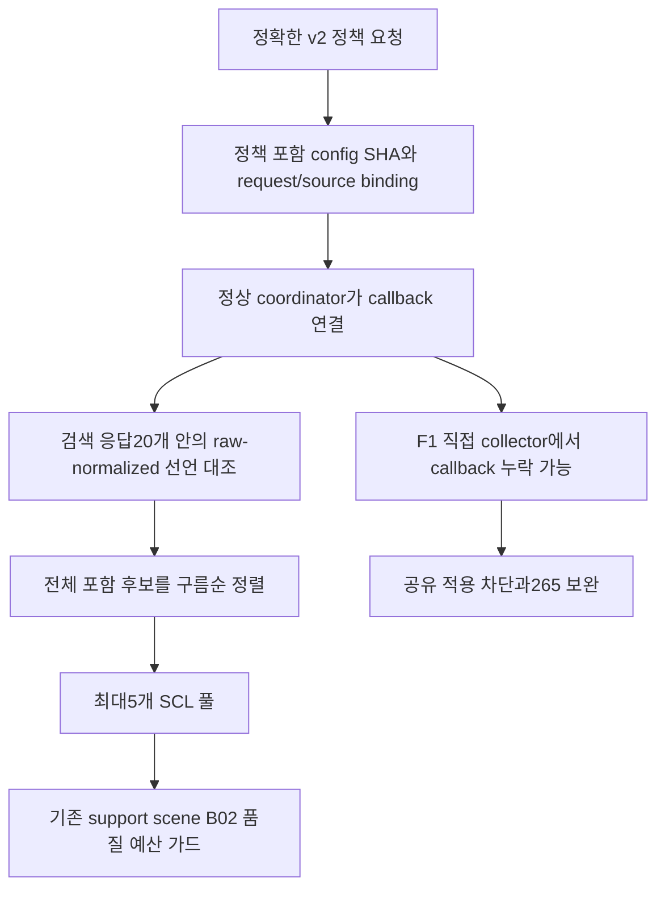

# 260·263·264 — AOI 전체 포함 선언을 먼저 검사하는 격리 정책과 적용 차단

- updated_at: 2026-10-18 263 독립 리뷰·264 공유 전 대조 완료 기준
- source_commit: `selection260-workspace-20261018`의 freeze260 고정판. 공유 main 적용 0.
- evidence_paths: [260 구현](../implementation/260_explicit_deficit_metadata_selection_isolated.md), [263 독립 리뷰](../implementation/263_deficit_metadata_selection260_independent_review.md), [264 공유 전 대조](../implementation/264_metadata_selection_preapplication.md), [freeze260](../../evidence/integration/selection260-workspace-20261018/freeze260.json), [최종90시험](../../evidence/integration/selection260-workspace-20261018/regression260-final.log), [263 receipt](../../evidence/integration/selection263-independent-review-20261018.json), [264 receipt](../../evidence/integration/selection264-preapplication-root-20261018.json)
- confidence: 고정 코드·시험·정적 리뷰·실제 대조 결과에 높음. 공급자 실제 호환성·새 확보는 미검증.
- status: **BLOCKED / TESTED_SYNTHETIC**. 독립 리뷰 완료·제품 소비 계약 F1과 시험 배치 F2 보완 필요. 265 별도 격리 구현 중이며 공유 적용·운영 실행은 0.

## 1. 쉬운 설명

**새 명시 정책에서는 사진의 선언 범위가 원하는 위치 전체를 덮는지 먼저 보고, 합격한 사진 중 최대 다섯 장을 SCL 검사하도록 격리 구현했다. 다만 두 공백이 발견돼 공유 적용을 차단했다.**

사진 가장자리에 원하는 장소 일부만 보이는 경우를 미리 걸러 내는 검사와 같다. 예전 검색의 “겹친다”와 새로운 선언의 “전체를 포함한다”는 다르다. 그러나 사진 설명서가 전체를 덮는다고 해도 실제 픽셀 위치·구름·NoData·기존 지원과의 겹침까지 합격한 것은 아니다.

260의 관련90개 시험 통과는 격리판의 유효한 사실이다. 263은 정책 표시만 있고 실제 검사 callback이 빠지는 경우와 공유 배치의 시험 기준 파일 누락을 발견했다. 264는 원판 충돌이 없음을 확인했지만 적용 승인으로 바꾸지 않았다. 265가 이를 별도 격리판에서 보완 중이다.

## 2. 이론: 검색 응답20개·선별 후 SCL 최대5개

현재 v1은 검색된 장면을 구름 비율순으로 정렬한 앞 최대5개를 SCL 검사한다. v2는 같은 응답 최대20개에서 identity·시각·bbox 선언을 먼저 검사한 뒤 구름순 최대5개를 SCL 풀로 사용한다. 앞의 후보를 제외하면 **기존6~20순위도 새5개 풀에 들어올 수 있다**. 의도한 선택 정책 변경이며 후보 상한을 몰래 늘린 것이 아니다.

다음 page·재검색·선택 뒤 B02 실패의 다음 후보 fallback·실패 후 refill은 추가하지 않는다. SCL 시도는 여전히 최대5개다. 모든 후보가 metadata에서 제외되면 `metadata_coverage_insufficient / quality_unverified`로 종료하며 SCL·선택scene·B02 읽기와 첫장면 fallback은0이다.

포함 조건은 선언bbox의 west≤AOI west, south≤AOI south, east≥AOI east, north≥AOI north다. 정확한 경계 일치는 허용하며 ratio 반올림·epsilon·부분 포함 fallback은 없다. 6D bbox·날짜변경선·역전·누락·비유한 값은 지원하지 않는다.

## 3. 코드·데이터 동작과 지문 결속

[격리 guard](../../evidence/integration/selection260-workspace-20261018/backend/app/data/deficit_candidate_guard.py), [격리 collector](../../evidence/integration/selection260-workspace-20261018/scripts/collect_samples.py), [격리 coordinator](../../evidence/integration/selection260-workspace-20261018/scripts/collect_deficit_guarded.py) 세 제품만 수정했고 새 시험1개를 추가했다. 공유 main255·246 제품과 원본·원장·모델은 변경하지 않았다.

v1의 정확 key/default 계약은 보존한다. v2는 `schema_version:2`와 정확한 `candidate_metadata_policy: DEFICIT_AOI_BBOX_CONTAINS_V1`을 요구한다. unknown·bool·누락·v1에marker추가를거부한다. 정책을 job config에 넣은 **뒤** 기존 식으로 config SHA를 계산한다. request 전체 canonical과job key에도 정책이 결속된다. 별도binding은 `{policy,request_sha256,source_sha256}`이고 실제고정source pin과비교한다.

producer가 만든 config에 실행loader의 periods를 새로 섞어 expected digest를 계산하지 않는다. 과거205/249/258 v1 expectedconfig나approval을 재사용하면 새정책지문이 빠진다. 수정판 적용 후에도 새v2요청·canonical·config SHA·approval·코드핀을 발급해야 한다.

`filter_candidate_pool`은 순수metadata 함수다. PC search endpoint와sentinel-2-l2a,응답items≤20·유한nonbool cloud0~100,raw/normalized의ID·collection·datetime·bbox 일치를검사한다. 응답구조·cloud·binding오류는전체선별실패,개별identity/time/bbox오류·부분교차는장면제외다. ID는 제한된ASCII 원문일치이며246의strictID/제품시각결속을대신하지않는다.

원문 `.024000Z`가 normalized와같고유효동년UTC면260시각조건에는허용된다. 초단위요청과정확시각을비교하는246은같은조합을차단할수있다. 검증목적이다르며소수초를없애거나baseline/alias를생성해맞추지않는다. 실제저장STAC나공급자현재응답의호환성을시험한것은아니다.

결과요약은최대20개의고정reason/index/rank와count·정책·지문뿐이다. URL·scene원문·서명query·geometry·임의예외를새요약에복사하지않는다. 전체포함이합격해도기존support/pending·scene/split/window claim·B02 1024/10m/10.000001m정렬·255진단·최종80/95·나지·정산을우회하지않는다. default256와5SCL/20search·4GiB·속도/429·물리3000도유지한다.

## 4. 시험 증거와 원 실패 보존

**최종6모듈90 PASS / 58.025초 / exit0 / skip0**다. fake provider 응답·Temp 파일·합성정산으로 v1 proof/기본256출력동등·v2지문/예약전차단·cloud동률·metadata제외·6~20유입/SCL최대5·refill0·limit1·기존supportveto·oldpending보존을시험했다. 초기집중12/16개와합산하지않는다.

첫90개회귀는56.640초에2개실패했다. 정책파싱을fresh proof의기존실패분류보다먼저해기존오류를가린문제였다. 기존proof실패분류뒤합격proof에정책을검사하도록좁게수정하고같은90개가통과했다. [원실패로그](../../evidence/integration/selection260-workspace-20261018/regression260.log)는보존했으며skip·기대오류변경으로숨기지않았다. 관련기존시험파일도원판그대로다.

freeze SHA는 `66d25b903db870ca6607bb56dc76bf8117b56d468f12ffafd1a20843e9313a8b`, 구현doc SHA는 `85cece0cfbc99dbc899d3e87889fe7d1b80305430b3077f1d5180c593f5562a4`다. 운영STAC/원본/원장/raster·HTTP·collector·실API/브라우저·운영QA는0이다.

## 5. 263 리뷰: 왜90개 통과여도 적용 차단인가

### F1 — 표시와 실제 검사 동작의 양방향 계약이 부족

정상v2 coordinator는callback을항상전달하고예약전binding도검증한다. 하지만marked config를직접collector에전달하면서callback=None이면새검사를하지않고legacy풀로진행할수있다. callback을받은경우만검증하는한방향조건때문이다. 정상coordinator의즉각누락과공개소비경계의공백을구분한다.

필요한수정은네트워크전에양방향으로막는것이다. 정확marker가있으면callable callback이필수이고,callback이있으면정확marker/1024/search≤20이필수다. unknown non-null marker도거부해야한다. marker없는legacy+None은기존동작을보존해야한다.263은정적읽기결론이며실호출을재현한시험결과가아니다.

### F2 — main에 없는두기준파일에의존하는시험포장

신규시험은`ROOT/baseline/backend/app/data/deficit_candidate_guard.py`와`ROOT/baseline/scripts/collect_samples.py`를직접import한다. 격리에는있지만main에는없고patch목록에도없다. 따라서신규시험만복사하면FileNotFoundError가난다. 이것은시험배치차단이며bbox/예산실가드를완화했다는뜻은아니다.

265는원바이트·고정SHA fixture/loader를시험bundle에넣는별도보완이다. 누락·변조는실패해야하며현재제품fallback·기준재생성·skip으로대체하지않는다. 별도보완완료·새freeze·독립검토·Root판단전공유적용하지않는다.

## 6. 264 원판 대조와 수치 차이

264 JSON의실제 `checks`는**20개이며모두true**다. 별도`delta`의대상4경로도baseline동일또는신규경로부재다. 초기에읽은doc264의“24개지문검사”표현은Root가**20개지문+4대상경로대조**로정정해현재JSON과일치한다. 이전표현차이는당시이력이며현재오류로표시하지않는다. 이를24개서로다른지문검사로합산하지않는다.

충돌없음은적용승인이아니다. 현재main의255·246은보존하고260freeze/실패·합격로그도그대로다. 265는별도격리두보완구현중이며최종시험·리뷰완료가아니다. 공유main·실서버·운영실행0/동결·독립검토·Root명시승인전BLOCKED다.

266은실패249에서보존한라벨1개의actual class count검증을준비중인단계로인계됐다. 이번문서에그실행·나지공식확보·성과를확정하지않는다. 전체개발과기존보호기준은유지하며이해담당의추가운영조회·시험·코드/CONT편집은0이다.

## 7. 발표 대본

### 1분

“새 정책은 원하는 위치가 사진의 선언 범위 안에 완전히 들어가는지를 먼저 검사합니다. 검색 응답 최대20개 중 metadata를 통과한 최대5개를 SCL 검사하므로 기존6~20순위도 새 풀에 들어올 수 있습니다. 격리90개 시험은 통과했지만 정책 표시만 있고 callback이 빠지는 공백과 시험 기준 파일의 공유 배치 문제가 발견됐습니다. 현재 적용은 차단됐고265가 별도 보완 중입니다. 선언 전체 포함이 실제 B02나 영상 품질 합격을 뜻하지 않습니다.”

### 5분

“먼저 bbox 교차 검색과 전체 포함 선별의 차이를 설명합니다. 260은 정확한 v2에서만 정책을 선택하고 request·config·source 지문에 결속합니다. 최대20개 응답의 raw/normalized 선언을 대조하고 metadata 합격 뒤 최대5개를 SCL 검사합니다. 추가 page나 실패 후 refill은 없습니다. 기존 실가드·정산·품질은 그대로입니다. 90개 합격은 격리 증거이고 최초2개 실패 로그도 보존했습니다. 263은 정상 coordinator와 별개로 marked config+callback None 경로와 ROOT/baseline 시험 포장 문제를 발견했습니다. 264의20개 검사와4개 경로 대조는 맞았지만 충돌 없음은 승인이 아닙니다. 265 보완·새 동결·독립 리뷰 후 Root만 공유 적용을 판단합니다. 현재 이 정책의 실수집이나 나지 확보는 없습니다.”

### 10분 구성

1. 0~2분: 사진 설명서 비유·bbox 교차/전체 포함·실제 픽셀 분리.
2. 2~4분: v2 선택과 지문·20응답/5SCL·6~20 유입.
3. 4~6분: raw 시각과246 차이·기존 실가드·bounded 요약.
4. 6~8분: 90개 시험·최초 실패 보존·F1/F2와20+4 대조.
5. 8~10분: 265 보완·공유 차단·새 지문·266 미래 성과 미확정/Q&A.

격리 코드와 완료 시험·리뷰를 읽는 시연으로 한정한다. 준비 명령을 실행하거나 동일 품질 검사를 반복하지 않는다.

## 8. FAQ

**1. 90개 통과인데 왜 막혔나요?** 격리 시험 범위 밖의 callback 누락 계약과 main 시험 배치 공백이 독립 리뷰에서 발견됐습니다.

**2. 기존6~20번째를 더 읽나요?** metadata 제외 뒤 새5개 풀에 포함될 수 있지만 SCL 시도 최대5개와 검색 응답20개는 유지합니다.

**3. metadata가 전체 포함이면 B02도 맞나요?** 선언 범위일 뿐입니다. 실제 격자·support·품질은 기존 가드가 별도로 확인합니다.

**4. .024초를 허용하면246을 완화한 건가요?** normalized/raw 시각 일치와 동년 검사인260과, 초 단위 요청의 정확 시각 결속인246은 다릅니다. 246 코드는 그대로입니다.

**5. 20개와4경로를 합해24개 SHA 검사인가요?** JSON checks20개와 delta4경로는 별도 배열입니다. 같은 의미의24개로 세지 않습니다.

**6. 265는 완료됐나요?** 별도 격리 보완 중이며 최종 동결·시험·독립 리뷰·Root 승인은 미완료입니다.

**7. 이전249/258 요청을 재사용하나요?** 정책이 config/request/job 지문에 들어가므로 새 v2 지문과 승인이 필수입니다.

**8. 266에서 나지를 확보했나요?** 이번 인계는 보존 라벨 검증 준비 단계입니다. 실행·공식 확보 성과로 확정하지 않습니다.

## 9. 266 실제 라벨 검사 후속

위 준비기록 이후[266 전용 해설](266_FAILED_BATCH_LABEL_ZERO_BARE.md)에저장라벨1개배열1회/class8실제0·histogram exact/225창생략windows0·경계면적미계산을완료근거로추가했다. 이한라벨에대한결과이며지역전체나지부재나공식확보·학습승인이아니다.26596격리PASS/267최종리뷰중·268공유적용전은별도후속으로분리한다.
