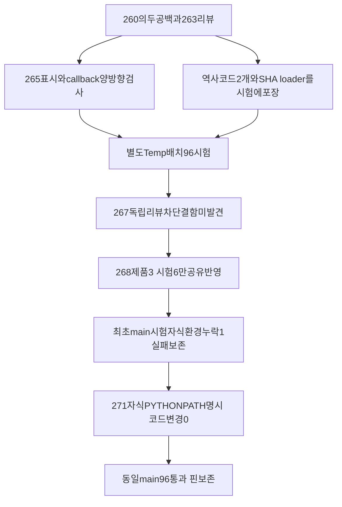

# 265·267·268·271 — 메타데이터 정책 보완과 공유 프로젝트 검증

- updated_at: 2026-10-18 18:10 KST 271 실제 프로젝트 검증 완료 기준
- source_commit: 265 고정 runtime3+시험bundle6의 적용 지문과268/271 receipt 기준
- evidence_paths: [268/271 공유 적용·검증 구현](../implementation/268_271_shared_selection_application_validation.md), [265 구현](../implementation/265_failclosed_selection_and_portable_tests_isolated.md), [267 독립 리뷰](../implementation/267_selection265_independent_review.md), [267 receipt](../../evidence/integration/selection267-independent-review-20261018.json), [268 실제 반영](../../evidence/integration/selection268-application-root-20261018.json), [최초 main 시험](../../evidence/integration/selection268-project-regression-root-20261018.log), [271 최종 검증](../../evidence/integration/selection271-project-validation-root-20261018.json), [271 실제 로그](../../evidence/integration/selection271-project-regression-root-20261018.log)
- confidence: 완료 코드·정적 리뷰·격리/프로젝트 시험과 보존 지문에 높음. 실제 공급자 응답·새수집·영상품질은 미검증.
- status: **TESTED_SYNTHETIC / VERIFIED_REAL_SHARED_PROJECT_APPLICATION**. runtime3·시험6 공유반영과 실제프로젝트96시험완료. 실제원격수집·학습·외부배포승인아님.

## 1. 쉬운 설명

**정책을 켰다고 표시하면서 실제 필터가 빠질 수 있던 공백을 막고, 시험 기준 파일을 함께 배치해 공유 프로젝트에서도 같은96개 시험을 통과했다.**

검사 스위치가 켜져 있으면 검사 장치도 반드시 연결돼야 한다. 265는 표시와 실제 callback을 양방향으로 확인한다. 또 작업실 옆 폴더가 없어도 옛 코드와 비교 시험을 할 수 있도록 기준 파일을 시험 묶음에 넣었다.

267의 독립 리뷰는 해당 범위 차단 결함이 없음을 확인했다. Root268이 제품3개와시험6개를 반영한 뒤 첫 main시험에서 자식Python의환경경로가빠져1개실패했다. Root271이제품/시험코드를바꾸지않고자식이상속하는경로를명시해같은96개가모두통과했다. 실패이력을삭제하거나시험을skip한것이아니다.

## 2. 이론: 양방향 계약과 자기완결적 시험

| 정책 키 | callback | 265 동작 |
|---|---|---|
| 없음 |None|기존default/v1 동작|
| 정확한 marker |callable·1024·search≤20|명시 정책 연결|
| 정확한 marker |없음/비callable|네트워크 전 차단|
| 있음·null/unknown/bool 등 |어떤 값이든|네트워크 전 차단|
| 없음 |None 이외|네트워크 전 차단|
| 정확 marker+callable |256 또는search>20|네트워크 전 차단|

키가 있으면서null인 것과 키가 없는 기본값은 다르다. 잘못된 계약은고정 `CENTER_METADATA_CALLBACK_INVALID`로search/SCL/asset 요청전에막는다. 다만기존위치에서검증하므로출력root폴더준비는먼저일어날수있다. 이검사가coordinator의예약전proof검산을대신하지않는다.

자기완결적 시험은 현재 제품을 과거 정답으로 대신하지 않는다는 뜻이다. 원바이트·SHA로고정한역사guard/collector만비교에사용하며누락·변조시실패한다. 제품코드는이fixture를실행의존성으로사용하지않는다.

## 3. 코드·데이터 흐름

제품은 [collect_samples.py](../../scripts/collect_samples.py)의양방향검사와260의guard/coordinator다. guard/coordinator두파일은260최종판과같고265의제품추가차이는collector검사다.260대비delta7개와공유union9개는기준이다르다. 공유반영은**제품3개+시험bundle6개**이며의존입력config·portable runner는제품으로복사하지않는다.

[selection265_fixtures.py](../../tests/selection265_fixtures.py)는자기옆fixture만기본경로로읽는다. manifest299바이트/SHA와역사guard22,548바이트·collector47,009바이트를검산한다. 최대64KiB·regular/symlink제외·전후identity/size/mtime·bounded읽기를확인하고검산한동일bytes만메모리compile/exec한다. 현재main·이웃260·외부baseline으로fallback하지않는다.

[신규시험](../../tests/test_selection265_contract.py)은marker누락·오염·None/비callable·256/search21을요청전에차단하고search/COG/callback미호출을확인한다. 정상명시선별과unmarked256출력의역사동등·fixture누락/변조실패도포함한다. 기존test260은baseline로드두곳만loader로바꾸고assertion을유지했다.

명시v2의request/config/source지문결속·20응답의metadata제외후최대5SCL·6~20유입·refill0·기존실support/scene/split/B02정렬·255진단·품질/예산/oldpending은그대로다. metadata전체AOI포함은실제B02픽셀·NoData·구름·최종품질통과가아니다.

## 4. 단계별 시험과 보존

| 단계 | 결과 | 설명 |
|---|---|---|
|265 별도Temp/project|96 PASS·unittest39.035초/외부40.531초|외부baseline없는46입력파일·전후SHA동일|
|267 독립정적리뷰|20핀불일치0·차단결함미발견|실행0·저장시험/assertion을읽은결론|
|268 최초main시험|96중95PASS/1FAIL·unittest86.518초/외부89.219초|자식import환경누락·원로그/FAIL JSON보존|
|271 실제main검증|96 PASS·unittest140.099초/외부141.469초·exit0|제품/시험수정0·자식환경교정후동일집합|

265의96과271의96을192개서로다른검증으로합산하지않는다. 집중22개·과거260의90개도중복/판차이가있어더하지않는다. 전체프로젝트회귀나실provider호환시험으로확대하지않는다.

268의실패는 `test_import_alone_does_not_load_collector_cli`에서자식이 `app`을찾지못한 `ModuleNotFoundError`였다. 부모sys.path만설정하고자식이상속할PYTHONPATH를누락한Root실행환경문제다. 이실패를단순무시하지않고모든96시험과FAIL증거를보존했다.

[271 실행기](../../evidence/integration/selection271-project-validation-root-20261018.py)는프로젝트/.runtime/backend/scripts/tests를자식환경에명시하고import probe를먼저확인했다. 이후같은7모듈96개를Temp자료로실행했다. 자동재시도나제품조건완화가아니라원인확인뒤Root가별도로수행한검증이다. 제품파일수정0·시험소스수정0이다.

271receipt SHA는 `24b837029aafa7413a5a31b56ddbf9cdab91a7a6a53155e45b3608820aaaef9d`,최종로그SHA는 `e3fd236d50336cc5378b301e5f2c6c43af95edeb0cd0f524c11e6e8c41dc4ddf`다. source9473·ledgera925·후보pointer920ceb·나지pointer1018b·profilea246의운영5핀과runtime3+시험6의9핀은전후보존됐다. 원격·collector·서버재시작·학습은0이다.

## 5. 현재 사용 범위와 다음 단계

263의F1/F2는당시260의발견사실로보존한다.265의보완·267독립확인·268공유반영·271프로젝트검증이그후속이다. 격리만완료됐다는이전기록을최신공유적용상태와혼동하지않는다.

기존default/v1·256와246strict시각계약,4GiB원격예산·공유간격/첫429·물리3000·품질80/95·나지gate는그대로다. 신규v2를실행하려면새requestcanonical/configSHA/approval·코드핀을명시발급해야하며과거205/249/258승인은재사용하지않는다.

실제공급자현재응답호환성·metadata진위·전체AOI의실픽셀포함·나지/적격확보는아직검증하지않았다. 원본1358/부족21과게시후보1342/나지3차단·학습false는유지한다. 내부CLI와시험포장변경이므로API/UI에정책을노출하지않았고서버restart는없었다. 최신실화면은별도259/261근거를따른다.

당시18:12 Root인계에서269는data담당의단1회로컬182 child15296/session64065 실행중이었다. 수집은아니며272정식리뷰문서/동결은별도대기였다. 여기서새위치제안결과·원격실행·확보를예측하지않는다. 추가운영조회·원본/원장읽기·native/HTTP·시험·코드/CONT편집은이해담당이수행하지않았다.

## 6. 발표 대본

### 1분

“정책 표시가 있으면 실제 검사callback도 반드시 있어야 하도록 보완했습니다. 과거 기준코드 두개를 시험에 함께 포장해 외부 개발폴더 의존도 없앴습니다. 격리96개 시험과 독립리뷰 뒤 제품3·시험6개를 공유반영했습니다. 첫main시험은 자식Python의 경로누락으로1개 실패했고 원증거를 남겼습니다. 코드를 바꾸지 않고 환경을 명시해 같은96개가 통과했습니다. 다만 실제원격과 새자료확보·학습승인은 아직 별도입니다.”

### 5분

“263의 제품 계약 공백과 시험배치 공백을 먼저 설명합니다. 265는marker나callback중하나라도있으면양쪽모두정확해야하도록네트워크전에막습니다. fixture는현재코드를정답으로쓰지않고과거원바이트와SHA를검사합니다. 별도배치96개시험과267정적리뷰가완료됐습니다. Root268은명시된runtime3·시험6만반영했으나첫96개중import-isolation자식시험1개가환경경로때문에실패했습니다. Root271이제품·시험을수정하지않고PYTHONPATH를명시해같은96개가통과했습니다. unittest140.099초와전체141.469초는다른구간이고격리96과192개로합산하지않습니다. 운영5핀·적용9핀은보존됐으며실제원격응답·픽셀품질·나지학습3차단은별도로남습니다.”

### 10분 구성

1. 0~2분: 검사스위치와실제장치비유/F1·F2.
2. 2~4분: 양방향failclosed·fixture동일bytes/SHA/fallback0.
3. 4~6분: 96격리시험·267정적리뷰·제품3/시험6반영.
4. 6~8분: 최초main실패보존·자식환경원인·동일96최종통과.
5. 8~10분: 핀보존·실provider/품질미검증·269준비와새v2승인/Q&A.

저장된로그와코드를읽는시연만한다. 이미통과한96개나운영조회·수집을반복하지않는다.

## 7. FAQ

**1. 최초 실패를 고치려고 시험을 바꿨나요?** 제품·시험 코드는바꾸지않고자식이상속할환경경로를명시했습니다. 원FAIL JSON과로그도유지합니다.

**2. 96개 두번이면192개인가요?** 같은관련집합의배치검증입니다. 합산하지않습니다.

**3. 263의공백은아직남았나요?** 265보완과267독립확인뒤268반영·271실제프로젝트시험까지완료했습니다. 당시260문제는역사로남습니다.

**4. 이제 실제 영상이 전체 AOI를 덮나요?** metadata선언필터의연결을검증했을뿐입니다. 실제B02·support·품질은실행가드가별도로확인해야합니다.

**5. 서버도 새로 시작했나요?** 내부CLI선별과시험bundle적용이며서버재시작은0입니다.

**6. 기존249/258요청으로 실행하나요?** 명시v2정책이config/request/job지문에들어가므로새핀·approval이필수입니다.

**7. 나지부족이나 학습차단은 해결됐나요?** 새자료를확보한작업이아니라나지3차단과학습false를유지합니다.

**8. 269계획은 완료됐나요?** 당시인계는단일로컬계획실행중이며수집이아닙니다. 실제결과를별도로확인해야합니다.

## 19:58 후속 관측 — 계획과 실제 수집 분리

269는 실제54.313초/115header·prior52보존/새4로컬제안을 완료했다. 이어 새v2요청과35핀·272독립리뷰를 갖춘270이18:21:16 종료됐으며 프로그램은16저장/6적격/B02검사true를 기록했다. 이는 이 해설의 합성96시험보다 뒤에 생긴 별도 운영근거다. 독립native·나지최종계수와새고정후보QA/UI는 아직완료가아니므로 실확보승인으로확대하지않는다. 기존1,342후보와나지3차단/학습false는유지된다.
