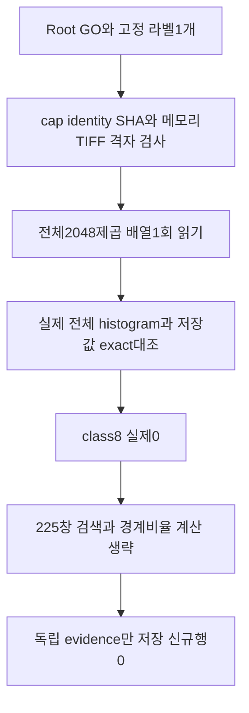

# 266 — 실패 배치에 보존된 약라벨 한 장의 실제 나지0 확인

- updated_at: 2026-10-18 18:01 KST 단일 실행·Root 후검산·동결 기준
- source_commit: 제품 변경 없음. 독립 evidence runner와 결과·freeze 기준
- evidence_paths: [완료 구현·실행 설명](../implementation/266_failed_batch_saved_label_bare_preview.md), [실제 결과](../../evidence/integration/bare266-label-preview-result-20261018.json), [Root 후검사](../../evidence/integration/bare266-root-postcheck-20261018.json), [freeze](../../evidence/integration/bare266-freeze-20261018.json), [독립 runner](../../evidence/integration/bare266-label-preview-20261018.py)
- confidence: 이 고정 라벨 한 장의 배열·히스토그램·지문 보존에 높음. 다른 지역/연도·독립 정답·최종 품질에 대한 판단 없음.
- status: **VERIFIED_REAL_LOCAL_SAVED_LABEL_ZERO_BARE / EXECUTION_UNAPPROVED**. 신규 확보·적격·나지 기여 증가0·집행/학습 승인 false.

## 1. 쉬운 설명

**249 실패 작업에 남아 있던 라벨 한 장을 실제로 읽었고, 그 파일의 나지 class8 픽셀이0임을 확인했다.**

완성하지 못한 사진 묶음에 남은 색칠 지도 한 장을 확인한 일과 같다. 쓸 만한 RGB 패치를 확보한 것은 아니지만, 이미 가진 라벨에서 나지 후보를 더 찾을 수 있는지는 좁게 확인할 수 있다. 결과는 이 지도 한 장에 나지 표시가 없었다는 뜻이다. 남동술라웨시 전체에 나지가 없거나 실제 지표면 정답에 나지가 없다는 판정이 아니다.

전체 파일에 나지가0이면 그 안의 어떤 작은 창에도 나지가256픽셀 있을 수 없다. 따라서 예정했던225개 창 검색을 **실행하지 않았다**. 후보0과 windows_scanned0을 결과로 남겼다.

## 2. 이론: 전체0에서 부분창0으로 조기 종료

원래 후보 조건은256×256 창 안의 나지 최소256픽셀과 주내 면적95%였다. 하지만 전체 라벨의 class8 개수가0이면 모든 부분창의 class8 개수도0이다. 이 논리로 나지 조건을 먼저 충족할 수 없음을 확인하고 부분창·경계 계산을 생략했다.

`windows_scanned=0`, `province_fraction_computed=false`, `qualified_dense_inside_windows=0`이다.225창을 검사했다거나95% 경계를 통과한 후보가 있었다고 설명하지 않는다. 나지256 기준 자체를 낮추거나 원본에 없는 후보를 만들지 않았다.

Esri 원라벨의 class8을 직접 센 결과이며 이 값이 독립 현장 정답·B02 정렬·최종 영상 유효율을 검증한 것은 아니다. 실패 배치의 라벨을 등록된 학습 패치처럼 aggregate에 넣지도 않았다.

## 3. 입력·코드·동작

대상은 남동술라웨시2024/train,실패249 배치의 `raw-esri_io.tif` 하나다. SHA는 `10180e532308d221ac26e9c6db24e288b0b9ac79db404c6f3dfccd2f10e23097`,파일97,234바이트·2048²·단일uint8·EPSG32751·10m다. 개인별 역할 인계의 초기 test 표기는 train으로 정정됐으며 고정split을 바꾼 일이 아니다.

runner는1개/최대8MiB/2048²만 허용하고 bounded bytes와identity/SHA를검사한다. 메모리TIFF에서정확한격자·범위·NoData와공식클래스집합을확인한뒤전체배열1회만읽는다. PROJ원격과GDAL PAM/인접파일검색을끄고원격파일을새로읽지않는다.

실제class8>0·히스토그램불일치·파일변경이면부분증거를보존하고Root재판단으로넘기는계약이었다. 자동225창탐색·반복읽기·재시도는없다.173API에실패배치를위장등록하지않고독립결과만낸다. 운영source/ledger는runner가읽지않으며Root의별도전후핀증거에결속한다.

## 4. 실제 실행과 증거

Root GO 뒤 **단1회** 실행했다.18:01:50 KST 시작·exit0,runner0.907초/전체exec2.0344925초다. 즉시 종료돼도구가장기session/PID를반환하지않았고추정번호를만들지않는다.

| 실제 검사 | 결과 |
|---|---:|
| 파일 읽기 |1개·97,234바이트|
| 전체 배열 읽기 |1회·4,194,304픽셀|
| class1 |962|
| class2 |4,072,659|
| class4 |408|
| class5 |54,635|
| class7 |7,058|
| class11 |58,582|
| class8 나지 |**0**|
| 저장 histogram 대조 |모든 클래스와 총합 exact|
|256창검사/주내면적비계산|0/미계산|
|후보/신규학습행|0/0|

결과SHA는 `916866d419a5ca88dccd27da03a59cf2432af87ca90b6d1fc7dc83916fea7cc2`,Root후검사SHA는 `1f17bc7731c45971e1f4d4020a96ea32e81ec0b2b1e7a579b73aac7cd905678f`다. 문서SHA는 `f0aa6a663394cf2c29eaec1ef1aa8a2ebe20f418d46849df2ddf6db561c61c54`,freezeSHA는 `a80cda9b9d12b1c6cb5db3ac2fd2d1b5d0a9c5f3afa2b2000986f1c9a2fd8de9`로인계됐다.

Root 후검사는원본9473/원장a925·후보pointer920ceb/나지pointer1018b·profilea246가전후동일함을확인했다. 잔여1,893,156,314바이트·oldpending2건136,314,880전액보존이다. runner와Root의역할을나누며이해담당이원본/원장을다시읽지않았다. 원격·collector·native patch QA·추가시험은0이다.

## 5. 한계와 후속

한저장라벨의미리보기다. weak참조를독립정답으로승격하지않고최종RGB/SCL/B02정합·유효80%·support/pending겹침·공간독립성·175/170소비자연결·집행·학습승인은모두false다. 신규확보나분모·나지기여패치수를늘리지않았고보유량/UI변경도필요하지않았다.

265의격리96PASS/267최종리뷰진행과268공유적용전상태는Root인계의별도후속이다. 이라벨검사가그제품검토나실수집성공을대신하지않으며여기서완료로합치지않는다.

## 6. 발표 대본

### 1분

“실패249 배치에 남은 약라벨 한 장을 실제로 읽었습니다. 2048² 전체 배열의 저장 히스토그램과 실제 값이 같았고 나지 class8은0픽셀이었습니다. 전체가0이면 어떤 작은 창도 나지256픽셀을 가질 수 없어225창 검색을 생략했습니다. 이 한 파일의 라벨 관측이며 지역 전체의 나지 부재나 독립 정답 판정이 아닙니다. 새 패치·학습행·나지 기여를 추가하지 않았고 기존 원본과 예산은 보존했습니다.”

### 5분

“먼저 실패 작업에도 저장된 라벨 파일은 남을 수 있음을 설명합니다. 그 파일을 등록 패치로 위장하지 않고 Root GO의 독립 runner로 한 번만 검사했습니다. cap·지문·identity와 격자·클래스 조건 뒤 전체 배열 한 번을 읽어 histogram을 비교했습니다. 총419만4304픽셀이 저장값과 exact였고 class8은0입니다. 그러므로 부분창 검색과 주내95% 계산을 하지 않아 windows_scanned는0입니다. 다른 위치나 연도의 나지 부재로 일반화하지 않습니다. Root가 운영 핀을 따로 확인했고 runner는 원본/원장을 읽지 않았습니다. 최종 품질·독립 정답·겹침·소비자·학습 승인은 여전히 false입니다.”

### 10분 구성

1. 0~2분: 남은 색칠 지도 비유와 실패배치·등록패치 구분.
2. 2~4분: 단일파일cap·identity·MemoryFile 격자·class집합.
3. 4~6분: 배열1회·histogram exact·전체0→부분창불가 논리.
4. 6~8분: windows0·경계미계산·Root별도핀·예산보존.
5. 8~10분: weak라벨 한계·공식확보/학습승인분리·Q&A.

완료 결과만 보여 주며 같은 라벨을 다시 스캔하지 않는다.

## 7. FAQ

**1. 225개 창을 검사했나요?** 아닙니다. 전체 나지가0이어서 창 검색을 생략했고 windows_scanned0입니다.

**2. 남동술라웨시에 나지가 없나요?** 이 한 저장 약라벨에 class8이 없다는 결과입니다. 지역 전체나 실제 정답으로 일반화하지 않습니다.

**3. 주내95% 조건은 통과했나요?** 나지 조건부터 충족할 수 없어 면적비 자체를 계산하지 않았습니다.

**4. 공식 데이터셋에 한 장이 추가됐나요?** 실패 작업의 라벨 미리보기이며 aggregate 행·신규적격·기여패치를 추가하지 않았습니다.

**5. 원격 비용이나 예약을 바꿨나요?** 추가HTTP·collector가 없고 기존원본·원장·예약·예산을 보존했습니다.

**6. 모델 학습이나 B02 오류도 해결됐나요?** 실제 라벨 class count의 좁은 검사입니다. 영상정합·품질·소비자·독립정답·학습을검증하지않았습니다.
