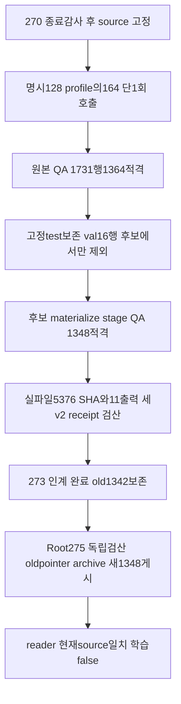

# 273·275·276 — 새 고정 후보 1,348개 QA·게시·현재 API 확인

- updated_at: 2026-10-18 20:38:49 KST 277 실제 브라우저 완료 후속 기준
- source_commit: 기존164/profile 코드와273 단일 실행·인계·275 게시 지문 기준. runtime 제품 수정 없음.
- evidence_paths: [273 완료 설명](../implementation/273_post270_candidate_qa_preparation.md), [273 summary](../../evidence/integration/priority164-guarded273-20261018/summary.json), [metadata 인계 검산](../../evidence/integration/priority164-guarded273-20261018/handoff-verification.json), [terminal](../../evidence/integration/priority273-terminal-20261018.json), [완료 freeze](../../evidence/integration/priority273-completion-freeze-20261018.json), [275 실제 게시](../../evidence/integration/priority275-publication-root-20261018.json)
- confidence: 고정 원본/후보·실파일·metadata 인계와 게시/reader에 높음. 276실API와277실브라우저는후속완료. 모델성능·학습승인은미검증.
- status: **VERIFIED_REAL — 고정 후보 QA·metadata 인계·게시/reader·실API 완료**. 나지3차단·학습false·독립정답/과학승인 없음. 277실브라우저는10절후속에서완료확인.

## 1. 쉬운 설명

**원본1,364개 적격 자료를 고정해 검사하고, 같은 장면이 다른split에 겹치는16행을 후보에서만 제외한 새1,348개 후보를 게시했다. 나지 부족3개 차단은 그대로다.**

재료 창고 원본은 그대로 두고, 같은 재료가 평가용과 검증용 양쪽에 들어가지 않도록 별도 수업용 목록을 만든 일과 같다. 원본을 삭제하거나 평가 기준을 낮춘 것이 아니다. 새 후보는 기존1,342보다6개 늘었지만 나지 픽셀과 기여 수는 늘지 않았다.

273은 실제 QA와 인계 검산이다.275는 그 결과의 정확한 행·지문·차단 상태를 다시 확인한 후 기존 pointer를 보존하고 새 목록으로 게시한 별도 작업이다. 게시 완료가 학습 승인이나 실제 화면 확인을 뜻하지 않는다.

## 2. 이론: 데이터 누출 제거와 클래스 대표성은 다른 조건

같은 원격 장면이train/validation/test에 걸치면 모델이 평가자료와 닮은 입력을 미리 보게 될 수 있다. 기존 고정test 우선순위로 같은scene의val16행을 후보에서 제외했다. 원본은 유지하고split을 옮기지 않는다.

누출이0이어도 나지같은희소클래스가충분하지않으면학습준비가되지않는다. 기존기준은각split의나지비율0.5%와256유효나지픽셀이상기여패치최소5개다. split별비율과한patch기여조건을혼동하지않는다. 약라벨통계는독립현장정답·모델정확도와도다르다.

## 3. 코드·데이터 흐름

Root는270 terminal·정산·잠금/OS종료와 단일신규분native감사뒤source를고정하고273을승인했다.270 신규16/적격6/나지0은선행감사인계이며273이그native를반복한것은아니다.273은기존164 `main(argv)`를같은profile scope에서한번만호출했다.

source SHA는 `0f436db2c320ca6a3b54ae265470d7c26e1e9d64fc657d35aa12619c3bb73b2b`,67,518,599바이트로기본64MiB보다409,735바이트크다. 실제 이원본에는명시 `bounded128m-3000-v1`이필요했다.128MiB최대원본전체를부하검증한결과로확대하지않는다.

snapshot/copy→원본QA→계획/검산→materialization/staging→후보QA/실파일hash→summary와wrapper·인계metadata검산이같은누적16GiB계약을따른다. source/candidate128MiB·scenes+history3000·depth32·node4M·작은역할별receipt/report한도를유지한다. source를후보크기에맞춰자동default로바꾸지않는다. 세receipt는정확v2marker다.

## 4. 실제 원본과 후보

| 구분 | 전체 행 | 적격 train/val/test | 적격 합 | 차단 |
|---|---:|---|---:|---|
|고정 원본|1,731|822/292/250|1,364|동일scene1+나지3|
|새 고정 후보|1,715|822/276/250|1,348|나지3|

제외는Banten과WestJava의동일scene `S2A_MSIL2A_20210812T025551_R032_T48MXT_20210812T132431`에속한val원본index288~303의16행이다. **16장면을제외한것이아니다.** test를보존하고후보에서만16patch행을뺐다. 남은source identity충돌0, exactretainedrows·retained/excluded완전분할을확인했다. 운영원본삭제·라벨수정·split변경은0이다.

| split | 나지픽셀/유효참조라벨분모 | 나지비율 | 기여패치 |
|---|---|---:|---:|
|train|2,562/52,383,086|0.00489089169%|1|
|val|2,998/17,776,457|0.01686500296%|2|
|test|1,025/16,252,940|0.00630655131%|0|

각비율은0.5%에미달하고기여패치도5개에미달한다. `REFERENCE_CLASS_IMBALANCE`가train/val/test에하나씩총3개다. ready_for_training와scientific_accuracy_validated는false,training/registry/network0이다.Connectivity witness는 `NOT_CAPTURED_BUDGET`이며기본실파일QA를생략했다는뜻이아니다.

## 5. 실제 시간·I/O·파일 검산

273은PID37520/session53854·단1회·exit0이다.20:06:05.451snapshot고정→20:31:53.167summary→20:31:54.445terminal,전체wrapper **1,574.593초(약26분15초)**다.

| 구간 | 시간 | 해석 |
|---|---:|---|
|전체wrapper|1574.593초|실제단일실행전체|
|CLI+후검|1572.015초|wrapper안의구간|
|원본QA함수|308.390초|proof검산포함·순수raster시간아님|
|후보QA함수|324.656초|다른cohort의정상QA·중복감사아님|

함수시간을전체에더하지않는다. 나머지는계획/materialize/stage·엄격JSON왕복·hash·부수처리구간이며개별병목을정밀측정했다고단정하지않는다. 느리다는이유로검증을건너뛰거나자동재실행하지않았다.

기존164가실제참조파일5376개의SHA를최종대조해불일치0이었다. 인계checker는추가native나5376파일재해시를반복하지않고11출력SHA/bytes·세v2receipt·원본문자행순서/완전분할·현재source/정책·old1342pointer보존을검산했다. source/candidate/두처리단계의파일수를서로더해성과를늘리지않는다.

QA+handoff의proof쓰기후누적metadataJSON I/O는**4,926,565,643바이트<17,179,869,184바이트(16GiB)**다. 손바뀜검산도이전사용량과terminal쓰기비용을넘겨받아계상했다.275게시전용scope의815,752,366바이트는별도게시작업시점이며QA단일계측값과섞지않는다. 외부OS/로그도구I/O나전체RAM을이숫자가모두보장하지않는다.

wrapper는RSS를측정하지않았다.별도OS표본의관측Windows PeakWorkingSet최대1,294,880,768바이트는종료최종peak보증·LinuxRSS·128MiB최대rich성능보증이아니다.228whitespace벤치를이번실제구조화source의26분실행과혼동하지않는다.

summarySHA는 `6978fc4cfe1b3b05d37b08c899a3c9b4edbaf24a9fe26cd2841f68f64bf730f0`,handoffSHA는 `a8eb96bf444dbadca20e77e683147cb4f83845ee8dd259fe50bea7c5a08b566c`,terminalSHA는 `8ed1d8264abfd810b713478dc850a1d93837f3092532bd22a67c4f496f99eb0e`다. 준비문서·실패없는원실행·승인·동결원판을보존했다.

## 6. 275 실제 게시와 인계 시점

20:34:14 인계검산까지old1342pointer와receipt는SHA920ceb로보존됐다.그후Root275가의도적으로새후보를게시한것은해당보존검사의위반이아니라별도후속이다.

[275실행기](../../evidence/integration/priority275-promote-root-20261018.py)는정확approval로summary/handoff/terminal/current source·ledger·oldpointer를고정했다.11출력과세v2marker·정수형retained/excluded완전분할·원본행exact·count/blocker/학습false를확인했다. old1342pointer원바이트archive→새receipt/tempexclusive/fsync→직전source/ledger/pointer와lock부재재검산→os.replace→역할있는reader확인순이다. 이작업도별도native를수행하지않았다.

**20:35:54 KST 실제게시완료**로새pointerSHA는 `1aee2e01583a024c508d6fdac0d3c4fac2260bbd449ea12269d5e033c1dcc7b4`다. reader는1,348(822/276/250)·현재source일치·충돌0·차단3·학습false를확인했다. 게시receiptSHA는 `6fc9d5c95430a9deb191d0bd6be2fcb36bde656151e05104947d8b3e3b7c6b70`로인계됐다. 원본·원장·model/registry·profile설정변경은275에서0이었다.

273의terminal `published=false`와275의실제게시완료는주체·시점이다르다.273담당은QA만마쳤고Root275가그후게시했다. 준비문서의미실행문장도당시계획이며현재실행여부는완료receipt로판단한다.

## 7. 276 실제 API 완료와 브라우저 후속

[275/276완료 후속 문서](../implementation/275_276_post273_publication_preparation.md),[276선택receipt](../../evidence/integration/profile276-selection-root-20261018.json),[실API11checks](../../evidence/integration/profile276-api-checks-root-20261018.json)를읽어API완료를후속반영했다. Root276은275publication핀을검산하고oldprofilea246원바이트archive후같은descriptor에현재source0f436을명시결속했다. 새configSHA는 `a6113a2563f69c44de9b1834f74a0e06c79b1631d226d816ef12e3adb42beba8`다. 자동상향·QA재실행·서버restart는없다.

실GET1회는 **HTTP200/31.968초·11검사true**다. 재고응답20:36:50.278733KST/예산관측20:36:51.800994를구분한다. 원본적격1,364·부족15,게시후보1,348/3차단·현재source일치·학습false,나지50검토만source불일치warning이다. 잔여**1,870,060,479바이트**·oldpending136,314,880바이트사용포함을확인했고원본/원장/두pointer와config보존을검산했다. 단일endpoint시간을SLA나128MiB최대성능으로쓰지않는다.

이절작성시277실브라우저는완료증거를받기전이었다. 이후10절에서실제화면·console/overflow를별도로확인했으며API/reader현재일치로화면증거를대신하지않는다. 후보의과거경고는현재source일치로해소됐지만나지50의과거검토시점은그대로다. 선행metadata필터선별과새6적격증가를곧바로인과적성능개선으로단정하지않는다.

새고정후보게시가원본부족이나나지학습차단을모두해결하지않는다. 원본·후보·나지검토의출처시점을유지하며원격수집·단일신규분감사·다음QA·학습승인은각각별도근거가필요하다. 이설명작성자는추가운영조회·원본/원장/raster읽기·HTTP/native·시험·제품/CONT수정을하지않았다.

## 8. 발표 대본

### 1분

“새 원본1,364개 적격자료를 검사해 같은장면의16행을 후보에서만 제외한1,348개를 게시했습니다. 원본은 보존했고 남은 동일scene충돌은0입니다. 실제5376파일SHA도 불일치0으로 확인했습니다. 하지만 나지 비율과 기여패치가 부족해3차단·학습false는 그대로입니다. QA와 인계, 게시reader는 완료했지만 실API는276,실브라우저는후속277에서각각확인했습니다.나지3차단과과거50검토경고는유지됩니다.”

### 5분

“첫째, 270 신규분 이후 고정 source가64MiB를 넘었으므로 명시128profile로 실제QA를 수행했습니다. 원본1731행/1364적격에서 test를보존하고val16patch행만후보에서제외했습니다. 후보1715행/1348적격·충돌0이며원본삭제는없습니다. 둘째,실제5376파일SHA와11출력·세v2receipt·완전분할을검산했습니다. 전체26분15초와원본308초·후보325초는서로포함되는구간입니다. 누적JSONI/O약49억바이트는16GiB안이지만최대성능보증은아닙니다. 셋째,275가old1342원바이트를보존하고새1348을안전게시해reader현재일치를확인했습니다. 마지막으로나지픽셀/기여1·2·0은증가하지않아학습은여전히차단입니다. 276실API는원본1364/부족15vs후보1348현재일치를확인했고나지50만stale입니다.277실화면도후속에서확인했으며나지검토50만과거경고를유지합니다.”

### 10분 구성

1. 0~2분: 창고원본과수업목록비유·데이터누출/대표성분리.
2. 2~4분: 명시128profile·단1회QA·1731→1715행.
3. 4~6분: split통계·16행의의미·5376SHA/완전분할.
4. 6~8분: 시간·I/O·메모리관측한계와275게시절차.
5. 8~10분: 나지3차단·현재source/게시/API/화면구분/Q&A.

저장된완료결과와게시receipt를보여준다. 같은QA/native/원본검산을발표목적으로반복하지않는다.

## 9. FAQ

**1. 원본16개를삭제했나요?** 새후보에서만같은scene의val16행을제외했습니다. 원본과고정split은보존했습니다.

**2. 16장면을제외했나요?** 같은원격scene에속한16patch행입니다.16개독립장면이아닙니다.

**3. 1348개면학습가능한가요?** 나지비율0.5%와기여5개를각split에서못채워3차단·학습false입니다.

**4. QA가26분인데두함수합은약10분인가요?** 전체는계획·materialize/stage·metadata검산과hash를포함합니다. 함수시간을전체에더하지않습니다.

**5. 5376파일을인계때다시전부읽었나요?** 기존164의최종재해시를보존하고인계는11출력등metadata검산만했습니다.추가native는0입니다.

**6. 128MiB최대성능도검증됐나요?** 실제source는약67.5MB이며명시128경로를완료했습니다. 최대rich128전체부하보증은아닙니다.

**7. terminal게시false인데실제로게시됐나요?**273담당은게시하지않았고이후Root275가20:35:54게시했습니다.주체와시점이다릅니다.

**8. API와화면도최신인가요?**275reader와276실API는현재source0f436의1348일치를확인했습니다.이후277실브라우저도같은source와1348일치를확인했습니다. 나지50만과거검토이고학습3차단은그대로입니다.

최종273 completion freeze SHA는 `0f51baecfc5ee39975adb44fb6b16f9fa69d7091b2ecf50a0ef98be7650a1510`,완료doc273SHA는 `43cf0a4e1ebb4f26341e7870ecbeb7e3ddbaeeda5e986b521b7eaf42fe3ff8e4`로인계됐다. 기존1342receipt와준비원문은보존하며이후의도된275게시/276결속은별도후속이다.

## 10. 277 실제 브라우저 후속 완료

[277 완료 문서](../implementation/277_post273_ui_followup.md)와 [실제 화면 receipt](../../evidence/integration/service277-post273-final-ui-20261018.json)를직접읽어276API후실화면을별도확인했다. 기존Chrome075탭에서refresh1회·새탭0,재고**20:38:48.617KST**/예산**20:38:49.167KST**의완료DOM과스크린샷을확인했다. Root276API의20:36:50.278/51.800과서로다른관측이다. 이해담당이브라우저를다시조작한것은아니다.

| 화면 항목 | 실제 관측 |
|---|---|
|원본|등록1,731·적격1,364(822/292/250)·적격외367·부족15|
|남동2024 셀|28개·부족0, 나머지부족은고론14+동자바1|
|게시후보|1,348(822/276/250)·source0f436현재일치·과거불일치경고해제|
|학습준비|나지3차단·ready_for_training=false 유지|
|나지50검토|과거source9c24의stale만유지·실제신규영상품질미검사/집행미승인|
|예산|사용2,424,906,817·잔여1,870,060,479바이트|
|미정산|2건136,314,880바이트사용포함·재차감/자동환불0·process UNKNOWN|

원본나지기여1/2/0과후보QA의통계를혼동하지않는안내도확인했다. 후보현재일치가과거나지50의겹침검토까지갱신한것은아니다. 현재원장SHA는 `5d1ef4d2c1b917402ffdda2365c69d81984b1e682bad22a8cc00ad238456e86e`다.

20:39:11.369관측의warn/error0,document/body scrollWidth와clientWidth모두1,573픽셀로가로넘침0이었다. 이는해당연결·화면기준이며전체과거콘솔·다른기기·모바일·접근성·SLA인증은아니다. API단일31.968초도화면SLA로확대하지않는다.

증거는 [완료 DOM](../../evidence/integration/service277-post273-final-ui-20261018-dom.txt), [현재 후보 화면](../../evidence/integration/service277-post273-final-ui-20261018-candidate.png), [과거 나지 검토 화면](../../evidence/integration/service277-post273-final-ui-20261018-bare.png)다. UI담당은기존탭을스크롤해두이미지를저장했고다른WIP탭/8000서버는건드리지않았다. 수동API GET·새탭·제품수정·서버restart·운영쓰기·collector·QA/native반복은0이다.

고론우선278새위치계획은진행중인후속이며미래수집성과가아니다.279소단위wrapper는준비/정적검토중·실행0으로인계됐다. 이완료단위는새1348후보의QA→게시→현재API→실화면확인까지이며나지부족해결·학습승인·전체개발완료가아니다.

### 발표·FAQ 후속

“20:38 실제화면에서원본1364개/부족15개와새1348후보의현재원본일치를확인했습니다.후보의과거불일치경고는해제됐지만나지50검토만옛source의경고를유지합니다.나지3차단과학습미충족은그대로입니다.예산과기존미정산사용포함안내,콘솔·가로넘침0도확인했습니다.다음고론계획과실수집은별도후속입니다.”

**후보경고가없어지면학습가능한가요?** 현재원본과검증출처가맞는다는뜻입니다.나지비율/기여조건3차단은남아있습니다.

**왜나지50만경고인가요?** 새후보QA/게시가과거나지공간겹침검토를다시수행하지않았기때문입니다.과거결과를현재집행허가로바꾸지않았습니다.
