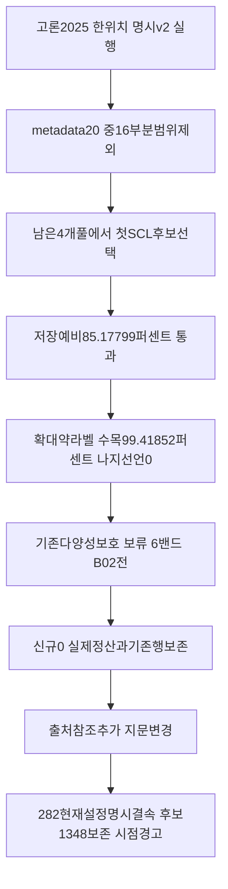

# 279·282 — SCL 통과 뒤 참조라벨 다양성 보류와 다시 나타난 시점 경고

- updated_at: 2026-10-18 20:53:56 KST 283 실제 브라우저 완료 후속 기준
- source_commit: 기존제품변경0.279 실행·좁은감사·282 명시재결속 evidence 기준
- evidence_paths: [279 실제 종료·감사](../implementation/279_gorontalo2025_single_batch_preparation.md), [279 좁은감사 JSON](../../evidence/integration/deficit279-native-root-20261018.json), [282 설정 선택](../../evidence/integration/profile282-selection-root-20261018.json), [282 실API 검산](../../evidence/integration/profile282-api-checks-root-20261018.json), [282 실행기](../../evidence/integration/profile282-post279-root-20261018.py)
- confidence: 저장선별·정산·행보존·설정/실API 근거에높음.라벨배열독립재계수·최종품질은미검증.283실화면은후속완료.
- status: **VERIFIED_REAL — 수집실행종료·신규0 좁은감사·현재API**. 신규확보/기여0·나지3차단·학습false.283실브라우저는10절에서별도완료확인.

## 1. 쉬운 설명

**고론탈로2025의 장면은 SCL 예비 검사를 통과했지만, 저장된 약라벨 예비 분포가 수목99.42%·우선 나지0으로 편중돼6밴드 취득 전에 보류됐다.**

배울 재료가 부족한 수업에서 이미 많은 종류만 가득한 묶음을 다시 들여오지 않도록 멈춘 상황과 같다. 구름 때문에 떨어진235나 격자 때문에 막힌249와 다르다. 이번에는 예비영상품질은통과했지만희소클래스보완에도움이적다는기존다양성보호가작동했다.

새패치는0개지만 선별과참조라벨확인비용은발생했고출처보고서참조도추가됐다. 방금게시한1,348후보는보존하면서현재문서지문이달라진경고를다시표시했다. 새학습자료가없어같은QA를반복하거나후보의출처를최신처럼바꾸지않았다.

## 2. 이론: SCL 품질·클래스 다양성·최종 품질은 별개

SCL은사용하기어려운픽셀을예비선별하는자료다.279는저장예비유효85.1779938%로65%를통과했다.85%가낮아서실패한것이아니며최종10m 유효80%검사를완료했다는뜻도아니다.

그다음label-first단계에서확대Esri약라벨분포를확인한다. 우세클래스≥98%,우선클래스<0.2%,다양성보류허용문맥이면 `reference_diversity_deferred`로6밴드앞에서멈춘다. 우선클래스는Esri class8(나지)이며class2는**수목/숲**이다. class2를물로설명하지않는다.

저장된예비히스토그램은실행이보고한값이다. 이번좁은감사에서라벨배열을독립재계수한결과가아니며실제토지피복정답이나최종256패치분포로일반화하지않는다.266의다른단일라벨실제배열검사와증거종류가다르다.

## 3. 동작과 실제 실행

279는Root승인아래고론탈로2025 한곳최대1batch16으로실행했고 **20:46:43 KST exit0/179.656초·worker1**로종료했다. lock해제와collector/supervisor종료확인뒤Root원본고정·별도GO로좁은감사를한번수행했다. native영상배열·기존전체재고·같은QA·HTTP재실행은0이다.

선별scene은 `S2B_MSIL2A_20250729T021209_R060_T51NUA_20250729T035650`다. SCL저장파일1개11,141바이트의SHA `9ceb45907f7290705cc78b04c4c65e26bea6ecb8dca2f2095170acb099618aa4`를검산했다. SCL유효율을배열에서독립재산출한것은아니다.

| 저장라벨예비선언 | 값 |
|---|---:|
|전체픽셀|4,194,304|
|class2 수목/숲|4,169,915|
|class1|237|
|class7|138|
|class10|17,843|
|class11|6,171|
|class8 나지|선언0|
|우세수목비율|99.4185209%|

문맥은priority_source_classes=[8],allow_dominant_class_deferral=true,snapshot_eligible_patches=185였다. [collect_samples.py](../../scripts/collect_samples.py)의기존조건과저장선언을대조했다. 결과는reference_preview_only이며6밴드/B02/최종격자·품질·나지기여검사에는도달하지않았다. B02정렬실패가발생했다고도표현하지않는다.

## 4. metadata 필터에서 실제 확인한 것과 한계

저장schema2요약은입력20·유지4·제외16·선택풀4다.20개index/cloud_rank의완전성·합계·최대5상한·request/source결속·URL미포함을확인했다. 따라서 **16개가metadata범위에서제외된저장결과**는확인됐다.

원격원문20개를다시요청하거나bbox를독립재현하지않았다. 이필터가SCL성공·실제COG기하·나지확보를보장하거나선택효과를정확도개선으로입증한것은아니다. 270의metadata11통과0제외기록과이번20중16제외는서로다른실행결과다.

## 5. 정산·보존·현재 수량

COG655,360+metadata361,869=**1,017,229바이트**를실정산했다. worker/window-state/원장이같고finalize/settle/publish각1회다. 신규물리패치·적격·나지기여모두0이며old1,731행/history/미정산2건136,314,880바이트는정확히보존했다. 등록1,731·적격1,364·부족15도유지됐다.

실물1,732는실행전inventory와신규0에근거한유지추론이며좁은감사가전체파일을다시세지않았다. 사용2,425,924,046·잔여**1,869,043,250바이트**다. oldpending은사용에이미포함되어다시빼지않는다. 0패치를0전송비용으로바꾸거나미정산을임의환불하지않는다.

source는source_manifests만추가돼 `0f436…73b2b`에서 `9b580b338c8a2bca9b1a65ae5184b05622c457480acfec7ff9ddf169260bf89c`/67,518,753바이트로바뀌었다. 원장SHA는 `3e8d7a98cbec1ac8b3a4a00ce546a7eb76014ec61e94e048c0b6ac5fd4f86225`다. 두읽기안정을확인했다. 감사JSONSHA는 `b41f0a052dbfd009419eae3c365084386d8d5cbcb971de6e3cd1fe6389d315d9`,완료doc279SHA는 `3baa7da431514a1ecd1365f8cd576887a1700c1eef6c46b3bfdf44889928dfa3`로인계됐다.

## 6. 방금 게시한 후보에도 왜 다시 경고가 생기나

275의1,348후보는0f436원본으로검증했고277화면도그시점현재일치였다. 이후279가새patch없이출처참조를추가해원본전체SHA가달라졌다. 따라서과거QA는여전히보존되지만현재원본문서전체와같다고표시하지않는다. 나지50검토는더오래된9c24라계속경고다.

새자료가없으므로같은QA를다시실행할근거가없다. 기존1,348pointer를유지하고현재설정만명시재결속한다. 경고는후보데이터가갑자기망가졌다는판정이아니라 **검증한출처와현재문서의시점차이**다. 출처SHA를고쳐써경고를없애면검증이력을왜곡한다.

## 7. 282 실제 설정·API와 브라우저 경계

[282선택receipt](../../evidence/integration/profile282-selection-root-20261018.json)는oldprofilea611원바이트archive뒤같은descriptor에현재9b580을선택했다. 새configSHA는 `ef093110c8bc180eddf122b64f831f86278cc3d30731ed98818dbbaf10a85e1e`다. 원본·원장·두pointer4핀을전후대조했고후보승계·QA반복·서버재시작·native는0이다.

[실API검사](../../evidence/integration/profile282-api-checks-root-20261018.json)는재고**20:51:56.572 KST**/예산**20:51:57.359 KST**,GET1회200/**31.781초·11검사true**다.현재1364/부족15vs고정1348/3차단·학습false,후보1348와나지50둘다stale,잔여1869043250/oldpending사용포함을확인했다. 단일시간을SLA로확대하지않는다.

이절작성시283실브라우저GO뒤최종증거대기였고,이후10절에서실화면을별도확인했다. API200을화면/console/overflow증거로대신하지않는다. 준비문서의282미실행기록은당시이력이며현재API완료는실receipt로구분한다. 이문서작성은완료근거읽기만이며추가운영조회·원본/원장·배열native·HTTP·시험·제품/CONT편집0이다.

## 8. 발표 대본

### 1분

“고론2025 수집은 SCL예비85.18%를 통과했습니다. 하지만 저장된 확대약라벨은 수목이99.42%이고 필요한나지는0으로선언돼, 기존다양성보호가6밴드전에보류했습니다. 새패치는0이며 실제선별비용1017229바이트는정산했습니다. 출처참조만추가돼원본지문이바뀌었기때문에방금게시한1348후보에도시점경고가다시나타납니다. 새자료가없어QA는반복하지않고현재설정과API만확인했습니다. 실브라우저는후속283에서같은수량과양쪽시점경고를확인했습니다.”

### 5분

“235·249·258과279는모두신규0이지만마지막차단이다릅니다.279는metadata20개중16개범위제외뒤4개풀을구성했고SCL85%를통과했습니다.그다음확대Esri약라벨의기존다양성조건에서보류됐습니다. 수목class2를물로오해하면안되며99.4185%는저장선언이고감사자가배열을다시센값도아닙니다. 원래1731행/history/pending을보존하고실정산1017229바이트와두읽기안정을확인했습니다. source참조가추가돼9b580으로바뀌면서1348QA의옛0f436출처와차이가생겼습니다. 같은QA를반복하지않고후보를보존하고경고를유지합니다. Root282는old설정을보존해새source만명시선택했고API200으로현재수량·잔여예산을확인했습니다. 나지기여와학습준비는여전히미충족이고실UI는후속283에서완료했고별도시각과범위를유지합니다.”

### 10분 구성

1. 0~2분: 재료다양성비유·SCL/참조라벨/최종품질분리.
2. 2~4분: metadata20→4풀·SCL통과·label-first보류.
3. 4~6분: 저장분포와독립배열재계수/정답의차이·신규0정산.
4. 6~8분: 행보존·source참조추가·1348시점경고와QA반복0.
5. 8~10분:282명시결속/API·283대기·후속과질의응답.

완료JSON과코드를읽는시연만하며실패수집·SCL/라벨배열·동일QA를다시실행하지않는다.

## 9. FAQ

**1. 85%가낮아떨어졌나요?** 아닙니다.65% SCL예비기준은통과했고다음참조라벨다양성보호에서보류됐습니다.

**2. class2는물인가요?** Esri class2는수목/숲이며물은class1입니다.

**3. 실제라벨을다시세나지0을확인했나요?**279감사는저장예비히스토그램을대조했고라벨배열독립재계수는false입니다.266의다른라벨실배열검사와다릅니다.

**4. metadata16개제외면실기하가검증됐나요?** 저장선별요약을확인했을뿐입니다.실B02/support/최종품질은후속별도검사입니다.

**5. 방금후보를게시했는데왜또경고인가요?** 새patch없어도출처참조가추가돼전체sourceSHA가바뀌었습니다.과거QA시점과현재문서를구분하는경고입니다.

**6. 그럼QA를또돌려야하나요?** 새학습자료가없어같은QA는반복하지않습니다.후보와검증출처를보존하고현재설정만재결속했습니다.

**7. 비용은발생했나요?**1017229바이트를실정산했으며기존pending은전액보존/사용포함입니다.

**8. 실화면도확인됐나요?** 282API에이어283실브라우저도확인했습니다. 현재9b580원본과옛출처의1348/50시점경고를그대로표시합니다.

## 10. 283 실제 화면 후속 완료

[283 완료 문서](../implementation/283_post279_ui_followup.md)와 [실제 화면 receipt](../../evidence/integration/service283-post279-final-ui-20261018.json)를직접읽었다. 기존Chrome075탭에서refresh1회뒤완료DOM은**20:53:55.482 KST 재고/20:53:56.279 KST 예산**을표시했다. Root282API의20:51:56.572/57.359와다른관측이다.

최초30초region조회는읽는중이라selector deadline이었지만추가요청·재시도없이같은요청완료를기다려확인했다. 재조회0이며지연원인은측정하지않았다. 다른개발작업이나서버문제를원인으로추정하거나이단일시간을SLA로제시하지않는다.

현재source9b580/원장3e8d·등록1,731/적격1,364/부족15,고정후보1,348/나지3차단·학습false가보였다. 후보는옛0f436·나지50은옛9c24의시점경고를둘다유지했다. 미검사·집행미승인안내와현재지원겹침검사완료로해석하지말라는문구도확인했다.

예산사용2,425,924,046·잔여**1,869,043,250바이트**,oldpending2건136,314,880바이트이미사용포함·자동환불/재차감0·process UNKNOWN이었다.20:54:20.055warn/error0,document/body/clientWidth모두1,573픽셀로가로넘침0이다. 해당세션·화면의범위이며모든기기·과거전체콘솔·접근성인증은아니다.

[실제DOM](../../evidence/integration/service283-post279-final-ui-20261018-dom.txt)과 [화면검산](../../evidence/integration/service283-post279-final-ui-20261018-checks.json)을보존했다. web_ui의별도수동GET·새탭·restart·제품/원본/원장/pointer쓰기·QA/native/collector는0이다. 화면은수량·예산·시점경고를확인했고라벨배열이나보류원인을다시검사하지않았다.

Root의별도후속인계에서284는prior60을보존·제외한단1로컬계획50.953초/116header·Goro2022→2025→EastJava2025 새4개완료다. 로컬위치제안이며실수집0이다.285고론2022한batch는준비/정적리뷰중·실행0으로구분하며미래성과를더하지않는다.

### 발표·FAQ 후속

“20:53 실제화면에서도현재원본1364개/부족15개와고정후보1348개를확인했습니다. 새patch는없지만출처참조가추가돼후보와나지50둘다시점경고를유지합니다. 최초대기제한뒤같은요청이완료된것이지재조회한것이아닙니다. 새4개위치계획과다음고론batch는실확보와구분합니다.”

**왜30초뒤에도기다렸나요?** 같은요청이읽는중이었고추가조회없이완료표시를확인했습니다. 지연의정확원인은측정하지않았습니다.

**현재수량은새위치4개를포함하나요?** 아닙니다.284는로컬제안이고285는준비이므로적격증가나부족감소로세지않습니다.
