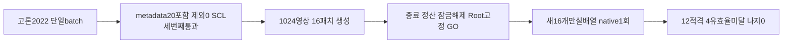

# 285 — 고론탈로2022 실제16패치·12적격과 나지0

- updated_at: 2026-10-18 21:03 종료·독립감사 완료 기준
- source_commit: 기존수집제품과고정285실행/감사증거. 이해담당제품변경0.
- evidence_paths: [285 실제 종료·native 설명](../implementation/285_gorontalo2022_single_batch_preparation.md), [실제감사 JSON](../../evidence/integration/deficit285-native-root-20261018.json), [새어댑터별도적용](../implementation/288_survey_stac_adapter_main_application.md)
- confidence: 신규16패치의실파일/배열·출처·정산·보존에높음.전체지역나지·독립정답·새후보QA는미검증.
- status: **VERIFIED_REAL — 신규분 단1회 bounded native 감사완료**. 적격+12·나지0·학습false.게시후보1348는과거시점이며290은준비단계.

## 1. 쉬운 설명

**새16개패치중12개가품질기준에합격했고고론2022부족4개를채웠다. 그러나실제나지픽셀은0이라나지학습문제는해결되지않았다.**

한반의최소재료가4개부족했는데좋은재료12개를더얻은상황과같다. 그반의부족은4개만줄고,다른반인고론2025와동자바2025의부족은그대로다. 수량보완과희소클래스나지보완을구분한다.

## 2. 실행·검사 흐름

285수집은21:03:10 KST exit0/**365.828초**였다. collector/supervisor종료·lock해제를확인하고Root원본hold·별도GO뒤신규16개만기존165helper로단1회검사했다. helper검사는**15.376초**로전체수집시간과다르다. 전체원본native·support재검사·HTTP·추가수집은0이다.

## 3. 실제 품질과 출처

image/label/quality48래스터+batch문서4개=52개SHA를확인했다.16개모두256²/6밴드·CRS/affine/shape정합·주내100%였다.12개는기존유효80%·주내95%를통과했고4개는유효52.522278%,68.101501%,53.617859%,79.457092%로80%미달이었다. 기준을낮추지않았다.

선택장면은 `S2A_MSIL2A_20220720T021401_R060_T51NVA_20240705T031025`,관측시각은2022-07-20T02:14:01.024000Z다. ID끝2024는처리시각이며관측연도2024로바꾸지않는다. 동년2022약라벨·행연도·STAC를결속했다.

실제source는EPSG32651/1024²/6밴드/10m·회전0이다. rawB02실배열과source첫밴드가전체동일하고16패치부분창의grid/affine·첫밴드도일치했다. trace21파일중16image가앞52검사와겹치므로52+21을고유73파일로세지않는다. 새leaf48TIFF와새16행참조가정확히같아신규미등재0이다.

## 4. 실제 나지0의 범위

동년rawEsri를nearest로실제B02 1024격자에정렬했을때class8실픽셀0,sourcequality후0,최종주경계/라벨/전체밴드지원후0,적격12개나지0·256이상기여0이었다. 실제labelhistogram과선언행도일치했다. sourcequality와최종지원mask는다른단계다.

이결과는1024목표와16패치의실제값이다. 확대2048라벨전체·고론탈로전체·독립현장정답의나지부재가아니다. 앞279의저장히스토그램선언과달리이번신규native는실배열을검사했다. 실제나지0과학습3차단유지로보고한다.

metadata저장요약은20입력/20AOI포함/제외0/풀5였다. 선택STACbbox의AOI포함은확인했지만원문20을재요청/재생하지않았다. 이번에는metadata필터의제외성과가없다. SCL앞2개35.006714/34.973526%미달뒤3번째86.117172%가통과했다. 예비SCL비율과최종patch유효율을분리한다.

## 5. 정산·보존과 현재 수량

| 항목 | 실제결과 |
|---|---:|
|등록행|1731→1747|
|적격|1364→1376(834/292/250)|
|전체셀부족|15→11|
|고론2022부족|4→0|
|남은부족|고론2025 10+동자바2025 1|
|신규실나지/기여|0/0|
|COG정산|23,396,352B|
|metadata정산|362,711B|
|합계|23,759,063B|
|잔여|1,845,284,187B|

기존1731행prefix/history·oldpending2건136,314,880B를정확보존했다.finalize/settle/publish각1회다. oldpending은사용에이미포함되며다시빼거나환불하지않는다. 실물1748은사전1732+신규16이며전체재스캔값이아니다.

현재source SHA는 `9d491e6ede51cf29407add25b83919cc5d4150576a694c5019814b973d20c2b7`/68,220,381B,원장은 `4a4f4a47b522b9497b944ac00b29d2368a977c1a4eb6dfe972a34959fcc68722`다. 두읽기안정·선택config/실행config·원장/보고서결속을확인했다.감사SHA는 `194affdac6f8838875251bdb8c6cb2807cc3492015b3b655ba71ae040ba8c455`다.

## 6. 현재 후보·후속과 승인 경계

기존게시1348은과거cohort이며현재source변경경고상태다.290새고정후보QA는준비만이고완료·새후보수·게시를미리확정하지않는다.285감사는pointer/profile/API/UI·모델·split을바꾸지않았다. 실제새후보QA와명시재결속·API/화면은별도근거로이어간다.

[288 파일어댑터](288_PINNED_STAC_FILE_ADAPTER.md)는원본hold중별도로두파일만추가/61합성시험을한작업이다. 실제나지취득이나이번12적격의원인으로해석하지않는다. 이해담당은완료문서/JSON만읽었고원본·원장/raster·HTTP·collector·추가시험을실행하지않았다.

## 7. 발표 대본

### 1분

“고론2022에서새16개를만들어12개가품질기준에합격했습니다.고론2022부족4개가해소돼전체부족은15에서11로줄었습니다.하지만실제나지픽셀과기여패치는0이라학습나지문제는남습니다.신규16개만단한번실배열검사를했고기존자료와미정산예약은보존했습니다.현재1376적격과과거게시1348후보는다르며새QA290은준비단계입니다.”

### 5분

“이번은메타데이터나선언만읽은결과가아니라새16개의실제배열검사입니다.6밴드·격자·주내100%·B02첫밴드동일을확인했습니다.4개는유효80%에못미쳐12개만적격입니다.나지는raw정렬부터sourcequality·최종지원·적격단계까지모두0입니다.12개가늘어도셀부족은기존고론2022의4개만채워11이남았습니다.실정산23759063바이트와oldpending보존을확인했고trace21중16은52파일검사와중복입니다.원본1747/1376은현재재고이고게시1348은과거후보이므로새QA·게시·실화면은별도입니다.”

### 10분 구성

1. 0~2분: 총적격과셀별부족·나지조건의차이.
2. 2~4분: 단일수집종료→RootGO→신규16native1회.
3. 4~6분: grid/B02/품질12·4구분·나지mask단계.
4. 6~8분: 52/21중복·정산·기존prefix/pending보존.
5. 8~10분: 현재1376과과거1348·290준비/학습false·Q&A.

## 8. FAQ

**1. 12적격이면부족도12줄었나요?** 고론2022의부족4만채워전체부족은4줄었습니다.다른셀의11은남습니다.

**2. 나지보완도성공했나요?** 이번실제나지0·기여0이라그조건은개선하지못했습니다.

**3. SCL86%인데4개가왜탈락하나요?** 예비20m SCL과최종10m패치의유효지원조건은다릅니다.최종80%미달을제외했습니다.

**4. 52+21=73고유파일인가요?** trace21중16image가52검사와중복돼합산하지않습니다.

**5. 새후보가이미게시됐나요?** 기존1348보존상태이며290은준비단계입니다.실제결과를별도로확인합니다.

**6. 실제지역전체에나지가없나요?** 이번1024목표와16패치범위의관측이며지역전체나독립정답판정은아닙니다.
