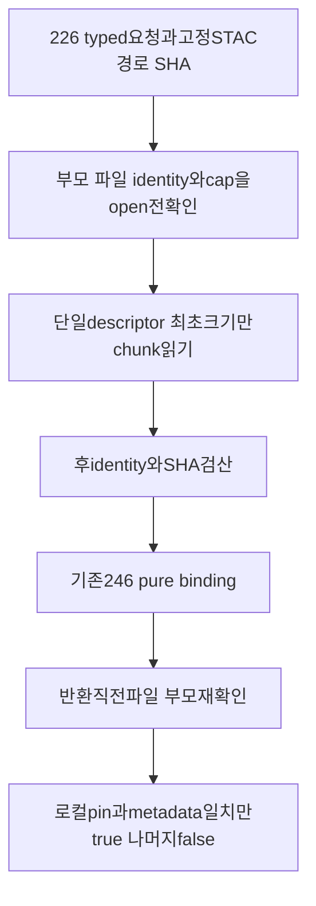

# 281·287·288 — 고정 로컬 STAC 파일을 읽어 선언 검증기로 넘기는 어댑터

- updated_at: 2026-10-18 21:07 KST 288 공유적용·프로젝트시험 완료 기준
- source_commit: 신규helper SHA `542c418f2fb7ed47c4e03a9fa9fad73bc2c4effcc5f95aaac27209792dac468c`
- evidence_paths: [281 격리구현](../implementation/281_isolated_survey_stac_file_adapter.md), [287 독립리뷰](../implementation/287_survey281_file_adapter_independent_review.md), [288 공유적용](../implementation/288_survey_stac_adapter_main_application.md), [적용 receipt](../../evidence/integration/survey288-application-root-20261018.json), [main시험로그](../../evidence/integration/survey288-project-regression-root-20261018.log)
- confidence: 로컬 파일 보호·합성시험·정적리뷰·두파일반영에높음.실공급자·SURVEY운영연결은미검증.
- status: **TESTED_SYNTHETIC / SHARED_APPLICATION_COMPLETED**. 실제SURVEYrunner/예약/registry/API소비연결0·운영수집미승인.

## 1. 쉬운 설명

**호출자가 지정한 STAC 파일 한 개가 맞는 파일인지 확인하고, 제한된 바이트만 읽어 기존246 선언 검증기에 넘기는 내부 어댑터를 추가했다.**

이전246이 서류 내용을 대조하는 검사관이라면281/288은 서류가 든 봉투의 주소·봉인·분량이 맞는지 확인하는 입구다. 서류 출처가 진짜이거나 실제 영상이 좋다는 인증은 아니다. 나지를 수집하는 실행기나 비용 예약 기능도 아직 연결하지 않았다.

281은격리구현,287은독립정적검토,288은신규제품·시험두파일의공유반영이다. 격리판의당시미적용기록과현재적용완료는시점이다르다.

## 2. 이론과 권한 경계

파일의경로가같아도읽는도중교체·성장할수있다. 따라서path/부모identity·단일regular/nlink1·크기·descriptor identity를읽기전후확인하고SHA가맞은뒤에만246을호출한다. 이관측이파일시스템전체의원자transaction이나미래소비권한이되는것은아니다.

최대1MiB는**한호출의로컬read allowance**다. 병렬두호출은독립allowance이며합계1MiB공유예산이아니다. 실제원격metadata1MiB/COG64MiB/65MiB선예약/4GiB원장을대신하지않는다. `actual_read_bytes`는Python에반환된payload양이며디스크장치물리IO·stat비용·원격전송량이아니다.

## 3. 코드·동작

[bare_survey_stac_file.py](../../backend/app/data/bare_survey_stac_file.py)의`read_pinned_survey_stac(root,request,selected_asset,maximum_read_bytes=...)`는절대root·canonical data상대ref·정확typed요청을받는다. 다른ref와casefold alias를거부하지만다른source/ledger/config/seed파일은열지않는다. 선택STAC만검사한결과를다른근거의실파일검증으로확대하지않는다.

예산은exact int0..1MiB이며bool·상향을거부한다. 파일2B..1MiB와allowance를os.open전에확인한다. 최대64KiB씩최초크기만읽고추가EOF cap+1 read나두번째hashdescriptor를열지않는다. 성장·짧은read·교체·부모변화·지문불일치를거부하며descriptor는finally닫는다.

부분read뒤실패해도 `.actual_read_bytes`를유지한다.첫64KiB뒤오류면65,536B를0이나환불로바꾸지않는다. 고정 `SURVEY_FILE_*`오류에경로/URL/token/원예외문을노출하지않는다. frozen반환값과`to_dict()`는사본이며입력변경이결과를바꾸지않는다.

성공은local_file_pin_and_identity_verified와내부metadata_consistency_verified만true다. 출처authenticity·remoteasset·rasterheader·ledger·quality·training·execution·collection·registry·targetconsumer는false다. 자료형객체를직접생성한것도승인토큰이아니다.

## 4. 시험·독립리뷰·공유 적용

[신규시험](../../tests/test_bare_survey_stac_file281.py)은16개다. 기존226/246의45개와합친유효집합은61개이며격리61PASS3.963초/공유main61PASS0.922초다. 같은61개를122개로합산하지않는다. Root288 전체적용wrapper는1.968초로unittest시간과다르다.

단일fd·정확bytes·낮은예산/과대파일open전차단·1MiB whitespace경계·hash실패binding0·실hardlink·모의reparse/부모교체·실growth/close후교체·부분read·엄격시각·사본/병렬독립호출을시험했다. 첫focused16중1실패는Windows가열린fd교체를먼저막아의도한후검사에못도달한fixture문제다. close직후실교체로fixture만고쳤고제품/cap은유지했다. 최초로그도보존한다.

287은15개근거지문불일치0·기반8개원판보존·필수제품수정미발견을확인했다. Root288은**신규제품1+신규시험1만추가**하고기존8개를덮어쓰지않았다. 운영5핀·코어39핀·신규2핀을전후보존했고HTTP·collector·학습0이다.시험로그SHA는 `73b47b637619cd9bb6169efd16bfdf1fa9e5f11db8ace390ea7913f0d9ee715c`다.

실Windows junction생성전체·적대적경합모두·최대RAM/RSS·실PC문서호환/인증은검증하지않았다. 부모identity의무관한변경에도보수차단될수있고자동재시도하지않는다.

## 5. 289 RFC와 미연결 기능

기존226/246의시각검사는그대로다. 원문 `.024000Z`를초단위요청에맞춰자르거나반올림하지않아여전히BLOCKED일수있다. [289 RFC](../implementation/289_survey_raw_provider_time_v2_rfc.md)는ID명목시각과원문시각을분리하자는 **PLANNED**계약이며제품/시험/runner구현0이다. 공급자시각의정확의미미확인에따른차단을해제하지않는다.

실제SURVEYrunner·단일global lock/누적예산·예약/정산·속도/429·실라벨/native/support·173/175명시lineage소비자는미연결이다. API/UI가소비하지않아화면수정·서버restart도불필요했다. 실제나지확보·독립정답·최종품질·학습을완료한것이아니다.

## 6. 발표 대본

### 1분

“고정 STAC 파일을 안전하게 읽어 기존 선언 검증기로 넘기는 어댑터를 추가했습니다. 파일과 부모가 바뀌지 않았는지 확인하고 한 번의descriptor로 최대1MiB만 읽습니다. 실패해도 실제 읽은 바이트를남기며출처·품질·집행승인을만들지않습니다. 격리검토후공유프로젝트61개시험이통과했지만SURVEY수집기·예산예약연결은아직없습니다.”

### 5분

“246이문서내용검사라면288은파일입구보호입니다. 요청·경로·alias를검사하고cap과allowance를open전에확인합니다.단일fd로처음크기만읽어identity와SHA를대조하고246호출후에도변경을확인합니다. 부분읽기는실제반환바이트로유지하며공유원격예산과다릅니다. 287독립검토와288두파일적용/61시험을완료했고동일격리61과합산하지않습니다. 실제junction·모든경합·공급자시각호환은미검증입니다.289는시각v2제안일뿐이며기존strict는유지합니다. 실제SURVEYrunner와예약/정산·native소비자는별도후속입니다.”

### 10분 구성

1. 0~2분: 서류봉투비유와246/288경계.
2. 2~4분: path/identity/cap-before-open·단일fd.
3. 4~6분: 부분read·오류·독립allowance·falsegate.
4. 6~8분: 61시험/원실패보존·287리뷰·288두파일적용.
5. 8~10분:289시각의미미확인·runner/예산미연결·Q&A.

## 7. FAQ

**1. 이제 나지를 수집하나요?** 파일입력어댑터만추가했습니다. SURVEYrunner·예약·소비연결은없습니다.

**2. 파일SHA가맞으면공식출처인가요?** 선택파일과pin이같다는뜻이며원격출처인증이아닙니다.

**3. 두호출이1MiB를나눠쓰나요?** 독립호출의allowance입니다.공유누적예산은미래coordinator가관리해야합니다.

**4. .024초를자동으로고치나요?** 원문과기존strict를유지합니다.289는별도RFC이며provider시각의미는미확인입니다.

**5. 61개두번이면122개인가요?** 같은집합의격리/프로젝트배치검증이므로합산하지않습니다.

**6. UI를왜고치지않았나요?** API/UI에서아직소비하지않는내부모듈이며보유량·사용자계약을바꾸지않았습니다.
