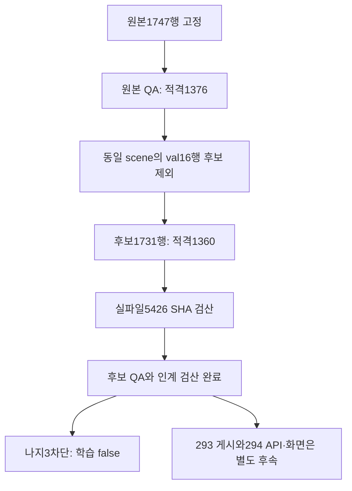

# 290 — 실제 후보 1,360개 QA 완료와 남은 나지 차단

- updated_at: 2026-10-18 21:49:21 KST 296 실제 브라우저 후속 기준
- source_commit: HEAD 36d433b. 이번 실행은 별도 동결 runner와 기존164/profile 코드 지문 기준이며 제품 코드 수정 없음.
- evidence_paths: [구현·완료 문서](../implementation/290_post285_candidate_qa_preparation.md), [summary](../../evidence/integration/priority164-guarded290-20261018/summary.json), [인계 검산](../../evidence/integration/priority164-guarded290-20261018/handoff-verification.json), [terminal](../../evidence/integration/priority290-terminal-20261018.json), [완료 freeze](../../evidence/integration/priority290-completion-freeze-20261018.json), [실행기](../../evidence/integration/priority290-runner-20261018.py)
- confidence: 고정 원본·후보의 수량, 파일 지문, 분할 제외, 명시128 경로 완료는 실제 증거로 확인. 최대 용량 성능·모델 정확도·학습 승인은 미검증.
- status: **VERIFIED_REAL — 단1 실제 QA 및 metadata 인계 완료**. **BLOCKED — 나지 대표성3건, 학습 준비 false**. 293 게시와294 실API는9절의 후속 근거로 완료됐다. 296 실브라우저도10절에서 실제 완료를 확인했다. 아래 각 단계의 대기 설명은 그 시점의 기록이다.

## 1. 쉬운 설명

**원본 적격1,376개를 검사해, 같은 위성 장면이 서로 다른 분할에 들어간16행을 후보에서만 제외한1,360개 후보를 만들고 검사를 끝냈다. 원본은 보존했고 나지 부족은 해결되지 않았다.**

재료 창고는 그대로 두고 수업용 목록을 따로 정리한 일과 같다. 같은 장면이 검증용과 평가용 양쪽에 들어가면 이미 본 풍경으로 시험을 보는 문제가 생길 수 있다. 이번에는 그 중복을 후보 목록에서 제거했다. 원본을 지우거나 품질 기준을 낮추지 않았다.

[285 실제 수집](285_GORONTALO2022_ACTUAL_COLLECTION.md)으로 늘어난 적격12개를 이번 고정 후보가 반영했다. 이전 게시 후보1,348개보다12개 많은1,360개다. 나지 픽셀과 기여 패치는 늘지 않았으므로 수량 증가를 나지 보완이나 학습 승인으로 해석하면 안 된다.

## 2. 이론적 배경: 세 가지 검사는 각각 필요하다

파일 지문 검산은 검사 대상이 고정된 파일과 같은지 확인한다. 분할 검사는 같은 출처가 학습·검증·평가 경계를 넘어가는지 확인한다. 클래스 대표성 검사는 나지 같은 특정 종류가 충분히 들어 있는지 확인한다. 지문이 맞고 출처 중복이 없어도 특정 종류가 부족하면 학습 준비도는 통과하지 못한다.

나지는 각 split에서 유효 라벨 픽셀의0.5% 이상, 기여 패치5개 이상이라는 두 조건을 각각 만족해야 한다. 한 패치의 나지 인정 문턱인256픽셀과 전체 split의0.5% 비율은 다른 조건이다. test에 나지1,025픽셀이 있어도 기여 인정 기준을 통과한 패치가0개일 수 있다. Esri 참조 class8은 모델 class7에 해당하며 독립 정답으로 검증한 결과가 아니다.

## 3. 동작 구조

## 4. 코드와 데이터가 실제로 한 일

동결290 runner가 Root GO와 source·정책·코드·기존 pointer 지문을 확인한 뒤 기존164 CLI를 한 번 호출했다. source snapshot→원본 QA→분할 계획→후보 package/stage→후보 QA→출력·인계 검산은 같은 명시 profile과 누적 JSON I/O 예산을 사용했다. 중첩 호출은 같은 계측 범위를 재사용했다.

| 범위 | 전체 등록행 | train 적격 | val 적격 | test 적격 | 적격 합계 |
|---|---:|---:|---:|---:|---:|
| 고정 원본 | 1,747 | 834 | 292 | 250 | 1,376 |
| 고정 후보 | 1,731 | 834 | 276 | 250 | 1,360 |

같은 scene `S2A_MSIL2A_20210812T025551_R032_T48MXT_20210812T132431`이 banten/west_java 그룹의 분할 경계를 넘었다. test를 유지하고 val의 원본 인덱스288–303, 총16행을 후보에서만 제외했다. 16개의 별개 위성 장면을 삭제한 작업이 아니다. 원본 행·운영 split·history는 보존했고 후보의 정확한 잔여 행, lineage, 전체 partition을 확인했다. 남은 source identity conflict는0이다.

원장 지문은 준비·보존 확인 근거이며 새로운 QA 입력으로 추가하지 않았다. 원본의 출처 중복 차단1건은 후보에서 해소되어 원본4차단에서 후보3차단으로 줄었다. 나머지3건은 train/val/test 각각의 나지 대표성 미달이다.

### 64MiB를 넘는 두 파일과 명시128 계약

| 파일 | 실제 bytes | 기본64MiB 초과 bytes |
|---|---:|---:|
| 원본 | 68,220,381 | 1,111,517 |
| 후보 | 67,599,006 | 490,142 |

기본64MiB는67,108,864B다. 양쪽 파일 모두 이를 넘었고 처음부터 승인된 `bounded128m-3000-v1`을 명시해 실제 QA와 인계까지 완료했다. 파일이 커졌다고 자동으로 상한을 올린 실행이 아니다. source/candidate128MiB, scenes+history3,000행, depth32, node4,000,000과 누적 JSON I/O16GiB를 유지했다. 작은 역할별 파일에는 별도 cap을 유지했다.

QA+인계의 최종 누적 JSON I/O는4,977,946,640B로16GiB인17,179,869,184B 이내다. 이는 원격 다운로드 사용량이나 최대 RAM이 아니다. 완료 freeze·문서 작성은 계측 종료 뒤 행정적 산출물이며 이 수치에 포함한다고 주장하지 않는다. 후속 게시·API 작업의 I/O도 이 QA 수치에 합치지 않는다.

## 5. 실제 검증 증거와 시간

| 검증 | 실제 결과 |
|---|---|
| 단일 실행 | PID25528/session5248, CLI1회, exit0 |
| 고정 시작 | 21:16:41.654 KST, 원본1,747행 |
| terminal | 21:40:19.460 KST |
| 전체 wrapper | 1,443.969초, 약24분4초 |
| 원본 QA 함수 | 326.406초 |
| 후보 QA 함수 | 330.187초 |
| 원래 CLI의 실파일 검산 | 5,426기록, SHA 불일치0 |
| 인계 metadata 검산 | 출력11개 지문 불일치0, v2 receipt3개 marker 확인 |
| 인계 proof | 21:41:39.798 KST |
| 완료 freeze | 21:44:51.875 KST |

전체 시간에는 준비·metadata 검산 등이 들어간다. 함수 시간 두 개를 더해 전체 실행시간으로 바꾸거나 순수 래스터 처리 시간으로 해석하지 않는다. 특정 지연 원인은 profiler 없이 단정하지 않았다. 인계 검산은 같은 래스터 QA를 재실행한 작업이 아니다.

원본 SHA는 `9d491e6ede51cf29407add25b83919cc5d4150576a694c5019814b973d20c2b7`, 후보 SHA는 `72c7385708ac824b0ff67da9bb72391f33d7f6f63fa942da4d01c46c50dc6961`이다. summary SHA는 `6a313637000e3badc25cf35ecd28f6f516a0dda3f276fdbc781c30a795f3badd`다. 인계 당시 원본·정책·원장과 기존1,348 pointer/receipt275 보존이 확인됐다. 그 뒤 Root의 의도된 게시 변경까지 불변이라고 주장하지 않는다.

## 6. 나지·성능·운영의 한계

| split | 유효 라벨 픽셀 | 나지 픽셀 | 나지 비율(%) | 기여 패치/최소5 |
|---|---:|---:|---:|---:|
| train | 53,118,025 | 2,562 | 0.0048232215 | 1/5 |
| val | 17,776,457 | 2,998 | 0.0168650030 | 2/5 |
| test | 16,252,940 | 1,025 | 0.0063065513 | 0/5 |

각 비율은0.5%보다 작다. train 적격12개가 추가돼 분모는 늘었지만 나지 픽셀은 같아서 train 나지 비율은 오히려 낮아졌다. 일반 지역·연도 최소 수량 부족11개와 이 나지3차단은 별개 문제다.

- **VERIFIED_REAL:** 고정 입력, 단1 QA, 실파일 SHA, 후보 분할, 명시128 경로와 인계 검산 완료.
- **BLOCKED:** 나지3차단, `ready_for_training=false`, 실제 학습0. `NOT_CAPTURED_BUDGET`이므로 공간 연결성 전체 검증 완료도 아니다.
- **IMPLEMENTED_UNVERIFIED:** 이번 완료만으로128MiB 최대 입력의 성능·동시 실행 안전성·최대 RSS를 인증하지 않는다. OS PeakWorkingSet 최댓값 표본1,307,496,448B는 최종 peak 보장이 아니며 runner의 `rss_observed=false`를 유지한다.
- **PLANNED/별도 후속:** 293 게시와294 profile 재결속·실 API·실 브라우저. 이 문서의 현재 완료 증거에는 포함되지 않는다.

이 단위는 runtime/UI 제품 변경이 없어 화면 코드 수정이나 서버 재시작이 필요한 작업이 아니다. 새 후보가 실제 화면에 반영됐는지는 게시·API·브라우저 후속 증거로 확인해야 한다. 자동 재시작·상한 상향·추가 collector·별도 native 감사·HTTP·registry·모델 학습·원본/원장/운영 split 쓰기는0이다. 전체 개발 완료나 과학적 정확도 승인으로 보고하지 않는다.

## 7. 발표 대본

### 1분

“285번에서 새로 얻은 자료를 포함해 원본 적격1,376개를 고정 검사했습니다. 같은 위성 장면이 서로 다른 분할에 들어간16행은 후보에서만 제외했고, 원본은 보존했습니다. 최종 후보는1,360개이며 파일 지문5,426기록의 불일치는0입니다. 원본과 후보가 모두64MiB를 넘었지만 사전 승인된 명시128 경로로 검사를 마쳤습니다. 다만 나지는 늘지 않아 세 분할 모두 대표성 기준 미달이고 학습 승인은 false입니다. 게시와 API·화면 반영은 별도 근거로 확인합니다.”

### 5분

“먼저 등록행과 적격 자료를 구분하겠습니다. 원본 등록은1,747행이지만 적격은1,376개입니다. 여기서 동일 scene 때문에 val에 겹친16행을 후보에서만 제외해 후보 등록1,731행, 적격1,360개를 만들었습니다. 16개의 별개 장면을 삭제한 것이 아니며 test와 원본은 유지했습니다.

다음은 증거의 범위입니다. 단1 실행이 약24분 걸렸고, 원본 QA와 후보 QA 함수는 각각326초와330초입니다. 나머지 시간도 검산 과정에 속하며 지연 원인을 특정 처리로 단정하지 않았습니다. 실파일5,426기록의 SHA가 맞았고, 후속 담당은 래스터를 다시 검사하지 않고11출력 지문과3영수증을 확인했습니다.

파일 크기도 중요한 변화입니다. 원본68,220,381B와 후보67,599,006B는 모두 기본64MiB를 넘습니다. 처음부터 명시128 profile로 동일한16GiB 누적 JSON I/O 제한을 지켰습니다. 실제 완료는 확인했지만128MiB 최대 성능이나 RAM 상한을 인증한 일은 아닙니다.

끝으로 나지 부족이 남았습니다. 기여 패치는 train1, val2, test0개로 최소5개에 못 미칩니다. 나지 비율도 각0.5%에 못 미칩니다. 일반 자료가12개 늘어도 나지0이면 이 문제는 해결되지 않습니다. 학습 준비 false를 유지하며 게시·API·실제 화면은 별도 후속 증거로 마감합니다.”

### 10분 진행 순서

1. 0–2분: 원본 창고와 별도 후보 목록의 비유, 원본 보존 설명.
2. 2–4분: 수량표와 같은 scene16행 후보 제외, 누출 제거와 대표성 구분.
3. 4–6분: 명시128/16GiB 계약, 두 파일의 실제 크기와 성능 미인증 경계.
4. 6–8분: 전체 시간·함수 시간·실파일 SHA와 인계 metadata 검산의 차이.
5. 8–10분: 나지 표, false 상태, 게시/API/화면 후속과 남은 수집 우선순위 설명.

## 8. FAQ

**Q. 1,376개가 있는데 왜 후보는1,360개인가요?** 같은 위성 scene이 split 경계를 넘는16행을 후보에서 제외했기 때문입니다. 원본 삭제는0입니다.

**Q. 후보가12개 늘었으면 나지도 해결됐나요?** 아닙니다. 적격 자료 증가와 나지 대표성은 다른 조건입니다. 나지 픽셀·기여 수는 이전과 같습니다.

**Q. SHA가 전부 맞는데 왜 학습을 못 하나요?** SHA는 파일 일치 확인입니다. 나지 비율과 기여 수 기준을 충족한 증거는 아닙니다.

**Q. test 나지1,025픽셀인데 기여0은 오류인가요?** 기여는 패치별 인정 기준을 만족해야 합니다. 전체 픽셀 합계와 기여 패치 수는 서로 다른 지표입니다.

**Q. 기본64를 넘었으니 자동으로 제한을 없앴나요?** 사전 승인된 명시128 profile을 사용했고 행·깊이·node·역할별 cap과 누적16GiB 제한을 유지했습니다.

**Q. 128MiB 파일을 언제나 이 시간 안에 처리하나요?** 이번 크기의 단일 실행 결과입니다. 최대 입력·동시 실행·SLA·최대 RAM 보장은 아닙니다.

**Q. 화면도 새1,360개로 바뀌었나요?** 이번 단위는 QA와 인계 완료입니다. 293 게시 및294 API·브라우저 완료 근거가 별도로 필요합니다.

## 9. 293 게시·294 명시 재결속과 실제 API 완료 후속

21:44:45.012767 KST Root가 새1,360개 후보를 게시했다. [293 완료 문서](../implementation/293_post290_publication_preparation.md)와 [실제 publication](../../evidence/integration/priority293-publication-root-20261018.json)에서 이전1,348 pointer의 원바이트 archive, 정확한 retained rows·완전 partition, 출력11핀·v2 receipt3개 검산과 현재 source 일치를 확인했다. 새 pointer SHA는 `996a88de2034e9803381d7ae4e906a0d1f418075675d13ef796fb5648bb472c0`다. 게시 검산 JSON I/O824,253,062B는 별도16GiB scope의 값이며290 QA+인계 수치와 합쳐 하나의 실행값으로 보고하지 않는다.

[294 완료 문서](../implementation/294_post290_source_profile_rebind_preparation.md), [입력 정정 기록](../../evidence/integration/profile294-input-pin-correction-root-20261018.json)은 첫 시도의 실패도 남긴다. Root가 잘못 입력한 publication SHA 때문에 `MANIFEST_JSON_PIN_MISMATCH`로 최초 읽기에서 차단됐다. 이때 설정은 그대로였고 출력·임시파일·HTTP 요청은 없었다. 제품 버그로 판단한 사례가 아니며, 검토한 실제 지문으로 명시 실행한 정정이다. 자동 재시도나 제품 변경은0이다.

정정한 실행은 old config ef093 원바이트를 보존하고 현재 source9d491에 같은 profile을 명시 결속했다. [selection](../../evidence/integration/profile294-selection-root-20261018.json)의 새 config SHA는 `a644b5b2cdf8917d13028f7a89ceeb4996d5ad5dc54af2b6fb2c9fda2c98f9de`다. 파일 크기 때문에 자동 profile을 선택한 것이 아니다.

[실제 API 검산](../../evidence/integration/profile294-api-checks-root-20261018.json)은 단1 GET 200/41.25초, 11검사 모두 true다. 재고 응답21:46:33.091901, 예산 관측21:46:34.397896 KST를 구분한다. 원본 적격1,376/셀 부족11, 게시 후보1,360(834/276/250)/현재 source 일치/나지3차단·학습false를 확인했다. bare50 검토는 과거 원본을 기준으로 하므로 시점 경고가 남는다. 잔여1,845,284,187B이며 oldpending136,314,880B는 이미 사용액에 포함돼 재차 차감하지 않는다. 원본·원장·게시 운영핀 보존, 서버 재시작·QA 반복·native·학습0이다.

원본과 후보 모두64MiB를 넘는 실제 QA→게시 reader→API 완료가 확인됐다. 이 단일 실행을128MiB 최대 성능·41.25초 SLA나 실브라우저 완료로 확대하지 않는다. **현재 상태는 VERIFIED_REAL_QA_PUBLICATION_API, 296 브라우저 별도 대기, 학습 BLOCKED**다.

### 후속 발표와 FAQ

발표에 다음 문장을 덧붙인다. “QA 뒤 별도 게시 검산을 거쳐1,360개 후보로 승계했고 현재 원본과 일치하는 실제 API 응답도 확인했습니다. 첫 입력 지문 오류는 설정 변경 전에 차단해 정정 기록을 보존했습니다. 나지3차단은 그대로이며 실제 화면 확인은 별도 후속입니다.”

**Q. API가 성공했으니 화면도 확인됐나요?** API 응답과 실제 브라우저는 다른 증거입니다. 296 완료 근거 전에는 화면 완료라고 보고하지 않습니다.

**Q. 왜 후보 시점 경고는 사라지고 나지50 경고는 남나요?** 새 후보는 현재 source9d491로 검증·게시했지만 나지50 보고서는 과거 source를 기준으로 한 별도 검토이기 때문입니다.

**Q. 첫 실패가 있었는데 성공만 보고하나요?** 최초 Root 입력 지문 오류와 부작용0 확인을 보존했습니다. 입력 검토 후 명시 정정한 실행의 API 성공을 따로 기록합니다.

## 10. 296 실제 브라우저 후속 완료

[296 완료 문서](../implementation/296_post290_ui_followup.md), [실제 화면 영수증](../../evidence/integration/service296-post290-final-ui-20261018.json), [DOM](../../evidence/integration/service296-post290-final-ui-20261018-dom.txt), [분리 계측](../../evidence/integration/service296-post290-final-ui-20261018-checks.json)과 [원본 카드 PNG](../../evidence/integration/service296-post290-final-ui-20261018-inventory.png)·[후보 비교 PNG](../../evidence/integration/service296-post290-final-ui-20261018-candidate.png)를 확인했다. 두 PNG에서도 원본1,747/적격1,376과 후보1,360/3차단·현재 원본 일치를 직접 볼 수 있다.

실제 브라우저 재고 응답은21:48:16.705738, 예산 관측은21:48:17.406248 KST다. 294 API의21:46 확인과 다른 관측이다. 원본 적격1,376(834/292/250), 적격 외371, 셀 부족11을 표시했다. 고론탈로2022는36개로 최소 수량을 충족했으며 남은 부족은 고론탈로2025의10개와 동자바2025의1개다.

고정 후보1,360(834/276/250)은 현재 source9d491과 일치해 후보 시점 경고가 해제됐다. 나지3차단·학습 미충족은 유지됐다. 나지50 보고서는 과거234의 source9c24를 기준으로 하므로 해당 보고서에만 원본 변경 경고와 실제 신규 품질 미검사·집행 미승인 안내가 남았다. 후보의 경고 해제가 나지50의 검토 갱신을 뜻하지 않는다.

예산 사용2,449,683,109B, 잔여1,845,284,187B, oldpending2건136,314,880B의 사용액 포함을 확인했다. oldpending을 다시 차감하거나 자동 환불하지 않는다. 화면의 실제 프로세스 상태는 UNKNOWN이므로 이 화면만으로 수집기 실행 여부를 확정하지 않는다.

첫 Playwright 클릭은 Runtime.evaluate timeout이었다. 직후 AX에서 과거 응답·활성 버튼·읽는중 미표시를 확인하고 native 클릭1회로 조회 시작과 완료를 관측했다. 이후 추가 새로 조회0, 별도 수동 API GET0·새탭0·서버 재시작0이다. 두 클릭 전달 시도를 숨기거나 실제 전체 HTTP 요청 수를 전수 계측했다고 주장하지 않는다. 완료 후 통합 계측 timeout도 보존했고 분리한 콘솔·치수 확인으로 마감했다.

분리 checks 파일의21:48:45.982 관측은 logs[] 및 치수1,573픽셀을 기록한다. 최종 화면 영수증의21:49:21.853 관측 역시 warn/error0, document scrollWidth/clientWidth/bodyWidth 모두1,573으로 가로 넘침0이다. 이는 해당 세션의 실제 관측이며 전체 과거 로그·모바일·접근성·최대 성능 인증이 아니다.

**현재 완료 범위는 VERIFIED_REAL — 290 QA→293 게시→294 실제 API→296 실제 브라우저다. 학습은 나지3차단으로 계속 BLOCKED다.** Root291의 현재 단1 로컬 계획 실행은 후속 위치 제안이며 새 원격 수집이나 확보량 증가가 아니다. 이 이해자료 작업은 추가 운영 조회·HTTP·시험·원본/원장/제품 쓰기를 하지 않았다.

### 최종 발표 문장과 FAQ

“현재 화면에서도 원본 적격1,376개와 누출 제외 후보1,360개를 구분해 확인했습니다. 후보는 현재 원본과 일치해 시점 경고가 사라졌지만, 나지50 보고서의 과거 시점 경고와 집행 미승인 안내는 남아 있습니다. 나지3차단과 학습 미충족도 그대로입니다. 다음 로컬 위치 제안은 새 자료를 확보한 성과로 더하지 않습니다.”

**Q. 이제 실제 화면 확인도 끝났나요?** 21:48 응답에서 확인했습니다. API21:46과 구분해 기록했고 콘솔·가로 넘침도 별도로 관측했습니다.

**Q. 후보 경고가 해제됐는데 왜 학습은 막혀 있나요?** 현재 원본과 지문이 같은 것과 나지 대표성이 충분한 것은 다른 조건입니다. 세 split 모두 나지 기준 미달입니다.

**Q. 나지50만 경고가 남으면 화면 오류인가요?** 별도 과거 보고서의 실제 근거 시점을 정직하게 표시한 것입니다. 새 후보 게시로 그 보고서가 자동 재검증되지는 않습니다.
