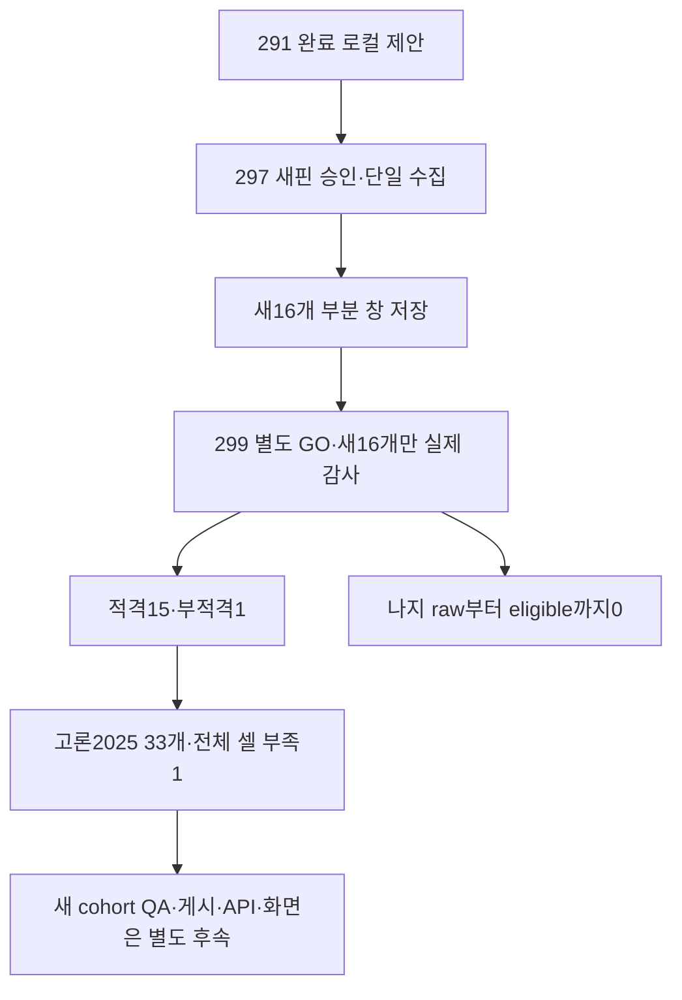

# 297·299 — 고론탈로2025 최소 수량 충족과 남은 동자바1개

- updated_at: 2026-10-18 22:12:42 KST 301 API·305 브라우저 후속 기준
- source_commit: HEAD36d433b 및297 승인·동결 코드 지문 기준. 신규 runtime 제품 수정 없음.
- evidence_paths: [297 구현·실제 결과](../implementation/297_gorontalo2025_single_batch_preparation.md), [299 감사·한계](../implementation/299_post297_bounded_native_preparation.md), [실제 감사](../../evidence/integration/deficit297-native-root-20261018.json), [완료 freeze](../../evidence/integration/deficit299-native-completion-freeze-20261018.json), [감사 runner](../../evidence/integration/deficit297-native-runner-root-20261018.py), [종료 관측](../../evidence/integration/deficit299-termination-observation-20261018.json)
- confidence: 새16개 패치의 품질·출처·나지 단계별 검사와 보존·정산은 실제 근거로 확인. 전체 실물 재스캔·새 cohort QA·독립 정답·학습 승인은 미검증.
- status: **VERIFIED_REAL — 단일 수집 종료와 신규 증분 감사 완료**. **BLOCKED — 학습false/나지3차단 유지**. 301 실제 API·305 실제 브라우저와302 로컬 제안은9절 후속으로 완료됐다. 아래 당시의 대기 기록은 보존한다. 304 수집 준비는 별도이며 실행 성과가 아니다.

## 1. 쉬운 설명

**고론탈로2025에서 새16개 패치를 저장했고 실제 검사로15개가 적격이었다. 이 지역·연도의 최소 수량을 채워, 남은 수량 부족은 동자바2025의1개다. 나지는 추가0이다.**

자료를 담는36개 지역·연도 칸 중 고론탈로2025 칸이 최소선28개를 넘어33개가 됐다. 필요한10개보다 많은15개가 늘었지만 초과분5개를 다른 칸의 부족에 대신 더할 수는 없다. 그래서 전체 칸별 부족은11→1로10개 줄었다. 나지라는 재료 종류가 충분한지는 별도 기준이므로 이 수량 충족만으로 학습을 시작하지 않는다.

## 2. 이론: 수량·패치 품질·클래스 대표성을 분리한다

1024×1024 영상 하나를256×256 부분 창16개로 나누면 창마다 유효 영역과 품질이 다르다. 이번16개 중1개는 유효 픽셀41,380/65,536, 약63.14%로80% 기준에 못 미쳤고 보존하되 적격으로 세지 않았다. 나머지15개를 실제 품질 적격 증가로 인정했다.

전체 목표1,200개를 넘었다는 사실, 각 지역·연도 최소28개 충족, 나지 비율0.5%·기여 패치5개 충족은 서로 다른 조건이다. 한 조건의 초과분이 다른 조건을 자동 해결하지 않는다. 참조 라벨의 Esri class8이 나지이며 모델 class7과 구분한다. 라벨 histogram의 class7 숫자를 나지로 잘못 읽으면 안 된다.

## 3. 실제 동작 구조

## 4. 코드·출처·데이터 검산

297은291의 고론탈로2025 제안 한 곳을 새 strict request와 현재 source·원장·코드 지문에 묶어 최대1 batch로 실행했다. 기존279 승인이나 config를 재사용하지 않았다. supervisor는 자식 실행 뒤 로그 기록 문제가 생겨도 finally에서 기다리는 기존 보호를 유지했다. 글로벌 잠금 안 fresh guard, 기존 예산·품질·지원 겹침·분할 보호도 유지했다.

299는297 종료와 Root의 별도 GO 후 helper165를 한 번 호출했다. 저장된 raw B02와1024 source 첫 band 배열의 일치,16개 부분 창의 첫 band와 window transform/CRS 일치를 실제 로컬 bytes로 확인했다. 저장 STAC scene은 `S2B_MSIL2A_20250629T021209_R060_T51NVA_20250629T035540`, 원시 datetime은 `2025-06-29T02:12:09.024000Z`다. 소수초를 임의 반올림한246 strict 계약 통과로 설명하지 않는다.

실제 source는 EPSG:32651,1024×1024,6band,10m이며 transform은 `[10,0,442070,0,-10,88330]`이다. TIFF를 로컬 MemoryFile에서 읽고 nearest 정렬 및 품질·support를 구분했다. URL·STAC 일치는 저장 출처의 결속 확인이며 원격 출처 인증이나 독립 정답 검증은 아니다.

저장 metadata 요약은12개 입력/12개 유지/0개 제외/선택 pool5였다. SCL 사전 유효율96.343994%는65% 문턱을 통과했다. 제외0이므로 metadata 선별이 이번15개 증가를 만들어냈다고 과장하지 않는다. 이 요약을 전체 원격 검색 결과의 독립 재조회로 확대하지 않는다.

## 5. 실검증 증거와 중복 없는 집계

| 항목 | 실제 확인 |
|---|---|
|297 수집 시작/종료|21:58:15.020913 →22:04:07.327723 KST, exit0|
|수집 terminal 시간|350.39초|
|새 부분 창/품질 적격|16/15|
|새 래스터|image·label·quality 각16, 합48개|
|helper 호출/파일 SHA|1회/52기록, 검산 실패0|
|추가 출처 trace|21개 중16개 image는 helper와 중복|
|미참조 새 래스터|0|
|기존 prefix/history/pending|1,747행·history·pending2건 exact 보존|
|감사 중 원본/원장 drift|false/false, metadata 두 읽기 안정|
|helper 시간|4.474028초|

52와21을 더해73개의 서로 다른 파일을 검증했다고 보고하지 않는다. trace21개 중16개 image는 앞선 검사와 겹친다. helper4.474028초도 전체 출처 trace 감사 wall이 아니다. 빠른 종료 때문에 감사 PID를 별도 포착하지 못했고 총 native wall/peak RSS도 측정하지 않았다. collector PID를 감사 PID로 대신 기재하지 않는다. 실제 감사 실행 session19511/exit0은 완료 freeze에 남았다.

등록 원본은1,763행, 적격1,391(train849/val292/test250)이다. 결과 JSON 안 `physical_total_at_read=1763`은 등록 집계 문맥이다. 디스크 실물은 사전 검산1,748+신규16=1,764로 **추론**한 값이며 전체 재스캔으로 확정한 값이 아니다.

source SHA는 `9e63564c87647a144665bbb6bbe49b4a95d09bbd2c3bc0f3725861c54d5e7109`/68,887,373B, ledger SHA는 `574d382dd9da51ae56dc8fb135532f8f2e5c542b2c4cafdf73a6ee8dd9c6045f`다. 감사 JSON SHA는 `e8c51e5c0afd86d4f0d89a58121103bad76ff3a5e4504079c41217ac08731096`다.

## 6. 나지·예산·현재 후보의 경계

나지는 raw label의 B02 grid 정렬0→source quality 반영0→최종 support 반영0→적격 합계0, 기여 패치0이었다. 부적격 패치의 나지를 적격 합계로 더하지 않았다. 이는 이번 대상1024/부분 창의 결과이며 고론탈로 전체에 나지가 없다는 판정이 아니다.

COG22,413,312B+metadata267,049B=22,680,361B를 실제 정산했다. 잔여는1,822,603,826B다. 처음의 최대 예약은 실비가 아니며 측정한 전송량으로 정산했다. 기존 미계측 pending2건136,314,880B는 그대로 보존했고 환불·재차 정산하지 않았다. finalize/settle/publish는 해당 단일 key에서 각각1회였다. 기존4GiB·물리3,000·최대2worker·2초/첫429·품질/split/support 조건을 낮추지 않았다.

기존 게시1,360개는 이전 source9d491을 검사한 고정 후보다. 이번 새 source9e635의 추가 적격15개는 그 QA 밖이다. 원본1,391에서 과거 제외16을 산술로 뺀 숫자를 새 검증 후보라고 발표하지 않는다. 새 cohort 검사가 끝나기 전에는 후보 수·분할·현재 지문 일치가 미확정이다. [290 QA·296 실화면](290_POST285_CANDIDATE_QA.md)은 이전 시점의 완료 기록으로 보존한다.

- **VERIFIED_REAL:** 새16개 증분 감사/적격15, 출처·grid·나지 단계별 검산, 정산·이전 자료 보존.
- **BLOCKED:** 나지3차단 해제 근거 없음, learning_ready=false/scientific_accuracy_validated=false. 독립 정답·모델 학습 승인 없음.
- **IMPLEMENTED_UNVERIFIED:** 새 source에 대한 전체 고정 후보 QA·게시·API·실브라우저는 이 단위에서 수행하지 않았다.
- **PLANNED:** Root301 재결속/API 후속과302 동자바2025 로컬계획은 별도 근거가 필요하다. 동자바 소단위 뒤 최종 원본을 고정해 QA1회로 묶는 전략이며 현재 실행 완료를 뜻하지 않는다.

내부 수집·감사 단위이므로 화면 코드 변경이 필요한 기능 추가는 없다. 원본 값 변화는 API/profile 및 실화면 후속 확인으로 전달한다. 299 감사 자체의 HTTP·추가 수집·운영 쓰기0과297의 실제 원격 수집을 혼동하지 않는다. 이 이해자료 작성자는 원본·원장·배열을 추가로 읽거나 시험·HTTP·수집을 실행하지 않았다.

## 7. 발표 대본

### 1분

“고론탈로2025에서16개 패치를 저장하고 실제 검사로15개 적격을 확인했습니다. 이 칸은33개로 최소28개를 충족했고 남은 수량 부족은 동자바2025의1개입니다. 원본 적격은1,391개입니다. 다만 나지 픽셀과 기여 패치는 추가0이라 학습 미승인은 유지합니다. 기존 게시 후보1,360개에는 이번15개가 포함되지 않아 새 QA가 필요합니다. 정산22,680,361바이트와 기존 미계측 예약 전액 보존도 확인했습니다.”

### 5분

“이번에는 수량을 먼저 설명하겠습니다. 고론탈로2025가18개에서33개로 늘었습니다. 최소28개까지 부족했던10개를 채웠고 초과분5개도 보존했습니다. 초과분을 다른 지역의 부족과 상쇄하지 않으므로 전체 셀 부족은11개에서1개로 줄었습니다.

16개를 얻었지만15개만 적격입니다. 각 창의 실제 유효 픽셀을 검사했고1개는80% 기준에 못 미쳤습니다. 품질 기준을 낮추지 않았습니다. 새 래스터48개와 출처를 확인했고 helper SHA52기록은 실패0입니다. 추가 trace21개 중16개는 같은 image라 중복 합산하지 않습니다.

출처는2025년6월29일 실제 저장 STAC와 raw B02,1024 source 첫 band,16개 부분 창의 grid·배열을 연결해 확인했습니다. 약한 참조 라벨은 독립 정답이 아니므로 모델 정확도나 과학적 승인을 의미하지 않습니다.

나지는 raw부터 품질·support 반영 뒤까지 모두0입니다. 일반 수량은 늘었어도 나지 부족은 해결되지 않았습니다. 이전1,360개 후보도 과거 원본 기준이므로 이번15개를 이미 검사한 것으로 계산하면 안 됩니다.

마지막으로 예산은 예약과 실비를 구분했습니다. 실제22,680,361바이트를 정산해 잔여1,822,603,826바이트이며 옛 pending2건은 그대로 보존했습니다. 다음 동자바 소단위와 최종 묶음 QA·게시·실화면은 별도 완료 근거로 보고합니다.”

### 10분 구성

1. 0–2분:36개 칸과 최소28 비유,15증가가 부족10만 줄이는 이유.
2. 2–4분:16중15 품질 적격, 부적격도 보존하는 이유.
3. 4–6분:2025 저장 STAC→B02→source→부분 창 출처와52/21 중복 집계.
4. 6–8분:나지 단계별0, 원본1,391과 과거 후보1,360의 검증 범위 차이.
5. 8–10분:예약/실정산/pending 보존과 마지막 수량 부족·나지 대표성·독립 정답의 후속 과제.

## 8. FAQ

**Q.15개 늘었는데 왜 부족은10개만 줄었나요?** 고론탈로2025에서 최소28개까지 필요한 수가10개였기 때문입니다. 초과5개를 동자바 칸의 부족과 상쇄하지 않습니다.

**Q.마지막1개만 채우면 학습 가능한가요?** 지역·연도 최소 수량 조건만 충족하게 됩니다. 나지 대표성·독립 정답·최종 후보 QA와 학습 승인 조건은 별도로 남습니다.

**Q.새 적격15개가 후보1,360개에 들어갔나요?** 기존 후보는 수집 전 source9d491 기준입니다. 이번 source9e635는 별도 QA·게시 전입니다.

**Q.나지0은 고론탈로 전체에 나지가 없다는 뜻인가요?** 이번 검사 대상 창과 지원 영역의 참조 라벨 결과입니다. 지역 전체 판정이 아닙니다.

**Q.실물은1,763개인가요1,764개인가요?** 등록행은1,763입니다. 디스크 실물1,764는 사전1,748+신규16으로 추론했으며 전체 재스캔 수치가 아닙니다.

**Q.감사가4.47초 만에 전부 끝났나요?**4.474028초는 helper 범위입니다. 출처 trace까지 포함한 전체 감사 wall/RSS는 측정하지 않았습니다.

**Q.API·화면도 새1,391개로 확인했나요?** 이 완료 단위에서는 아닙니다.301 실API·브라우저 완료 증거를 별도로 반영해야 합니다.

## 9. 301 실제 API·305 실제 화면과302 로컬 제안 후속

[301 완료 문서](../implementation/301_post297_current_inventory_profile.md)와 [303 독립 정적 검토](../implementation/303_profile301_static_review.md)를 읽어 준비/검토와 Root의 실제 실행을 구분했다. 303은 정적 읽기에서 추가 차단을 발견하지 못한 근거이며 자체 API·수집 성공을 뜻하지 않는다. 이후 Root301이 old config a644를 원바이트 archive하고 동일 descriptor에서 source만9d491→9e635로 명시 결속했다. 새 config SHA는 `b9a2cd5cfe20bb570281882adcd1f47b4b81b0be4e69c0f0b91d606f0cd17f9e`다. 원격 예산 증액이나 품질 기준 변경이 아니다.

실 API는200/31.922초·11검사 true였다. 재고22:10:51.805379와 예산22:10:52.558416 KST를 분리한다. 원본1,391/셀 부족1, 기존 후보1,360과 나지50의 시점 불일치, 나지3차단·학습false, 잔여1,822,603,826B·oldpending사용액 포함 및 운영핀 보존을 확인했다. QA·native·게시 반복·서버 재시작0이며 단일 조회시간을 SLA로 확대하지 않는다.

[305 완료 문서](../implementation/305_post297_ui_followup.md), [실제 UI 영수증](../../evidence/integration/service305-post297-final-ui-20261018.json), [DOM](../../evidence/integration/service305-post297-final-ui-20261018-dom.txt), [checks](../../evidence/integration/service305-post297-final-ui-20261018-checks.json)과 [원본 PNG](../../evidence/integration/service305-post297-final-ui-20261018-inventory.png)·[후보 PNG](../../evidence/integration/service305-post297-final-ui-20261018-candidate.png)를 확인했다. 두 PNG에서도 원본1,763/적격1,391과 과거 후보1,360/시점 불일치 문구를 직접 볼 수 있다.

브라우저는 기존 Chrome075의 새로 조회1회로 완료했다. 재고22:12:38.483874, 예산22:12:39.714226 KST로 API 시각과 다르다. 원본 적격1,391(849/292/250), 적격 외372, 고론2025=33/부족0, 동자바2025=27/부족1을 표시했다. 기존 후보는1,360(834/276/250)·3차단·학습 미충족이며 old source9d491이므로 현재9e635와 다르다는 경고가 나타났다. 나지50 역시 old9c24 기준의 경고·미검사·집행 미승인을 유지했다.

이 차이를 전부 미검증 신규31개라고 해석하면 안 된다. 원본1,391과 후보1,360의 차이31개에는 기존 같은scene16행 후보 제외와 새 native 적격15개의 범위 차이가 함께 있다. 새15개는 증분 native 검증을 마쳤지만 과거290 cohort QA에는 들어 있지 않다. 경고 표시는 검증 자료가 손상됐다는 뜻이 아니라 현재 원본과 과거 고정 QA의 시점을 구분하는 기능이다.

예산 사용2,472,363,470B/잔여1,822,603,826B이며 pending2건136,314,880B는 사용에 이미 포함됐다. 실제 프로세스는 UNKNOWN으로 표시했다. 22:12:42.534 KST 콘솔 warn/error0, scrollWidth/clientWidth/bodyWidth 모두1,573픽셀로 가로 넘침0이었다. 이는 이번 세션의 관측이며 모바일·전체 과거 로그·접근성·최대 응답시간 인증이 아니다. 별도 수동GET·새탭·서버 재시작·제품/운영 쓰기0이다.

[302 실제 결과](../../evidence/integration/centers302-result-20261018.json)는22:11:01 KST, 단1 CLI/67.171초/118header 검산·이전68제안 보존·원본/원장핀 안정·새 동자바2025 후보2개다. 이전291의104.797초를 이번 시간으로 쓰지 않는다. 이 두 곳은 로컬 위치 제안이며 실원격0·full pending support 검산false·실품질/나지/취득 승인 없음·collection_started=false다. 당시304 collector는 준비 중이며 Root GO 전 실행0이다.

Root 전략은 마지막 동자바 소단위 뒤 최종 source를 고정해 후보 QA를 한 번 묶어 수행하는 것이다. 현재 API/화면 확인을 새 cohort QA 성공이나 마지막1개 확보로 바꾸지 않는다. 이 이해자료 작성자는 완료 산출물만 읽고 새 운영조회·HTTP·native·시험·수집을 실행하지 않았다.

### 후속 발표 문장과 FAQ

“현재 화면에도 원본 적격1,391개와 마지막 수량 부족1개가 반영됐습니다. 기존 후보1,360개는 과거 원본의 검증 결과라 시점 경고를 정직하게 남겼습니다. 차이31개는 기존 누출 제외16행과 새 적격15개의 범위 차이이며 전부 미검증 신규 자료라는 뜻은 아닙니다. 새 동자바 위치2곳은 제안만 완료됐고 확보 성과로 더하지 않습니다. 마지막 소단위 뒤 최종 고정 QA를 묶어 수행할 계획입니다.”

**Q.방금 후보 QA가 끝났는데 왜 다시 경고인가요?** 그 뒤 실제 새15개가 원본에 추가돼 source 지문이 달라졌습니다. 과거 QA는 보존하고 현재 자료까지 검사한 것으로 자동 확대하지 않습니다.

**Q.왜 지금 곧바로 같은 후보 QA를 또 돌리지 않나요?** 남은 동자바 소단위를 먼저 처리한 뒤 최종 원본으로 한 번 묶어 검사하는 전략입니다. 검사를 생략하거나 새 자료를 이미 통과했다고 표시하지 않습니다.

**Q.동자바 후보2개면 부족1개는 해결됐나요?** 로컬 제안2곳일 뿐입니다. 실제 지원 겹침·영상 품질·원장/예산 보호와 수집·감사를 통과한 적격 자료가 생겨야 부족이 줄어듭니다.
