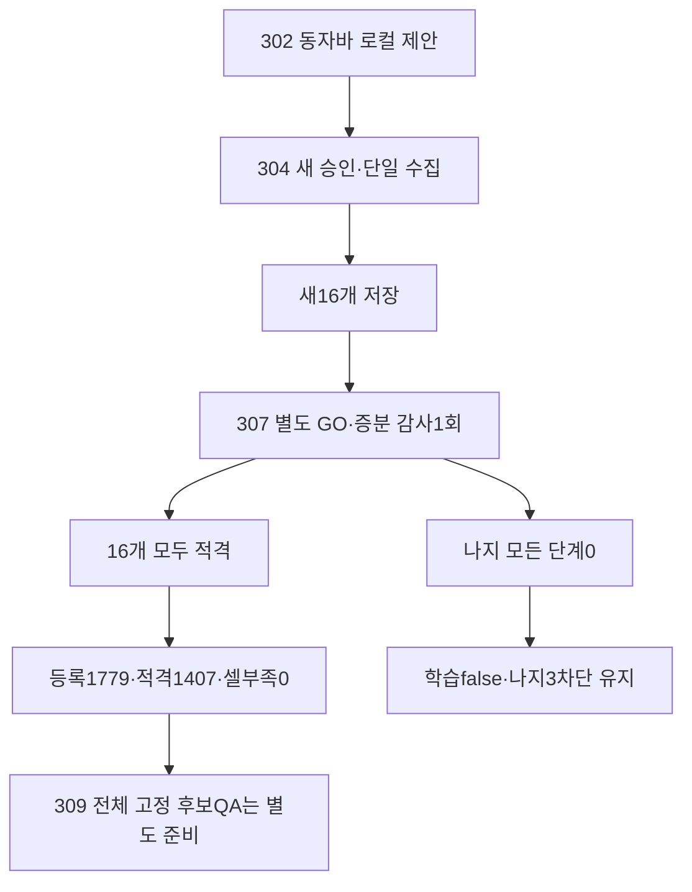

# 304·307 — 지역·연도 최소 수량 충족과 남은 학습 차단

- updated_at: 2026-10-18 KST,307 실제 완료 절 기준
- source_commit: 제품 변경 없음.304 승인·동결 runner와307 결과 지문 기준.
- evidence_paths: [307 완료 감사 문서](../implementation/307_post304_bounded_native_preparation.md), [실제 감사 JSON](../../evidence/integration/deficit304-native-root-20261018.json), SHA `7e933d923f6a7507a878f66bd7fea391b7b181779746f175567f0febdf8c884c`.
- confidence: 신규16개 실제 품질·출처·나지·정산·보존 검산은 확인. 전체 실물 재스캔·새 전체 후보QA·최신 화면·독립 정답은 이 단위에서 미검증.
- status: **VERIFIED_REAL — 새16/16적격·셀 최소수량 부족0**. **BLOCKED — 나지3차단/학습false**. **PLANNED —309 최종 고정 후보QA**, 별도 GO 전 실행0.

## 1. 쉬운 설명

**동자바2025의 마지막 수량 부족을 보완해 모든 지역·연도 칸이 최소 수량을 충족했다. 새16개 모두 적격이며 원본 적격은1,407개다. 나지는 추가0이므로 학습 준비 완료는 아니다.**

36개 칸에 필요한 최소 자료를 채운 이정표다. 마지막 동자바 칸에1개가 부족했지만 한 영상에서 나눈16개가 모두 품질 조건을 통과했다. 초과분은 보존한다. 필요한 칸이 찼다는 사실과 자료 종류가 균형 잡혔다는 사실은 다르다. 나지라는 종류의 부족과 독립 정답·모델 검증은 남았다.

## 2. 이론: 최소 수량과 학습 준비도는 서로 다른 문턱

전체 적격 목표1,200개, 지역·연도별 최소28개, 나지의 분할별0.5%·기여5개는 다른 조건이다. 이번에 충족한 것은 지역·연도 최소 수량이다. 나지가 없는 적격 자료가 늘면 일반 수량은 좋아져도 나지 비율은 개선되지 않는다.

파일 지문 검산은 같은 파일인지, 출처 검산은 저장 STAC→B02→부분 창이 연결되는지 확인한다. 약한 참조 라벨이 실제 정답인지나 모델 정확도를 입증하는 검사가 아니다. 새 증분의 native 검사와 전체 고정 cohortQA도 구분한다.

## 3. 동작 흐름

## 4. 코드·데이터가 한 일

307 담당은304 종료와 실제 정산·collector 부재·잠금 해제를 확인한 뒤 별도 Root GO를 받아 동결 증분 runner를 한 번 실행했다. 이전1,763행 prefix·history·pending2건을 원문과 대조하고 새16개에만 helper165를 호출했다. 이전 전체 래스터는 다시 감사하지 않았다.

선택 장면은 `S2C_MSIL2A_20250606T023551_R089_T49MFM_20250606T065914`, 원 datetime은 `2025-06-06T02:35:51.025000Z`다. 저장 STAC·scene·row에서 원문을 대조했다. `.025`를 반올림하거나246 strict 정책을 바꾸지 않았다. 선택 SCL 예비 유효율은100%로65% 문턱을 통과했다.

실제 source는 EPSG:32749,1024×1024,6band,10m,transform `[10,0,618880,0,-10,9146730]`이다. 고론탈로의 EPSG:32651을 그대로 쓰지 않았다. raw B02와 source 첫 band 배열,16개256 부분 창의 첫 band·CRS·window transform 일치를 로컬 bytes로 검산했다. 저장 metadata 일치는 원격 진실 인증이 아니며 전체20개 검색 feature를 재생한 것은 아니다.

## 5. 실제 증거와 시간·개수의 경계

| 항목 | 확인된 결과 |
|---|---|
|304 종료|22:24:54.378141 KST,exit0/424.657초|
|307 감사|session64841/PID43896,exit0/helper1회|
|새 패치/적격|16/16|
|새 래스터|image·label·quality 각16,합48개|
|helper SHA|52개 고유 파일,검산 실패0|
|추가 trace|21개 중16개 image는 helper와 중복|
|새 미참조 래스터|0|
|helper 시간|6.3469994초,전체 trace wall 아님|
|기존 prefix/history/pending|모두 exact 보존|
|원본·원장 두 읽기|driftfalse/false|

52+21을73개의 서로 다른 파일로 합산하지 않는다. 전체 감사 wall과 peak RSS는 따로 측정하지 않았다. 감사 종료와 collector 종료의 시간·PID를 섞지 않는다.

원본은 등록1,779행/적격1,407개/셀 부족0이다. 디스크 실물1,780개는 사전 검산1,764+새16의 추론이며 전체 실물 재스캔 수치가 아니다. 등록행과 실물 수를 같은 단위로 쓰지 않는다.

source SHA는 `0c149628ccfa916ee976e561c5da05f9ccc810cbeab7d233a05b9bc7eff54658`/69,564,847B,ledger SHA는 `d5ee31ff7970adaaa6b166805c240616efa8e9af713bb8394c7a166346f21c91`다. 승인 핀과 exact 대조했고 순차 읽기의 안정성을 확인했다. 원자적 DB snapshot을 증명한 것은 아니다.

## 6. 나지·예산·후속 QA와 화면

나지는 raw 정렬0→source quality0→final support0→eligible0,기여 패치0이었다. 이번 부분 창의 참조 라벨 범위 결과이며 동자바 전체에 나지가 없다는 판정은 아니다. 품질 부적격 나지를 적격 합계에 넣거나 새행을 가짜로 만들지 않았다.

COG22,478,848B+metadata367,038B=22,845,886B를 worker/state/ledger로 대조했다. 잔여1,799,757,940B이며 oldpending136,314,880B 전액을 보존했다. 예약68,157,440B는 실제 전송량이 아니다. finalize/settle/publish는 해당 key에서 각각1회였다. 기존 예산4GiB·물리3,000·2worker·2초/첫429·품질/split/support는 완화하지 않았다.

현재 게시 후보1,360개는 과거 source9d491 기준이다.297의 새15개와 이번16개는 그 QA 밖이다. 원본1,407에서 과거 제외16을 산술로 빼서 새 후보 성공값으로 발표하지 않는다.309는 최종 source 고정QA 준비이며 별도 GO 전 실제QA0이다. 새 후보QA·게시·명시 profile 재결속·API·실브라우저는 각각 완료 증거가 필요하다. [301/305 화면](297_299_GORONTALO2025_ACTUAL_COLLECTION.md#9-301-실제-api305-실제-화면과302-로컬-제안-후속)의1,391/부족1은 이전 완료 시점의 기록이며 이번 최신 화면으로 재사용하지 않는다.

이 단위는 내부 수집·감사여서 새 UI 코드가 필요한 기능 추가는 아니다. 최신 수량의 화면 반영은 후속 API·브라우저 확인으로 보고한다.307 감사 자체는 HTTP·추가 수집·운영 쓰기·학습·registry0이다.304의 실제 원격 수집과 구분한다. 이해 담당도 감사 JSON·완료 문서만 읽고 운영 원본·원장·배열을 추가 조회하거나 시험하지 않았다.

## 7. 발표 대본

### 1분

“동자바2025에서 새16개가 모두 실제 품질 적격으로 확인됐습니다. 원본 적격은1,407개이고 모든 지역·연도의 최소 수량 부족은0입니다. 다만 나지 추가는0이라 나지3차단과 학습 미승인은 유지합니다.52개 파일 SHA 검산과 출처·grid 일치를 확인했고 옛 pending 전액을 보존했습니다. 현재1,360개 후보는 과거 원본 기준이므로 최종 고정QA·게시·화면 반영은 별도 후속입니다.”

### 5분

“먼저 수량의 이정표입니다. 마지막 동자바2025 부족1개를 새16개 적격으로 채웠습니다. 지역·연도 최소28개라는 바닥 조건이 모두 충족됐습니다. 이것이 이번에 완료된 범위입니다.

다음은 실제 검사입니다.16개 부분 창의 이미지·라벨·품질 마스크와 저장 STAC에서 raw B02,source와 창의 첫 band·grid까지 대조했습니다.52개 고유 파일 SHA 검산이 통과했고 추가 trace21개 중16개는 같은 image여서 중복 합산하지 않았습니다. helper6.347초를 전체 감사 시간으로 말하지 않습니다.

나지는 raw부터 품질·support를 거친 뒤까지 모두0입니다. 일반 수량 충족과 종류의 균형은 다른 문제입니다. 나지0.5%·기여5개 및 독립 정답·과학 검증은 별도로 남습니다.

예산은 실제22,845,886바이트를 정산해 잔여1,799,757,940바이트이며 옛 pending은 보존했습니다. 새 자료31개를 과거1,360개 후보에 자동 합산하지 않습니다.309는 최종 고정QA 준비이며 게시·API·브라우저까지 각 실제 완료 근거로 이어 보고합니다.”

### 10분 구성

1. 0–2분:36개 칸의 최소 수량 충족과 전체 프로젝트 완료의 차이.
2. 2–4분:16개 실제 품질·STAC/B02/부분 창 출처·grid 검산.
3. 4–6분:52SHA/21trace 중복과 helper/전체 wall·실물 추론 구분.
4. 6–8분:나지 단계별0·미승인·독립 정답의 남은 조건.
5. 8–10분:정산·옛 pending 보존·309 준비와 게시/API/화면 후속.

## 8. FAQ

**Q.셀 부족0이면 학습을 시작하나요?** 최소 수량 조건만 충족했습니다. 나지3차단·최종QA·독립 정답·학습 승인 조건은 별개입니다.

**Q.새16개가 모두 적격이면 나지도 늘었나요?** 이번 검사에서 나지는 모든 단계0입니다. 영상 품질과 나지 포함 여부는 다른 지표입니다.

**Q.실물1,780개도 전수 검사했나요?** 사전1,764+신규16의 추론입니다. 이번 감사는 새16개 범위이며 전체 재스캔은 하지 않았습니다.

**Q.이제 화면도1,407/부족0인가요?** 이 단위의 실제 화면 확인은 아직 없습니다. 이전 화면1,391/부족1을 최신 관측으로 재사용하지 않습니다.

**Q.다음 QA는 이미 통과했나요?**309는 준비 단계입니다. 실제 결과가 나오기 전 후보 수·분할·학습 준비도를 확정하지 않습니다.
