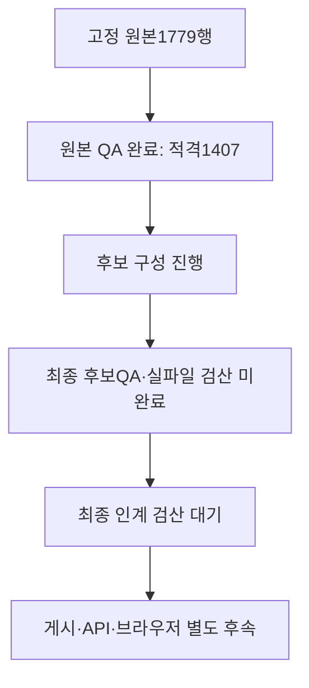

# 309 — 최종 고정 후보1,391개 QA·인계 완료

- updated_at: 2026-10-18 23:08:41 KST,315 실제 브라우저 완료 후속 기준.
- source_commit: 신규 제품 구현 없음.309 준비 runner·기존164/profile16코드의 동결 지문 기준.
- evidence_paths: [309 준비·시작 계약](../implementation/309_post304_candidate_qa_preparation.md), [311 독립 정적 검토](../implementation/311_post304_candidate_qa_static_review.md), Root의 원본QA 완료 인계. 운영 파일·부분 QA 산출물은 읽지 않았다.
- confidence: 완료 summary·terminal·handoff와 구현 문서에서 후보 수·파일 지문·분할·gate·누적 계측을 확인했다. 최대128 성능·독립 정답·학습 승인·후속 게시/API/UI는 이 완료 범위 밖이다.
- status: **VERIFIED_REAL — 최종 후보QA·metadata 인계 완료**. **BLOCKED — 나지3차단/학습false**.312 게시·313 실제 API는11절에서 완료.315 실제 브라우저도12절에서 완료 확인. 이후320/322 나지 검토 게시·API는 별도 해설을 참조한다. 아래1–6절은 사전 구조 당시 기록이며 현재 실제 결과는7절부터 확인한다.

## 1. 쉬운 설명

지역·연도별 최소 수량을 채운 원본1,779행/적격1,407개의 QA가314.125초에 완료됐다고 Root가 인계했다. 지금은 그 원본에서 별도 후보를 만드는 단계다. 최종 후보QA·실파일 검산·summary/terminal·게시·API·실제 화면 확인은 아직 끝났다고 말할 수 없다.

재료 창고의 점검이 끝났어도 실제 수업용 목록의 중복 제거와 최종 검사가 남아 있는 상황이다. 현재 게시 후보1,360개는 과거 source9d491 기준이며 새 원본과 시점 불일치 상태다. 원본1,407에서 과거 제외량을 빼서 새 후보 성공값을 계산하지 않는다.

## 2. 이론적 배경 — 수량 충족과 학습 승인을 분리

셀 부족0은 지역·연도 최소 수량 조건의 충족이다. 나지 비율·기여 수·독립 정답·과학적 검증·최종 후보QA·학습 승인은 각각 다른 조건이다.304 증분의 나지 추가는0이었다. 이번 최종 gate는 실제 완료 결과로 확인해야 하며 미리 통과나 미달 건수를 새 관측값으로 확정하지 않는다.

## 3. 준비 코드 흐름과 현재 위치

309 준비 계약은 기존290의 단1 CLI 호출과 같은 명시 `bounded128m-3000-v1`을 유지한다. source/candidate128MiB,scene+history3,000행,depth32,node4,000,000,누적 JSON I/O16GiB와 작은 역할별 cap을 유지한다.128MiB는 최대 RAM·RSS·시간 보장이 아니다. 원장 준비 지문은 provenance이며 새 QA 입력으로 추가하지 않는다.

311 정적 검토는6개 준비 파일의 지문과16제품 지문의 일치, 단1 CLI callsite·동일 scope·GO·부분 보존·재시도 금지·기존1,360 pointer 보호를 읽어 추가 실행 차단을 발견하지 못했다. 정적 검토 자체가 실제 QA 성공이나 실행 허가는 아니다.

## 4. 현재 증거 표

| 단계 | 현재 확인 범위 |
|---|---|
|고정 원본|1,779행/적격1,407·셀 부족0, source0c149 기준|
|원본QA|Root 인계:314.125초 완료|
|후보 구성|진행 중, 최종 수·분할·제외량 미확정|
|후보QA·실파일 SHA|최종 완료 근거 미확보|
|summary·terminal·인계 proof|최종 근거 미확보|
|게시 pointer|기존1,360 유지/과거 source9d 기준|
|새 게시·API·브라우저|미완료, 별도 후속 필요|
|학습·모델 승인|없음|

시작은22:36:14.301 KST/PID24432/session96526, snapshot 고정은22:36:45.719399 KST라는 준비문서의 실제 시작 기록을 참고한다. 이는 현재 프로세스의 생존 여부를 새로 관측한 값이 아니다. 이 문서 작성자는 OS·운영 source/ledger/pointer·부분 산출물을 추가 읽지 않았다.

## 5. 최종 갱신 체크리스트

- [ ] 최종 summary/terminal·완료 문서·freeze를 Root에게 받아 exit와 실제 완료 시점을 확인한다.
- [ ] 원본/후보 등록행·적격·split·제외량·동일scene/partition·원본 보존을 이번 실제 값으로 기록한다.
- [ ] 실파일 SHA 기록 수·불일치·11출력핀·v2영수증3개·marker를 실제 완료 근거에서 확인한다. 이전290 수치를 새 값으로 복사하지 않는다.
- [ ] 나지 픽셀·분모·비율·기여 수·blocker·ready/scientific/training 및 connectivity를 관측값으로 기입한다.
- [ ] 전체 wall·원본/후보QA 함수 시간·누적 JSON I/O·RSS 관측 유무를 구분한다.
- [ ] 기존1,360 pointer 보존과 최종 인계 검산 시점을 확인한다. 이후 의도된 게시 변경과 구별한다.
- [ ] 새 게시·profile 재결속·API·브라우저 완료를 각각 받은 뒤 별도 시간순 후속 절에 추가한다.
- [ ] 쉬운 설명·최종 도식·1/5/10분 대본·FAQ·INDEX/이력을 실제 완료 범위에 맞춰 마감한다.

## 6. 임시 발표 문장과 FAQ

“모든 지역·연도 최소 수량을 충족한 원본의 QA는 완료됐고 적격1,407개입니다. 현재 후보 구성·최종 검증은 진행 단계라 후보 수나 학습 승인을 확정하지 않습니다. 게시1,360개는 과거 원본의 검증 결과로 보존하며 새 결과·게시·API·화면을 순서대로 확인하겠습니다.”

**Q.원본QA가 끝났으면 후보도 통과했나요?** 후보 구성·누출 제거·최종QA·인계 검산은 별도 단계입니다. 아직 최종 결과가 없습니다.

**Q.셀 부족0이면 왜 기다리나요?** 수량은 채웠지만 클래스 대표성·최종 후보 검증과 학습 승인 조건은 다른 문제입니다.

**Q.새 후보 수를 예상해도 되나요?** 발표에서는 확정하지 않습니다. 이번 실제 제외·분할·QA 결과를 받아 기록합니다.

이 단위는 완료 전 문서 구조 준비뿐이다. 제품·UI·운영 원본·원장·CONT 변경,HTTP·collector·native·시험·추가QA 실행0이다. INDEX는 최종 완료 근거 전 별도 갱신하지 않아 기존 완료 해설의 현재 범위를 보존한다.

## 7. 실제 최종 완료 — 원본1,407→후보1,391

[최종 summary](../../evidence/integration/priority164-guarded309-20261018/summary.json), [인계 검산](../../evidence/integration/priority164-guarded309-20261018/handoff-verification.json), [terminal](../../evidence/integration/priority309-terminal-20261018.json)과309 완료 문서를 읽었다. 사전 미확정 기록을 지우거나 미래 실행으로 소급하지 않고 실제 완료를 추가한다. 위 체크리스트 중 QA·인계 항목은 아래 근거로 확인했으며 게시/API/브라우저 항목은 남아 있다.

| 범위 | 등록행 | history | train적격 | val적격 | test적격 | 적격합계 |
|---|---:|---:|---:|---:|---:|---:|
|고정 원본|1,779|0|865|292|250|1,407|
|최종 고정 후보|1,763|0|865|276|250|1,391|

같은 scene `S2A_MSIL2A_20210812T025551_R032_T48MXT_20210812T132431`이 banten/west_java의 split을 넘었다. test를 유지하고 val의 source index288–303 총16행을 **후보에서만** 제외했다.16개의 별개 scene을 삭제한 작업이 아니다. 원본·운영split·모델은 보존했고 후보의 source identity conflict는0이다. 기존 게시1,360과 비교해 후보 적격31개가 늘었으며297의15+304의16개를 반영한다.

원본4차단 중 출처 중복1건은 후보에서 제거됐지만 나지 대표성3건은 남았다. 원본 등록행1,779와 후보 적격1,391을 같은 단위로 비교하거나 원본을 삭제했다고 설명하지 않는다.

## 8. 실제 시험·계측·보존 증거

단1 runner PID24432/session96526이 exit0으로 종료했다. terminal은23:03:02.849132 KST, metadata 인계는23:04:01.049395 KST다. whole wall1,608.765초(약26분49초), 원본QA314.125초, 후보QA 함수343.078초를 분리한다. 후보 함수에는 입력 증거 검산도 포함돼 순수 래스터 처리 시간은 아니다. 프로파일링 없이 특정 지연 원인을 단정하지 않았고 자동 재시작·상한 확대·추가 동일QA0이다.

기존164 CLI가 실제 파일5,526기록의 SHA를 재검산해 불일치0이었다. 이어 metadata checker1회가 출력11핀 불일치0·schema2 영수증3개·정확128 marker·완전 partition·exact retained rows·lineage/history를 확인했다. 인계 검산을 같은 래스터QA 반복으로 합산하지 않는다. checker의 receipt 읽기 expectedpin 누락은 실행 전에 Root가 발견해 원바이트 archive 후 한 줄 보완했고 최종판만 실행했다. QA 제품·runner 변경은0이다.

source69,564,847B와 후보68,943,578B는 둘 다 default64MiB를 넘는다. 승인된 명시128 profile을 동일하게 유지했으며 자동 선택·제한 상향은 없었다. QA+handoff/proof의 누적 JSON I/O는5,076,287,859B로16GiB(17,179,869,184B) 이내다. 후검산은 기존 사용량을 이어 받아 잔여 범위에서 읽고 썼다. 문서·완료freeze는 계측 종료 뒤 행정 산출물이며 이 수치에 포함한다고 주장하지 않는다. 후속 게시/API의 별도 scope와도 합치지 않는다.

인계 당시 원본source0c149·정책01991·원장d5ee와 기존1,360 pointer/receipt293의996a 지문 보존을 확인했다. 이후 Root312가 의도적으로 게시하는 변경까지 불변이라고 주장하지 않는다. OS PeakWorkingSet 최댓값 표본1,332,064,256B는 Windows 표본일 뿐 최종peak/RSS 보장이 아니며 wrapper `rss_observed=false`를 유지한다.

핵심 지문은 summary `1359667f4ef2316b8bfffc52a939cd626ca6b87be10139ec192c0abe5b47ec3b`, handoff `8c02c1831358e684c6788a8820e79173464a0f47d3d860199ec5b1a97f8831f1`, terminal `f5fa44070eeb071c7c5cb1105908dd6d6110e335ccda9cab58b47a97957b8a30`다.

## 9. 최소수량 충족 뒤에도 나지·학습은 미완료

| split | 유효 참조 픽셀 | 나지 픽셀 | 나지 비율(%) | 기여패치/최소5 |
|---|---:|---:|---:|---:|
|train|55,132,456|2,562|0.0046469905|1/5|
|val|17,776,457|2,998|0.0168650030|2/5|
|test|16,252,940|1,025|0.0063065513|0/5|

나지 픽셀·기여 수는290과 같다. 일반 train 적격은 늘었지만 나지가 늘지 않아 분모 증가로 train 비율이0.0048232215%→0.0046469905%로 낮아졌다. 각 split의0.5%와 기여5개에 못 미쳐 `REFERENCE_CLASS_IMBALANCE`3건이 남았다. test 합계1,025픽셀/기여0은 패치별256픽셀 인정 조건과 전체 합계의 차이다.

`ready_for_training`·`observed_gate_ready_for_training`·`scientific_accuracy_validated`·`training_executed`는false, registry/HTTP0이다. connectivity는 `NOT_CAPTURED_BUDGET`으로 전체 연결성 완료를 주장하지 않는다. 약한 참조 라벨 검사는 독립 정답·과학적 정확도·다른 모델 준비를 대신하지 않는다.

312 현재 게시·313 profile/API·315 실제 브라우저는 이 문서 작성 시 미완료다. QA 완료가 새 후보의 실화면 반영을 뜻하지 않는다. 내부 QA로 UI 제품 변경은 필요하지 않으며 게시/API/화면은 별도 완료 근거로 연결한다. 이해 담당은 완료 산출물만 읽었고 추가 운영원본·원장·pointer 조회·HTTP·QA·시험·CONT 편집0이다.

## 10. 완료판 발표 대본과 FAQ

### 1분

“모든 지역·연도 최소 수량을 채운 원본1,407개에서 동일 scene의16행을 후보에서만 제외해 새1,391개 후보 검증을 끝냈습니다. 원본은 보존했고5,526파일 SHA 불일치는0입니다. 기존 후보보다31개 늘었지만 나지는 늘지 않아 세 split의 대표성 차단과 학습false가 유지됩니다. 게시·API·실제 화면은 별도 후속 근거를 기다립니다.”

### 5분

“먼저 이번에 끝난 것은 최종 고정 cohortQA와 인계 검산입니다. 원본1,779행 중 적격1,407개이며 후보는1,763행/적격1,391개입니다. 같은 scene이 split 경계를 넘는16행은 후보에서만 제외했고 test와 원본을 유지했습니다. 출처 충돌은0입니다.

기존1,360개보다31개 늘어난 후보는 고론과 동자바의 새 적격15+16을 포함합니다. 이 숫자는 실제 QA 결과이며 사전 산술 예상으로 승인한 값이 아닙니다.5,526파일 SHA와11출력핀·3영수증·정확한 행 분할/lineage/history를 검산했습니다.

전체 실행은 약26분49초이며 원본과 후보 함수 시간은314초와343초입니다. 같은 명시128 profile로 두64MiB 초과 파일과 누적16GiB JSON 제한을 유지했습니다. 이번 실행이 최대128 입력 성능이나 RAM 보장은 아닙니다.

끝으로 수량 충족과 나지는 다릅니다. 나지 기여는1/2/0으로 여전히5개씩에 못 미치고 비율도0.5% 미달입니다. 학습false와3차단을 유지합니다. 게시·API·실브라우저는 각 실제 완료 뒤 시간순으로 인계하겠습니다.”

### 10분 구성

1. 0–2분: 원본1,407/후보1,391·최소수량0부족의 의미.
2. 2–4분: 같은scene16행 후보 제외·원본 보존·충돌0.
3. 4–6분: 파일SHA와metadata 인계·시간/계측/명시128의 경계.
4. 6–8분: 나지 표·분모 증가·3차단/false의 이유.
5. 8–10분: 게시/API/화면 별도 단계와 전체 개발 미완료.

**Q.최종 후보는 이제 몇 개인가요?** 실제 QA 결과1,391개(865/276/250)입니다. 새 게시·화면 완료와는 별개입니다.

**Q.최소수량을 다 채웠는데 왜 학습false인가요?** 나지 비율·기여 수 기준이 세 split 모두 미달이며 독립 정답·과학적 승인도 별도입니다.

**Q.5,526파일 SHA가 맞으면 정확도도 입증됐나요?** 고정 파일의 일치를 확인한 결과입니다. 라벨의 독립 정답이나 모델 정확도를 입증하지 않습니다.

**Q.위의 미완료·체크리스트는 오류인가요?** 사전 준비 당시의 상태를 보존한 기록입니다. 현재 완료 범위는7–10절이며 게시/API/브라우저는 여전히 별도 대기입니다.

## 11. 312 실제 게시·313 명시 재결속과 API 완료

[312 완료 문서](../implementation/312_post309_candidate_publication_preparation.md)와 [실제 publication](../../evidence/integration/priority312-publication-root-20261018.json)을 확인했다. Root가309 최종QA·인계 지문과314 독립검토, 운영 배타성을 확인한 뒤 단1 승계해23:06:11.607432 KST에 exit0으로 완료했다. 기존1,360 pointer는 원바이트 archive했고 새1,391(865/276/250) pointer SHA는 `25d7bf6d37a7c96ab6a9eaa2a74e78b94f52e8186b22a8ac705184ff96b5832e`다.

게시 reader는 현재 source0c149 일치·availabletrue·충돌0·3차단·readyfalse를 확인했다. 정확 retained rows/partition·11출력핀·3v2 receipt와 교체 직전 재핀·동일128 scope를 유지했다. 게시작업 JSON I/O840,543,869B는 최종 결과 쓰기 전의 별도 scope 수치다.309 QA+인계5,076,287,859B와 섞어 단일 실행의 누적값으로 보고하지 않는다. 원본/원장·학습·registry는 변경하지 않았다. publication SHA는 `ae247af18730fc9d391b8c5730d5db5c72772b1545d2b5112a8aa6f1a7bf0356`다.

[313 완료 문서](../implementation/313_post309_source_profile_preparation.md), [selection](../../evidence/integration/profile313-selection-root-20261018.json), [실제 API 검산](../../evidence/integration/profile313-api-checks-root-20261018.json)은 별도 단계다. old profile b9a2는 원바이트 보존하고 같은 descriptor에서 source9e635→현재0c149로만 명시 결속했다. 새 config SHA는 `e63f89cae95c33bad9f5195e9750b684232ee89a895309d591668e7519767a68`다. 파일 크기에 따른 자동 profile 상향이나 원격 예산 증액이 아니다.

단1 실제 GET200/32.657초·11검사 true였으며 재고23:07:16.963124,예산23:07:18.670589 KST를 분리한다. 원본 적격1,407/셀 부족0, 후보1,391/current source 일치/3차단false를 확인했다. 나지50만 과거 원본 검토이므로 시점 경고·미검사·집행 미승인이 남는다. 잔여1,799,757,940B·oldpending136,314,880B의 사용액 포함·운영4핀/config 보존을 확인했다. 같은 QA·native 반복·서버 재시작·제품 변경0이다. 단일32.657초를 SLA·최대128 성능으로 확대하지 않는다.

현재 후보는1,391개다.1,348과1,360은 보존된 과거 cohort/receipt의 수량이며 현재 후보로 읽지 않는다. **현재 완료는 QA→게시→실제 API이고315 실제 브라우저는 아직 별도 대기다.** API 응답 성공을 화면 확인으로 바꾸지 않는다. 나지3차단·학습false와 전체 개발 미완료는 유지한다.

### 후속 발표 문장과 FAQ

“최종QA 뒤 정확한 행·지문·영수증을 확인하고 과거1,360개를 보존해 현재1,391개 후보로 게시했습니다. 실제 API도 현재 원본과 일치함을 확인했습니다. 원본1,407개와 후보1,391개는 같은 장면16행의 후보 제외 때문에 다릅니다. 나지3차단은 그대로이며 실제 화면은 별도 확인을 기다립니다.”

**Q.현재 후보는1,360인가요1,391인가요?**312의 실제 게시 뒤 현재는1,391입니다. 이전1,360은 원바이트 보존한 과거 기록입니다.

**Q.원본과 일치하면 학습 가능한가요?** 같은 검증 원본이라는 뜻입니다. 나지 대표성3건과 학습false는 별개로 남습니다.

**Q.실제 화면도 확인됐나요?**313은 실제 API 완료입니다.315 브라우저 완료 증거 전에는 화면 확인을 주장하지 않습니다.

## 12. 315 실제 브라우저 완료와 이후 나지 검토의 시점

[315 완료 문서](../implementation/315_post309_final_candidate_browser_verification.md), [실제 UI 영수증](../../evidence/integration/service315-post309-final-ui-20261018.json), [checks](../../evidence/integration/service315-post309-final-ui-20261018-checks.json), [DOM](../../evidence/integration/service315-post309-final-ui-20261018.dom.txt), [저장 PNG](../../evidence/integration/service315-post309-final-ui-20261018.png)를 확인했다. 완료 문서SHA는 `26c84ac196ea820e1548ae074b7d88beaa4d30e3ff34e1d76cc44befbdecdd56`, UI 영수증SHA는 `e129f5026acd84e145540609f234b3a8d0573489e97a84f7b18bc8ac3646348e`다.309 완료 문서SHA `0f7985ee1f02aca037b9439446abcedab7ed0b0075b484abbd9a7aa10dd5435f`, 완료freeze SHA `2b9693b41e4e800f18067ab814b2a0c6868afb6a7da6814657a337f9413de836`도Root가 인계한 완료판 식별값으로 기록한다.

실제 재고 응답23:08:40.311442,예산23:08:41.325020 KST를313 API23:07과 구분한다. 화면은 등록1,779/적격1,407·셀 부족0, 후보1,391(865/276/250)·현재source0c149 일치/후보 경고 해제·나지3차단/학습false를 표시했다. 당시 나지50만 old9c24 기준 시점 경고·미검사·집행 미승인이 남았다. 화면의 물리 패치1,779는 manifest 등록행 표시이며 실물 전수 재스캔이 아니다.

잔여1,799,757,940B·oldpending136,314,880B 사용액 포함·실프로세스UNKNOWN을 확인했다.16개 checks 모두true,콘솔warn/error0,document/body1,573≤viewport1,588로 가로 넘침false다. 기존 탭의 새로 조회1회·수동GET/새탭/restart0이다. fullPage 캡처는5,000ms timeout을 보존했고 조회·입력을 반복하지 않은 viewport 캡처에 성공했다. 저장 PNG를 직접 확인했다. 이 관측을 전체 과거 로그·모바일·SLA 검증으로 확대하지 않는다.

따라서 **309 QA→312 게시→313 API→315 실제 브라우저는 모두 VERIFIED_REAL**이다. 학습은 나지3차단으로 계속false다. 이후 나지50의 현시점 재검토·320 게시·322 API는 [316 별도 해설](316_CURRENT_BARE_REVIEW_AND_TARGET_PROFILE.md)에 이어 기록한다.315 당시의 old나지 경고를 이후 최신API 상태로 재사용하지 않는다.323 최신 나지 게시 브라우저 확인은 이 문서 작성 시 아직 별도 대기다.

발표에는 다음을 덧붙인다. “실제 화면에서도 현재 원본1,407개와 고정 후보1,391개·출처 일치를 확인했습니다. 최소 수량은 충족했지만 나지3차단과 학습 미승인은 그대로입니다. 이후 최신 나지 검토 게시·API는 별도 근거로 확인했으며 원격 품질·집행 승인은 생기지 않았습니다.”

**Q.최종 후보의 실제 화면 확인도 끝났나요?**315에서 끝났습니다. 이후 나지 검토를 새로 게시한 화면의323 검증과는 다른 시점입니다.

**Q.스크린샷 timeout이면 화면 검증 실패인가요?**조회는 완료됐고 DOM·16checks가 있습니다. 전체페이지 캡처 실패를 보존하고 조회 재시도 없이 viewport 캡처로 마감했습니다.

323 후속: 최신 나지50 게시의 실제 브라우저도 완료됐다. [316 해설9절](316_CURRENT_BARE_REVIEW_AND_TARGET_PROFILE.md#9-323-실제-화면-완료와324-순수계약-정적검토)에23:29재고/예산·검토23:14시점 분리와경고해제/미검사·집행미승인 유지·64cap연결BLOCKED를 기록했다. 위315/322 당시 대기 설명은 각 관측시점의 역사다.
