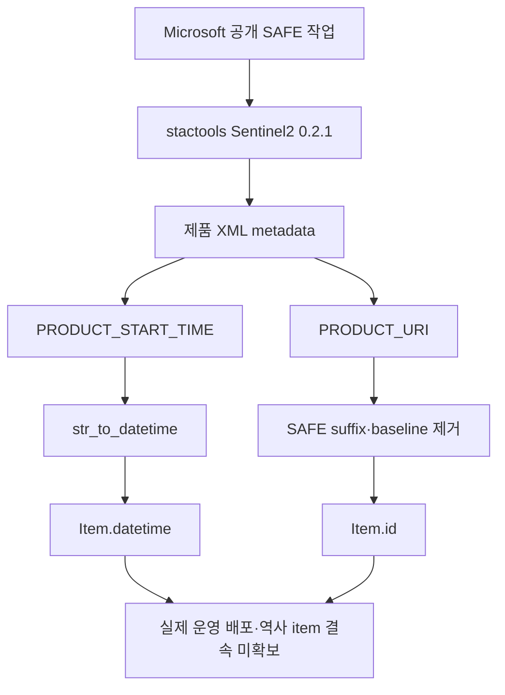

# 310 — 장면 이름과 STAC 원문 시각의 출처 구분

- updated_at: 2026-10-18 KST, 완료310 조사 문서 기준
- source_commit: 제품 변경 없음. 조사한 stactools v0.2.1 commit은 `d8200c120491eeffbf5772dbf8b444b0c958ca1f`. Microsoft main의 commit 고정판은 미확보.
- evidence_paths: [310 완료 조사](../implementation/310_pc_datetime_producer_evidence_review.md), SHA `28507a92a0eb3547ed1bcdedc64563e4bdcb28ec69ae02f156906808fe1b4442`.
- confidence: 공개 생성 코드의 원필드 연결은 확인. 실제 PC 배포·역사 item 동일성과 보편적 동일 초 보장은 미확보.
- status: **VERIFIED_REAL_DOCUMENTARY — 공개 생성 경로 조사 완료**. **BLOCKED — 현재 운영 동일성·같은 calendar-second 보장 미확보**. **PLANNED — SURVEY v2 계약·실행 연결**.

## 1. 쉬운 설명

**공개 producer는 STAC 시각을 제품 XML의 PRODUCT_START_TIME에서 읽고, 장면 ID는 PRODUCT_URI에서 따로 만든다. 이름 속 시각으로 원문 시각을 대체하지 않는다.**

상품 이름과 상세 기록에 각각 적힌 시각을 따로 보존하는 상황과 같다. 공개 제작 설명서에서 두 칸의 작성 방법을 찾았지만, 현재 모든 상품이 그 판본으로 만들어졌는지는 아직 확인하지 못했다. 공개 코드 확인은 공급자 운영 인증이 아니다.

원문에 `.024000Z`가 있으면 이를 지우거나 반올림해 기존 gate를 통과시키지 않는다. 소수초가 있다는 사실과 이름·원문이 서로 다른 초를 가리킨다는 사실은 별개다. 이번 조사로 특정 PC item에서 서로 다른 초가 발생했다고 입증한 것은 아니다.

## 2. 이론적 배경

ID는 식별자이고 datetime은 별도 metadata다. 날짜 문법이 맞거나 두 값이 비슷해 보여도 같은 원필드·같은 물리적 사건이라는 보장은 아니다. 공개 코드 버전, 실제 배포 버전, 과거 ingest와 후처리도 구분한다.

같은 calendar-second는 UTC 날짜·시·분·초가 같은 관계다. 이를 새 정책의 보편 허용 조건으로 채택하려면 공급자 의미 계약과 실자료 결속이 필요하다. 소수초 허용이나 임의 허용 오차를 이번 문서로 승인하지 않는다.

## 3. 확인한 코드 흐름

310 담당은 Microsoft requirements의0.2.1 선언, Dockerfile 설치, sentinel2.py의 SAFE metadata→create_item 호출을 이어 읽었다. 공개 함수 안에서 datetime 재지정은 없었으나 함수 밖 후처리·backfill 여부는 미확인이다.

고정0.2.1 stac.py는 product_metadata.datetime을 Item 시각으로 사용한다. product_metadata.py는 General_Info/Product_Info의 PRODUCT_START_TIME을 파싱한다. ID는 PRODUCT_URI에서 별도로 만든다. 두 입력이 같은 초인지 검사하거나 이름으로 datetime을 잘라내는 경로를 확인한 것은 아니다.

이 SAFE 경로를 granule tile sensing timestamp 경로라고 설명하지 않는다. 최신 main의 다른 입력 분기를 과거0.2.1에 소급하지 않는다. datetime 객체 파싱이 있으므로 `.024Z`와 `.024000Z` 같은 직렬화 자릿수까지 원문 그대로 보존됐다고 주장하지 않는다. 실제 공급자 응답 문자열과 bytes SHA를 별도로 보존해야 한다.

## 4. 증거와 검증 범위

| 근거 | 확인한 범위 | 미확보 범위 |
|---|---|---|
|공개 requirements/Dockerfile|의존성·빌드 레시피 연결|운영 이미지 digest·역사 ingest 판본|
|고정0.2.1 두 소스|PRODUCT_START_TIME→datetime, PRODUCT_URI→ID|모든 PC item의 동일 생성 경로|
|SentiWiki compact naming|첫 날짜의 datatake start sensing 의미|특정 tile/pixel 시각과의 동일성|
|일반 STAC 날짜 설명|RFC3339·명목 capture datetime 표현|PC 원필드와 이름의 동일 초 계약|
|공개 extension 예제|0이 아닌 소수초 표기 존재|현재 endpoint·프로젝트249 item 인증|

공개 예제는 mutable main이며 PC endpoint 관측이 아니다. 예제 한 건이 같은 초라고 전체 PC item의 동일 초를 보장하지 않는다. 이름의 두 번째 날짜도 별도 discriminator이며 물리적 제작 완료 순서로 덧해석하지 않는다.

이번 단위는 문서·코드 조사다. 합성 시험·실서비스/API/UI 시험은 실행하지 않았으므로 PASS 수치를 만들지 않는다. PC catalog/data/COG HTTP0, 운영 source/ledger/model 읽기·복사0, native·전체 QA·collector/SURVEY0, 제품 변경0이다. 이해 담당도 완료 문서만 읽었다.

## 5. 한계와 후속 계약

기존226/246 v1/default와260 정책은 변경0이다.289 명시 v2 schema/marker·runner·원장 예약·소비 연결은 PLANNED다. 이번 문서로 gate·집행 차단을 해제하지 않으며 실제 나지·영상품질·독립 정답·학습 승인 성과0이다.

다음에는 실제 ingest commit/container digest·의존성·후처리 근거가 필요하다. 별도 승인 범위에서 동일 item의 원문 STAC와 제품 XML PRODUCT_START_TIME/PRODUCT_URI·granule metadata를 각각 고정해야 한다. 실자료 몇 건의 관계와 공급자의 일반 보장을 분리한 뒤 새 정책·경계 시험을 설계한다. 이번 작업은 그 원격 취득을 하지 않았다.

UI/API 행위가 바뀌지 않아 화면 연결·서버 재시작은 필요하지 않다.304 수집·감사 결과는 이 조사 해설에 포함하지 않는다.

## 6. 발표 대본

### 1분

“공개 producer의 시각 생성 경로를 조사했습니다. 제품 XML의 PRODUCT_START_TIME은 datetime으로, PRODUCT_URI는 ID로 각각 연결됩니다. 이름 시각으로 원문을 덮어쓰지 않습니다. 다만 현재 PC 배포와 과거 특정 item이 같은 코드로 만들어졌다는 결속, 언제나 같은 초라는 보장은 아직 없습니다. 기존 gate와 수집은 바꾸지 않았고 SURVEY v2 운영은 차단 상태입니다.”

### 5분

“먼저 두 시각을 나눕니다. 상품 이름과 상세 기록처럼 ID와 datetime은 서로 다른 출처에서 올 수 있습니다. Microsoft 공개 작업과 고정0.2.1 소스를 연결해 XML 원필드를 찾았습니다. 이것이 이번의 확인된 성과입니다.

그러나 공개 Dockerfile은 운영 이미지 digest가 아니고 과거 item의 재처리 이력도 아닙니다. 최신 다른 입력 분기의 시각 의미를 과거 SAFE 경로에 섞지 않았습니다.

공개 예제에는 .024000Z가 있습니다. 소수초를 삭제하거나 반올림하지 않습니다. 소수초 존재가 서로 다른 초의 실제 발생을 입증하지도, 예제 한 건의 같은 초가 모든 item을 보장하지도 않습니다.

다음에는 공급자 배포 근거와 동일 item의 XML·원문 STAC를 고정해 관계를 확인해야 합니다. 그 뒤 명시 v2 정책과 시험을 설계할 수 있습니다. 현재 기존 v1·제품·UI·수집·예산은 변경하지 않았고 나지 성과나 학습 승인을 추가하지 않습니다.”

### 10분 구성

1. 0–2분: 이름과 상세 기록의 비유, 두 필드 분리.
2. 2–4분: 공개 작업→0.2.1→XML→Item 두 경로 도식.
3. 4–6분: 소수초·표기·같은 초·물리적 취득시각 구분.
4. 6–8분: 고정 소스·실제 배포·역사 item 결속의 증거 단계.
5. 8–10분: 후속 증거와 v2 PLANNED·기존 변경0 설명.

## 7. FAQ

**Q.원필드를 찾았으니 운영 의미도 확정됐나요?** 공개0.2.1 SAFE 경로는 확인했지만 실제 배포와 역사 item의 결속은 미확보입니다.

**Q.소수초를 지우면 되나요?** 원문을 변형해 기존 검증을 통과시키지 않습니다. 보존된 원문과 명시 새 계약이 필요합니다.

**Q.초까지만 맞으면 충분한가요?** 보편 조건으로 채택할 공급자 보장은 아직 없습니다.

**Q.실제 PC item에서 다른 초가 확인됐나요?** 이번 조사에서는 입증하지 않았습니다. 소수초 존재와 다른 초 발생은 별개입니다.

**Q.이제 나지 수집이 가능한가요?** 실행 연결·예약·수집 권한을 만든 일이 아닙니다. SURVEY v2 운영 차단은 유지됩니다.
