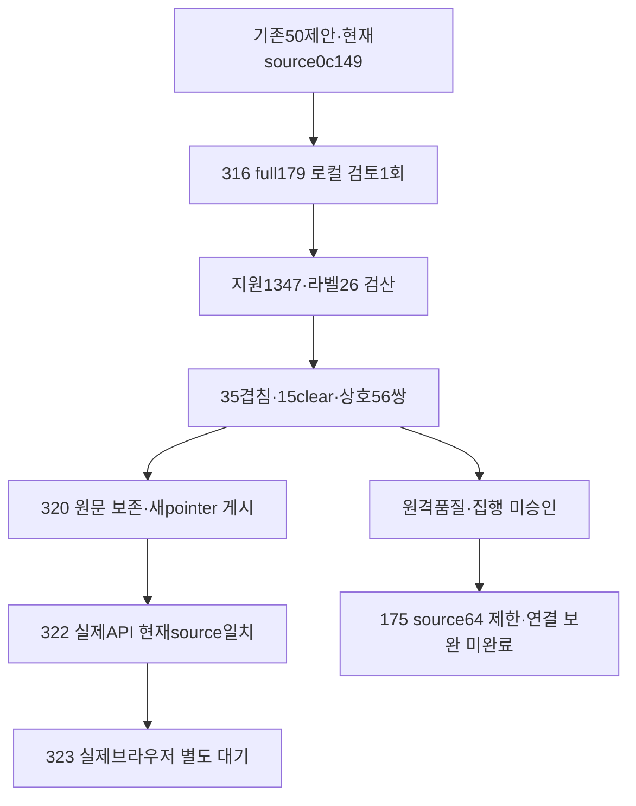

# 316·320·322 — 현재 나지 후보 로컬 검토와 남은 집행 차단

- updated_at: 2026-10-18 23:29:39 KST,323 실제 브라우저 후속 기준
- source_commit:316/320/322는 동결 실행·게시 근거 기준.319는 별도 격리 구현이며 공유 main 적용0.
- evidence_paths: [316 완료](../implementation/316_post309_bare_overlap_review_preparation.md), [검토 결과](../../evidence/integration/bare316-result-root-20261018.json), [보고서](../../evidence/integration/bare316-report-root-20261018.json), [317 차단](../implementation/317_bare316_independent_static_review.md), [318 설계](../implementation/318_target256_explicit_source_profile_design.md), [319 격리 계약](../implementation/319_pure_target_source_profile_isolated.md), [320 게시](../implementation/320_current_bare_review_publication_preparation.md), [322 API](../implementation/322_post320_bare_review_api_preparation.md)
- confidence: 현재 원본의 로컬 라벨·지원 겹침 검토와 게시 reader·실API는 실제 근거 확인. 원격 품질·실취득·집행·학습은 미승인.
- status: **VERIFIED_REAL — 로컬 검토·안전 게시·실API 완료**. **TESTED_SYNTHETIC —319 순수 계약27시험**. **BLOCKED — 표적 수집의64MiB source 소비와 전체 실행 연결 미완료**.323 실제 브라우저도9절에서 완료.325 격리 localpreflight 개발은 미래 단계다. 아래 API 당시의 브라우저 대기는 그 시점의 기록이다.

## 1. 쉬운 설명

**기존 나지 후보50개를 현재 자료로 다시 살펴35개는 기존 지원 영역과 겹치고15개는 겹치지 않음을 확인했다. 이 결과를 게시하고 실제API로 확인했지만 새 나지를 취득한 일은 아니다.**

후보지를 지도 위에서 기존 작업 구역과 맞춰 본 일이다. 기존 구역 밖이라는 사실은 그곳의 새 영상이 맑고 정확하며 나지가 충분하다는 보장이 아니다. 후보들끼리도 겹칠 수 있어15개를 독립15곳·확보15개로 세지 않는다.

## 2. 이론: 겹침·품질·집행은 별도 조건

기존 지원 겹침은 이미 사용한 영상·마스크·지원 범위와 후보가 겹치는지다. 후보상호겹침은 아직 후보인 창끼리의 관계다. 실제 원격 SCL/B02 품질은 새 영상을 받아 검사해야 하는 다른 조건이다. 이들에 더해 예산·source핀·scene/window/split·정산 보호가 집행에 연결돼야 한다.

동일 source에 결속된 최신 보고서라는 사실도 실행 권한은 아니다. UI 시점 경고를 해제하는 것과 원격 품질·집행 미승인 안내를 해제하는 것은 구분한다.

## 3. 코드·데이터 흐름

## 4. 316 실제 검토 범위와 결과

Root 별도GO 후 기존179 CLI를 정확1회 실행해 exit0으로 마쳤다. report 기록은23:14:05.588803 KST이며 정확한 CLI wall은 따로 측정하지 않았다. 기록시각을 경과시간으로 바꾸지 않는다. 전체 inventory scan1회,지원1,347파일/2,272,420,372B,라벨26파일/4,668,329B를 실제 로컬 검산했다. 명시 local지원3GiB 경로이며 원격4GiB 예산이나 QA 누적JSON16GiB와 다른 계약이다.

| 주 | 후보 | 기존지원 clear | 기존지원 overlap |
|---|---:|---:|---:|
|남술라웨시|9|8|1|
|고론탈로|1|0|1|
|남동술라웨시|11|0|11|
|동자바|8|3|5|
|반텐|15|4|11|
|서자바|6|0|6|
|합계|50|15|35|

전체 후보상호겹침은56쌍이다.15clear가 서로 독립인15곳이라는 뜻은 아니다. 과거234와 집계가 같아도 현재309 source0c149·원장d5ee·추가 지원을 포함해 다시 검사한 별도 근거다. 원본·원장·proposal·boundary핀은 보존했고 HTTP·수집·운영 쓰기0이다.

inventory.status의 BLOCKED/EXISTING_SUPPORT_OVERLAP는 첫 target의 겹침 판정이다. inventory_verified/pending_footprints_verified/source_pins_verified는 모두true다. 파일 검산 실패를 숨긴 결과나 자원 실패를 무시한 승인이 아니다. 어느 경우도 execution_supported/actual_quality_eligible/scientifically_verified_bare는false다.

결과SHA는 `aaa97f9b64fca9e6a11d8fe9f07a4e649c224ed69fbae599605d28f49490887e`,보고서SHA는 `16b923a42c28d89e26b2003c24ab4ca46e9bb9b28e95f2d8a1e8d3f25b1f9093`다. 보고서707,005B의 전체 assets를 이 해설에서 재열거하거나 새 native 검사를 하지 않았다.

## 5. 317 차단·318 설계·319 격리 시험의 차이

317은 실제 표적 계획175의 current_manifest_ref 읽기가64MiB 제한임을 확인했다. 현재 source는69,564,847B라 이 경로에서 FILE_LIMIT로 막힌다.179 검토가128MiB를 읽고 inventory가3GiB를 처리해도175 내부의64MiB 호출까지 연결된 것은 아니다. source를 작게 복제·분할하거나 cap을 자동 상향해 우회하지 않는다.

318은 새 outer request v3/local plan v2에 정확128 marker를 명시하고 legacy v1/v2·planv1/source64를 보존하는 **설계**다. 실제 reader·공통scope·pin·worker/thread·최종writer까지 누적JSON16GiB를 이어야 한다.175만 decorate해 전체계측 완료라고 말하지 않는다. 설계 시험은 당시 실행0이다.

319는 그 중 순수 선언 계약만 격리 구현했다. v1계획의 명시 upgrade,outerv3/planv2 양방향 marker 검증,독립 inventory envelope와 canonical 원요청 digest를 제공한다. bounded detached copy 후 그 사본만 검증·canonical화하며 false gate를 유지한다.ROLE_LIMITS는 선언표이지 실파일 상한 집행이 아니다. 파일 존재·실SHA·alias·영상품질·예산·권한을 검사하지 않는다.

격리27PASS/0.232초(wrapper2.328초),외부 baseline 없는 portable27PASS/0.146초(wrapper1.828초)는 같은27시험의 다른 배치다.54개 시험으로 합산하지 않는다. 최초26중1FAIL은 UTF8 오류코드의 숫자8을 허용하지 않은 시험 regex 문제였고 제품은 surrogate를 거부했다. 수정전 시험·실패JSON은 보존했지만 최초 전체 rawlog는 당시 캡처하지 못한 한계도 남겼다.

319 main 적용0·실I/O/scope·175/176/170 연결0이며64MiB 실제 집행 차단은 계속된다.325는 별도 격리 localpreflight 개발 중으로 완료 성과가 아니다. 기존 품질·겹침·정산·학습 gate를 완화한 부분은 없다.

## 6. 320 실제 게시와322 API 완료

[320 publication](../../evidence/integration/bare320-publication-root-20261018.json)은23:27:25.512160 KST,exit0이다.316 보고서를 새 DATA 보고서에 원바이트 복사하고 oldbarepointer1018b를 archive한 뒤 새pointer `5f23cc3760766e3994ac1e4f6d099d5dadbb694e7675d586aad5cb201cd63972`로 승계했다. 원234/과거37·50보고서는 보존했다. 현재source 일치/6주50·35overlap15clear·상호56쌍·미승인 reader를 확인했고 원본·원장·후보1,391 pointer는 그대로다. 게시scope JSON I/O215,219,012B는 결과 쓰기 전 별도 계측값이다.

[322 실API checks](../../evidence/integration/bare322-api-checks-root-20261018.json)는GET1회200/17.188초·11검사true다. 재고23:28:03.822355,예산23:28:04.348232,나지검토23:14:05.588803 KST를 구분한다. 원본1,407/셀부족0·후보1,391 current/3차단false·나지50 current/report일치·미검사/집행미승인·잔여1,799,757,940B/pending사용포함을 확인했다.5핀 보존·profilee63f 변경0·restart/추가QA/native/수집0이다.17.188초는 단일 관측이며 SLA가 아니다.

315 당시 old나지 시점 경고는 역사이고322 API에서는 현재 보고서로 갱신됐다.323 브라우저 완료 전 실제 화면에서도 최신 나지 경고가 해제됐다고 주장하지 않는다. 원격 품질 미검사와 집행 미승인은 최신 게시 뒤에도 유지된다. 나지 추가·학습 승인0이다.

## 7. 발표 대본

### 1분

“현재 원본으로 기존 나지 후보50개를 다시 로컬 검토했습니다.35개는 기존 지원과 겹치고15개는 겹치지 않지만 후보끼리56쌍의 겹침도 있어 독립15곳이나 확보15개가 아닙니다. 최신 검토를 게시하고 실제API에서 현재 source 일치를 확인했습니다. 원격 품질·집행은 미승인이며 표적 계획 내부64MiB 제한 연결도 아직 차단입니다.319의27합성시험은 선언 계약만 검증한 결과입니다.”

### 5분

“이번에는 새 영상을 받은 것이 아니라 기존 후보의 위치와 라벨·지원 범위를 현재 자료에 맞춰 검사했습니다.지원1,347파일과 라벨26파일을 한 번 검산했고50개 중15clear·35overlap을 얻었습니다. clear는 기존 지원과 겹치지 않는다는 뜻이며 후보상호56쌍도 별도로 고려해야 합니다.

inventory BLOCKED는 첫 target의 겹침을 뜻합니다.전체 inventory/pending/source핀 검산3개는true라 파일 검증 실패와 다릅니다. 그래도 실제 원격 품질이나 집행 승인으로 바꾸지 않습니다.

실행 연결에는 또 다른 차단이 있습니다.현재 원본은64MiB를 넘는데175 계획은64MiB까지 읽습니다.179 검토 성공이 이 내부 경로를 자동 확장하지 않습니다.318은명시 버전 설계,319는 격리 순수 계약27시험이며 실제 읽기·계측·수집 연결은 아직 없습니다.

마지막으로320은 원문 보고서와 oldpointer를 보존해 안전 게시했고322 API에서 현재source의50개 검토와 미승인 상태를 확인했습니다.323 실제브라우저는 별도 대기입니다.나지 취득과 학습 승인은 추가하지 않았습니다.”

### 10분 구성

1. 0–2분: clear 후보와 실취득의 차이.
2. 2–4분: 주별15/35표·상호56쌍·검산true와첫target BLOCKED.
3. 4–6분: 175 source64 차단과318 설계/319 선언 계약의 범위.
4. 6–8분: 27시험 배치·원판/실패 보존·공유 미적용.
5. 8–10분: 320게시/322API/323화면 별도 시점과 미승인 유지.

## 8. FAQ

**Q.15clear면15개를 수집할 수 있나요?** 후보상호겹침·실영상 품질·집행 연결·새 승인이 남았습니다. 독립15곳이나 확보15개가 아닙니다.

**Q.BLOCKED인데 검산 성공은 모순인가요?** 첫 target이 기존지원과 겹쳐 집행 차단된 것이며 전체파일 검산3true와 다른 판정입니다.

**Q.128MiB 검토가 되는데 왜 표적 수집은 막히나요?** 서로 다른 내부 소비 경로입니다.175의source64 제한을 명시적으로 연결해야 합니다.

**Q.319가27PASS면 해결됐나요?** 선언을 검증한 순수 격리 계약입니다.실파일 읽기·scope·원장·coordinator 연결은0입니다.

**Q.이제 실제 화면도 최신인가요?**322 API까지 확인했습니다.323브라우저 완료 근거는 별도로 기다립니다.

이해 담당은 완료문서·evidenceJSON·315저장스크린샷만 읽었다.운영원본·원장·제품을 추가로 읽거나 수정하지 않았고HTTP·새시험·native·수집·CONT쓰기0이다.

## 9. 323 실제 화면 완료와324 순수계약 정적검토

[323 완료 문서](../implementation/323_current_bare_review_browser_verification.md), [실UI 영수증](../../evidence/integration/service323-current-bare-review-ui-20261018.json), [checks18개](../../evidence/integration/service323-current-bare-review-ui-20261018-checks.json), [DOM](../../evidence/integration/service323-current-bare-review-ui-20261018.dom.txt), [재고PNG](../../evidence/integration/service323-current-bare-review-ui-20261018-inventory.png)·[나지PNG](../../evidence/integration/service323-current-bare-review-ui-20261018-bare.png)를 확인했다.두 PNG에서 현재 원본 집계와 최신50검토·6주표·미승인 안내를 직접 확인했다. UI 영수증SHA는 `fad8298cb17d576b62ba4cab23ef7fefc2de767674e90a6dfcb1fba1bbb7ab66`다.

재고23:29:38.937374,예산23:29:39.451833,나지 검토23:14:05.588803 KST를 구분한다. 기존 탭 새로 조회1회·18checks 모두true였다. 원본1,779/1,407·셀 부족0,후보1,391current/3차단false,나지50current-source 일치/이전stale 해제·35overlap15clear/6주 미검사·집행미승인을 확인했다. 후보상호56쌍은 기존지원 겹침35에 더하지 않는다.

예산 잔여1,799,757,940B·oldpending사용포함·실프로세스UNKNOWN을 유지했다. 콘솔warn/error0,document/body1,573≤viewport1,588로 overflowfalse다. viewport PNG2개를 보존했고 fullPage 시도0·추가수동GET/새탭/restart/제품수정0이다.315의fullPage timeout과 이번323의시도0을 혼동하지 않는다. 단일 세션 관측을 전체 기기·SLA 인증으로 확대하지 않는다.

[324 독립 정적검토](../implementation/324_target319_pure_contract_static_review.md)는319 순수계약에 추가 차단 결함을 발견하지 못했다. 시험을 새로 실행하지 않았고27시험/portable27은 같은 시험군이다. 정상API의 detachedcopy·canonical일관성·false필드를 확인한 범위이며 임의 동시변경의 원자snapshot·실source I/O·175/170실행 연결 보장은 아니다.

현재 완료는 **316 로컬검토→320게시→322API→323실브라우저 VERIFIED_REAL**이다. **319는격리순수계약/324정적검토 완료,325는격리localpreflight 개발중·main0·실표적64cap 집행 BLOCKED**다. 현재source 일치 경고해제는 원격 품질·나지 취득·집행 승인이 아니며 학습3차단false가 유지된다.

발표에 다음을 덧붙인다. “실제 화면에서도 최신50검토의 source 일치와35겹침15비겹침을 확인했습니다. 이전 시점 경고는 해제됐지만6주 모두 원격 품질 미검사·집행 미승인입니다. 순수계약의 정적검토가 끝나도 실제source 읽기·집행 연결은 별도입니다.”

**Q.이제 최신 나지 검토의 실제화면도 확인됐나요?**323에서 확인했습니다. source 시점경고만 해제됐으며 품질·집행 미승인은 그대로입니다.

**Q.324에서 차단이 없으면 수집GO인가요?**순수계약의 정적검토 결과입니다. 실제 I/O·coordinator연결·독립검토·명시실행승인은 별도로 필요합니다.
