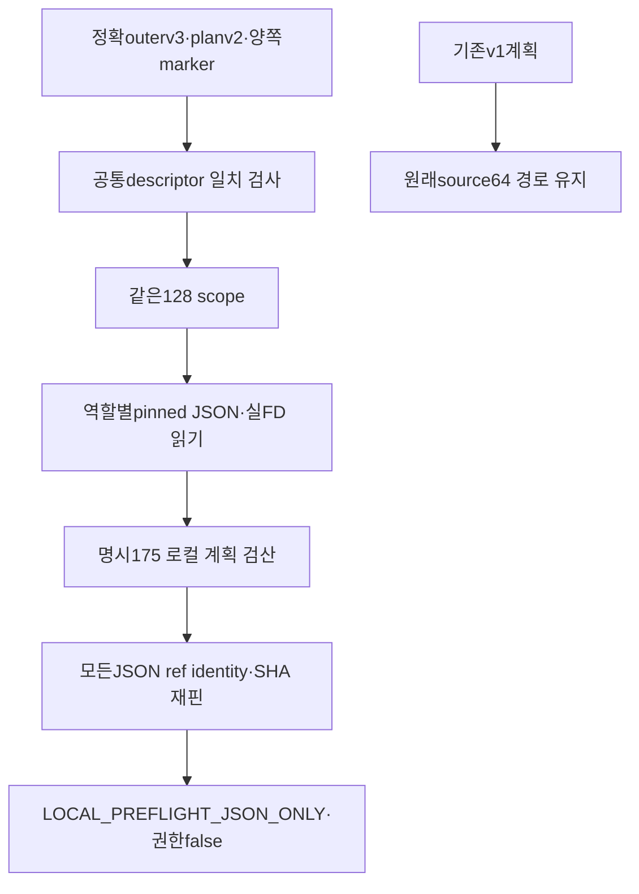

# 325 — 격리 환경의 명시128 로컬 사전검사

- updated_at: 2026-10-18 23:56:30 KST,327 공유적용·회귀 완료 기준
- source_commit:325 격리판에서327 runtime4개를 공유 코드에 명시 적용.8절 후속의 실제 지문 기준.
- evidence_paths: [325 완료 문서](../implementation/325_explicit_target_source_local_preflight_isolated.md), [freeze](../../evidence/integration/target325-workspace-20261018/freeze325.json), [시험 결과](../../evidence/integration/target325-workspace-20261018/test-results325.json), [64MiB 초과 합성관측](../../evidence/integration/target325-workspace-20261018/large-once325-observation.json), [격리 adapter](../../evidence/integration/target325-workspace-20261018/backend/app/data/targeted_source_io.py), [격리 계획 모듈](../../evidence/integration/target325-workspace-20261018/backend/app/data/targeted_bare_plan.py)
- confidence: 완료 격리 코드와 보존된 합성시험 근거를 읽어 확인. 실제 운영 입력·공유main·coordinator·원격 품질·수집 연결은 미검증.
- status: **TESTED_SYNTHETIC —325 격리검증 및327 공유코드146회귀 완료 / SHARED_APPLIED**. **BLOCKED —170 실coordinator/worker/전체writer 미연결·실수집64MiB 차단 유지**. 아래1–7절의main0·검토대기는325 당시 역사이며 현재 공유적용 결과는8절이다.

## 1. 쉬운 설명

**319가 신청서의 선언을 검사했다면,325는 격리 시험장에서 실제 파일을 열어 읽고 로컬 계획 사전검사까지 연결했다. 실제 운영 수집기는 아직 이 경로를 쓰지 않는다.**

기존 출입문은64MiB 제한을 그대로 두고, 정확한 표식을 가진 요청만 새128MiB 사전검사실로 들어오게 만든 단계다. 검사실에서 합성파일 검증에 성공해도 실제 작업 차량·예산 예약·작업자·정산 시스템의 연결까지 끝났다는 뜻은 아니다. 새 자료·나지 확보·학습 승인은0이다.

## 2. 이론: 파일 상한·누적 I/O·파일 동일성은 각각 필요하다

파일 하나의 cap은 한 번에 허용할 입력의 크기다. 누적 JSON I/O 예산은 같은 작업에서 실제 읽고 쓴 양의 합계다. 처음 stat만 확인하고 다른 큰 reader를 호출하면 좁은 cap이 무력화될 수 있어 같은 효과cap을 fd·실제 읽기·파싱까지 전달해야 한다.

검사 중 파일이 자라거나 같은 내용으로 다른 파일이 교체돼도 첫 identity와 최종 지문을 비교해야 한다. cachehit은 실제로 다시 읽지 않은 bytes를 읽었다고 계상하지 않는다. 자원 초과 오류를 일반 계획 실패로 삼켜 다음 예약으로 넘어가지 않도록 상위로 전파한다.

## 3. 코드·데이터 동작

격리 공용 reader에 `maximum_bytes=None` 선택 인자를 추가했다. None은 원래 rolecap·반환·오류를 유지한다. 명시값은 bool이 아닌 정수이며0보다 크고 기존 rolecap 이하여야 한다. 기존cap을 늘리는 값은 입력 path stat/open 전에 거부한다. 효과cap은 stat/fstat·실read·SHA·전후identity와parser 구조 검사까지 전달된다.

새 `prepare_explicit_targeted_bare_jobs(root,request,base_config)`만 adapter를 사용한다. 기존 `prepare_targeted_bare_jobs(root,plan,base)`는 원래v1/source64를 유지한다. ambient128 scope가 있다는 이유로 자동 상향하거나 legacy 요청을v3로 fallback하지 않는다.

adapter는319의 exact계약과 공용descriptor를 먼저 확인해 오염을 root/open 전에 거부한다. source128MiB,proposal/boundary2MiB,ledger/lineage8MiB의 역할을 명시한다. 공용status_report/readiness16MiB reader는 각각8MiB로 좁혀 사용한다. source의scenes+history≤3,000/depth32/node4M·실SHA를 확인한다. TIFF는 별도64MiB/MemoryFile 조건이며 JSON128로 분류하지 않는다.

기존175의 로컬 라벨·grid·boundary·listedimage overlap 검사는 유지한다. 새planv2 marker가canonical에 포함돼 새planSHA/jobkey는 달라질 수 있지만 기존v1 결과·오류는 원판과 exact 비교했다. cache는path/role·identity·expectedSHA를 결속하고 마지막 재핀에서 동일내용 교체도 거부한다. ProfileResourceError는 새 경로에서 일반catch에 삼켜지지 않는다.

반환에metadata_usage·원v3requestSHA·profile을 남기되 execution_supported/coordinator_connected/training_ready는false다. 이는 LOCAL_PREFLIGHT_JSON_ONLY다. caller가 나중에 결과dict를 직렬화하는 I/O와170lock/worker/thread·state/report/receipt 전체writer는 이 범위에 포함되지 않는다.

## 4. 실제 시험 근거와 한계

| 배치 | 결과 | unittest 시간 | wrapper 시간 |
|---|---|---:|---:|
|최종 집중|63PASS/exit0|19.563초|22.031초|
|외부baseline 없는portable|65PASS/exit0|46.256초|51.766초|

두 배치는 사례가 겹친다.128개 고유 회귀시험으로 합산하지 않는다. 초기18PASS도 최종 시험군에 중복 계상하지 않는다.319의27계약시험과 기존175회귀·새cap/adapter 검사를 포함한다. 새 시험은 실행하지 않고 보존된 로그·결과를 읽었다.

portable에서 합성source67,112,960B(64MiB+4,096)의 **명시 로컬 사전검사를 단1회** 수행했다.19.5초에 작은Temp TIFF/도형 검사까지 완료했고 metadata read134,227,800B/write0,합계134,227,800B<16GiB였다. 유효JSON+whitespace 입력이므로 실제rich 운영128MiB 최대 성능을 보장하지 않는다.209,129,472B PeakWorkingSet 표본도 최종peak·LinuxRSS 보장이 아니다.

같은portable 배치에서 실제4백만개 값을 가진 합성JSON의 node 초과를 차단했다. source128MiB+1/ledger8MiB+1은 open 전 차단,행3,000+history1/depth33·성장·교체·hash불일치·최종재핀·cache0read·중첩예산소진·자원오류전파·marker오염을 시험했다. 원래legacy는 ambient128에서도64MiB+1을 FILE_LIMIT로 거부했고 default/None reader도 원판과 같은 결과였다.

관련main9개 baseline을 원바이트 보존하고 종료 시 main/archive SHA와bytes exact를 검산했다. portable은 운영data·source·원장·모델과 외부baseline이 없는 임시root에서 수행했다. Python/GIS 라이브러리 설치까지 필요 없다는 뜻은 아니다. 기존 Affine PendingDeprecationWarning도 로그에 보존했다.

완료문서 SHA는 `9d5c2bcbf0d31aa144d3589c829835b5ca3f856746eae0947edb7400e70a53d4`,freeze SHA는 `c908ea546e8029dfc669fd716a34def18eb932e612922e33bf6381603cf6ee4e`다. 이는 격리판 식별값이며 공유적용 승인 서명이 아니다.

## 5. 남은 차단과 UI 경계

319 순수계약→325 실FD/175로컬 사전검사까지 진전했다. 그러나 main 적용0·운영data I/O0·HTTP/native운영검사/collector/예약0이다.170coordinator-lock 안 재검사·167pending/fullsupport·현재source/ledger핀·scene/window registry·worker ContextVar·전체metadatawriter·원격실정산 연결은 남았다. 운영main의64MiB 집행 차단은 유지된다.

326 독립검토가 진행 중이다. 결론·Root baseline대조·명시 공유적용·실검산·별도 실행 승인 전 운영 재개를 보고하지 않는다. source파일 cap과지원3GiB·라벨768MiB·원격COG64MiB+metadata1MiB/공유예산4GiB는 다른 자원 계약이다. 품질·겹침·split·B02정렬·oldpending·학습false는 바꾸지 않았다.

내부 격리기능으로 API/UI 행위 변경0이므로 새 화면 조회·서버 재시작이 필요하지 않다. 현재 사용자 화면의 검토 게시 성공과 이 실행 연결 개발을 섞지 않는다. [316 해설](316_CURRENT_BARE_REVIEW_AND_TARGET_PROFILE.md)의 최신50검토/15clear도 여전히 수집·나지 성과가 아니다.

## 6. 발표 대본

### 1분

“325는 격리 환경에서 정확한 새 요청만 실제 파일을 읽고175 로컬 사전검사로 보내도록 연결했습니다. 합성64MiB 초과파일을 한 번 검증했고 실제 읽기·지문·교체·상한을 확인했습니다. 기존64MiB 경로는 유지했습니다. 다만 공유main·원격·예약·worker·전체writer 연결은0이고 독립검토도 진행 중입니다. 실제 수집 차단 해결이나 나지 확보로 보고하지 않습니다.”

### 5분

“이전319는 선언을 검사하는 순수 계약이었습니다.325는 정확한marker를 먼저 검증한 뒤 같은scope에서 역할별 파일을 실제 읽고 마지막지문까지 확인하는 격리 연결입니다.좁은cap은stat만이 아니라fd와실read·parser까지 전달합니다.

합성67,112,960바이트 파일로 명시175 사전검사를 한 번 완료했고19.5초·누적JSON약134MB를 기록했습니다. 이 입력은whitespace가 있는 시험자료라 운영rich128MiB의성능 보장은 아닙니다.실제node4M 초과·성장·교체·cache0read·자원오류전파도 시험했습니다.

집중63개와portable65개는 겹치는시험군입니다.128개고유시험으로더하지않습니다.기존v1/source64의반환과오류도원판과대조했고ambient128에서도legacy64초과를차단했습니다.

운영연결은아직입니다.공유main적용0·운영자료읽기0이고coordinator/worker/thread/원장예약·전체metadatawriter·실정산을연결하지않았습니다.독립검토후별도적용과실검산이필요합니다.현재실수집차단과학습미승인은그대로입니다.”

### 10분 구성

1. 0–2분:순수 신청서검사와실파일 사전검사의차이.
2. 2–4분:marker→scope→역할cap→FD/identity→최종재핀 도식.
3. 4–6분:63/65중복시험과합성64초과·node실패·legacy보존.
4. 6–8분:LOCAL_PREFLIGHT_JSON_ONLY의계측범위/성능한계.
5. 8–10분:326검토·공유적용·coordinator/worker연결과실수집별도승인.

## 7. FAQ

**Q.이제64MiB 차단은해결됐나요?**격리명시로컬경로만큰파일을읽습니다.공유main의실수집경로는차단상태입니다.

**Q.합성시험성공이면현재원본도검사했나요?**운영원본읽기0입니다.실자료검사는별도승인과후속근거가필요합니다.

**Q.63+65=128시험통과인가요?**서로겹칩니다.배치별63/65로기록하고128고유회귀로합산하지않습니다.

**Q.실I/O 계측을다연결했나요?**로컬사전검사의JSON만입니다.worker/thread·전체writer·원격계측·예약·실정산은범위밖입니다.

**Q.화면을다시조회해야하나요?**API/UI 동작변경이없는격리내부구현입니다.현재완료근거만해설하고새조회하지않습니다.

## 8. 327 실제 공유 적용·146회귀 완료 후속

[327 완료 문서](../implementation/327_target_source_local_preflight_shared_application.md)와 [completion](../../evidence/integration/target327-application-root-20261018/completion.json), [교정 회귀 결과](../../evidence/integration/target327-application-root-20261018/test-result-corrected.json)·[로그](../../evidence/integration/target327-application-root-20261018/main-regression-corrected.log)를 읽었다. 현재 공유 `targeted_source_io.py`와 교정 시험의 새 import/socket 차단·별도 subprocess 경로도 직접 읽었다. 제품 코드는 편집하지 않았다.

325 격리판·326 독립검토 뒤 Root가9개 baseline 지문을 exact 대조해 runtime4개를 공유 코드에 적용했다. 기존 profile reader·targeted_bare_plan2개는 수정 전 원바이트를 archive했고, targeted_source_profile/targeted_source_io2개는 새로 추가했다. 기존 test_targeted_bare_plan은 같아 덮어쓰지 않았다. 처음 application.json의TESTS_PENDING 기록은 당시 사실로 보존했다.

최초 공유 회귀145건은144PASS/1FAIL이었다. 전체 로더가 coordinator를 먼저 import한 뒤 시험이 전역sys.modules에 그 모듈이 없어야 한다고 단정한 **시험 격리 결함**이었다. 원 main-regression.log/test-result.json과 수정 전 시험을 보존했고 runtime 수정0이다. 이를 제품 장애나145PASS로 바꾸어 쓰지 않는다.

교정 시험은 기존 module identity를 보존하면서 호출 중 새 coordinator import와 socket을 실제 차단한다. 추가 fresh subprocess1건은 처음부터 coordinator가 없고 호출 뒤에도 없음을 검사한다. 독립 정적읽기에서 추가 차단이 없음을 확인한 뒤 같은9모듈 회귀가 **146PASS/exit0,unittest93.214초/wrapper103.610초**로 완료됐다. 원145시험 실행과 새146을 합쳐 고유 회귀 수로 보고하지 않는다.325의63/65 격리·portable 사례와도 중복 합산하지 않는다. 합성 대형파일 benchmark·운영native는 반복하지 않았다.

completion23:56:30.033021 KST에서 적용runtime4개와 원본·원장·후보·나지pointer·선택profile의 운영5핀 불변을 확인했다. Root는 운영파일의 hash를 읽었으나 수정·운영preflight·전체 실물 재스캔은 하지 않았다. 이해 담당은 그 완료 증거만 읽고 운영data를 다시 읽지 않았다.

현재는 **공유 코드의 로컬 사전검사 함수 적용과 회귀 완료**다.170CLI/coordinator·전역lock 안 명시v3 fresh검사·worker ContextVar·전체metadatawriter·원격예약·실정산에 연결하지 않았다. 실main의기존256수집64MiB 경로는 여전히BLOCKED다. 운영preflight/collector/serverrestart0·나지확보/학습승인0이다. 새 route나UI계약이 없어추가브라우저조회가필요하지않고 마지막323실화면은이전완료근거로보존한다.

완료문서SHA는 `5c5c7dd9405bfd8b51be7c40b94d5ec14306ef042363e786011cd26133e70102`,completion SHA는 `22a676a2085f482f1783011ee9a5dc36b6594e83e86246cfac969142bcc4bc46`다. 교정로그SHA는 `b5f72c0810d4c95aae590dff56e481def546d75d39f511a06485166715627598`다.

## 9. 328은 실제coordinator 연결 설계만

[328 설계](../implementation/328_target256_coordinator_metadata_io_design.md),SHA `4dd5d95165745ac4bb78b881fda00f47f9f9e60461daa0f09396fd20cada60cb`는LOCAL_PREFLIGHT_JSON_ONLY 밖에 남은23 I/O공백과연결정책을검토한문서다.제품·시험·운영I/O0이며현재실행연결완료를뜻하지않는다.

requestbootstrap부터source·ledger·config·상태JSON/JSONL·원격metadata응답·report·workerreceipt·aggregate·stdout까지역할별계측이필요하다. worker는ContextVar를자동상속하지않으므로 submit마다새copy_context를만들되같은Budget참조를공유하는안을설계했다. worker마다새16GiB를만들거나동일Context객체를동시에run하지않는다.실행경로에이전파가이미구현됐다고설명하지않는다.

ProfileResourceError는ValueError파생이므로기존reserve exceptValueError나worker의일반catch에삼켜져일반예산부족/검색실패로축약될수있다.새명시경로에서추가제출중지·기존future회수·finalize각1회시도후원오류를전파하는보완이필요하다는설계다.자원중단을HTTP429로위장하지않는다.

예산소진으로정산JSON도쓸수없으면예산밖에서원장을고쳐성공처리하거나pending을환불하지않는다.새batch의전액예약을보수적으로남기고정산/게시미완료로후속감사에넘기는안을명시했다.이는실제로예약누락사고가일어났다는보고가아니며미래구현계약이다.기존oldpending2의전액도보존한다.

### 최종 발표와FAQ 보완

“로컬사전검사4개runtime은공유코드에반영했고교정한146회귀가통과했습니다.최초145중시험격리1실패는원로그를보존했고제품수정없이새import/socket차단과fresh subprocess로보완했습니다.다만실제170coordinator와worker·전체writer·원격예약·정산은아직연결하지않았습니다.328은그23 I/O공백과오류/pending보존을설계한단계입니다.공유적용완료를실수집가능으로확대하지않습니다.”

**Q.이제main에도코드가있나요?**327에서runtime4개를공유적용했습니다.325당시main0은역사입니다.운영수집경로연결은여전히별도미완료입니다.

**Q.첫시험실패를없앤건가요?**원로그·결과·시험원판을보존했습니다.선행import가있는전체suite의환경을고려한시험교정이며runtime은바꾸지않았습니다.

**Q.146PASS면실제수집을재개해도되나요?**로컬함수공유회귀범위입니다.170/worker/thread/정산연결과실검산·승인은아직필요합니다.

**Q.328의pending보존설계는실제미정산사고인가요?**미래연결에서자원소진이발생할경우의계약설계입니다.이번운영예약·전송은0이며원pending은그대로입니다.
