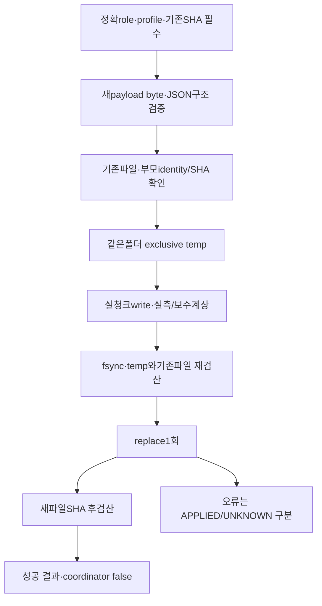

# 329 — 고정 역할 JSON 교체 저장기의 격리 검증

- updated_at: 2026-10-19 00:14:22 KST,331 공유 적용·검증 완료 기준. 산출물 경로의20261018은 배정 식별자로 유지.
- source_commit:331에서 저장기·시험 신규2파일을 공유 코드에 원바이트 적용. targeted_atomic_json.py SHA `11ea4b0956468045bdd27f7dd605f0d61508fd3846000dba001ef9b4a87aaa66` 기준.
- evidence_paths: [329 완료 문서](../implementation/329_fixed_role_atomic_json_writer_isolated.md), [freeze](../../evidence/integration/target329-workspace-20261018/freeze329.json), [격리 저장기](../../evidence/integration/target329-workspace-20261018/backend/app/data/targeted_atomic_json.py), [격리 시험](../../evidence/integration/target329-workspace-20261018/tests/test_target329_atomic_json.py), [집중 로그](../../evidence/integration/target329-workspace-20261018/focused329-final.log), [portable 결과](../../evidence/integration/target329-workspace-20261018/portable329-final-result.json)
- confidence: 완료 코드·합성 파일 교체/계측·실패 시험 근거를 읽어 확인. 운영 원장·수집기·다중파일 정산·전원장애 보장은 미검증.
- status: **TESTED_SYNTHETIC / SHARED_APPLIED —331 신규2파일 적용·공유30시험 완료**. **BLOCKED — 실제 CollectionLedger·170·worker·JSONL/stdout 미연결**.330 최종 독립검토에서 이 저장기 범위의 필수 차단을 발견하지 않았다. 아래1–9절의격리/main0/검토대기는당시기록이며 현재결과는10절이다.

## 1. 쉬운 설명

**기존 JSON을 바로 덮어쓰는 대신 같은 폴더의 독점 임시파일에 새 내용을 완성하고, 원래 파일과 새 파일을 다시 검사한 뒤 한 번 교체하는 저장기다. 실패했을 때 이미 바뀌었는지 모르는 경우도 별도로 남긴다.**

장부를 수정할 때 원본을 지우며 쓰는 대신 새 종이에 완성하고 원본 번호까지 확인해 갈아 끼우는 방식이다. 그러나 장부 한 장의 교체 기능과 전체 수집비 정산은 다르다. 이번에는 합성 임시파일만 시험했으며 실제 원장·자료·예산·수집을 변경하지 않았다.

## 2. 이론: 안전한 교체와 적용 여부는 별개다

기존 파일의 정확한 SHA를 caller가 제공해야 한다. 읽은 이후 다른 writer가 바꿨거나 새 임시파일이 바뀌면 성공으로 처리하지 않는다. 쓰기 전 크기·구조를 확인하고 실제 읽기와 쓰기를 같은16GiB 예산에 계상한다.

os.replace가 정상 반환했는지, 새 파일 검산까지 끝났는지, 호출이 예외를 던져 적용 여부를 모르는지는 다른 상태다. UNKNOWN을 미적용으로 단정해 재실행하면 같은 변경을 반복할 수 있다. 이 구현은 자동 rollback·재시도 대신 상태와 임시파일 보존 여부를 남긴다.

## 3. 코드와 데이터 흐름

`replace_json`은 정확bytes를 그대로 검증·저장한다. `replace_json_value`는 JSON 기본형을 bounded detach한 뒤 그 사본만 canonical 직렬화한다. caller의 후속 변경을 저장하지 않지만 임의 동시수정의 원자snapshot/ABA 검출을 보장하지 않는다. 두 API 모두 기존파일 교체 전용이며 없는 파일을 처음 생성하는 API는 아니다.

role은config2MiB/ledger8MiB/source128MiB로 고정이고 caller가 숫자cap을 늘릴 인자는 없다. source의scenes+history≤3,000/depth32/node4M를 적용한다. 중복키·BOM/NUL·잘못된UTF8·비유한숫자·하위형/순환 등은 거부한다. source 외에는 정확JSON object가 필요하다. 대형rich128MiB·실4Mnode 성능 시험을 이번에 반복하지 않았다.

payload검증은 파일open 전이다. 경로와부모identity·regularfile을 확인하고 symlink/reparse/hardlink를 거부한다. 같은폴더의 고정temp를xb로 독점 생성해64KiB 이하 청크로 쓴다. 남은예산 확인→실write→반환량/전후size 대조→실bytes charge를 같은 잠긴budget에서 수행한다. nested scope는 기존Budget을 재사용한다.

이 size차 계측은 함수가 만든 unbuffered regular temp의 순차append에 한정된다. 목적파일overwrite·외부stream·pipe·JSONL/stdout에 일반화하지 않는다. 측정 불명이면0으로 보고하지 않고 시도청크 전체를 보수계상해 중단한다. 정상 작은 시험의 reads는2×oldbytes+2×newbytes,writes는newbytes이며 기존파일 두 번·temp·교체후 읽기를 포함한다.

## 4. 실패·경쟁·임시파일의 해석

| commit outcome | 의미 |
|---|---|
|NOT_ATTEMPTED|replace를 시도하기 전 실패|
|APPLIED|replace는 정상 반환했으며 이후검증 실패일 수 있음|
|UNKNOWN|replace를 호출했지만 예외가 나 적용 여부를 확정 못함|

`committed=False`만 보고 미적용이라고 단정하지 않는다. 실제replace 후 예외를 던지는 모형으로 UNKNOWN을 시험했다. 이후 Root의 별도 bounded 복구판정이 필요하며 자동rollback0이다.

temp는우리소유inode·size·부모·knownprefix SHA가 맞고 cleanup읽기예산도 있을 때만 지운다. 기존temp·외부교체temp·측정불명·예산부족은 보존한다. 부모가 이동되면 옛폴더를 찾아 삭제하지 않는다. 외부가원파일을바꿨다면그외부파일을덮어쓰지않고이를원본보존성공으로꾸미지않는다.

같은Budget은I/O전체를직렬화하고다른Budget의협력writer는같은exclusive temp로경쟁한다. 그러나 최종검사와replace 사이의 임의외부writer를 원자CAS로 잠그는 보장은 없다. OS강한directoryhandle·directoryfsync/전원차단영속성·다중파일정산transaction도 범위밖이다.

## 5. 시험 증거와 보존 이력

| 배치 | 실제 결과 | unittest | wrapper |
|---|---|---:|---:|
|최종 집중|30PASS/skip0|4.878초|6.820초|
|baseline없는Temp portable|동일30PASS/skip0|4.437초|7.202초|

두배치는같은30사례이므로60고유시험으로합산하지않는다. 최초24PASS도별도고유회귀로더하지않는다. 확장판첫30건은29PASS/1ERROR였다. Windows가열린temp의부모rename을WinError5로차단한fixture시점문제로 원로그·시험원판을보존했다. 제품수정없이temp를닫은뒤첫부모검사hook에서rename하도록시험만보완했다.

정상실bytes/scope재사용·잘못된role/marker/pin·open전초과차단·행/history/depth·temp충돌·partial/unknown쓰기·취소·fsync실패·destination/temp/parent교체·예산소진·postcommit/UNKNOWN·writer경쟁·hardlink·없는destination·분리직렬화를다뤘다. 운영함수/HTTP0·RSS/peak미관측이다. 시간은합성배치범위이며SLA가아니다.

portable은runtime3개와시험1개만임시폴더에복사해baseline폴더없이동일시험을실행했다. 325에서복사한기존profile·splitJSON I/O는원판그대로이며공유main을수정하지않았다. 문서SHA는 `4b75dbda713f632a650cc738e188b3c98caddd6ed2c8fc68983461b14f45f11b`,freezeSHA는 `1daf49fe9fd9053e707131c4d94fbed18b160d29f10403a1f22fecfdded2510c`다.

## 6. 현재 한계와 다음 단계

328 설계 중 단일파일저장기 부분만 격리완료다. 실제CollectionLedger·170·worker·JSONL/stdout·정산오류처리·pending상태 연결은0이다. 공유적용도0이며330 독립검토 결론전 적용가능으로확대하지않는다. 원격예산4GiB·COG한도·품질/split·oldpending·나지/학습gate는변경하지않았다.

API/UI계약변경없는내부격리함수라서버restart나새브라우저조회가필요하지않다. [325/327 로컬사전검사](325_EXPLICIT_LOCAL_PREFLIGHT_ISOLATED.md)와마찬가지로부분구현완료를전체수집연결완료로보고하지않는다. 실제나지확보·학습승인0이다. 이해담당은완료코드/문서/합성근거만읽고운영source·model·ledger를읽거나수정하지않았다.

## 7. 발표 대본

### 1분

“329는기존JSON의정확지문을받아독점임시파일에새내용을쓰고검산후한번교체하는격리저장기입니다. 실제읽기·쓰기를같은예산으로계상하며실패는미시도·적용·결과불명으로나눕니다.30시험을두배치에서통과했지만60고유시험은아닙니다.운영원장·worker·정산은연결하지않았고공유적용0·독립검토진행중입니다.”

### 5분

“장부를반쯤덮어쓰지않으려면새내용을다른종이에완성하고원본번호를확인해갈아끼워야합니다. 이번API는기존SHA를필수로받고config/ledger/source역할별cap을고정합니다.없는파일을새로만드는기능은없습니다.

쓰기전구조검사·실청크write계측·fsync·기존파일과temp재핀·replace후SHA확인을같은budget에서수행합니다.이미scope가있으면새16GiB를지급하지않습니다.측정불명은0이아니라청크전액을보수계상합니다.

실패상태도중요합니다.replace전은NOT_ATTEMPTED,정상반환뒤실패는APPLIED,호출중예외는UNKNOWN입니다. UNKNOWN에서미적용이라단정해자동재실행하지않습니다.temp도우리소유와prefix가검증될때만지웁니다.

Windows열린temp부모rename시험오류는원로그를보존하고닫힌뒤hook으로시험만교정했습니다.최종30개와portable동일30개가통과했습니다.하지만실제원장·worker·정산연결·전원차단·다중파일transaction은미완료입니다.330독립검토뒤다음연결을별도검토합니다.”

### 10분 구성

1. 0–2분:원본장부와임시사본비유·기존SHA필수.
2. 2–4분:고정role·실FD/write측정·같은budget도식.
3. 4–6분:NOT_ATTEMPTED/APPLIED/UNKNOWN·cleanup보존.
4. 6–8분:30시험두배치·Windowsfixture실패보존·경쟁한계.
5. 8–10분:공유미적용·330대기·원장/정산/worker미연결.

## 8. FAQ

**Q.atomic이면전원차단에도원장전체가안전한가요?**단일파일교체범위입니다.directoryfsync·전원차단영속성·다중파일정산transaction은보장하지않습니다.

**Q.committedfalse면다시실행해도되나요?**UNKNOWN일수있습니다.별도상태판정없이자동재시도하지않습니다.

**Q.불명확한쓰기는0바이트로계상하나요?**시도청크전체를보수계상하고측정불명으로중단합니다.

**Q.이제실제원장도이저장기를쓰나요?**아직아닙니다.격리구현이며CollectionLedger·170/worker연결과공유적용은0입니다.

**Q.실제수집이나나지성과가늘었나요?**운영I/O·HTTP·수집0이며실제자료·학습승인을추가하지않았습니다.

## 9. 330 정적검토 인계와 두 가지 해석 한계

Root가 전달한330 현재 정적결론은329 범위에서 추가 필수 차단을 발견하지 못했다는 것이다. 최종검토문서는 아직 대기이며 독립검토를 공유적용·실제원장 연결 승인으로 바꾸지 않는다. Root main반영0·331은준비 단계다.

`atomic_json_temporary_preserved`는 실제temp파일이그경로에존재한다는관측증거가아니다. 안전cleanup을확인하지못했다는표시다.예를들어replace가실제로파일을이동한뒤예외를던지면UNKNOWN이면서temp이름은이미없을수있다.플래그만보고temp존재·미적용을단정하지않는다. committedfalse 역시미적용의보장이아니다.

ledger역할은8MiB의JSON저장보호이며원pending행의semantic exact보존을검증하는기능은아니다.어떤행을유지하고예약·정산을어떻게전이할지는caller별계약이필요하다.이caller연결은아직0이다.따라서“ledger역할을지원하니oldpending보존까지완료됐다”라고말하지않는다.

발표에는“임시보존플래그는파일존재확인이아니며generic ledger저장기는pending업무규칙을검증하지않는다”를덧붙인다.

## 10. 330 최종 독립검토와331 실제 공유 적용 완료

[330 최종검토](../implementation/330_target329_atomic_json_static_review.md), [331 완료문서](../implementation/331_atomic_json_writer_shared_application.md), [실제 completion](../../evidence/integration/target331-application-root-20261019/completion.json), [공유시험 로그](../../evidence/integration/target331-application-root-20261019/shared-target329-tests.log)를읽었다. 현재 공유저장기의고정role·replace후검산·outcome코드도직접확인했다.330최종문서SHA는 `a39b4eba4f078e197be275f30f6df7b7f3e85290048b9a9861a376c34369e508`다.

Root는16개동결참조·기존공통2핀·새파일부재를확인해 **신규runtime1+시험1,총2파일만** 원바이트추가했다. 기존제품덮어쓰기0·공통2불변·329원판/실패로그/freeze보존이다. application.json의시험전상태도역사로남겼다.공유적용뒤같은30시험이unittest2.484초/wrapper3.860초에모두통과했다. 격리30·portable동일30과합쳐90고유사례로부풀리지않는다.이전146회귀·벤치마크·운영native/QA반복0이다.

completion00:14:22.583438 KST는새runtime·시험·공통2·운영5핀불변과30시험통과를기록한다. Root의운영확인은SHA읽기이며운영원장쓰기·전수재스캔·운영preflight가아니다.이해담당은완료증거만읽고운영파일을다시열지않았다.

UNKNOWN은미적용이아니며temporary_preserved는실temp존재증거가아니다. oldpending의정확행·예약·정산차액은genericledger저장기가아닌caller의업무검증책임이다.이9절한계는공유적용후에도같다.추가로valueAPI는role검증뒤detach/직렬화가먼저이고marker/pin검증은bytesAPI에서후행할수있다.잘못된marker/pin이항상메모리분리전거부된다고설명하지않는다.파일I/O전에는거부하며임의caller원자snapshot·peakRSS는보장하지않는다.매우이른실패에는temp후오류속성자체가없을수도있다.

현재CollectionLedger·170·worker·JSONL/stdout연결0·원격/운영원장쓰기0이다. 새route/UI계약이없는내부함수라serverrestart/새조회0이며실서버가이함수를사용한다고주장하지않는다.332는새격리사본에서optionalmetadata_io와원장callersemantic계약·Tempreserve/settle만구현하는별도배정이다.332main0·운영예약/환불/수집0이며아직완료성과로보지않는다.

331완료문서SHA는 `34bed8c49dba864e13181f811c9d6add33ed4896185a26e10a26ab7a895c9e91`,completionSHA는 `f3c72cbe7115f9a44d4c4c2e159001b75774dfdcfcc1117f89812842b888ac67`,공유로그SHA는 `174a0d6eb7cb80c38da5c724752d9468e17cc17503d5fd355db348d8fd0eafc4`다.공유적용을원pending정산·표적수집·나지/학습승인으로확대하지않는다.

### 후속 발표 문장과FAQ

“저장기와시험2개는공유코드에원바이트추가했고같은30시험이통과했습니다.기존공통2파일과운영5핀은유지했습니다.독립검토의UNKNOWN·temp플래그·callerpending책임은그대로입니다.실제원장과170worker는아직연결하지않았고332는격리caller계약개발입니다.”

**Q.현재main에도저장기가있나요?**331에서공유추가됐습니다.329당시main0은역사이고실제caller연결은여전히0입니다.

**Q.새30PASS는새로운30사례인가요?**기존격리/portable과같은시험군을공유적용뒤검증한것입니다.중복고유회귀로합산하지않습니다.

**Q.원장역할지원이면pending검증도끝났나요?**아닙니다.8MiB저장보호와업무의미검증은다르며332별도caller계약과후속검토가필요합니다.
