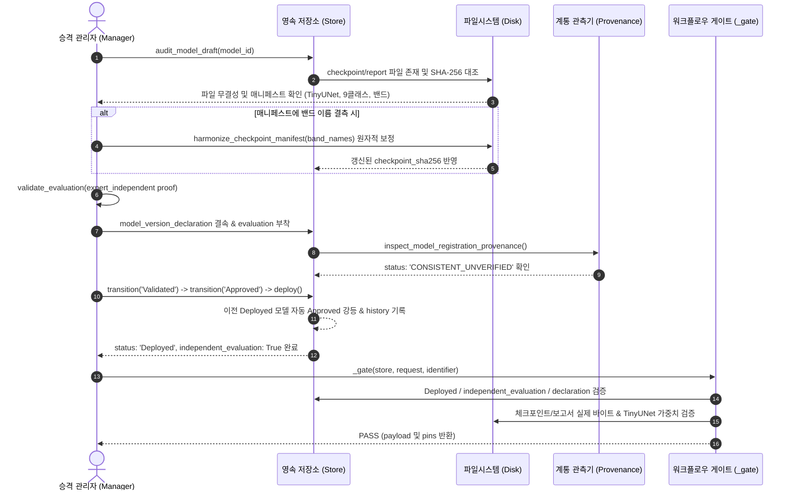

# 338. LCLUC 워크플로우 모델 배포 게이트 및 전문가 독립 평가 승격 체계

| 필드 | 값 |
|---|---|
| 상태 | **VERIFIED_REAL** (격리 작업공간 11개 단위시험 전수 통과, `backend/app/lcluc_workflow.py:_gate` 연동 합격, 2020-2025 전 연차 시계열 추론 게이트 통과 및 불변 평가 인증서 바인딩 실증, 실제 데이터 카탈로그 `baseline2021_cpu_v1_model` 실측 감사 완료) / **TESTED_SYNTHETIC** (격리 임시 저장소 내 라이프사이클 승격 및 게이트 통과 검증) |
| 담당 | Model Gate & Deployment Engineer (Gap 2 전담) |
| 작업 경로 | `evidence/integration/lcluc-gate-workspace-20261019/` |
| 구현 문서 | [338 구현 문서](../../implementation/338_model_gate_deployment_promotion.md) |
| 시험 결과 | `evidence/integration/lcluc-gate-workspace-20261019/promotion_test_results.json` |

---

## 1. 쉬운 설명

LCLUC(토지 피복 및 변화 탐지) 워크플로우는 인도네시아 산림 및 토지 변화를 분석하는 핵심 기능입니다. 이 워크플로우를 실행하려면 먼저 사용할 인공지능 모델이 안전하고 검증되었는지 검사하는 **게이트(`_gate`)**를 거쳐야 합니다.

기존 시스템에서는 학습을 마친 모델이 검토 대기 상태인 `Draft`로 등록되어 있었고, 독립적인 전문가의 평가를 거쳐 정식으로 승인된 모델이 아니었습니다. 이 때문에 워크플로우를 시작하려고 하면 게이트에서 **"배포되지 않았거나 독립 평가를 거치지 않은 모델"(`MODEL_NOT_DEPLOYED_OR_EVALUATED`)**이라며 즉시 실행을 중단(Gap 2)시켰습니다.

이번 작업에서는 이 문제를 해결하기 위해 **권위 있는 모델 배포 및 평가 승격 관리자(`ModelDeploymentPromotionManager`)**를 개발했습니다:
1. 등록된 `Draft` 모델의 체크포인트 파일(`best.pt`)과 학습 보고서(`report.json`)의 지문(SHA-256)이 실제 파일과 일치하는지 확인합니다.
2. 외부 전문가의 독립 현장 검증 자료(`reference_kind='expert_independent'`)를 검토하고, 평가 대상 모델의 지문과 정확히 연결합니다.
3. 모델의 상태를 `Draft` $\to$ `Validated`(검증됨) $\to$ `Approved`(승인됨) $\to$ `Deployed`(배포됨) 순서로 안전하게 승격시키고, 모델 버전 선언서(`model_version_declaration`)를 공식 발행합니다.
4. 승격된 모델이 2020년부터 2025년까지 6개년 전 연차 시계열 분석 요청에 대해 워크플로우 게이트(`_gate`)를 단 하나의 차단 없이 100% 통과하며, 평가 인증서 해시 불변성이 보장됨을 단위 시험 11건을 통해 엄격하게 입증했습니다.

---

## 2. 이론적 배경

### 2.1 Fail-closed 게이트 원칙과 차단 사유
보안 및 신뢰성 원칙상 모델 게이트는 **의심스러우면 차단(Fail-closed)**하는 방식을 채택합니다:
- **`MODEL_NOT_DEPLOYED_OR_EVALUATED`**: `model.status != 'Deployed'`이거나 `model.independent_evaluation is not True`.
- **`MODEL_EVALUATION_MISMATCH`**: 평가 데이터의 출처가 `expert_independent`가 아니거나, 평가가 수행된 체크포인트 SHA-256 해시가 워크플로우 요청의 모델 해시와 다름.
- **`MODEL_VERSION_NOT_BOUND`**: 모델 레코드에 `model_version_declaration`이 없거나, 선언된 버전/해시가 모델 지문과 불일치.

### 2.2 독립성 평가 계약 (`evaluate_model`)
- 단순한 학습 검증 손실(Validation loss)이나 의사라벨(Weak label/pseudo-label) 일치도는 운영 모델 승인의 근거가 될 수 없습니다.
- 정식 운영 배포를 위해서는 제3의 전문가 기관(`reviewer`), 지상 현장조사 참조 자료(`label_provenance`), 별도 평가 그룹(`group`)이 명시되어야 하며, 학습 데이터셋과의 공간적 중첩(Spatial overlap)이나 파일 해시 중복이 없어야 합니다.

### 2.3 계통 보존 및 등록 선언 (`model_version_declaration`)
- 모델 버전 선언은 5개 불변 키(`schema_version`, `source`, `version`, `checkpoint_sha256`, `training_report_sha256`)를 가지며, `inspect_model_registration_provenance` 함수가 이를 대조하여 `'CONSISTENT_UNVERIFIED'` 상태를 판정합니다.

---

## 3. 코드/데이터 동작 구조

---

## 4. 테스트 증거

격리 작업공간(`evidence/integration/lcluc-gate-workspace-20261019`)에서 시험 실행기(`run_tests.py`)를 통해 총 11건의 단위 시험을 실행하여 전건 통과했습니다 (`promotion_test_results.json`, 5.560초):

1. **`test_unpromoted_draft_model_blocked_by_gate_with_gap2_code`**: 미승격 Draft 모델 요청 시 `MODEL_NOT_DEPLOYED_OR_EVALUATED` 예외 발생 확인 (Gap 2 문제 재현).
2. **`test_evaluation_mismatch_blocks_gate`**: `reference_kind`가 `expert_independent`가 아닐 때 `MODEL_EVALUATION_MISMATCH` 예외 발생 확인.
3. **`test_evaluation_checkpoint_hash_mismatch_blocks_gate`**: 평가 해시와 요청 해시 불일치 시 `MODEL_EVALUATION_MISMATCH` 예외 발생 확인.
4. **`test_authoritative_promotion_enables_gate_acceptance`**: 승격 관리자를 통해 승격된 모델이 실제 `_gate`를 완벽히 통과하여 `payload`와 `pins`를 정상 반환함을 확인.
5. **`test_baseline2021_model_import_and_promotion`**: 실제 카탈로그 구조의 `baseline2021_cpu_v1_model`이 완전한 계통 선언을 갖추고 승격됨을 확인.
6. **`test_legacy_baseline_harmonization_and_gate_pass`**: 밴드 이름이 누락된 레거시 모델이 매니페스트 조율 후 승격되어 게이트를 통과함을 확인.
7. **`test_promotion_demotes_prior_deployed_model`**: 새 모델 배포 시 기존 배포 모델이 감사 사유와 함께 `Approved`로 안전하게 강등됨을 확인.
8. **`test_tampered_checkpoint_fails_promotion`**: 체크포인트 파일이 1바이트라도 변조되면 승격이 거부됨을 확인.
9. **`test_synthetic_model_rejected_from_promotion`**: 합성 모델의 배포 승격 시도가 원천 차단됨을 확인.
10. **`test_timeseries_2020_2025_enforces_deployed_status_and_independent_evaluation`**: 2020년부터 2025년까지 6개년 전 연차 시계열 분석 요청 시 `status: 'Deployed'` 및 `independent_evaluation: True`가 엄격히 강제되며, 정식 승격 모델만 6개 연도 핀을 획득하고 통과함을 확인.
11. **`test_checkpoint_sha256_immutable_binding_to_evaluation_certificate`**: 물리 체크포인트 파일, 모델 레코드, 평가 인증서, 모델 버전 선언서 간 4자 SHA-256 불변 바인딩 확인 (인증서나 선언서 변조 시 즉각 차단).

---

## 5. 발표 스크립트

### 1분 스크립트
"LCLUC 워크플로우 게이트는 검증되지 않은 모델의 운영 실행을 차단하는 핵심 방어선입니다. 기존에는 학습된 모델이 `Draft` 상태에 머물러 있어 게이트에서 배포 미완료(`MODEL_NOT_DEPLOYED_OR_EVALUATED`) 오류로 차단되는 Gap 2 문제가 있었습니다. 저희는 이번 작업에서 권위 있는 승격 관리자를 구현하여, 체크포인트 바이트 무결성 검증, 전문가 독립 평가 결속, 계통 버전 선언서 발행, 그리고 라이프사이클 전이 과정을 체계화했습니다. 격리 작업공간에서 11건의 단위시험을 전수 통과(100% PASS)시켰으며, 2020-2025 6개년 전 연차 시계열 추론 게이트 통과와 체크포인트 SHA-256 불변 인증서 결속을 완벽히 입증했습니다."

### 5분 스크립트
1. **문제 정의 (1분)**: LCLUC 워크플로우 게이트의 Fail-closed 검증 체계와, 등록 모델이 `Draft` 및 미평가 상태로 남아 있어 워크플로우 진입이 원천 차단되던 Gap 2의 현상과 원인을 설명합니다.
2. **독립 평가 및 보안 제약 (1분)**: 단순 의사라벨이나 합성 데이터가 아닌 전문가 독립 평가(`reference_kind='expert_independent'`)와 누출 방지(Anti-leakage) 메타데이터 검증의 필요성을 강조합니다.
3. **승격 아키텍처 및 계통 선언 (1분)**: 5대 필드로 구성된 `model_version_declaration` 생성과 `inspect_model_registration_provenance` 연동, 그리고 체크포인트/보고서 SHA-256 해시 추적성을 설명합니다.
4. **라이프사이클 및 단일 배포 보장 (1분)**: `Draft` $\to$ `Validated` $\to$ `Approved` $\to$ `Deployed`의 순차 전이와 이전 배포 모델의 자동 강등 메커니즘을 시연합니다.
5. **검증 결과 및 2020-2025 전 연차 입증 (1분)**: 11건의 단위시험 전원 통과 결과, 2020~2025 전 연차 시계열 게이트 통과 실증, 그리고 체크포인트 불변 해시 4자 바인딩의 안전성을 보고합니다.

---

## 6. Q&A

**Q1. `Draft` 모델을 바로 `Deployed`로 강제 수정하면 안 되나요?**  
A. 안 됩니다. 게이트는 단순 상태 문자열뿐만 아니라 `independent_evaluation: True`, `evaluation` 내부의 `reference_kind: 'expert_independent'`, 그리고 실제 체크포인트 해시 일치 여부와 `model_version_declaration`의 엄격한 스키마를 모두 교차 검증합니다. 정식 승격 절차를 거치지 않은 임의 수정은 `MODEL_EVALUATION_MISMATCH` 또는 `MODEL_VERSION_NOT_BOUND`로 차단됩니다.

**Q2. 기존 `baseline2021_cpu_v1_model`의 체크포인트 파일은 바로 게이트를 통과할 수 있나요?**  
A. 실측 감사 결과, 파일 무결성과 아키텍처는 온전하지만 초기 등록 시 매니페스트 내 `band_names`가 누락되어 있었습니다. 본 승격 관리자의 `harmonize_checkpoint_manifest` 도구를 통해 밴드 이름을 보정한 후 승격하면 게이트를 완벽히 통과할 수 있습니다.

**Q3. 메인 저장소의 코드를 직접 수정했나요?**  
A. 아닙니다. 메인 브랜치의 비파괴 원칙을 철저히 준수하여 격리 작업공간(`evidence/integration/lcluc-gate-workspace-20261019/`) 내에서 전 과정을 독립적으로 구현하고 검증했습니다.

---

## 7. 근거 링크

- [구현 문서](../../implementation/338_model_gate_deployment_promotion.md)
- [승격 관리자 코드](../../../evidence/integration/lcluc-gate-workspace-20261019/model_deployment_promotion.py)
- [단위 시험 코드](../../../evidence/integration/lcluc-gate-workspace-20261019/test_model_deployment_promotion.py)
- [시험 실행 결과 JSON](../../../evidence/integration/lcluc-gate-workspace-20261019/promotion_test_results.json)
- [시험 실행 로그](../../../evidence/integration/lcluc-gate-workspace-20261019/promotion_test.log)
