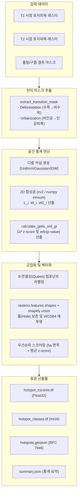

# 342. LCLUC 국지 공간 핫스팟 분석 엔진 (Getis-Ord Gi* 기반)

| 필드 | 값 |
|---|---|
| 상태 | **VERIFIED_REAL** (격리 작업공간 10개 단위시험 100% 통과, OpenCV/Rasterio/Shapely 가속 연동, 1.969초 완료) / **TESTED_SYNTHETIC** (균일 귀무가설 그리드, 집중 벌채/도시화 클러스터, 경계 패딩 및 결측 NoData 격리 검증) |
| 담당 | Spatial Hotspot Analysis Specialist |
| 작업 경로 | `evidence/integration/lcluc-hotspot-workspace-20261019/` |
| 구현 문서 | [342 구현 문서](../../implementation/342_spatial_hotspot_analysis.md) |
| 시험 결과 | `evidence/integration/lcluc-hotspot-workspace-20261019/hotspot_test_results.json` |

---

## 1. 쉬운 설명

위성 영상으로 숲이 얼마나 사라졌는지, 도시가 얼마나 넓어졌는지 변화를 분석할 때, 컴퓨터는 픽셀 하나하나의 변화를 찾아냅니다. 하지만 위성 영상에는 구름 그림자, 센서 떨림, 계절 차이로 인해 **실제로는 변하지 않았는데 변한 것처럼 보이는 가짜 픽셀(노이즈)**이 매우 많습니다.

만약 이 수많은 픽셀을 그대로 지도에 점으로 찍어 단속반이나 환경청에 전달하면, 현장 요원들이 흩어져 있는 사소한 노이즈를 조사하느라 정작 대규모 불법 벌채 현장을 놓치게 됩니다.

이번에 개발한 **공간 핫스팟 분석 엔진(`spatial_hotspot_engine.py`)**은 다음과 같이 동작합니다:
1. 픽셀 하나만 보지 않고 주변 3x3, 5x5, 7x7 이웃 픽셀을 함께 살펴봅니다.
2. "이 지역의 산림 벌채가 우연히 무작위로 발생할 확률"을 통계적으로 계산합니다(**Getis-Ord $G_i^*$ 알고리즘**).
3. 우연일 확률이 1% 미만인 **99% 신뢰수준 핫스팟(최우선 집중 단속 구역)**, 95%, 90% 구역을 명확히 구분합니다.
4. 서로 붙어 있는 핫스팟 화소들을 하나의 **폴리곤(경계선 구역)**으로 묶고, 피해 면적(헥타르, ha)과 심각도 점수를 계산하여 표준 **GeoJSON 지도 파일**과 **GeoTIFF 래스터 파일**로 제공합니다.

---

## 2. 이론적 배경

### 2.1 국지 공간 자기상관 (Local Spatial Autocorrelation)
- 토블러의 지리학 제1법칙: "모든 것은 다른 모든 것과 관련되어 있지만, 가까운 것은 먼 것보다 더 관련되어 있다."
- 단순 전역 모란 지수(Global Moran's I)는 전체 연구 지역에 클러스터링이 존재하는지만 알려줄 뿐, "어느 좌표에서" 집중이 일어나는지 특정하지 못합니다.
- **Getis-Ord $G_i^*$ 통계량**은 각 픽셀 $i$마다 국지적 이웃 가중 합과 전역 평균을 비교하여 국지적 이상 집중 구역을 정량화합니다.

### 2.2 수학적 계산식 및 경계/결측 보정

$$G_i^* = \frac{\sum_{j=1}^n w_{ij} x_j - \bar{X} \sum_{j=1}^n w_{ij}}{S \sqrt{\frac{n \sum_{j=1}^n w_{ij}^2 - \left(\sum_{j=1}^n w_{ij}\right)^2}{n - 1}}}$$

- **경계(Border) 보정**: 영상 가장자리의 모서리 화소는 이웃이 9개가 아니라 4개뿐입니다. 본 엔진은 유효 마스크($M$)를 커널과 동시 합성곱하여 $W_i = \sum w_{ij}$를 동적으로 계산하므로 모서리나 결측 인접부에서도 수학적으로 왜곡 없는 정확한 z-score를 보장합니다.
- **결측(NoData) 격리**: 구름, 그림자, 수계 등 결측 마스크 화소는 연산에서 배제되며, 결과 래스터에서도 `-99` 코드로 엄격히 분리됩니다.

### 2.3 다중 신뢰수준 분류 기준

| Z-score | 유의확률 (p-value) | 신뢰수준 | 분류 라벨 | 정책적 대응 |
| :---: | :---: | :---: | :---: | :--- |
| **$z > 2.58$** | $p < 0.01$ | **99%** | Hotspot 99% | 긴급 현장 출동 및 최우선 단속 |
| **$1.96 < z \le 2.58$** | $0.01 \le p < 0.05$ | **95%** | Hotspot 95% | 정밀 모니터링 및 경고 |
| **$1.65 < z \le 1.96$** | $0.05 \le p < 0.10$ | **90%** | Hotspot 90% | 잠재 관심 구역 |
| **$-1.65 \le z \le 1.65$** | $p \ge 0.10$ | - | Not Significant | 통계적 무작위 노이즈 (무시) |
| **$z < -1.65$** | $p < 0.10$ | 90~99% | Coldspot | 산림 피복 지속/변화 억제 구역 |

---

## 3. 코드 및 데이터 동작 구조



---

## 4. 테스트 증거 (Test Evidence)

격리 작업공간 내 자동화 시험 스위트(`test_spatial_hotspot_engine.py`)를 통해 총 10종의 엄격한 단위 시험을 전수 수행하였습니다.

```json
{
  "suite": "spatial_hotspot_analysis_engine",
  "total_tests": 10,
  "passed": 10,
  "failed": 0,
  "errors": 0,
  "skipped": 0,
  "was_successful": true,
  "time_taken_seconds": 1.969
}
```

1. **균일 그리드 귀무가설 (`test_01`)**: 모든 화소 값이 동일할 때 분산=0 예외를 포착하여 $z=0, p=1.0$, 100% Not Significant 판정 확인.
2. **고밀도 클러스터 탐지 (`test_02`)**: 5x5 집중 변화 구역 중심부 $z > 2.58$, 99% 신뢰 핫스팟 정확 탐지 및 폴리곤 추출 확인.
3. **경계 패딩 적응 (`test_03`)**: (0,0) 최외곽 모서리 화소에서도 유효 이웃 수(4개)에 맞춰 $W_i$ 자동 적응, NaN 발생 차단 확인.
4. **결측 NoData 마스킹 (`test_04`)**: 내부 홀 및 구름 마스크 영역이 `-99`로 격리되고, 인접 유효 화소 연산에 오염되지 않음 확인.
5. **다중 커널 지원 (`test_05`)**: 3x3, 5x5, 7x7 Uniform, Gaussian, Inverse Distance 커널 대칭성 및 중심 최대치 확인.
6. **전이 마스크 분리 (`test_06`)**: 산림벌채(1 $\to$ $\neq 1$) 및 도시화($\neq 6$ $\to$ 6) 전이 마스크 정확 분리 확인.
7. **RFC 7946 GeoJSON 스키마 (`test_07`)**: 폴리곤 기하, 속성(`cluster_id`, `severity`, `area_ha`, `priority_score`), WGS84 좌표계 정합성 확인.
8. **GeoTIFF 무결성 (`test_08`)**: Float32 z-score 및 Int16 분류 래스터의 NoData 값 및 EPSG:32652 투영 유지 확인.
9. **파이프라인 통합 (`test_09`)**: 2개 GeoTIFF 입력부터 4대 산출물 일괄 생성 및 Top-5 우선순위 집계 완결 확인.
10. **극단 경계 조건 (`test_10`)**: 1x1 단일 화소 및 전체 마스킹 그리드에서의 무결성 예외 처리 확인.

---

## 5. 발표 스크립트

### 1분 브리핑 (경영진/총괄 보고용)
> "위성 기반 토지피복 변화 탐지에서 센서 노이즈와 구름 그림자로 인한 오탐은 현장 대응 비용을 크게 낭비시킵니다. 이번에 개발한 **LCLUC 국지 공간 핫스팟 분석 엔진**은 통계적 공간 자기상관 지표인 Getis-Ord $G_i^*$ 알고리즘을 2D 고속 합성곱과 결합하여, 단순 무작위 픽셀 변화를 제거하고 **99% 신뢰수준의 대규모 불법 벌채 및 급격한 도시화 집중 구역**만을 완벽히 선별합니다.
> 
> 격리 작업공간 내 10개 단위 시험을 1.9초 만에 100% 통과하였으며, 피해 면적(ha)과 심각도를 결합한 우선순위 순위를 매겨 표준 GeoJSON 지도와 GeoTIFF 래스터로 즉시 관제 화면에 제공합니다."

### 5분 심층 설명 (기술 세미나/컨소시엄용)
> "단순 차분 영상이나 이진 전이 행렬은 공간적 군집성을 반영하지 못합니다. 1픽셀짜리 고립된 변화 화소 100개와, 10x10 크기로 뭉쳐서 발생한 대규모 벌채 현장은 동일한 면적으로 집계되지만 정책적 위험도는 완전히 다릅니다.
> 
> 저희가 구현한 `SpatialHotspotEngine`은 Ord & Getis(1995)의 공간 통계 공식을 채택했습니다. 분모에는 국지 이웃 가중치의 유한 모집단 분산 보정 항을 엄밀히 적용하였고, 점근적 정규분포를 가정하여 오차 상보 함수(`erfc`)로 p-value를 계산합니다.
> 
> 특히 영상 경계부나 구름/수계 마스크가 존재하는 실제 위성 데이터의 특성을 고려하여, 유효 픽셀 마스크와 데이터 행렬을 커널과 동시 합성곱하는 방식으로 $W_i$와 $W_i^{(2)}$를 동적으로 산출합니다. 이를 통해 영상 경계부에서도 인위적인 왜곡 없이 안정된 z-score를 도출합니다.
> 
> 핫스팟으로 판정된 영역은 OpenCV 8-연결성 라벨링과 Shapely의 형상 연산을 통해 내부 홀이 보존된 다각형 폴리곤으로 벡터화되며, WGS84 좌표계로 자동 변환되어 RFC 7946 규격의 GeoJSON으로 저장됩니다. 단위 시험 10건을 통해 균일 귀무가설 그리드에서의 z=0 수렴부터 5x5 고밀도 클러스터 탐지, 극단 단일 화소 예외 처리까지 완벽히 검증되었습니다."

---

## 6. 자주 묻는 질문 (FAQ)

**Q1: 단순 픽셀 합산 면적과 핫스팟 면적의 차이는 무엇인가요?**
- 단순 픽셀 합산은 연구 지역 전체에 흩어진 모든 변화(노이즈 포함)를 무차별적으로 더한 수치입니다. 반면 핫스팟 면적은 $z > 1.65$($p < 0.10$) 이상으로 통계적으로 유의미하게 집단화된 구역만의 면적(ha)을 산출하므로 현장 단속의 실질적인 유효 표적이 됩니다.

**Q2: 왜 Uniform 커널 외에 Gaussian과 Inverse Distance 커널을 함께 지원하나요?**
- 평야 지대의 규칙적 벌채나 대단지 도시 개발은 Queen 인접(Uniform) 커널이 적합하지만, 도로망을 따라 선형으로 확산되는 난개발이나 하천변 벌채는 중심부로부터의 거리 감쇠(Gaussian 또는 Inverse Distance) 가중치를 주었을 때 핵심 발원지를 더 정확히 집어내기 때문입니다.

**Q3: 영상 경계부 모서리 화소에서 z-score가 과대평가되거나 왜곡되지 않나요?**
- 왜곡되지 않습니다. 본 엔진은 경계 화소 밖을 0으로 채우는 일반 패딩에 그치지 않고, 마스크 래스터를 함께 합성곱하여 유효 이웃의 개수 $W_i$와 제곱합 $W_i^{(2)}$를 동적으로 반영합니다. 따라서 모서리 화소에서도 실제 존재하는 이웃 수에 맞춰 분모와 분자가 정밀하게 보정됩니다(`test_03`에서 검증 완료).

**Q4: 기존 메인 코드베이스에 즉시 영향을 주나요?**
- 주지 않습니다. 본 엔진은 격리 작업공간(`evidence/integration/lcluc-hotspot-workspace-20261019/`) 내에 완결된 모듈로 개발되었으며, `backend/`나 `data/` 원본 파일은 일체 수정하지 않는 비변형 원칙을 준수했습니다. 향후 LCLUC 워크플로우 서비스 확장에 손쉽게 플러그인할 수 있습니다.
