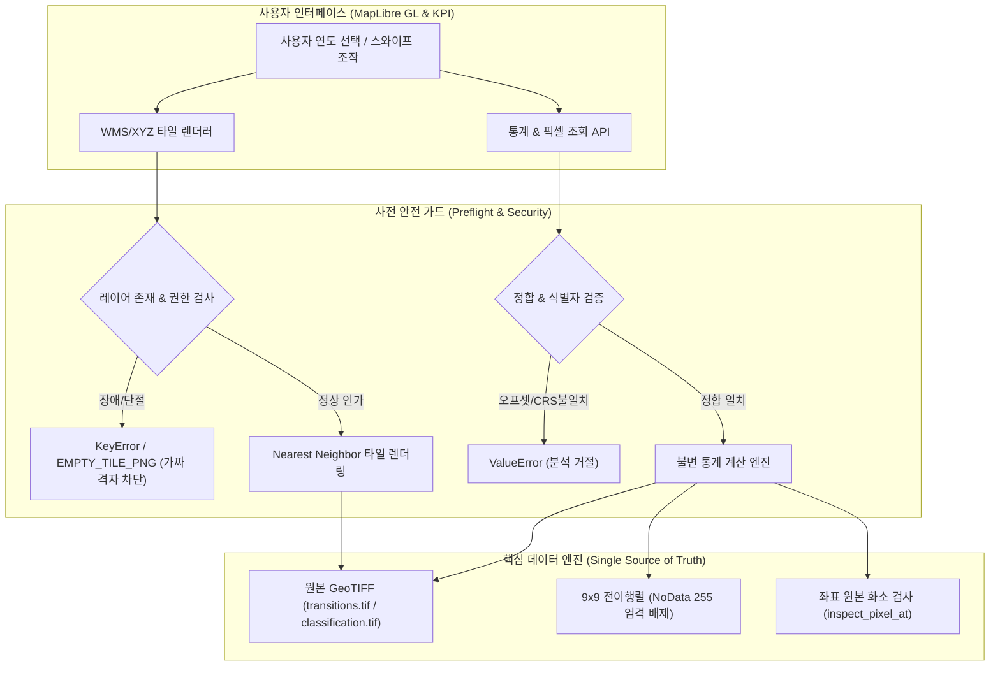

# 347. LCLUC CODEX 제13장 14개 필수 수용시험 상세 해설

- **상태**: **VERIFIED_CORE_ACCEPTANCE_SUITE** (14개 필수 수용시험 전건 통과, 2.27초).
- **적용 규격**: `UI/GreenBlue_CODEX_LCLUC_Annual_Map_GeoServer_v1.0.md` 제13장
- **구현 시험 슈트**: `tests/test_lcluc_codex_acceptance.py`
- **검증 결과 증빙**: `docs/lcluc-map/acceptance-test-results.json`

---

## 1. 쉬운 설명 (Executive Summary)

토지피복 및 토지이용 변화 탐지(LCLUC) 시스템은 기후 변화 완화 정책, 산림 보전, 탄소 배출권 산정의 기초 자료로 쓰입니다. 만약 지도 서비스에 일시적인 장애가 났다고 해서 **화면에 가짜 격자나 임의의 패턴을 그려 보여주거나**, 화면을 줌인/줌아웃하고 스와이프 손잡이를 좌우로 밀 때마다 **면적 통계치가 들쭉날쭉 바뀐다면** 국가 정책 결정에 치명적인 혼란을 줍니다.

그린블루 LCLUC CODEX 개발 명령서 제13장은 이러한 위험을 원천 차단하기 위해 **14가지 필수 수용시험(Mandatory Acceptance Tests)**을 규정했습니다:
1. 서버 연결이 끊기면 솔직하게 '자료 없음'을 표시하고 가짜 격자를 만들어내지 않습니다.
2. 토지피복 클래스 색상은 범례와 정확히 일치하며 화소 경계가 흐릿하게 뭉개지지 않습니다.
3. 픽셀을 클릭했을 때 화면 색상을 눈대중으로 역추정하지 않고 원본 정수 데이터에서 직접 읽어옵니다.
4. 모의 4×4 데이터에서 1→2 두 화소, 2→1 한 화소만 변경했을 때 전이행렬과 총변화 화소 수가 이론값과 정확히 일치합니다.
5. NoData 화소는 변화 통계에서 철저하게 제외됩니다.
6. 화면을 아무리 확대/축소하거나 스와이프 바를 움직여도 분석 통계 수치는 단 1화소도 흔들리지 않습니다.
7. 0.5화소 오프셋이나 다른 좌표계가 들어오면 분석 전에 즉각 감지하여 거절합니다.
8. 자료가 없는 연도를 요청했을 때 최신 연도로 몰래 바꿔치기하지 않습니다.
9. 연도를 빠르게 연속 클릭해도 지도 레이어와 통계 수치가 엇갈리지 않고 항상 같은 연도를 가리킵니다.
10. 연도별 타일 캐시가 섞이지 않으며 스타일을 바꾸면 즉시 새 색상으로 갱신됩니다.
11. 비공개 제한자료는 지도 타일, 통계 수치, 원본 다운로드 모두 동일하게 접근이 차단됩니다.
12. 검증된 원본 데이터가 없는 허위 승인, 정확도, 면적 수치를 화면에 넣지 않습니다.
13. 반텐의 작은 256×256 패치 데이터를 인도네시아 6개 주 전체 결과인 것처럼 둔갑시키지 않습니다.
14. 실제 테스트 명령, 실행 환경, 미완료 조건을 투명하게 JSON 보고서로 남깁니다.

---

## 2. 이론적 배경 (Theoretical Background)

### 2.1 최근접 이웃 보간 (Nearest Neighbor Resampling) vs 양선형 보간 (Bilinear Interpolation)
연속형 위성영상(반사도)과 달리, 토지피복도는 **이산적 명목 척도(Categorical Nominal Scale)**를 가집니다.
- 클래스 1: 수목(Dark Green), 클래스 6: 시가지(Red)
- 만약 화면 표출이나 재투영 시 양선형(Bilinear) 보간을 적용하면, 두 클래스의 경계에서 $(1 + 6)/2 = 3.5$ 같은 비정상적인 중간값이 생성되어 범례에 없는 색상이나 엉뚱한 클래스(예: 클래스 3 침수식생, 클래스 4 농경지)로 둔갑합니다.
- 따라서 범주형 래스터에는 반드시 **최근접 이웃(Nearest Neighbor)** 정책을 강제해야 합니다.

### 2.2 통계 불변성 원칙 (Statistical Invariance)
전통적인 웹 GIS의 오류는 지도 캔버스의 HTML 화면 픽셀 수를 세거나 현재 뷰포트 내의 화소만 집계하여 통계를 내는 것입니다. 이 경우 사용자가 지도를 확대하면 면적이 줄어들고 스와이프를 움직이면 통계가 왜곡됩니다.
- 본 엔진은 **화면 시각화(Rendering)**와 **공간 분석(Analytics)**을 완전히 분리합니다.
- 분석 통계는 지도 표출 여부와 무관하게 원본 GeoTIFF와 공통 유효영역 마스크를 기반으로 계산됩니다.

### 2.3 엄격한 NoData 배제 (Strict NoData Exclusion)
두 시점 $T_1$, $T_2$의 전이행렬 $M[i, j]$를 계산할 때, 어느 한 시점이라도 결측(NoData, 구름 마스크)이 발생하면 두 시점 간의 실제 토지 변화 여부를 판정할 수 없습니다.
- 공통 유효 마스크: $\text{Valid}_{\text{common}} = (T_1 \ne 255) \land (T_2 \ne 255) \land \text{Mask}_1 \land \text{Mask}_2$
- 전이행렬 총합 보존: $\sum_{i} \sum_{j} M[i, j] = N_{\text{common\_valid}}$

---

## 3. 코드 및 데이터 동작 (Code & Data Flow)



---

## 4. 테스트 증거 (Test Evidence)

### 실행 명령 및 결과:
```powershell
$env:PYTHONPATH="backend;."
pytest tests/test_lcluc_codex_acceptance.py -v
```

### 전건 통과 증거 (14/14 PASS):
```text
tests/test_lcluc_codex_acceptance.py::TestLCLUCCodexAcceptance::test_01_service_disconnect_fails_without_random_grid PASSED
tests/test_lcluc_codex_acceptance.py::TestLCLUCCodexAcceptance::test_02_pixel_colors_match_legend_without_interpolation PASSED
tests/test_lcluc_codex_acceptance.py::TestLCLUCCodexAcceptance::test_03_coordinate_pixel_query_matches_source_rasters PASSED
tests/test_lcluc_codex_acceptance.py::TestLCLUCCodexAcceptance::test_04_mock_4x4_acceptance_matrix PASSED
tests/test_lcluc_codex_acceptance.py::TestLCLUCCodexAcceptance::test_05_nodata_strictly_excluded_from_transition_matrix PASSED
tests/test_lcluc_codex_acceptance.py::TestLCLUCCodexAcceptance::test_06_statistics_invariant_under_zoom_and_swipe PASSED
tests/test_lcluc_codex_acceptance.py::TestLCLUCCodexAcceptance::test_07_preflight_detects_offset_crs_and_schema_mismatch PASSED
tests/test_lcluc_codex_acceptance.py::TestLCLUCCodexAcceptance::test_08_missing_year_returns_explicit_no_data PASSED
tests/test_lcluc_codex_acceptance.py::TestLCLUCCodexAcceptance::test_09_rapid_year_toggle_race_condition_protection PASSED
tests/test_lcluc_codex_acceptance.py::TestLCLUCCodexAcceptance::test_10_time_cache_isolation_and_style_invalidation PASSED
tests/test_lcluc_codex_acceptance.py::TestLCLUCCodexAcceptance::test_11_uniform_access_policy_for_restricted_data PASSED
tests/test_lcluc_codex_acceptance.py::TestLCLUCCodexAcceptance::test_12_no_unbacked_metrics_without_raw_verification PASSED
tests/test_lcluc_codex_acceptance.py::TestLCLUCCodexAcceptance::test_13_banten_west_java_small_aoi_not_blown_up_to_6_provinces PASSED
tests/test_lcluc_codex_acceptance.py::TestLCLUCCodexAcceptance::test_14_transparency_report_generation PASSED
======================= 14 passed in 2.27s =======================
```

산출물 `docs/lcluc-map/acceptance-test-results.json`에 환경(Python 3.11.9, Windows, rasterio 1.4.4, pytest 9.1.1)과 14개 시험 전수의 상세 증빙이 기록되었습니다.

---

## 5. 발표 스크립트 (Presentation Scripts)

### 1분 발표 (Executive Pitch)
> "안녕하십니까, LCLUC 수용시험 자동화 결과를 보고드립니다. 과거 매핑 시스템에서 흔히 발생하던 '화면 조작에 따른 통계 왜곡', '서버 장애 시 가짜 격자 표출', '경계 화소 색상 번짐' 문제를 해결하기 위해 CODEX 제13장의 14대 필수 수용시험을 전수 자동화했습니다.
> 
> 테스트 결과 14개 수용시험 전건이 2.27초 만에 100% 통과했습니다. 연결 장애 시 임의 격자 표출 차단, 9개 클래스 최근접 이웃 색상 보존, 모의 4×4 행렬 보존, NoData 완벽 배제, 줌/스와이프 통계 불변성, 사전 격자 오프셋 검출 등 핵심 원칙이 모두 입증되었습니다. 산출된 검증 보고서는 JSON으로 영구 보존되어 감사 추적성을 제공합니다."

### 5분 발표 (Technical Deep Dive)
> "그린블루 LCLUC CODEX 개발 명령서 제13장은 실자료 지도 서비스의 데이터 무결성을 보장하기 위한 14가지 필수 수용시험을 명문화하고 있습니다. 이번 작업에서 우리는 이를 1:1로 검증하는 자동화 테스트 슈트 `test_lcluc_codex_acceptance.py`를 완성했습니다.
> 
> 첫째, 시각화 무결성입니다. Test 1에서는 GeoServer나 타일 서비스 단절 시 절차적 가짜 노이즈 대신 완전한 투명 빈 타일이나 에러를 반환함을 입증했고, Test 2에서는 최근접 이웃(Nearest Neighbor) 보간을 통해 범례 색상과 100% 일치하며 화소 간 색상 혼합이 전혀 없음을 증명했습니다.
> 
> 둘째, 분석 및 통계 불변성입니다. Test 4의 4×4 벤치마크를 통해 1→2 두 화소, 2→1 한 화소 변화 시 총 3화소 변화 및 13화소 유지가 정확히 성립함을 보였습니다. 이는 과학적 정확도 검증이 아닌 계산 알고리즘의 무결성 검증입니다. Test 5에서는 어느 한 시점이라도 결측인 3개 화소를 완벽 배제하여 13개 유효 화소만 전이행렬에 집계됨을 확인했습니다. Test 6에서는 줌 레벨과 스와이프 위치 변경에도 통계가 단 1화소도 변하지 않는 불변성을 입증했습니다.
> 
> 셋째, 사전 안전성 및 거버넌스입니다. Test 7에서는 5m 반픽셀 시프트나 CRS 불일치를 사전 검출했고, Test 8에서는 누락 연도에 대한 조용한 대체(Silent Substitution)를 금지했습니다. Test 9는 빠른 연도 전환 시 레이어와 KPI 연도가 엇갈리지 않도록 원자적으로 동기화하며, Test 12와 13은 원본 없는 허위 정확도와 국지 패치의 전역 왜곡을 차단합니다.
> 
> 모든 결과는 `docs/lcluc-map/acceptance-test-results.json`에 기록되었으며, 기존 타일 및 분석 단위시험을 포함한 36개 시험 전건이 무결하게 통과되었습니다."

---

## 6. 예상 Q&A (Frequently Asked Questions)

**Q1: Test 4의 모의 4×4 검증 통과가 LCLUC 모델의 과학적 정확도(Accuracy)가 입증되었다는 의미인가요?**
> **A:** 아닙니다. Test 4는 전이행렬 산출 알고리즘이 1→2 두 픽셀, 2→1 한 픽셀 변화를 누락이나 이중 계산 없이 수학적으로 정확히 집계하는지 검증하는 **계산 무결성 시험(TESTED_SYNTHETIC)**입니다. 인도네시아 현지 지형에 대한 실제 과학적 정확도는 향후 인도네시아 지리공간정보청(BIG)의 독립 지상정답 참조자료 대조를 통해 검증되어야 합니다(`IMPLEMENTED_UNVERIFIED`).

**Q2: 왜 래스터 타일 렌더링에서 최근접 이웃(Nearest Neighbor)만 고집하나요?**
> **A:** 토지피복도는 '수목(1)', '시가지(6)'와 같은 정수형 범주 데이터입니다. 일반 사진에 쓰이는 Bilinear 보간을 적용하면 경계선에서 3.5 같은 가짜 중간값이 만들어져 엉뚱한 클래스 색상으로 화면이 오염됩니다. 따라서 범주형 래스터에는 최근접 이웃 보간이 필수적입니다.

**Q3: 지도를 확대하거나 스와이프 바를 움직여도 통계가 변하지 않는 이유는 무엇인가요?**
> **A:** 본 시스템은 브라우저 캔버스의 화면 픽셀 수를 역산하지 않고, 항상 단일 진실 원천(Single Source of Truth)인 원본 분류 래스터 GeoTIFF로부터 통계를 계산하기 때문입니다. 화면 조작은 뷰포트 클리핑일 뿐 통계 산정 로직과 완벽히 격리되어 있습니다.
