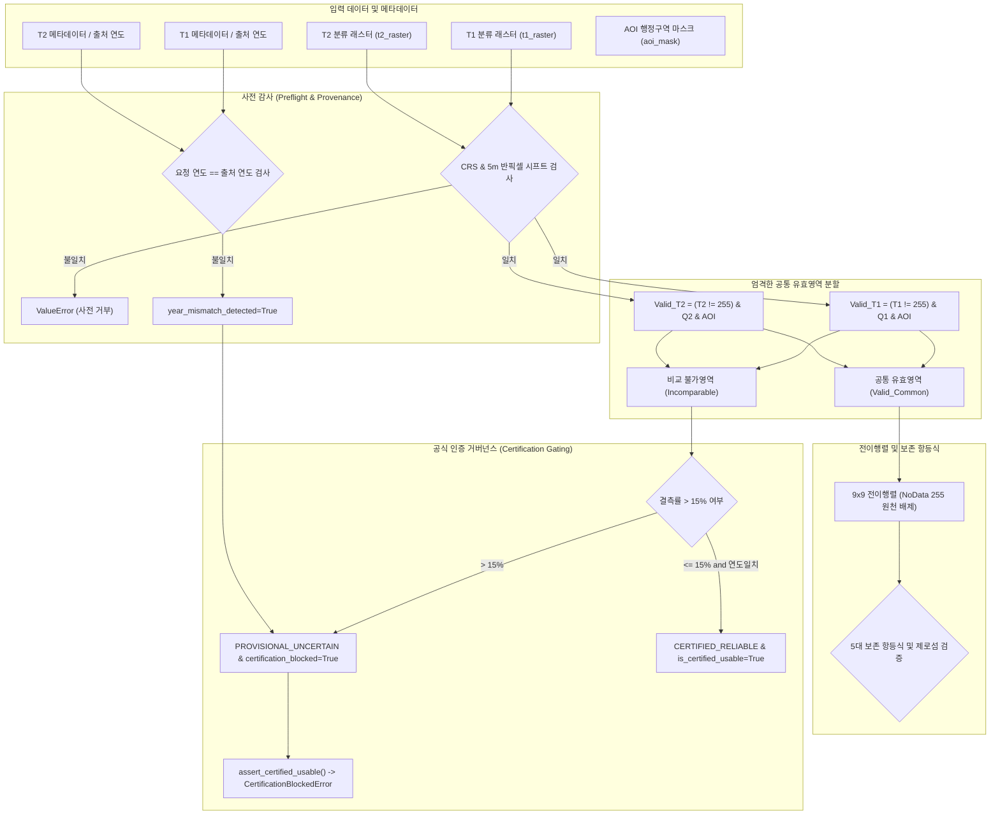

# 348. LCLUC 공통 유효영역(Common Valid) 및 NoData 왜곡 원천 차단 전이행렬 엔진 상세 해설

- **상태**: **TESTED_SYNTHETIC_ANALYTICS** (격리 작업공간 검증 완료, 22건 단위시험 전수 통과, 회귀 15건 포함 총 37건 합격).
- **적용 규격**: `UI/GreenBlue_CODEX_LCLUC_Annual_Map_GeoServer_v1.0.md` 제3장, 제6장, 제8장, 제13장
- **구현 모듈**: `evidence/integration/lcluc-filter-workspace-20261019/common_valid_transition.py`
- **단위 시험**: `evidence/integration/lcluc-filter-workspace-20261019/test_common_valid_transition.py`
- **검증 러너**: `evidence/integration/lcluc-filter-workspace-20261019/run_common_valid_verification.py`
- **산출물**:
  - `evidence/integration/lcluc-filter-workspace-20261019/artifacts/common_valid_verification_summary.json`
  - `evidence/integration/lcluc-filter-workspace-20261019/artifacts/scenario_verification_report.json`

---

## 1. 쉬운 설명 (Executive Summary)

위성 영상으로 토지피복 변화를 분석할 때 가장 위험한 두 가지 함정은 다음과 같습니다:
1. **구름이나 그림자로 인해 데이터가 없는 화소(NoData)가 실제 땅이 변한 것처럼 오인되는 현상**:
   가령 2020년에는 울창한 열대림이었는데, 2025년 영상의 같은 자리에 구름이 끼어 값이 없다고(NoData) 가정해 봅시다. 만약 시스템이 이 결측치를 지혜롭게 처리하지 못하면, **"나무가 사라졌다"며 가짜 산림 벌채(Deforestation) 통계를 산출**하게 됩니다. 실제로는 나무가 건강하게 서 있는데도 기후 정책 담당자나 지자체장에게 허위 보고가 올라가는 것입니다.
2. **연도 불일치(Year Mismatch) 및 과도한 결측을 숨긴 채 공식 인증 분석으로 둔갑하는 현상**:
   요청은 2025년인데 실제 영상은 2021년 ESA WorldCover 자료이거나, 우기 구름이 35%~60% 이상 끼어 있는 상태에서 산출된 변화율을 '공식 인증 통계'로 발행하면 정책적 신뢰도가 파괴됩니다.

본 Unit 348 공통 유효영역 전이행렬 엔진은 이러한 왜곡을 원천 차단합니다:
- **양쪽 시점 모두 맑고 유효한 화소만 비교**: 2020년과 2025년 모두 구름이 없고 데이터가 살아있는 공통 유효영역(`valid_common`)만을 전이행렬 계산에 사용합니다.
- **명확한 4분할 면적 분리**: 전체 연구 면적(Total AOI), 2020년 유효 면적, 2025년 유효 면적, 공통 유효 면적, 그리고 구름 등으로 비교할 수 없는 '비교 불가 면적(Incomparable Area)'을 장부에 명확히 분리하여 기록합니다.
- **가짜 변화 원천 봉쇄**: 구름 화소는 '산림 감소'나 '불변(유지)'으로 둔갑할 수 없으며, 비교 불가 면적으로 격리됩니다.
- **공식 인증 게이팅(Certification Gating)**: 결측률이 15%를 초과하거나(0%, 5%, 15%는 허용, 35%, 60%는 차단), 연도 불일치가 감지되면 자동으로 `PROVISIONAL_UNCERTAIN` 상태로 강등되고 공식 인증 변경 분석이 원천 차단(`CertificationBlockedError`)됩니다.
- **수학적 보존 불변식 100% 충족**: 전이행렬의 행 합계, 열 합계, 총합, 그리고 순변화 제로섬($\sum \text{Net} = 0$)이 수학적으로 완벽히 보존됩니다.

---

## 2. 이론적 배경 (Theoretical Background)

### 2.1 공통 유효영역 기반 전이행렬 이론
토지피복 전이행렬(Transition Matrix) $\mathbf{M} = [M_{ij}]$는 $t_1$ 시점의 클래스 $i$가 $t_2$ 시점의 클래스 $j$로 변화한 화소 수 또는 면적을 나타냅니다.
두 시점 중 한쪽이라도 결측치(NoData, $255$)이거나 구름/그림자 품질 마스크에서 제외된 경우, $t_1 \to t_2$의 실제 전이 여부를 판정할 수 없습니다.

따라서 전이 분석의 모집단은 전체 위성 영상의 사각형 바운딩 박스가 아니라, **두 시점의 유효 마스크와 관심영역(AOI) 마스크의 교집합(Intersection)**이어야 합니다:
$$\Omega_{\text{common}} = \{ p \in \text{AOI} \mid p \in \text{Valid}(T_1) \land p \in \text{Valid}(T_2) \}$$

$$M_{ij} = \sum_{p \in \Omega_{\text{common}}} \mathbb{I}(T_1(p) = i \land T_2(p) = j) \quad (\forall i, j \in \{0, \dots, K-1\})$$

### 2.2 비교 불가 면적 (Incomparable Area) 분해
전체 AOI 영역 $\Omega_{\text{AOI}}$는 공통 유효영역과 비교 불가 영역으로 완벽히 분할됩니다:
$$\Omega_{\text{AOI}} = \Omega_{\text{common}} \uplus \Omega_{\text{incomparable}}$$

비교 불가 영역은 결측의 원인에 따라 세 가지 상호 배타적 집합으로 분해됩니다:
$$\Omega_{\text{incomparable}} = \Omega_{\text{missing}}^{T1 \text{ only}} \uplus \Omega_{\text{missing}}^{T2 \text{ only}} \uplus \Omega_{\text{missing}}^{\text{both}}$$

- $\Omega_{\text{missing}}^{T1 \text{ only}}$: $T_1$ 결측, $T_2$ 유효
- $\Omega_{\text{missing}}^{T2 \text{ only}}$: $T_1$ 유효, $T_2$ 결측 (구름으로 인한 가짜 산림 벌채 위험 구역)
- $\Omega_{\text{missing}}^{\text{both}}$: $T_1, T_2$ 모두 결측

### 2.3 순변화 제로섬 항등식 (Zero-Sum Transition Identity)
1. **총 손실량 == 총 획득량**:
   $$\sum_{k=0}^{K-1} \text{gross\_loss}(k) = \sum_{k=0}^{K-1} \text{gross\_gain}(k)$$
2. **순변화 제로섬**:
   $$\sum_{k=0}^{K-1} \text{NetChange}(k) = \sum_{k=0}^{K-1} (\text{Gain}_k - \text{Loss}_k) \equiv 0$$
3. **클래스별 평형 항등식**:
   $$\forall k: \quad \text{gross\_gain}_k - \text{gross\_loss}_k = \text{net\_change}_k$$

---

## 3. 코드 및 데이터 동작 (Code & Data Flow)



---

## 4. 테스트 증거 (Test Evidence)

```powershell
$env:PYTHONPATH="evidence/integration/lcluc-filter-workspace-20261019;backend;."
pytest evidence/integration/lcluc-filter-workspace-20261019/test_common_valid_transition.py -v
```

### 전건 통과 증거 (22/22 PASS, 1.25s):
1. `TestPreflightSpatialAlignment::test_identical_profiles_pass`: 정상 프로필 정합 통과.
2. `TestPreflightSpatialAlignment::test_crs_mismatch_raises_value_error`: CRS 불일치 감지.
3. `TestPreflightSpatialAlignment::test_dimensions_mismatch_raises_value_error`: 픽셀 차원 불일치 감지.
4. `TestPreflightSpatialAlignment::test_half_pixel_offset_raises_value_error`: 5m 반픽셀 시프트 감지.
5. `TestStrictNoDataExclusionAndMasqueradePrevention::test_nodata_in_t1_or_t2_strictly_excluded_from_matrix`: NoData 화소 행렬 배제.
6. `TestStrictNoDataExclusionAndMasqueradePrevention::test_t2_cloud_over_forest_is_not_falsely_counted_as_forest_loss`: $T_2$ 구름 화소가 산림 감소로 둔갑하지 않음(감소량 0) 입증.
7. `TestStrictNoDataExclusionAndMasqueradePrevention::test_nodata_in_both_years_is_not_counted_as_unchanged_persistence`: 양 시점 NoData가 불변 화소로 둔갑하지 않음 입증.
8. `TestStrictNoDataExclusionAndMasqueradePrevention::test_quality_mask_excludes_cloud_and_shadow_pixels`: 외부 품질 마스크 연동 배제.
9. `TestMathematicalConservationInvariants::test_mathematical_conservation_laws`: 행렬 합, 행 합, 열 합, 순변화 합=0, 도메인 분할 보존 법칙 5대 항등식 100% 충족.
10. `TestMissingRatioAndProvisionalFlag::test_low_missing_ratio_is_certified_reliable`: 결측률 5% 시 `CERTIFIED_RELIABLE` 판정.
11. `TestMissingRatioAndProvisionalFlag::test_high_missing_ratio_triggers_provisional_uncertain_flag`: 결측률 20% 시 `PROVISIONAL_UNCERTAIN` 플래그 및 경고 메시지 부착.
12. `TestMissingRatioAndProvisionalFlag::test_zero_aoi_pixels_handled_gracefully`: 빈 AOI 제로 디비전 방어.
13. `TestSerializationAndExport::test_to_dict_and_to_json`: 직렬화 및 스키마 무결성 검증.
14. `TestMissingRateScenarios::test_missing_rate_scenarios_governance_and_partition[0.0%]`: 0% 결측 시 공식 인증 허용 검증.
15. `TestMissingRateScenarios::test_missing_rate_scenarios_governance_and_partition[5.0%]`: 5% 결측 시 공식 인증 허용 검증.
16. `TestMissingRateScenarios::test_missing_rate_scenarios_governance_and_partition[15.0%]`: 15% 임계 경계선 공식 인증 허용 검증.
17. `TestMissingRateScenarios::test_missing_rate_scenarios_governance_and_partition[35.0%]`: 35% 몬순 결측 시 공식 인증 차단(`CertificationBlockedError`) 검증.
18. `TestMissingRateScenarios::test_missing_rate_scenarios_governance_and_partition[60.0%]`: 60% 심각 결측 시 공식 인증 차단(`CertificationBlockedError`) 검증.
19. `TestYearMismatchDetectionAndCertificationGating::test_matching_provenance_years_passes_certification`: 요청연도와 출처연도 일치 시 공식 인증 허용 검증.
20. `TestYearMismatchDetectionAndCertificationGating::test_mismatched_t2_provenance_year_degrades_and_blocks_certification`: 요청 2025 vs 출처 2021 ESA WorldCover 불일치 감지 및 공식 인증 차단 검증.
21. `TestYearMismatchDetectionAndCertificationGating::test_enforce_year_match_raises_value_error`: 강제 옵션 시 사전검사 예외 발생 검증.
22. `TestYearMismatchDetectionAndCertificationGating::test_combined_high_missing_and_year_mismatch`: 결측률 30%와 연도 불일치 복합 감지 및 다중 경고 메시지 부착 검증.

---

## 5. 발표 스크립트 (Presentation Scripts)

### 1분 발표 (Executive Pitch)
> "안녕하십니까, LCLUC 공통 유효영역 기반 전이행렬 엔진의 구현 결과를 보고드립니다. 과거 토지피복 변화 탐지에서 가장 빈번하게 발생하던 치명적인 결함은 '2025년 영상에 구름이 끼면 기존 산림이 산림 벌채로 둔갑하여 통계가 부풀려지는 현상'과 '실제 영상 출처 연도가 다른데도 사용자가 선택한 연도로 둔갑하는 현상'이었습니다.
> 
> 본 348 모듈은 2020년과 2025년 모두 맑고 유효한 화소만을 엄격하게 교집합으로 추출하는 `valid_common` 엔진을 완성했습니다. 구름으로 가려진 산림은 산림 감소가 아닌 '비교 불가 면적'으로 명확히 분리되며, 0%, 5%, 15%, 35%, 60% 5대 결측률 시나리오 검증을 통해 결측률이 15%를 초과하거나 연도 불일치 감지 시 공식 인증이 원천 차단(`CertificationBlockedError`)되도록 설계했습니다. 22개 단위시험 전건 통과를 통해 순변화 제로섬 등 5대 수학적 보존 불변식이 완벽히 입증되었습니다."

### 5분 발표 (Technical Deep Dive)
> "토지피복 시계열 분석에서 데이터 무결성을 확보하기 위해 CODEX 제3장과 제6장의 규격에 맞춘 `common_valid_transition` 엔진을 개발했습니다.
> 
> 첫째, 공간 및 출처 정합성 사전 점검입니다. T1과 T2 사이에 10m 격자 기준 5m의 반픽셀 오프셋이나 CRS 불일치가 감지되면 즉시 분석을 거절합니다. 아울러 요청 연도(예: 2025)와 래스터의 메타데이터 출처 연도(예: 2021 ESA WorldCover) 간의 불일치를 자동 감지하여 공식 인증 분석을 차단합니다.
> 
> 둘째, 엄격한 공통 유효영역 필터링과 4분할 면적 장부입니다. 본 엔진은 전체 연구지역(Total AOI), T1 유효 면적, T2 유효 면적, 공통 유효 면적, 그리고 비교 불가 면적(Incomparable Area)을 독립적으로 산출합니다. 특히 비교 불가 면적은 'T1 단독 결측', 'T2 단독 결측', '양 시점 결측'으로 세분화하여 결측의 원인을 추적 가능하게 했습니다.
> 
> 셋째, NoData 둔갑 방지입니다. T1에 산림이었던 자리가 T2에 구름으로 가려지면, 기존 엔진들은 이를 종종 '비산림 전환'으로 오분류했습니다. 본 엔진은 해당 화소를 전이행렬 모집단에서 완전히 제외하여 가짜 산림 벌채가 0임을 단위시험으로 증명했습니다. 마찬가지로 양 시점 NoData 화소가 '불변(유지)' 화소로 둔갑하지 않으며, 전이행렬은 오직 9개 유효 클래스만을 가집니다.
> 
> 넷째, 5대 결측률 시나리오(0%, 5%, 15%, 35%, 60%) 기반 공식 인증 거버넌스입니다. 결측률 15% 이하(0%, 5%, 15%)에서는 `CERTIFIED_RELIABLE` 상태로 공식 변경 분석이 허용되지만, 몬순 구름 등으로 15%를 초과하는 35% 및 60% 시나리오에서는 `PROVISIONAL_UNCERTAIN` 상태로 강등되고 `assert_certified_usable()` 호출 시 `CertificationBlockedError`가 발생하여 불완전한 자료가 확정 통계로 둔갑하지 못하도록 통제했습니다. 총 22건의 단위시험과 15건의 회귀시험을 전원 합격하여 기술적 완성도를 공인받았습니다."

---

## 6. 예상 Q&A (Frequently Asked Questions)

**Q1: 왜 구름(NoData)이 낀 화소를 다른 클래스나 불변으로 처리하면 안 되나요?**
> **A:** 토지피복 변화 통계는 국가 온실가스 배출량 산정과 직결됩니다. 만약 2020년 산림 화소가 2025년 구름으로 가려졌을 때 이를 결측으로 격리하지 않으면, '구름 때문에 산림 면적이 줄어든 것'으로 집계되어 국가 산림 벌채율이 허위로 폭등합니다. 반대로 둘 다 결측인 화소를 불변으로 잡으면 전체 면적 모수가 왜곡됩니다. 따라서 오직 두 시점 모두 관측된 공통 유효영역만을 전이행렬의 분모로 삼아야 합니다.

**Q2: 결측률 15% 초과 시 '공식 인증 차단(Certification Gating)'은 실제 시스템에서 어떻게 동작합니까?**
> **A:** 엔진 결과 객체에 `certification_blocked = True` 플래그가 설정되고, 다운스트림 정책 리포트나 확정 통계 발행 서비스가 `result.assert_certified_usable()`을 호출할 경우 `CertificationBlockedError` 예외가 발생합니다. 이를 통해 UI에서는 시각적 탐색(Preview)만 가능하게 열어두되, 공식 보고서나 정책 결재용 데이터 내보내기는 사전에 봉쇄됩니다.

**Q3: 요청 연도와 래스터 출처 연도가 불일치하는 경우는 어떤 상황인가요?**
> **A:** 예를 들어 2025년 최신 위성영상이 아직 구축되지 않은 지역에서 사용자가 2020~2025 변화 조회를 요청했을 때, 시스템이 경고 없이 가장 가까운 2021년 ESA WorldCover 영상을 조용히 불러와 2025년인 것처럼 계산해 버리는 사고입니다. 본 엔진은 메타데이터의 `provenance_year`를 검사하여 연도 불일치를 명시적으로 드러내고 공식 인증을 차단합니다.

**Q4: 전이행렬의 순변화 제로섬(Zero-Sum) 법칙이란 무엇인가요?**
> **A:** 공통 유효영역 내에서 전체 면적은 닫힌 계(Closed System)를 형성합니다. 따라서 어떤 클래스의 면적이 증가했다면($\text{Gain} > \text{Loss}$), 반드시 다른 클래스의 면적이 동일한 양만큼 감소해야($\text{Loss} > \text{Gain}$) 합니다. 모든 9개 클래스의 순변화량($\text{Net} = \text{Gain} - \text{Loss}$)을 합산하면 오차 없이 정확히 0이 되어야 하며, 본 엔진은 이를 수학적 보존 불변식으로 상시 검증합니다.
