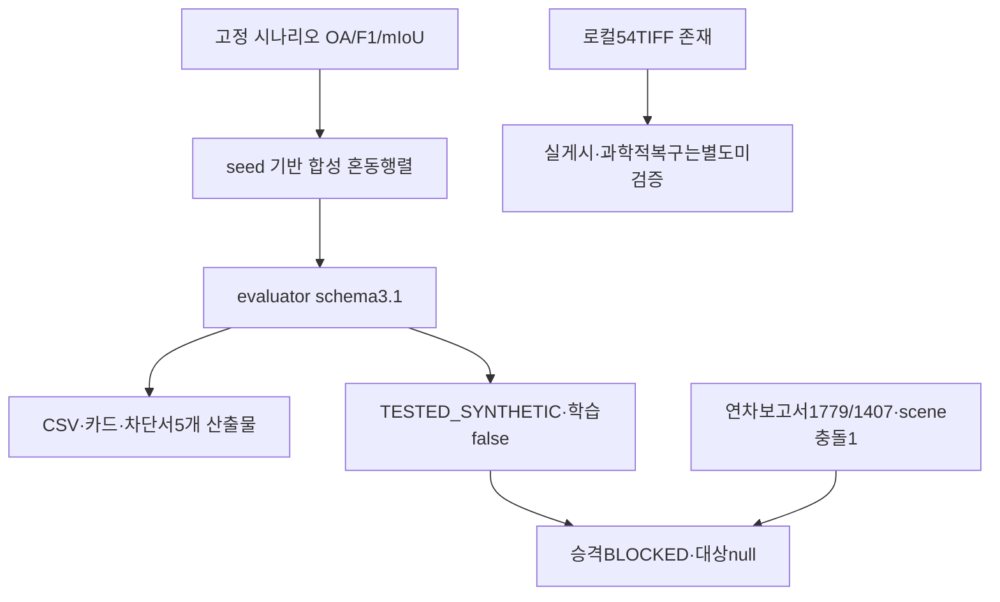

# 350 — CODEX v3 G6~G9 근거 교정과 합성 벤치마크 해설

- updated_at: 2026-10-20, Unit352 교정 기준
- source_commit: 변경 중인 shared workspace의 evaluator schema3.1 기준. evaluator SHA `1e5d3958277d683a346f2e796daf39758faa61bc8456d2272ae95e257e391e43`; 시험 SHA `2954a485aed0f8a24314cc5cc28203438730f0fca5517e4c0417e0ae3b44e5c7`.
- evidence_paths: [352 독립감사·교정](../implementation/352_g6_g9_evidence_integrity_remediation.md), [evaluator](../../backend/app/ml/model_benchmark_evaluator.py), [시험 코드](../../tests/test_model_benchmark_evaluator.py), [합성 지표CSV](../lcluc/v3/06_model_metrics_baseline_vs_challenger.csv), [혼동행렬 설명](../lcluc/v3/06_per_class_metrics_and_confusion.md), [G8 카드](../lcluc/v3/06_holdout_independence_and_model_card.md), [G9 차단서](../lcluc/v3/07_retraining_model_approval_rollback.md)
- confidence: 완료 코드·산출물·Root 독립감사를 읽은 범위. 이해 담당의 학습·예측·서비스 조회·시험 실행은 0.
- status: **G8/G9 TESTED_SYNTHETIC / 승격 BLOCKED**. **G6 VERIFIED_REAL은 로컬 TIFF 54개 존재와 제한된 서비스 관측 범위**. 과학적 복구·전수 게시·G7 학습 준비는 BLOCKED이며, G7 코드 교정은 진행 중이다.

이 문서는 이전 350판의 전체 단계 완료·실제 재학습 성능·공식 승격 주장을 철회하고 대체한다. 합성 시나리오·실파일 존재·서비스 응답·운영 승인은 서로 다른 증거다. G0~G14 전체 구현·검증 완료를 이 문서로 주장하지 않는다.

## 1. 쉬운 설명

**현재 G8/G9의 점수는 실제 모델 시험 성적표가 아니라 코드가 만드는 예시 성적표다. 화면·문서 흐름을 시험할 수 있지만 실제 학습·예측·정확도·승격 근거로 사용할 수 없다.**

시험장 안내판에 예시 점수를 넣어 화면을 확인한 상황과 같다. 예시의 점수가 높다고 실제 학생이 시험을 봤거나 합격한 것은 아니다. 마찬가지로 TIFF 파일 54개가 있다는 사실도 모든 GeoServer 레이어가 게시됐거나 구름 결측이 실제로 복구됐다는 증거는 아니다.

원본 연차 보고서의 등록은 1,779행, 품질 적격은 1,407행(865/292/250)이다. scene 분할 충돌 1건과 클래스 부족이 남아 있으며, learning_ready는 false다. 폴더 인벤토리 1,780을 적격 수로 읽거나 누출 0·학습 준비 완료로 표현하지 않는다. G7 담당의 코드 교정은 진행 중이므로 완료라고 보고하지 않는다.

## 2. 이론적 배경

실제 정확도는 독립 라벨과 고정된 예측 배열을 비교해 재계산해야 한다. 학습 로그·체크포인트 SHA·입력 및 분할 지문·예측 산출물·독립 라벨이 필요하다. 고정 숫자나 seed로 만든 혼동행렬은 재현 가능한 예시지만 관측된 모델 성능은 아니다. 그 예시에서 계산한 클래스별 지표도 같은 합성 범위다.

홀드아웃은 지리적 이름만 나누는 것으로 입증되지 않는다. 같은 Sentinel-2 원본 scene이 Banten/validation과 West Java/test에 걸치면 원본 차원의 누출 조건을 검토해야 한다. 분할 충돌 0·완전 공간 독립성·독립 정답은 서로도 다른 주장이다. 현재 원본 충돌 1건이 있으므로 독립 홀드아웃 확인은 false로 유지한다.

서비스 HTTP 200·PNG 응답과 레이어별 출처·내용의 진실성도 다르다. GetCapabilities가 named layer를 열거하지 않는다면 표본 GetMap 성공만으로 전수 게시 목록을 입증하지 못한다. 배포 승인에는 과학적 정확도와 별도로 사람의 승인 기록이 필요하다.

## 3. 코드와 데이터의 실제 흐름

`evaluate_all()`은 학습을 실행하거나 체크포인트·독립 라벨·예측 파일을 읽지 않는다. 과거 4개 실험명과 고정 점수·가중치/seed 42를 예시로 유지한다. `EXP-D`는 scenario_reference일 뿐 best 모델이 아니다. `best_experiment_id=None`이며 promotion/rollback 대상은 None, 모든 is_best_model은 false다.

검증된 시험 패치/픽셀은 0/0이다. scenario 264패치·17,301,504픽셀은 가정값으로 별도 필드에 둔다. 실제 1,179개 학습이나 264개 독립 평가를 수행한 것이 아니다. 학습 설정 50epoch·batch 16 같은 값도 과거 계획일 뿐 실행 이력은 아니다.

| 실험 | 상태 | 시나리오OA | 시나리오F1 | 시나리오mIoU |
|---|---|---:|---:|---:|
|EXP-A|TESTED_SYNTHETIC|0.482|0.440|0.380|
|EXP-B|TESTED_SYNTHETIC|0.546|0.492|0.421|
|EXP-C|TESTED_SYNTHETIC|0.768|0.731|0.692|
|EXP-D|TESTED_SYNTHETIC|0.864|0.841|0.812|

위 숫자·차이·상대 증가율은 모두 합성 시나리오다. EXP-D의 OA 86.4%나 F1 0.841을 실제 성능으로 발표하지 않는다. 지표 CSV는 scenario_* 열을 쓰며, 혼동행렬 문서·카드·G9 결정에도 출처와 차단을 함께 기록한다.

현재 `training_executed`, `prediction_artifacts_verified`, `holdout_independence_verified`, `scientific_accuracy_validated`, `promotion_authorized`는 모두 false다. 결정은 `BLOCKED_NO_EXECUTED_TRAINING_OR_MEASURED_PREDICTIONS`다. 실제 학습·checkpoint SHA·측정 예측·독립 라벨·scene 충돌 해소·learning-ready·사람 승인의 부재를 각각 차단 사유로 둔다.

## 4. G6/G7 독립감사의 실제 범위

| 항목 | 확인된 사실 | 허용하지 않는 확대 해석 |
|---|---|---|
|G6 로컬파일|primary TIFF54개실제존재|54/72레이어전수게시·실영상복구완료|
|G6 생성|coverage_comparison고정배열·복원/잔여마스크가그합성배열에서파생|독립G5lineage로증명된복구율|
|GeoServer호환서비스|GetCapabilities200·표본annual_valid_banten_2021 GetMap PNG200|named목록완비·전체레이어검증|
|registry|현재CSV54primary행만존재·이전secondary18행덮어씀|54+18=72등록이현재보존됐다는주장|
|G7 원본|1779행/1407적격(865/292/250),scene충돌1·learning_readyfalse|1780적격·1179/337/264실분할·누출0·학습게이트통과|
|G7 코드교정|별도담당진행중|새교정완료/새시험통과선취|

[primary manager](../../backend/app/ml/geoserver_primary_layers_manager.py)는 게시 검사 없이 상태 문자열을 기록한 경로가 있다. 상태 문자열은 외부 게시 증거가 아니다. [registryCSV](../lcluc/v3/08_geoserver_1st_2nd_layer_registry.csv)를 읽어 현재 54행에 stage 1st_primary만 있는 것도 확인했다. 감사의 권위 원본은 `data/first-group-training-esri-v1/annual-window-report.json`이다. 이해 담당은 큰 운영 원본을 다시 계산하지 않고 352 독립감사의 수량/충돌을 인용한다.

1,780은 이미지·라벨·quality 파일명이 있는 폴더 인벤토리 범위다. 기존 manager의 밴드 6 상수·누출 false 상수·개수만의 readiness는 실제 band/공간 검증이 아니다. 이 문서의 과거 G5 복구율·G10~G14 탄소/생태계 효과 역시 이번 근거로 검증된 성과라고 재사용하지 않는다.

## 5. 시험 근거와 한계

Root352 구현 문서는 evaluator 시험 4PASS/3.08초와 py_compile exit 0을 보고했다. 이해 담당은 시험 코드와 완료 기록만 읽었고 새 시험을 실행하지 않았다. 4개 시험은 시나리오 4개·검증 시험 수 0·best/승격 대상 없음·false gate·5개 출력의 출처/차단 이유를 검사한다. 실제 학습·모델 정확도 시험은 아니다.

최초 CLI는 Windows CP949가 workspace의 en dash를 출력하지 못해 export 전에 종료했다. 동일 CLI에 UTF8 출력을 명시해 5개 산출물을 재발행한 기록을 보존했다. 이를 실제 학습 시도·성공이나 부분 모델 배포로 세지 않는다. 과거 67 backend/347 frontend/build 숫자는 이번 정확도·승격 증거가 아니며, 이 해설에서 전체 실제 검증 완료의 근거로 재사용하지 않는다.

실서비스의 정상 응답·로컬 파일 존재는 한정된 범위의 실제 관측이다. 원격 수집·실제 학습·모델 승격·운영 배포·기관 승인 기록은 없다. 향후 G6 registry 보존/lineage·named 목록/전수 HTTP·G7 권위 원본 결속·독립 라벨/예측·재계산 지표·사람 승인 근거가 생기기 전까지 승격은 차단한다.

## 6. 발표 대본

### 1분

“G6부터 G9의 기존 완료 표현을 근거에 맞게 교정했습니다. 로컬 TIFF 54개 존재는 확인됐지만 마스크에는 합성 배열이 있고, 전수 게시 목록과 registry 보존 문제가 남습니다. 권위 원본은 1779행 중 1407개 적격이며 scene 충돌 1건과 학습 미준비 상태가 있습니다. G8/G9 점수는 코드가 만드는 합성 시나리오로 실제 학습·예측·정확도가 아닙니다. 승격 대상과 승인은 없으며 차단을 유지합니다.”

### 5분

“파일과 화면이 있다는 사실을 학습 성과와 구분하겠습니다. 현재 TIFF 54개는 로컬 파일 존재 범위의 실제 근거입니다. 그러나 복구 비교 배열이 합성이며 named-layer 목록도 비어 있어 표본 PNG 200을 전체 게시로 확대하지 않습니다. registry는 primary 54행으로 덮였으므로 이전 secondary 18행의 보존도 필요합니다.

데이터 수량은 권위 연차 보고서를 따릅니다. 1779행/1407개 적격이며 865/292/250 분할입니다. 같은 scene이 검증/시험을 넘는 충돌 1건이 있고 learning-ready는 false입니다. 1780개 폴더를 모두 적격으로 세거나 완전 누출 0이라고 말하지 않습니다. G7 교정 코드도 아직 진행 중입니다.

evaluator는 실제 학습이나 예측 파일을 읽지 않습니다. 4개 시나리오와 합성 혼동행렬·고정 점수를 출력합니다. 264패치도 시나리오 수량이며 검증 시험 패치는 0입니다. 높은 예시 점수를 실제 성능으로 발표하지 않고 best 모델·승격 대상·롤백 대상을 비워 둡니다.

4개 시험 통과는 이 차단과 출처 계약이 유지되는지 검증한 합성 시험 결과입니다. 앞으로 실행된 학습 로그·체크포인트 지문·독립 라벨·예측 산출물·재계산 지표·분할 충돌 해소·사람 승인이 필요합니다. 그전까지 운영 승격은 차단합니다.”

### 10분 구성

1. 0–2분: 파일 존재·합성 시험·실제 관측·운영 승인 구분.
2. 2–4분: G6 파일 54개/합성 마스크/목록 공백/registry 18행 손실.
3. 4–6분: G7 권위 원본 1407개·scene 충돌 1건·진행 중인 교정.
4. 6–8분: G8 고정 시나리오·검증 test 0·false 상태·4개 시험의 범위.
5. 8–10분: G9 차단과 필수 증거·전체 개발 미완료.

## 7. Q&A

**Q. OA 86.4%와 F1 0.841은 실제 성과인가요?** TESTED_SYNTHETIC 시나리오 예시입니다. 실제 학습·예측·독립 라벨에서 측정하지 않았습니다.

**Q. 그럼 4PASS는 무엇을 증명하나요?** 합성값이 승격 근거로 바뀌지 않고 false 상태와 차단 출처가 산출물에 유지되는 계약입니다.

**Q. TIFF 54개가 있으면 GeoServer 54레이어 게시 아닌가요?** 로컬 파일 존재와 서비스 게시 목록은 다릅니다. GetCapabilities의 named 목록과 전수 내용 검증이 필요합니다.

**Q. GetMap PNG 200은 믿을 수 없다는 뜻인가요?** 표본 응답의 실제 관측입니다. 그 범위를 전수 게시·과학적 복구로 확대하지 않는다는 뜻입니다.

**Q. 왜 1780개 적격이 아닌가요?** 그 수치는 폴더 파일명 인벤토리입니다. 권위 원본의 품질 적격은 1407개이며 분할/클래스/충돌 기준도 따로 있습니다.

**Q. 기관 승인과 승격은 있나요?** 확인된 사람 승인 기록도 승격 대상도 없습니다. 모든 운영 승격은 차단 상태입니다.
