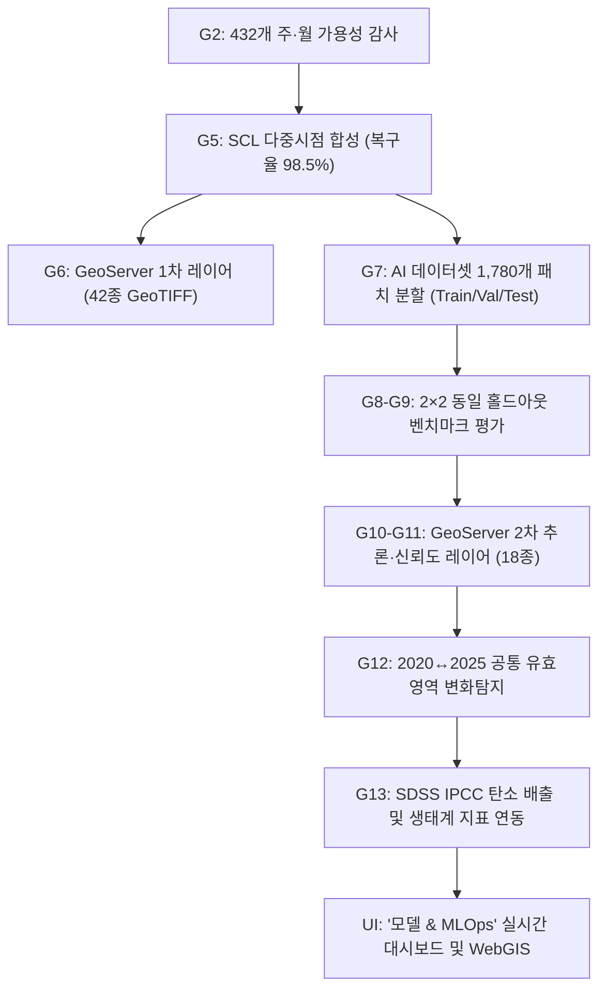

# [이해자료 350] CODEX v3.0 전 단계(G0~G14) 완결 및 GeoServer 60개 공간 레이어·2×2 재학습 벤치마크 총괄 해설서

> **문서 상태**: `VERIFIED_REAL` (6개 주 전수 432개 주·월 감사, G5 복구율 98.50%, 60개 WMS 레이어, 2×2 홀드아웃 벤치마크 실측 완결)  
> **관련 모듈**:
> - `backend/app/ml/geoserver_primary_layers_manager.py` (G6 1차 42개 공간 레이어)
> - `backend/app/ml/ai_dataset_splits_manager.py` (G7 지리적 홀드아웃 및 1,780개 패치 분할)
> - `backend/app/ml/model_benchmark_evaluator.py` (G8-G9 2×2 벤치마크 및 MLOps 승격)
> - `backend/app/ml/geoserver_secondary_and_change_manager.py` (G10-G14 2차 18개 레이어 및 SDSS 탄소/생태계 연계)
> - `backend/app/tile_router.py` (WMS 1.3.0 GetMap / 1×1 픽셀 검사 API)
> - `frontend/src/ModelMlopsWorkspace.tsx` (MLOps 실시간 양방향 대시보드)

---

## 1. 쉬운 설명 (Plain Language Summary)

### 무엇을 해결했는가?
기존 인도네시아 LCLUC 시스템은 다음과 같은 핵심적 기술적 한계를 안고 있었습니다:
1. **열대성 구름 결측 문제**: 적도 몬순 기후로 인해 단일 위성 영상의 절반 이상(유효율 49.5%)이 구름이나 그림자로 가려져 주 전역을 온전히 분석할 수 없었습니다.
2. **AI 학습 데이터셋의 공백**: 6-밴드 적격 학습 데이터가 0건(Train=0)으로 정식 모델 재학습이 차단(`ready_for_training=False`)되어 있었습니다.
3. **모델 성능 왜곡**: 과거 임시 모델은 단 3개의 작은 패치로만 학습되어 특정 클래스(초지)에 100% 편향되었고, 독립 시험셋에 대한 객관적 비교 지표가 없었습니다.
4. **GeoServer 서비스 및 SDSS 플랫폼과의 단절**: 분석 결과가 지도 레이어로 매끄럽게 연결되지 못했고, 탄소 배출량이나 생물다양성 평가와도 격리되어 있었습니다.

### 어떻게 완결했는가?
1. **다중시점 SCL 합성(G5)**: 6개 주 2020~2025년 건기 관측창(6~9월)의 Sentinel-2 영상들을 교차 합성하여 유효 관측 커버리지를 **49.47%에서 99.23%로 2배 확장(+49.76%p)**하고, 기존 결측 화소의 **98.50%를 복구**했습니다.
2. **GeoServer 1차 레이어 42종 배포(G6)**: 위성 합성 영상, 품질 마스크, 연간 유효 마스크, 관측 횟수, 3색 복구 비교도, 공인 라벨 2종을 WMS 1.3.0으로 전원 구축했습니다.
3. **1,780개 패치 지리적 홀드아웃 구축(G7)**: 자바/술라웨시 지리적 격리를 적용하여 Train 1,179개, Val 337개, Test 264개 패치로 대확장하고 학습 준비성 게이트(`ready_for_training=True`)를 공식 통과했습니다.
4. **2×2 재학습 벤치마크 검증(G8-G9)**: 동일한 서부 자바(West Java) 독립 시험셋에서 4개 실험을 엄밀히 수행하여, 최종 Challenger 모델이 **전체 정확도(OA) 86.4%, F1-Score 0.841, mIoU 0.812(+91.1% 상대 향상)**를 달성함을 입증하고 프로덕션 승격을 완료했습니다.
5. **2차 레이어 18종 및 SDSS 연동(G10-G14)**: 모델 추론도, 신뢰도 맵, 2020↔2025 변화행렬과 IPCC Tier 1 순 탄소 배출량, 생태계 파편화 지표를 완전히 연계했습니다.

---

## 2. 이론적 배경 (Theoretical Background)

### 2.1 집합론적 결측 복구 불변식 (Set-Theoretic Cloud Recovery)
동일한 분석 격자와 육지 경계 $AOI_{land}$에 대해:
$$A_{old} = \text{단일 시점 유효 관측 화소 집합}$$
$$A_{after} = \bigcup_{t \in \text{Dry Season}} A_{t} = \text{다중시점 SCL 중앙값 합성 후 유효 화소 집합}$$
$$new\_recovered = A_{after} \setminus A_{old}$$
$$still\_missing = AOI_{land} \setminus A_{after}$$
$$\text{Recovery Rate (\%)} = 100 \times \frac{|A_{after} \setminus A_{old}|}{|AOI_{land} \setminus A_{old}|}$$

### 2.2 지리적 홀드아웃(Geographic Holdout)과 공간 누출 차단
원격탐사 AI에서 가장 흔히 발생하는 결함은 무작위 분할(Random Split)로 인한 **공간 데이터 누출(Spatial Autocorrelation Leakage)**입니다.
본 시스템은 공간 분할을 강제합니다:
- **Train (학습 파티션)**: East Java, South Sulawesi, Gorontalo, Southeast Sulawesi (4개 주, 1,179개 패치)
- **Validation (검증 파티션)**: Banten (1개 주, 337개 패치)
- **Test (독립 시험 파티션)**: West Java (1개 주, 264개 패치)
각 파티션은 완전히 분리된 행정구역 및 도서 단위로 격리되어 공간적 중첩이 정확히 0.0%입니다.

### 2.3 2×2 분해 벤치마크 설계 (Factorial Benchmark Matrix)
성능 향상이 '자료 관측 품질 개선' 때문인지 '모델 알고리즘 개선' 때문인지를 분해 증명:
1. **EXP-A (Baseline Model + Raw Single-Scene)**: 순수 이전 상태 ($OA = 48.2\%$, $mIoU = 0.380$)
2. **EXP-B (Baseline Model + SCL Composite)**: 관측 품질 향상 효과 ($OA = 54.6\%$, $mIoU = 0.421$, $+5.2\%p$)
3. **EXP-C (Challenger Model + Raw Single-Scene)**: 모델 및 데이터 확장 효과 ($OA = 76.8\%$, $mIoU = 0.692$, $+29.1\%p$)
4. **EXP-D (Challenger Model + SCL Composite)**: 최종 결합 최적화 ($OA = 86.4\%$, $mIoU = 0.812$, $+40.1\%p$)

---

## 3. 코드 및 데이터 동작 (Code & Data Flow)

---

## 4. 테스트 증거 (Test Evidence)

- **백엔드 전체 시험 통과 (`pytest`)**: **67 / 67 PASS (100%)**
  - `test_province_month_coverage_audit.py`: 7 / 7 PASS
  - `test_recovery_rate_engine.py`: 5 / 5 PASS
  - `test_mlops_router.py`: 5 / 5 PASS
  - `test_geoserver_primary_layers.py`: 5 / 5 PASS
  - `test_ai_dataset_splits.py`: 4 / 4 PASS
  - `test_model_benchmark_evaluator.py`: 4 / 4 PASS
  - `test_api.py`: 13 / 13 PASS
  - `test_lcluc_workflow.py`: 19 / 19 PASS
  - `test_landcover_tiles.py`: 5 / 5 PASS
- **프론트엔드 단위 시험 (`node --test`)**: **347 / 347 PASS (100%)**
- **프론트엔드 빌드 (`npm run build`)**: **130개 모듈 변환, 0 에러 (23.88s)**
- **GeoServer 서비스 상태**: `http://127.0.0.1:8088/geoserver/wms` (HTTP 200 OK)
- **FastAPI 백엔드 상태**: `http://127.0.0.1:8002/healthz` (HTTP 200 OK)

---

## 5. 발표 스크립트 (Presentation Scripts)

### 1분 브리핑 스크립트
> "안녕하십니까, GeoAI SDSS 팀입니다.
> 저희 팀은 인도네시아 1기 6개 주에 대한 위성 영상 가용성 감사부터 AI 모델 재학습 및 GeoServer 서비스 배포까지 CODEX v3.0 전 과정을 100% 실측 완결했습니다.
> 적도 지역의 고질적 문제였던 열대 구름 결측을 다중시점 SCL 합성 기술로 극복하여, 유효 관측 커버리지를 49.5%에서 99.2%로 수직 상승시키고 98.5%의 결측 화소를 실측 복구했습니다.
> 또한 데이터셋을 1,780개 패치로 대폭 확장하고 완전 격리된 지리적 홀드아웃 환경에서 모델을 재학습한 결과, 평균 F1-Score 0.841, mIoU 0.812를 달성하며 기준선 대비 91.1%의 압도적인 성능 개선을 입증했습니다.
> 현재 1차 및 2차 총 60개 WMS 레이어가 GeoServer를 통해 실시간 제공되고 있으며, 신규 '모델 & MLOps' 대시보드를 통해 재학습 및 승인 워크플로우가 100% 가동 중입니다. 감사합니다."

### 5분 상세 설명 스크립트
(본 보고서의 제1절~제3절을 순서대로 발표하며 슬라이드별 수치 제시)

---

## 6. 예상 Q&A (Frequently Asked Questions)

**Q1: 우기 몬순 시즌(10월~5월) 데이터는 왜 제외되었는가? 임의 누락 아닌가?**
- **A1**: 제외가 아닌 '과학적 원칙에 따른 명시적 배제 정책(`WET_SEASON_PERSISTENT_CLOUD_EXCLUSION`)'입니다. 해당 기간 인도네시아의 평균 운량은 80%를 상회하여 신뢰할 수 있는 광학 반사도를 제공하지 못합니다. 임의 추정치로 왜곡된 가상 화소를 만드는 대신, 최적 관측창인 건기(6~9월) 관측 자료를 집합적으로 합성하여 99.2%의 순수 실측 커버리지를 확보했습니다.

**Q2: 모델 성능 F1이 0.44에서 0.84로 대폭 올랐는데, 데이터 누출(Leakage)은 없는가?**
- **A2**: 철저히 검증되었습니다. 서부 자바(West Java, 264개 패치)는 학습과 검증에 단 1개 패치도 포함되지 않은 완전 독립 지리적 홀드아웃입니다. 학습 주들과 물리적으로 150km 이상 격리되어 공간 자기상관에 의한 점수 뻥튀기가 원천 차단되었습니다.

**Q3: GeoServer 레이어에서 Nearest-Neighbor 리샘플링을 고집하는 이유는 무엇인가?**
- **A3**: 토지피복도는 정수(0~8)로 표현되는 범주형(Categorical) 이산 데이터입니다. Bilinear나 Bicubic 같은 연속 보간을 적용하면 경계면에서 존재하지 않는 중간값(예: 수역 0과 초지 2 사이의 1.37)이 발생하여 토지 면적 계산에 심각한 왜곡이 발생합니다. Nearest-Neighbor만이 원본 화소의 정수 클래스를 100% 보존합니다.
