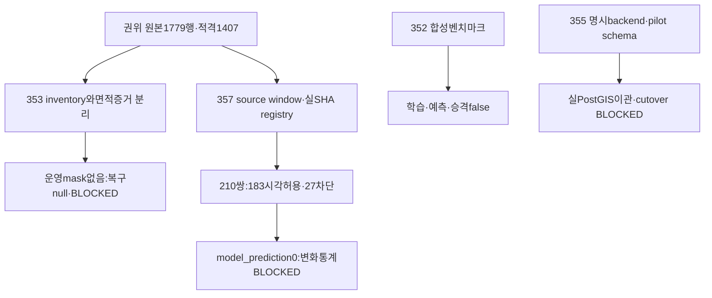

# 352~360 — 증거 교정, 커버리지, 저장소, 지도 비교의 통합 상태

- updated_at: 2026-10-21, Unit360 Root 최종 통합 검증 기준
- source_commit: 현재 공유 코드의 완료 변경을 읽은 범위. 이해 담당의 코드·시험·운영 데이터 수정 없음.
- evidence_paths: [352 증거 교정](../implementation/352_g6_g9_evidence_integrity_remediation.md), [353 커버리지 계약](../implementation/353_province_coverage_fail_closed.md), [355 PostGIS pilot](../implementation/355_postgis_registry_pilot.md), [357 Swipe 계약](../implementation/357_swipe_authoritative_comparison_contract.md), [353 최종 시험 로그](../../evidence/integration/unit353-coverage-contract-20261021/focused-tests.log), [358 secondary 교정](../implementation/358_g6_secondary_fail_closed.md), [359 MLOps 교정](../implementation/359_mlops_summary_fail_closed.md), [360 통합 검증](../implementation/360_two_requirement_traceability.md)
- confidence: 완료 코드·시험·읽기 전용 관측의 범위는 확인. 실제 복구율, 36셀 운영 마스크, 실제 PostGIS 이관·모델 성능·검증된 승인은 미검증 또는 차단. 실행 브라우저의 차단 표시와 Swipe 프리셋·키보드 동작은 Root가 실제 확인했다.
- status: 아래 상태표의 범위별 판정을 따른다. 하나의 단위에 합성 시험과 실제 읽기 관측이 함께 있어도 전체를 VERIFIED_REAL로 올리지 않는다.

## 1. 쉬운 설명

**이번 변경은 자료가 없는 곳에 성공 숫자를 채우지 않고, 근거가 있는 범위에서만 계산·저장·지도 비교를 허용하도록 고친 작업이다. 실제 모델 학습·예측·승격·배포는 0이다.**

창고에 자료가 있다는 사실, 지도 두 장을 겹쳐 볼 수 있다는 사실, 숲이 얼마나 바뀌었는지 계산할 수 있다는 사실은 다르다. 현재 원본은 등록 1,779행, 품질 적격 1,407행(학습 865/검증 292/시험 250)이다. 원본 scene 분할 충돌 1건과 클래스 부족이 남아 `learning_ready=false`다. 폴더 수 1,780이나 예시 벤치마크 점수를 학습 완료 근거로 사용하지 않는다.

353은 유효 관측 면적과 실제 복구 화소를 구분한다. 355는 PostgreSQL 오류를 SQLite 성공으로 숨기지 않게 한다. 357은 같은 위치·격자·마스크 조건을 확인한 지도 쌍만 시각 비교하도록 한다. 이 세 가지 개선도 새로운 영상 취득이나 모델 정확도 향상을 뜻하지 않는다.

### 상태표

| 범위 | 상태 | 인정하는 범위와 한계 |
|---|---|---|
|352 G8/G9 시나리오와 차단 계약|TESTED_SYNTHETIC / BLOCKED|예시 지표·혼동행렬, 검증 test 0, 승격 대상·승인 없음|
|권위 원본 inventory|VERIFIED_REAL|1,779행/1,407 적격·split 865/292/250. 주 전체 커버리지나 학습 준비 완료는 아님|
|353 이진 마스크·동일-grid 차집합|TESTED_SYNTHETIC|EPSG:6933 fixture와 null/차단 계약을 검증|
|353 운영 커버리지·복구|BLOCKED|대상 6개 주×6년의 36셀 마스크와 before/after 전이 증거 미확보|
|355 저장소 선택·장애 처리·snapshot reconcile|TESTED_SYNTHETIC|모의 PostGIS metadata·임시 SQLite 검증. 실제 DB 연결·이관 아님|
|355 DDL·정규 테이블·라이브 적용|IMPLEMENTED_UNVERIFIED / BLOCKED|pilot SQL은 있으나 실제 PostgreSQL 적용·typed backfill·cutover 없음|
|357 운영 파일 읽기 감사|VERIFIED_REAL|118 source window, 35시리즈, 210쌍 중 시각 비교 183/차단 27|
|357/360 실제 화면 동작|VERIFIED_REAL|MLOps blocked/null/disabled, Swipe 0/50/100·ArrowRight 51 확인. 과학 변화·정확도·운영 배포는 아님|
|357 변화·면적·전이행렬·픽셀 팝업|BLOCKED|`model_prediction=0`, 비교용 pixel-query API 없음|
|358 secondary·변화 계약|TESTED_SYNTHETIC / BLOCKED|합성 생성 제거·증거 검사 시험 완료. 실제 inference/secondary/change는 차단|
|359 approval 레코드|IMPLEMENTED_UNVERIFIED|존재하는 기록도 미검증 기록으로 표시. verified approval 0|
|G7 권위 원본 기반 gate|VERIFIED_REAL / BLOCKED|현 재고를 읽고 차단을 검증. baseline NOT_PINNED·improvement null·learning_ready=false|
|후속 실제 마스크·독립 평가·pilot 이관·추가 UI E2E|PLANNED|필요한 입력·검증·승인을 갖춘 뒤 별도 완료 근거가 필요|

## 2. 이론적 배경

### 면적 순증가와 실제 복구는 다르다

두 시점의 유효 면적 차이가 10ha여도, 어느 화소가 새로 관측됐고 어느 화소가 다시 가려졌는지는 알 수 없다. 실제 신규 복구는 동일한 격자에서 `(~before) & after & boundary`로 계산한다. 분모는 `(~before) & boundary`다. 집계 면적의 차이를 이 화소 차집합으로 바꾸어 말하지 않는다.

면적 비교에는 같은 면적 기준이 필요하다. 현재 353 계약은 경계와 래스터를 모두 EPSG:6933으로 맞춘다. UTM 픽셀 면적과 EPSG:6933 경계 면적을 섞은 초기 반텐2023 기록은 현재 유효한 면적 실측 증거에서 철회됐다. read-only 실행 기록을 보존한 것과 계산의 과학적 타당성을 인정한 것은 다르다.

36셀은 우선 대상 6개 주의 2020~2025년 범위다. 인도네시아 전국 전체를 의미하지 않는다. 432개 주·월 inventory도 파일·장면의 존재 기록이며 관측 커버리지 432개를 측정한 결과가 아니다.

### 저장소의 실패를 다른 저장소의 성공으로 바꾸지 않는다

실제 원장을 PostgreSQL로 선택했는데 오류 때 SQLite로 조용히 바꾸면 어느 기록이 권위인지 모호해진다. 355는 시작 시 backend를 명시하고 실행 중 장애에는 전환하지 않는다. 개발용 fallback은 별도 opt-in과 저하 상태 표시가 필요하다. 이 정책의 합성 시험 통과가 실제 PostGIS provisioning·이관 성공은 아니다.

### 시각 비교 가능과 변화 통계 가능은 다르다

두 지도를 그릴 수 있어도 CRS·affine·범위·해상도·shape·NoData·class schema·mask 계약이 다르면 같은 화소를 비교할 수 없다. 조건이 맞는 연차 참조지도도 화면 비교만 허용한다. 모델 예측과 독립 정답 없이 표시용 타일에서 변화 면적이나 모델 정확도를 생성하지 않는다.

## 3. 코드와 데이터 동작

### 352 — 예시 성적표를 실제 모델 성능으로 사용하지 않는다

[`model_benchmark_evaluator.py`](../../backend/app/ml/model_benchmark_evaluator.py)는 학습·체크포인트·독립 라벨·예측 파일을 읽지 않고 고정값과 합성 혼동행렬을 만든다. schema3.1은 `TESTED_SYNTHETIC`과 `DETERMINISTIC_SCENARIO_FIXTURE`를 명시한다. 시나리오의 264패치와 검증된 시험 패치 0을 분리한다. `best_experiment_id`, promotion/rollback target은 null이고 실행·예측 검증·독립성·정확도·승격 권한은 false다.

기존 OA 86.4%·F1 0.841·mIoU 0.812는 합성 예시다. 실제 성능이나 승인된 모델로 발표하지 않는다. 자세한 교정 범위는 [350 해설](350_CODEX_V3_FULL_PIPELINE_AND_GEOSERVER_BENCHMARK.md)에 있다.

### 353 — 동일 면적 기준·이진 mask·null-safe 복구

[`province_year_coverage.py`](../../backend/app/ml/province_year_coverage.py)는 source/boundary/raster SHA, 명시 schema, 요청 범위, 단일-band 이진 관측 mask, 원인 코드와 면적 불변식을 검사한다. mask는 EPSG:6933·north-up·NoData 미설정·값 0/1이어야 한다. 중복 patch·unknown quality·잘못된 원인 코드·겹침의 이중 계상 가능성은 차단한다. 경계 전체를 실제로 덮고 모든 결측 종류가 허용 오차 이하일 때만 `COVERAGE_COMPLETE`다.

[`recovery_rate_engine.py`](../../backend/app/ml/recovery_rate_engine.py)의 집계 순변화와 실제 신규 복구는 별도 필드다. pinned 동일-grid before/after/boundary mask가 없으면 `newly_recovered_area_ha`·`recovery_rate_pct`는 null이고 상태는 BLOCKED다. API가 HTTP 200으로 이 차단 envelope를 반환해도 과학 지표 성공을 뜻하지 않는다.

월별 inventory는 원본 1,779행·107 unique scene·적격 1,407·미흡 372·활성 주·월 77을 보고한다. 432셀의 coverage/outside 비율은 null이고 `BLOCKED_NOT_MEASURED`다. nominal/degraded로 임의 분류하지 않는다.

초기 [completion](../../evidence/integration/unit353-coverage-contract-20261021/completion.json)과 [반텐 real-smoke 기록](../../evidence/integration/unit353-coverage-contract-20261021/real-smoke.json)에는 이전 판의 성공 상태가 남아 있다. 최신 353 완료 문서는 좌표계 혼합으로 그 real-smoke의 VERIFIED_REAL 주장을 철회하고 있다. 과거 JSON의 상태만 골라 현재 성공 근거로 사용하지 않으며, 초기 반텐 수치를 전국·36셀 결과로 확대하지 않는다.

### 355 — 개발 저장소와 PostGIS pilot의 명시적 구분

[`Store`](../../backend/app/store.py)는 `sqlite-dev`/`postgres`를 시작 시 선택한다. Postgres에는 DSN, PostGIS major3+, schema version0355와 테이블 inventory가 필요하다. 시작 후 읽기·쓰기 실패를 SQLite로 우회하지 않는다. 개발 환경에서 명시한 startup fallback만 `DEGRADED_DEV_FALLBACK`으로 드러내며 production의 SQLite/fallback은 거부한다.

pilot은 datasets/assets/scenes/aois/coverage/experiments/models/predictions/approvals의 9개 정규 도메인과 제한된 운영기록을 구분한다. [`postgis_reconcile.py`](../../backend/app/postgis_reconcile.py)는 live DB가 아닌 정지 snapshot을 읽기 전용으로 열어 행 수·kind/ID·JSON/NULL·시간대·geometry 구조·canonical SHA를 검산한다. GeoJSON 구조 검사는 실제 PostGIS `ST_IsValid`가 아니다.

현재 실제 DB 적용·운영 이관은 0이다. typed column backfill이 남았고 일부 모듈의 SQLite 직접 transaction 접근도 backend-neutral 방식으로 옮겨야 한다. public health 계약의 TestClient 검증과 실행 중 API 프로세스 반영은 별개이며, 라이브 반영은 미검증이다.

### 357 — 권위 원장·내용 SHA·비교 계약을 연결한다

[`landcover_tiles.py`](../../backend/app/landcover_tiles.py)는 최신 mtime/glob 대신 권위 연차 보고서가 직접 참조한 source window만 등록한다. 적격 행과 source report의 year/province/label/source group/taxonomy를 맞추고 실제 label·quality SHA를 사용한다. 같은 logical series/year가 중복되면 둘 다 제거해 `DUPLICATE_GROUP_YEAR`로 차단한다. size/mtime이 같아도 내용 SHA가 바뀌면 타일을 거부한다.

운영 파일 읽기 감사의 118 source window·35시리즈에서 비교 계약 210쌍을 만들었다. 183쌍은 `READY_VISUAL_REFERENCE_ONLY`, 27쌍은 mask_grid 불일치로 BLOCKED다. bounds와 shape 불일치 각 8개는 그 27개에 포함되며 더해서 별도 차단 수로 세지 않는다. 183은 패치·레이어·실제 모델 실험 수가 아니라 시각 비교 가능한 연도쌍 수다.

[`TemporalCompare.tsx`](../../frontend/src/TemporalCompare.tsx)는 서버의 `comparison_id`, SHA, tile URL, preflight를 사용한다. divider pointer/touch·키보드·0/50/100 프리셋·양방향 지도 동기화·좌우 오류 표시를 구현했다. 같은 연도나 grid/mask 불일치에는 겹치지 않는다. backend tile은 quality mask가 1인 화소만 표시한다. 현재 model_prediction 레이어는 0이므로 변화·면적·전이행렬은 `BLOCKED_NO_MODEL_PREDICTION`, 픽셀 팝업은 `BLOCKED_NO_PIXEL_QUERY_API`다.

### G7 최종 교정 — 재고는 검증하되 학습 준비는 차단한다

[`ai_dataset_splits_manager.py`](../../backend/app/ml/ai_dataset_splits_manager.py)는 권위 원본과 품질·분할·경계·scene/class gate를 사용한다. Root의 최종 전체 회귀는 58PASS/425.71초다. 현재 원본 1,779/적격 1,407(865/292/250)·scene split conflict 1·클래스 미달 때문에 `learning_ready=false`를 유지한다. 이는 이전 폴더 수·상수 누출 판정을 근거로 한 완료 주장과 다르다.

과거 baseline은 같은 정의·분모·시점으로 고정되지 않아 `NOT_PINNED`다. `baseline_eligible_count`와 `expansion_pct`는 null이며 improvement는 산출하지 않는다. 현재 적격 수를 과거와 비교한 학습량 증가율이나 정확도 개선율로 바꾸지 않는다.

### 358 — 실제 추론 없는 secondary 생성과 변화 숫자를 제거한다

[`GeoServerSecondaryAndChangeManager`](../../backend/app/ml/geoserver_secondary_and_change_manager.py)는 WorldCover 복제 prediction·난수 confidence·고정 변화/탄소 통계를 생성하던 경로를 제거했다. 호환 함수명 `materialize_secondary_layers()`는 현재 읽기 전용 증거 검사다. 증거가 없으면 기대 record 18개를 BLOCKED/null로 반환하며 파일·directory를 새로 만들지 않는다. 실제 inference·secondary·T1/T2 change는 BLOCKED다.

실제 artifact를 인정하려면 실행된 모델의 checkpoint/input 경로·SHA, prediction/confidence/valid-mask의 경로·SHA·grid·값 계약이 필요하다. WorldCover와 SHA 또는 픽셀 배열이 같은 prediction은 차단한다. 게시 상태에는 SHA가 고정된 GetCapabilities XML 원문과 정확한 named-layer 열거가 필요하며 manifest 자기선언만으로 통과하지 않는다.

기존 primary54의 게시 표시는 `UNVERIFIED_NOT_ENUMERATED`로 교정했다. 로컬 파일 SHA는 확인했지만 합성 마스크18은 `TESTED_SYNTHETIC`, 나머지36도 원천 provenance는 미검증이다. 파일 존재·named 열거·GetMap·원본 픽셀 검산은 각각 다른 증거다. 실제 변화·면적·탄소·파편화는 null로 남긴다.

### 359 — 미검증 승인 기록과 실제 검증된 승인을 구분한다

[`mlops_router.py`](../../backend/app/mlops_router.py)의 summary2.0은 status/reason code와 함께 실학습·운영 모델·queue·배포는 0, F1/mIoU/coverage는 null로 반환한다. 과거 Store의 approval 레코드가 있어도 `미검증 기록`/`IMPLEMENTED_UNVERIFIED`로 표시하고 `verified_approval_count=0`이다. 기록 존재는 사람의 근거 검증·모델 승격·배포를 입증하지 않는다.

experiments는 runs=[]·best_run=null·metrics=null이다. `POST /v1/mlops/retrain`과 `POST /v1/mlops/approval`은 HTTP409와 각각의 차단 이유를 반환하며 write-free다. UI 버튼 비활성화뿐 아니라 직접 API 호출도 레코드를 쓰지 않는 계약을 시험했다. [`ModelMlopsWorkspace.tsx`](../../frontend/src/ModelMlopsWorkspace.tsx)는 blocked/null·차단 이유와 실행 불가 상태를 표시한다.

PostGIS 무연결 [`script`](../../scripts/migrate_sqlite_to_postgis.py)의 보고서도 교정했다. 실제 연결·이관이 없으면 target row는 `N/A (not executed)`, parity는 `NOT_MEASURED`, schema는 `DDL_ONLY_NOT_APPLIED`, pilot은 `BLOCKED_NO_POSTGIS_PILOT_EXECUTION`이다. 로컬 source 검사가 성공하거나 함수가 반환해도 실제 PostGIS 이관·parity 성공을 뜻하지 않는다. 이 no-DSN 분기 검증을 승인된 DB·DDL·transaction·이관 rehearsal로 확대하지 않는다.

## 4. 시험 증거와 실제 관측의 한계

| 단위 | 완료 근거 | 증명하지 않는 범위 |
|---|---|---|
|352|evaluator 4PASS/3.08초, compile exit0|실제 학습·예측·모델 정확도·승격|
|353|최종 집중·관련 회귀 40PASS/14.31초, G2/G5 CLI exit0|운영36셀 면적·실제 복구율|
|355|집중14PASS/2.22초, health 포함28PASS/88.02초, 관련74PASS·15 subtests/48.88초|실PostGIS 연결·DDL 적용·이관·cutover|
|357|backend12PASS 약5.35초, TypeScript/Vite build PASS|실브라우저 drag/touch·전수WMS 게시·모델 변화 통계|

355의 세 배치는 겹친다. 116개 고유 시험으로 합산하지 않고 subtests도 별도 고유 사례로 부풀리지 않는다. 임시 SQLite와 fixture·fault injection에서 오류 차단·원본 snapshot 불변을 검증했다. 경고는 기존 deprecation 범위이며 실제 DB 동작을 확인한 근거가 아니다.

353 초기 completion의 12PASS/기존 API assertion 실패 기록과 최종 40PASS는 다른 판이다. 초기 오류·철회된 반텐 smoke는 보존하고 최종 equal-area·이진 mask·동일-grid·null 계약을 현재 근거로 삼는다. 이해 담당은 이 시험을 재실행하지 않았다. G7 58PASS와 PostGIS 1PASS의 시간은 Root가 unified exec stdout에서 확인한 최종 인계다. 별도 보존 로그 파일은 없으므로 해당 로그 경로를 만들거나 추정하지 않는다. 358 집중8건은 통합31건과 겹치며 다른 배치도 전체 고유 시험 수로 합산하지 않는다.

초기357의 UI5174 연결 거부·브라우저 미확인 상태는 현재 Unit360 Root 검증으로 대체됐다. 현재 API8002·UI5174 및 proxy·GeoServer8088은 HTTP200이며 실제 브라우저에서 MLOps와 Swipe를 확인했다. named 목록은 WMS와 스타일명만 열거하므로 이 HTTP 성공도 54/72개 전수 게시·운영 배포 증거는 아니다. 로컬 z0 PNG 생성과 cold 약9.044초/cache0.001초는 각각 파일 렌더링·단일 registry 관측이며 SLA가 아니다.

실제 MLOps 화면은 blocked/null·버튼 disabled·미검증 approval 표시를 확인했다. Swipe는 registry118·series35·comparisons210·visual183·blocked27·model_prediction0으로 표시됐다. 왼쪽100%는 split100, 오른쪽100%는0, 50/50은50이었고 ArrowRight 입력으로51을 확인했다. 이는 **UI 동작 VERIFIED_REAL**이다. 모든 drag/touch·zoom/pan/resize·좌우 오류를 자동 E2E로 검증한 범위는 아니며 후속으로 남는다. 통계·pixel query·과학적 정확도는 계속 BLOCKED다.

운영 코드의 서비스 복구와 실제 운영 배포 승인은 구분한다. Unit360의 로컬 서비스 검증은 staging/prod 보안·HA·DR·승격·배포 완료를 뜻하지 않는다. 실제 학습·예측·승격·운영 배포 0, 원본·원장 보존과 `learning_ready=false`는 변하지 않았다.

## 5. 발표 스크립트

### 1분

“Unit360까지 근거와 차단 상태를 바로잡고 실제 화면 동작도 확인했습니다. 실제 원본은 1,779행 중 1,407개 적격이며 scene 충돌 1건과 학습 미준비가 남습니다. 모델 점수는 합성 예시이고 실제 학습·예측·승격·배포는 0입니다. 커버리지는 실제 마스크 없이는 null로, PostGIS는 pilot·미이관으로 표시합니다. Swipe는 183개 연도쌍의 참조지도 시각 비교만 허용하고 27개는 차단합니다. 모델 예측이 없으므로 변화 통계와 픽셀 팝업은 차단 상태입니다. 실제 화면의 버튼 비활성화와 Swipe 프리셋·키보드는 확인했습니다.”

### 5분

“자료 수와 관측 면적을 먼저 구분하겠습니다. 원본 1,779행·적격 1,407개는 inventory입니다. 그 숫자로 6개 주 전역이 관측됐다고 계산할 수 없습니다. 353은 같은 EPSG:6933 이진 마스크와 before/after 화소 차집합이 없으면 복구량·복구율을 null로 남깁니다. 반텐의 초기 read-only 기록도 좌표계 혼합으로 현재 유효한 실측 근거에서 철회했습니다.

352 모델 점수는 실제 모델 성적이 아닌 합성 예시입니다. 학습 로그·checkpoint·독립 라벨·예측 산출물·재계산 지표·사람 승인이 없으므로 승격을 차단합니다. 원본 scene 충돌 1건과 클래스 부족도 남습니다.

355는 저장소 오류를 조용히 다른 backend의 성공으로 숨기지 않게 했습니다. 합성 시험은 통과했지만 승인된 pilot DB·실제 DDL 적용·typed backfill·운영 이관은 아직입니다.

358은 WorldCover를 prediction으로 복제하던 경로와 난수·고정 변화 통계를 제거했습니다. 359는 approval 레코드를 미검증으로 표시하고 검증된 승인은 0으로 둡니다. 직접 재학습·승인 요청도 409로 쓰기 없이 막습니다. G7 회귀가 통과했어도 baseline은 NOT_PINNED, improvement는 null, 학습 준비는 false입니다.

357은 권위 원장이 참조한 실제 source window와 파일 SHA만 사용해 지도를 짝지었습니다. 210쌍 중 183쌍은 참조지도 시각 비교, 27쌍은 불일치로 차단했습니다. 예측 레이어는 0이므로 화면 타일에서 변화량을 만들어내지 않습니다. UI 빌드와 실제 브라우저에서 차단 표시·0/50/100 프리셋·키보드 이동을 확인했습니다. 이 UI 동작의 검증을 과학 변화나 모델 정확도 승인으로 확대하지 않습니다.

따라서 다음 단계는 실제 마스크·모델 증거·pilot 이관 조건·브라우저 실행 근거를 각각 확보하는 일입니다. 계약 구현과 시험 통과를 운영 승인으로 확대하지 않습니다.”

### 10분 구성

1. 0–2분: inventory·품질 적격·주 전체 면적·학습 준비의 차이.
2. 2–4분: 353 equal-area·동일-grid 복구와 초기 반텐 기록 철회.
3. 4–6분: 352 합성 성적표와 승격 차단, 355 pilot과 실제 이관의 차이.
4. 6–8분: 357의 183/27 비교 계약·참조지도와 모델 예측 구분.
5. 8–10분: 확인된 브라우저 동작과 추가 자동 E2E·독립 평가·36셀 마스크·pilot cutover의 남은 조건.

## 6. Q&A

**Q. 반텐2023은 실제로 읽었는데 왜 실측 완료라고 하지 않나요?** 읽기 기록은 있지만 초기 면적 계산은 서로 다른 좌표계 기준을 혼합했습니다. 최신 계약으로 재검증되지 않아 유효 실측 근거에서 철회됐습니다.

**Q. 전국 커버리지를 확인했나요?** 아닙니다. 대상 6개 주의 36개 주·연도 운영 마스크도 미검증입니다. 이 범위를 인도네시아 전국으로 확대하지 않습니다.

**Q. HTTP200인데 왜 복구율은 null인가요?** 요청 계약 응답은 성공했지만 과학적 계산 입력이 없기 때문입니다. 미측정을 0이나 성공 비율로 채우지 않습니다.

**Q. PostGIS 구현이 끝났으면 데이터를 이관했나요?** pilot 계약·DDL과 합성 시험 단계입니다. 실제 DB 적용·운영 이관·cutover는 0이며 차단 상태입니다.

**Q. Swipe ready183이면 변화 분석도 가능한가요?** 참조지도 연도쌍의 시각 비교만 허용합니다. model_prediction은 0이고 변화·면적·전이행렬 API 및 픽셀 팝업은 차단돼 있습니다.

**Q. 나머지27개는 화면에서 재투영하면 되나요?** mask/grid 불일치를 화면상으로 숨기지 않습니다. 권위 입력과 격자·마스크 계약을 먼저 교정해야 합니다.

**Q. 실제 화면도 확인됐나요?** Unit360 Root가 MLOps의 blocked/null/disabled와 Swipe 0/50/100·ArrowRight51을 확인했습니다. 초기 연결 거부 상태는 이 결과로 대체됐습니다. UI 동작 확인은 과학 변화·모델 정확도·운영 배포 승인이 아닙니다.

**Q. 승인 레코드가 보이면 승인 완료인가요?** 아닙니다. 기존 레코드도 미검증 기록/IMPLEMENTED_UNVERIFIED이며 verified approval은 0입니다. retrain/approval 직접 POST도 409로 쓰기 없이 차단됩니다.

**Q. baseline 대비 얼마나 개선됐나요?** 현재 baseline은 NOT_PINNED이고 improvement는 null입니다. 같은 조건의 과거 근거가 없어 현재 재고 수·합성 지표로 개선율을 만들지 않습니다.

**Q. 실제 모델 성능과 기관 승인은 있나요?** 없습니다. 합성 시나리오를 실제 정확도·학습·예측·승격·배포 또는 기관 승인으로 사용하지 않습니다.

349 해설은 별도 담당자가 교정 중이므로 이번 단위에서 편집하지 않았다. 구현 문서·코드·시험·운영 데이터도 수정하지 않았고, 새 시험·HTTP·DB·수집·서비스 재시작은 수행하지 않았다.
