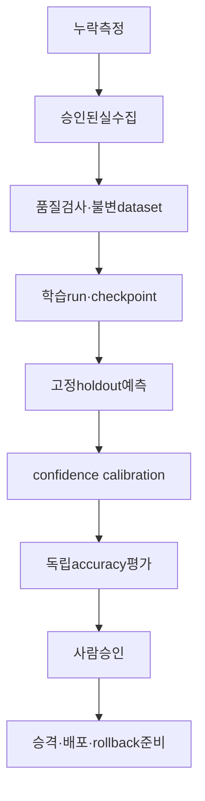

# 361 — 자료 역할 분리, 관측 결측 계획과 MLOps 증거 게이트

- updated_at: 2026-10-21, Root 최종 구현·회귀 인계 기준
- source_commit: 현재 공유 planner schema1.1, primary manifest schema3.2, MLOps summary schema2.1/retraining-readiness1.0 기준. 제품 코드는 이 이해자료 작업에서 수정하지 않았다.
- evidence_paths: [planner 완료 문서](../implementation/361_province_year_gap_acquisition_planner.md), [Esri 출처 교정](../implementation/361_esri_reference_provenance_fail_closed.md), [planner 보존 시험 로그](../../evidence/integration/unit361-gap-acquisition-planner-20261021/pytest.log), [planner 코드](../../backend/app/ml/province_year_gap_acquisition_planner.py), [MLOps 코드](../../backend/app/mlops_router.py), [primary manifest](../lcluc/v3/04_geoserver_primary_layers_manifest.json)
- confidence: 완료 코드·시험·로컬 파일 감사와 Root 최종 결과를 읽어 확인. 권위 경계·GISTARU live metadata·운영36셀 mosaic·실수집·실학습은 확보 또는 실행되지 않았다.
- status: **구현·합성 시험 완료**. **TESTED_SYNTHETIC**은 계약 검증 범위다. 운영 입력 연결·현재 계획은 **IMPLEMENTED_UNVERIFIED / BLOCKED**이며 실제 계획·추가 수집·학습·예측·승격·배포는0이다.

## 1. 쉬운 설명

**GISTARU는 구역과 공간계획을 비교하는 참조, Esri는 외부 연차 분류의 weak label, Sentinel-2와 SCL은 실제 관측과 품질의 근거다. 이번 구현은 이 역할을 섞지 않고, 근거가 없으면 계획·학습을 차단한다.**

비유하면 GISTARU는 도면 비교 자료, Esri는 외부 분류표, Sentinel-2는 실제 사진이고 SCL은 구름·그림자 같은 사진 품질 표시다. 도면이나 분류표가 있다고 사진의 가려진 지점을 새로 관측한 것은 아니다. 법적·통계 경계는 별도 권위 자료로 확인해야 한다.

감사에서 전달된 coverage0.42~4.49%는 현재의 진단값이다. 최종 권위 경계·원인 mosaic로 검증된 전체 주 관측률이나 복구율이 아니다. 개별 셀·분모·지문 연결 없이 확정 통계로 발표하지 않는다. **실제 추가 수집은0**이다.

WorldCover에서 만든 파일을 Esri로 보여주던 P0는 생성 경로 제거·6개 파일 격리·API409 차단으로 교정했다. 코드가 완료됐다는 사실과 실제 Esri가 독립 정답이라는 주장은 다르다. 현재 정확도·confidence는 null이며 재학습은 차단 상태다.

## 2. 이론적 배경

### 자료별 역할과 경계의 권위

| 자료 | 허용 역할 | 대신할 수 없는 근거 |
|---|---|---|
|권위 행정경계|통계 AOI·주 내부 픽셀 판정|weak label·관측 품질|
|GISTARU|공간계획 참조·권위 경계 교차검증|단독 법정 경계 확정·구름/NoData 판정|
|Esri 연차 토지피복|외부 분류 참고·weak training label|gap 탐지·경계 결정·독립 정답·모델 예측|
|Sentinel-2 L2A와SCL|실제 관측과 품질·결측 원인|행정경계·독립 토지피복 정답|

GISTARU의 계획 경계와 행정 AOI가 같다고 가정하지 않는다. 공개 포털 화면이나 서비스 이름만으로 통계 사용 권한을 확정하지 않는다. 정확한 판본·레이어·질의·비교 증거와 별도 권위 경계가 필요하다.

coverage의 나머지 전부를 구름이라고 말하지 않는다. footprint 밖·구름·그림자·NoData는 서로 다른 원인이다. 같은 면적 기준·grid에서 원인을 구분하고, 전후 복구는 동일 mask의 화소 차집합으로 확인해야 한다. 외부 분류표로 빈 부분을 색칠한 것은 실제 관측 보완이 아니다.

### confidence와accuracy

Confidence는 모델이 예측에 부여한 점수이고 accuracy는 독립 정답과 실제 예측을 비교한 결과다. confidence0.95가 곧 accuracy95%는 아니며 높은 점수로 틀릴 수 있다. 고정 calibration set에서 reliability와보정오차를 확인하는 과정도 필요하다.

Esri weak label은 독립 정답이 아니므로 독립 accuracy의 정답으로 사용할 수 없다. Esri와의 참고 일치도는 `weak_label_agreement`로 출처·한계를 표시하며 OA/F1/mIoU나 검증된 정확도 개선으로 발표하지 않는다. 학습에 쓴 label과 다시 비교한 일치율은 특히 독립 평가를 대신하지 못한다.

## 3. 코드·데이터 동작과 현재 상태

### planner1.1 — 모든 입력이 검증돼야 후보를 만든다

입력은 대상 6개 주×2020~2025년의 정확한 36개 셀이다. 인도네시아 전국 전체를 뜻하지 않는다. source와 경계·관측/원인 raster의 SHA, 권위 경계의 통계 사용 승인·기관·판본·유효일자·HTTPS 출처를 요구한다. 현재의 2017 geoBoundaries 참조는 현행 법정 권위 경계로 자동 인정되지 않는다.

GISTARU 입력은 `gistaru-boundary-reference/1.0`이며 정확한 HTTPS ArcGIS REST MapServer URL·layer id/name·실제 query_where·out_sr=4326·retrieved_at과 고정된 서비스 metadata SHA가 필수다. `VERIFIED_MATCH` 또는 `DISCREPANCY_ADJUDICATED`와 로컬 비교 증거 경로/SHA도 필요하다. 불일치의 판정 근거 없이 포털 주소만 기입하면 차단한다. 현재 GISTARU live metadata는 unavailable이며 이번 구현이 원격 서비스를 조회한 것은 아니다.

observed/cause는 같은 EPSG:6933·shape·affine의 단일 band mask다. observed는 0/1, cause는 0_NONE/1_CLOUD/2_SHADOW/3_NODATA/4_OUTSIDE_FOOTPRINT이며 NoData는 설정하지 않는다. 경계 밖 값은 0, 관측 화소의 cause는 0, 미관측 내부 화소의 cause는 1~4여야 한다. 원인 미분류 픽셀이나 36셀 누락·SHA/grid 불일치가 있으면 target을 만들지 않는다.

모든 셀을 검증한 뒤에만 원인별 후보 geometry/bbox·ha·우선순위를 생성한다. 순서는 OUTSIDE_FOOTPRINT→NODATA→CLOUD→SHADOW다. 성공한 계획도 `execution_authorized=false`, collector/ledger/lock/remote 실행 false이며 후보 AOI가 다운로드 요청이나 승인은 아니다. 실패 CLI는 exit2/output_written=false로 출력 파일을 만들지 않고 성공 출력도 기존 파일을 덮어쓰지 않는다.

현재는 권위 경계·GISTARU 고정 비교·36셀 mosaic가 없어 **BLOCKED_MISSING_AUTHORITATIVE_BOUNDARY_AND_CAUSE_MOSAICS**다. 실제 운영 계획 파일과 수집은 0이다. planner의 MLOps 인계도 실제 취득·품질 QA·불변 dataset pin 전에는 `retraining_ready=false`, pin=null을 유지한다.

### Esri P0 — 잘못된 출처를 제공하지 않는다

실제 6개 주의 WorldCover 원본에 종전 LUT를 적용한 배열과 legacy `esri_reference.tif`는 6/6에서 shape·전체 픽셀이 exact 일치했다. 이는 독립 Esri가 아닌 WorldCover 파생물임을 확인한 **VERIFIED_REAL_LOCAL_BYTES** 감사다. 새로운 정답 라벨이나 관측을 얻은 성과가 아니다.

[`geoserver_primary_layers_manager.py`](../../backend/app/ml/geoserver_primary_layers_manager.py)는 해당 Esri 생성을 제거했다. 호환 슬롯은 남기되 파일 경로·WMS URL 등은 null/BLOCKED로 두고 기존 파일은 감사용 격리 상태로 보존한다. manifest3.2는 로컬 파일 54개 중 accepted48/quarantined6을 구분한다. accepted는 격리되지 않은 자산 분류이지 전수 게시·과학적 검증 완료가 아니다. named_layers_verified는 0이다.

[`tile_router.py`](../../backend/app/tile_router.py)는 WMS/픽셀의 레이어 이름과 direct path 우회도 HTTP409 `UNVERIFIED_REFERENCE_PROVENANCE`로 차단한다. 실제 Esri 연차 weak label은 권위 원장이 직접 참조한 label/quality·연도·dataset·SHA 경로로만 분리한다. [`landcover_tiles.py`](../../backend/app/landcover_tiles.py)는 `weak_label_agreement`, `independent_ground_truth=false`, `model_prediction=false`를 내려 독립 정확도/변화 통계 입력과 구분한다.

### MLOps summary2.1 — 실제9단계와증거요구

| 단계 | 현재상태 | 필수근거 |
|---|---|---|
|누락측정|BLOCKED|권위경계·동일grid observed/cause SHA|
|수집|BLOCKED/미실행|승인계획·Sentinel/SCL asset·취득영수증|
|품질검사와불변dataset|BLOCKED|QA·dataset/split manifest·scene누출해소|
|학습|BLOCKED/미실행|run id·checkpoint SHA·학습로그|
|고정holdout예측|BLOCKED/미실행|prediction·holdout manifest|
|confidence calibration|BLOCKED|calibration set·reliability bins·ECE·Brier score|
|독립accuracy|BLOCKED|독립label manifest·실제예측·OA/F1/mIoU/클래스별지표|
|사람승인|BLOCKED|검토근거·approval지문·승인자·시점|
|승격·배포·rollback준비|BLOCKED/미실행|promotion/deployment receipt·검증된rollback대상 SHA|

`retraining-readiness/1.0`은9단계와reason code·required evidence를반환한다. 현재모든단계차단/미실행,confidence와OA/F1/mIoU는null이다. `retrain_allowed=false`, 자동 gate 우회 false, weak label의 accuracy 사용 false, 참조지도의 관측 대체 false다. 기존 미검증 approval 기록은 검증된 사람 승인으로 올리지 않으며 verified approval은 0이다.

기존 원본 1779행/적격 1407(865/292/250)·scene 충돌 1·클래스 부족·learning_ready=false는 유지된다. 원본 지문이 있다는 사실과 학습 준비 통과는 다르다. baseline은 NOT_PINNED/improvement null이며 합성 벤치마크로 개선율을 채우지 않는다.

UI의 증거 게이트 표시와 confidence/accuracy 분리도 추가했다. Root는 Unit361 변경 뒤 실행 중 API 8002와 UI 5174를 다시 연결해 실제 브라우저에서 9개 BLOCKED 단계, confidence 미측정, 독립 accuracy/F1/mIoU 미측정, 재학습·승인 버튼 차단을 확인했다. 이 화면 확인은 과학 지표나 실제 수집·학습의 검증이 아니다. 실제 수집·학습·예측·승격·배포 0, 검증된 rollback 대상 없음을 유지한다.

## 4. 시험 근거와 범위

| 근거 | 결과 | 인정범위 |
|---|---|---|
|planner 보존로그|20PASS/23warnings/22.01초|36셀fixture·경계/GISTARU/SHA/grid/원인·CLI출력·학습인계차단|
|Root planner최종회귀|21PASS|최종보강계약검증. 운영입력으로실제계획생성한결과아님|
|Esri 문서의앞선회귀|53PASS/147warnings/39.01초|오표기생성/제공차단·실weak label구분|
|Root 관련최종회귀|59PASS/147warnings/2subtests|최종통합차단계약. 실제취득/독립정확도아님|
|MLOps API|8PASS|summary2.1·9게이트·null/false·차단계약|
|UI source계약|1PASS|게이트와confidence/accuracy표시연결|
|frontend build|성공|타입·번들생성. 실브라우저E2E아님|
|Root 최종 통합회귀|80PASS/171warnings/2subtests/67.26초|planner·coverage·Esri/GeoServer·API·MLOps 최종 차단계약|
|실행 서비스·브라우저|API/UI/proxy/GetCapabilities 200, legacy Esri GetMap 409|9개 gate와 null/차단 표시의 로컬 실제 적용. 운영·과학 검증 아님|

앞선 20/53과 Root 최종 21/59는 겹치는 배치다. 합쳐 고유 시험 수로 부풀리지 않으며 subtests도 별도 고유 회귀로 더하지 않는다. Root 최종 인계에 없는 시간이나 로그 파일을 추정하지 않는다. warning은 보존된 기존 Affine deprecation 범위이며 과학 결과의 승인 표시가 아니다.

최종 코드의 합성 시험은 **TESTED_SYNTHETIC**, 6개 legacy 파일 일치 감사는 **VERIFIED_REAL**의 로컬 bytes 범위, 실행 중 로컬 API·브라우저 연결은 **VERIFIED_REAL**의 UI 적용 범위다. 운영 입력 연결은 **IMPLEMENTED_UNVERIFIED**, 실제 계획·수집·학습·승격은 **BLOCKED**, 다음 증거 확보와 실행은 **PLANNED**다. 이해 담당은 시험·HTTP·서비스 재시작을 하지 않았고, 위 로컬 실행 확인은 Root가 후속 수행했다.

## 5. 다음 실행 계획 — 완료된 구현과 남은 일을 구분

1. 책임기관의 통계 사용 승인 경계·판본·SHA를 확보한다. GISTARU의 정확한 레이어 metadata와 고정 비교 증거를 연결한다.
2. Sentinel-2/SCL의 36셀 observed/cause mosaic를 같은 EPSG:6933 grid로 만들고 경계 밖/원인 미분류 픽셀을 감사한다.
3. 실제 운영 입력으로 읽기 전용 planner를 실행해 검증된 후보 AOI 계획을 만든다. 성공해도 실행 승인은 false다.
4. 별도 예산·원장·전역 lock·중복/품질·분할 검토와 사람 승인 뒤에만 수집을 실행한다.
5. 취득 품질 QA→불변 dataset pin→실제 학습/예측→calibration/독립 평가→사람 승인→승격/rollback 조건을 단계별 완료 근거로 보고한다.

## 6. 발표 대본

### 1분

“세 자료의 역할을 분리하는 코드와 차단 시험이 완료됐습니다. GISTARU는 경계 교차검증, Esri는 weak label, Sentinel-2/SCL은 실관측과 품질입니다. WorldCover에서 만든 가짜 Esri 6개는 격리했고 경로 우회도 409로 차단했습니다. 다만 권위 경계·GISTARU 메타데이터·36셀 원인 mosaic가 없어 실제 계획과 추가 수집은 0입니다. MLOps 9단계도 모두 차단 상태이며 confidence와 독립 정확도는 null입니다. 구현 완료를 실제 학습·승격·배포 성과로 보고하지 않습니다.”

### 5분

“먼저 도면과 분류표와 사진을 나눕니다. 권위 경계는 통계 AOI, GISTARU는 그 경계의 교차검증, Esri는 외부 분류 참고, Sentinel-2와 SCL은 실제 관측입니다. 포털 주소나 참조지도 값만으로 구름 아래를 관측했다고 말하지 않습니다.

planner는 정확한 서비스 URL·레이어·질의·outSR·시점·metadata SHA와 36셀 observed/cause를 요구합니다. 모두 검증되기 전 target을 만들지 않으며 성공해도 다운로드 권한은 false입니다. 현재 입력이 부족해 실제 계획·수집은 0입니다.

Esri P0는 6개 실제 파일이 WorldCover LUT와 완전히 같다는 감사 뒤 격리했습니다. accepted48은 전수 게시 성공이 아니고 quarantine6은 파일을 지우지 않고 제공을 막은 상태입니다. 실제 Esri도 weak label이며 독립 정답이나 모델 예측이 아닙니다.

MLOps는 누락 측정→수집→품질/불변 dataset→학습→예측→confidence calibration→독립 accuracy→사람 승인→승격·배포·rollback 준비의 9단계입니다. 모델의 자신감과 독립 정답에 맞힌 비율은 다릅니다. 현재 모든 gate와 실행은 차단이고 점수는 null입니다.

합성 시험·회귀·UI 소스 시험·build는 이 계약을 검증했습니다. 실제 수집·모델 성능·승인을 검증한 것은 아닙니다. 다음은 권위 입력 확보와 원인 mosaic, 별도 수집 승인입니다.”

### 10분 구성

1. 0–2분: 권위 경계·GISTARU·Esri·Sentinel/SCL 역할표.
2. 2–4분: planner의 exact 증거와 36셀·현재 차단.
3. 4–6분: WorldCover 6개 격리·48/6 분류·우회 409·weak label 한계.
4. 6–8분: MLOps 9단계·confidence와 accuracy·null.
5. 8–10분: 합성 시험 범위와 실제 운영 계획/수집/학습/승인 후속.

## 7. Q&A

**Q. 이제 수집계획이 실제로 생겼나요?** 아직 아니다. planner 구현은 완료됐지만 권위 경계·GISTARU 고정 비교·36셀 mosaic가 없어 실제 계획과 수집은 0이다.

**Q. GISTARU 포털 주소만 넣으면 되나요?** 정확한 MapServer·layer id/name·질의·outSR4326·retrieved_at·metadata와 비교 파일 SHA까지 필요하다. live metadata는 현재 미확보다.

**Q. Esri P0는 어떻게 고쳤나요?** WorldCover 파생 6개를 격리하고 생성 경로를 제거했으며 레이어명·WMS·픽셀·direct path의 제공을 409로 차단했다. 실제 Esri 원본을 새로 얻었다는 뜻은 아니다.

**Q. accepted48은 48개가 전부 정식 게시됐다는 뜻인가요?** 격리 파일을 제외한 자산 분류다. named-layer 전수 게시는 검증되지 않았다.

**Q. 실제 Esri면 독립 accuracy의 정답으로 쓸 수 있나요?** 아니다. weak label이며 independent_ground_truth=false/model_prediction=false다. 참고 일치도와 독립 정확도를 구분한다.

**Q. confidence0.95면 accuracy95%인가요?** 아니다. 예측 점수의 보정과 독립 정답의 정확도 평가는 서로 다른 근거를 필요로 한다. 현재 두 값 모두 null이다.

**Q. 시험이 통과했으니 재학습·승격을 하나요?** 계약 시험 완료다. 실제 취득·QA·dataset·학습/예측·독립 평가·사람 승인·배포 영수증이 없어 9단계는 차단 상태다.

**Q. 0.42~4.49%는 최종 주 전체 관측률인가요?** 감사 진단 범위다. 권위 분모·원인 mosaic 없이 최종 coverage나 복구율로 승격하지 않는다.

이 문서는 완료 구현의 해설이다. 제품·시험·implementation·운영 데이터를 수정하지 않았고 새 시험·HTTP·DB·수집·서비스 재시작을 실행하지 않았다.
