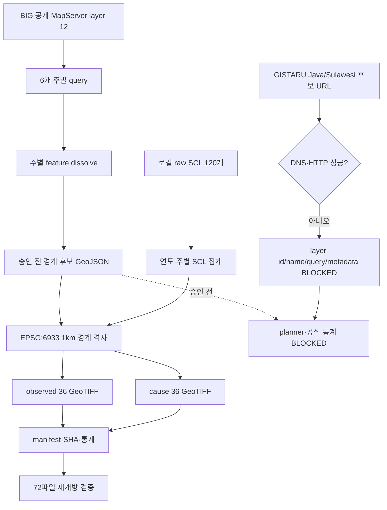

# 362 — 6개 주 경계 후보, GISTARU 서비스 발견, 36셀 SCL 관측·원인 모자이크

- updated_at: 2026-10-27, Unit362 완료 구현·증거 인계 기준
- source_commit: `375f037379ac878353b652591d87a17efa51f021` 위 공유 작업트리의 Unit362 구현. 제품 코드는 이 이해자료 작업에서 수정하지 않았다.
- evidence_paths: [완료 요약](../../evidence/integration/unit362-province-evidence-20261027/completion.json), [검증 결과](../../evidence/integration/unit362-province-evidence-20261027/validation.json), [BIG 6개 주 경계 후보](../../evidence/integration/unit362-province-evidence-20261027/six-province-boundary-candidate.geojson), [GISTARU 서비스 발견 기록](../../evidence/integration/unit362-province-evidence-20261027/gistaru-service-discovery.json), [36셀 모자이크 manifest](../../evidence/integration/unit362-province-evidence-20261027/province-year-scl-mosaic-manifest.json), [builder](../../backend/app/ml/province_year_evidence_builder.py), [builder CLI](../../scripts/build_province_year_evidence.py), [검증 CLI](../../scripts/validate_province_year_evidence.py), [회귀시험](../../tests/test_province_year_evidence_builder.py)
- confidence: 완료 코드와 고정 evidence를 읽어 확인했다. 로컬 산출물·해시·격자·값 도메인은 검증됐지만 관할기관 경계 승인과 GISTARU live metadata는 확보되지 않았다.
- status: **부분 완료**. SCL 모자이크는 **VERIFIED_REAL_LOCAL_ARTIFACTS_BOUNDARY_APPROVAL_PENDING**, BIG 경계는 **CANDIDATE_PENDING_COMPETENT_AUTHORITY_AND_STATISTICAL_APPROVAL / IMPLEMENTED_UNVERIFIED**, GISTARU layer/query/metadata는 **BLOCKED**다. 새 Sentinel 다운로드·collector·ledger·lock은 모두 0이다.

## 1. 쉬운 설명

**이번 구현은 6개 주×2020~2025년의 36칸에 대해 로컬 SCL 파일로 “관측됐는가”와 “왜 비었는가”를 같은 1km 격자에 기록했지만, 이 숫자를 공식 통계로 쓰기 위한 경계 승인과 GISTARU 확인은 아직 끝나지 않았다.**

세 가지 결과를 한꺼번에 “완료”라고 부르면 안 된다.

| 결과 | 쉬운 의미 | 현재 상태 |
|---|---|---|
|BIG 6개 주 경계 후보|공개 공식 서비스에서 6개 주 도형을 받아 주별로 합친 후보 경계|**IMPLEMENTED_UNVERIFIED**. 관할기관·통계 사용 승인이 없는 후보|
|GISTARU Java/Sulawesi 서비스 후보|어느 MapServer를 확인해야 하는지 정확한 HTTPS 후보 URL을 고정|URL 후보만 고정. DNS/HTTP 실패로 layer id/name/query/metadata는 **BLOCKED**|
|36셀 observed/cause mosaic|로컬 raw SCL 120개를 읽어 36개 연도·주마다 관측 여부와 결측 원인을 만든 실제 파일|**VERIFIED_REAL_LOCAL_ARTIFACTS_BOUNDARY_APPROVAL_PENDING**|

전체 후보 경계의 1,123,578개 1km 셀 가운데 관측 셀은 10,032개, 즉 **0.892862%**다. 미관측 1,113,546셀의 원인은 CLOUD 607, SHADOW 374, NODATA 0, OUTSIDE_FOOTPRINT 1,112,565로 분류됐다. 여기서 OUTSIDE_FOOTPRINT는 “구름”이 아니라 로컬 SCL 자료 발자국이 해당 경계 셀을 덮지 않았다는 뜻이다.

이 1km 결과는 누락 위치와 원인을 빠르게 재고 조사하는 **인벤토리 격자**다. Sentinel-2의 최종 10m/20m 과학 산출물이나 토지피복 예측 지도가 아니며, 0.892862%를 승인된 공식 주별 관측률로 발표해서도 안 된다.

## 2. 이론적 배경

### 경계의 출처와 사용 승인은 별개다

공식 공개 서비스에서 받은 도형이라는 사실은 출처 추적에는 중요하지만, 그것만으로 해당 판본의 유효일자와 통계 사용 승인이 확정되지는 않는다. 이번 BIG 후보에는 `approved_for_project_statistics=false`와 `NO_CURRENT_EFFECTIVE_DATE_OR_STATISTICAL_APPROVAL_RECORD_IN_PUBLIC_LAYER_METADATA`가 명시돼 있다. 따라서 실제 파일 바이트와 출처는 확인했어도 승인된 통계 AOI로 승격하지 않는다.

GISTARU는 공간계획 참조와 경계 교차검증 입력이다. MapServer의 정확한 서비스 URL만 알아낸 상태와, 실제 layer id/name·질의·metadata를 받아 고정한 상태는 다르다. 네트워크 이름 해석이나 HTTP 조회가 실패했을 때 레이어 번호를 추측하지 않는 것이 fail-closed 원칙이다.

### observed와 cause는 같은 질문이 아니다

`observed`는 해당 경계 셀 안에 유효한 SCL 관측이 하나라도 있는지를 0/1로 표시한다. `cause`는 관측되지 않은 셀을 CLOUD, SHADOW, NODATA, OUTSIDE_FOOTPRINT 중 하나로 설명한다.

- clear SCL: 4, 5, 6, 7, 11
- cloud SCL: 8, 9, 10
- shadow SCL: 2, 3
- nodata SCL: 0, 1
- cause 값: 0_NONE, 1_CLOUD, 2_SHADOW, 3_NODATA, 4_OUTSIDE_FOOTPRINT

한 셀에 clear가 하나라도 있으면 `observed=1`, `cause=0_NONE`이다. clear가 없으면 해당 셀 안의 SCL 투표로 원인을 정하고, 동률이면 CLOUD→SHADOW→NODATA 순으로 결정한다. 로컬 SCL 발자국 자체가 없으면 OUTSIDE_FOOTPRINT다. 이 구분 때문에 “미관측=전부 구름”이라는 잘못된 해석을 피할 수 있다.

### 1km 동일 격자의 목적과 한계

모든 산출물은 EPSG:6933의 1,000m 격자이며 주 경계 bounds를 같은 규칙으로 정렬한다. 동일한 CRS·shape·affine을 사용하면 observed와 cause를 셀별로 직접 대조하고 원인별 누락량을 합산할 수 있다. 다만 SCL의 원래 10m/20m 수준 정보를 1km 인벤토리 셀로 집계하므로, 이 산출물은 수집 계획과 결측 진단용이다. 세밀한 과학 분석·정확도 평가·최종 제품에는 승인 경계와 원해상도 기반 별도 QA가 필요하다.

## 3. 코드·데이터 동작

### 전체 흐름

### BIG 경계 후보 생성

[`province_year_evidence_builder.py`](../../backend/app/ml/province_year_evidence_builder.py)는 BIG의 `https://geoservices.big.go.id/rbi/rest/services/BATASWILAYAH/BATAS_WILAYAH/MapServer/12`를 사용한다. layer id는 12, 이름은 `Area Batas Wilayah Administrasi Provinsi`, service item id는 `2b90614c9619463491b4725c192eda68`이다.

대상 지역명 `Banten`, `Jawa Barat`, `Jawa Timur`, `Sulawesi Selatan`, `Gorontalo`, `Sulawesi Tenggara`마다 `wadmpr='<지역명>'`으로 질의하고 geometry를 WGS84로 받는다. 반환된 feature는 각각 8, 27, 40, 25, 6, 23개이며 주 단위로 dissolve한다. 후보 파일 SHA-256은 `233c034c0b6a777799b14ab5451afedc3ece9abbe836b28e59292a18f4c2a423`이다.

동자바와 남술라웨시는 CRS 변환 뒤 geometry 유효화에 `SHAPELY_BUFFER_ZERO_AFTER_CRS_TRANSFORM`가 적용됐다. 상대 면적 변화는 각각 약 `3.18e-16`, `1.8363347e-05`로 `0.0001` guard 안이지만, 이것이 행정 승인 자체를 의미하지는 않는다.

### GISTARU 서비스 발견

정확히 고정된 후보 서비스는 다음 두 개다.

- Java: `https://gistaru.atrbpn.go.id/arcgis/rest/services/004_RTR_PROVINSI_PULAU_JAWA/_3000_PROVINSI_JAWA_PR_PERDA/MapServer`
- Sulawesi: `https://gistaru.atrbpn.go.id/arcgis/rest/services/006_RTR_PROVINSI_PULAU_SULAWESI/_7000_PROVINSI_SULAWESI_PR_PERDA/MapServer`

두 요청 모두 `getaddrinfo failed`로 HTTP 응답을 받지 못했다. 따라서 후보 URL은 고정됐지만 layer id/name, 실제 query, 고정 metadata SHA는 null/BLOCKED다. discovery 파일 SHA-256은 `e1017e8a1e501ebdf35e2d7ab2bd125b536a695af62003a5bf88c6d5a9da4633`이다.

### 36셀 모자이크 생성과 검증

builder CLI는 로컬 raw SCL 120개를 읽어 6개 주×6개년, 정확히 36개 셀의 observed/cause GeoTIFF 72개를 만든다. 새 Sentinel 원격 다운로드, collector 실행, 취득 ledger 작성, lock 획득은 하지 않는다. manifest SHA-256은 `44ca741bd85567d2b010536623bf214109cc5a91c0cf326253ecd1ad5b617ccd`다.

[`validate_province_year_evidence.py`](../../scripts/validate_province_year_evidence.py)는 72개 GeoTIFF를 다시 열어 다음을 확인한다.

1. 정확히 36개 셀과 72개 파일이 존재한다.
2. 120개 입력 asset이 중복 없이 manifest·SHA와 연결된다.
3. observed/cause가 같은 EPSG:6933, 1km shape와 affine을 쓴다.
4. nodata가 설정되지 않고 값 도메인이 계약 범위다.
5. 경계 밖 값은 0이고, 경계 안의 모든 미관측 셀은 원인 하나를 가진다.

이 검증은 로컬 파일의 실제 생성과 내부 일관성을 증명한다. 승인 전 경계의 법적·통계 적합성이나 최종 10m/20m 제품 품질을 증명하지는 않는다.

### 코드 지도

| 파일 | 책임 |
|---|---|
|`backend/app/ml/province_year_evidence_builder.py`|경계 후보 조회·dissolve, GISTARU 발견, SCL→1km observed/cause 생성|
|`scripts/build_province_year_evidence.py`|36셀 bundle 생성 CLI|
|`scripts/validate_province_year_evidence.py`|경계·discovery·manifest·72 GeoTIFF 재검증 CLI|
|`tests/test_province_year_evidence_builder.py`|승인 전 경계, GISTARU fail-closed, 36셀 동일 격자, 누락 셀 거부 회귀시험|
|`evidence/integration/unit362-province-evidence-20261027/`|고정 완료·검증·후보·발견·manifest 증거|

## 4. 테스트 증거와 남은 개발

### 검증된 사실

| 항목 | 결과 | 증거 상태 |
|---|---:|---|
|로컬 raw SCL 입력|120개 고유 asset|**VERIFIED_REAL_LOCAL_ARTIFACTS**|
|모자이크 산출|36 observed + 36 cause GeoTIFF|**VERIFIED_REAL_LOCAL_ARTIFACTS_BOUNDARY_APPROVAL_PENDING**|
|전체 후보 경계 셀|1,123,578|승인 전 1km 인벤토리 분모|
|observed|10,032, 0.892862%|승인 전 로컬 산출물 통계|
|gap|1,113,546|승인 전 로컬 산출물 통계|
|gap 원인|CLOUD 607, SHADOW 374, NODATA 0, OUTSIDE_FOOTPRINT 1,112,565|72파일 재개방 검증|
|회귀시험|25 PASS, 102 warnings, 71.27초|구현·계약 회귀 통과|
|정적 확인|`compileall` PASS, `git diff --check` PASS|구문·diff 형식 확인|

102개 warning은 rasterio의 `PendingDeprecationWarning`이며 시험 실패는 아니다. 시험은 BIG 후보를 승인 상태로 올리지 않는지, GISTARU 레이어를 추측하지 않는지, 36개 셀이 동일 격자인지, 셀 하나라도 빠지면 거부하는지를 포함한다.

### 상태별 해석

- **VERIFIED_REAL_LOCAL_ARTIFACTS_BOUNDARY_APPROVAL_PENDING**: 120개 로컬 SCL을 실제로 읽어 72개 파일을 만들고 다시 검증했다.
- **IMPLEMENTED_UNVERIFIED**: BIG 공개 서비스에서 후보를 만드는 코드는 실행됐고 실제 후보 파일도 있으나, 관할기관·통계 사용 승인이 없다.
- **BLOCKED**: GISTARU live metadata, layer id/name, 실제 query, metadata SHA가 DNS/HTTP 실패 때문에 없다.
- **0 / 미실행**: 새 Sentinel 다운로드, collector, ledger, lock, 실제 gap acquisition, 학습, 예측, 승격, 배포.

`completion.json`의 전체 bundle 상태가 `PARTIAL_BLOCKED_GISTARU_AND_BOUNDARY_APPROVAL`인 이유가 이 구분이다. Unit361의 “모자이크 부재”는 해소됐지만, planner를 공식 실행할 조건 전체가 충족된 것은 아니다.

### 앞으로 완성해야 할 개발 항목

1. 관할기관이 BIG 경계 판본·유효일자·6개 주 통계 사용을 승인한 기록을 고정하고 후보를 승인 입력으로 승격한다.
2. 네트워크가 가능한 환경에서 두 GISTARU MapServer를 재조회해 정확한 layer id/name·query·outSR·retrieved_at·metadata SHA를 고정한다.
3. 승인 BIG 경계와 GISTARU 계획 경계를 비교하고, 일치 또는 차이 판정의 근거·담당 승인 기록을 남긴다.
4. 승인 입력으로 36셀 planner를 다시 실행해 원인별 취득 후보를 만든다. 후보 생성과 실제 다운로드 승인은 계속 분리한다.
5. 별도 승인 뒤 Sentinel-2/SCL collector·ledger·lock·취득 영수증을 연결하고, 동일 격자 before/after로 실제 복구량을 검증한다.
6. 최종 과학 제품이 필요하면 1km 인벤토리를 그대로 확대 해석하지 말고 10m/20m 원해상도 처리·QA·독립 평가 파이프라인을 별도로 완성한다.
7. UI 연동이 필요할 때는 경계 승인 전, GISTARU 차단, 로컬 모자이크 완료를 서로 다른 상태로 표시한다. 이번 Unit362에는 UI 변경·브라우저 검증이 포함되지 않았다.

## 5. 발표 스크립트

### 1분 발표

“Unit362는 6개 주 6개년, 36개 셀의 관측과 결측 원인 모자이크를 만들었습니다. 120개 로컬 SCL 파일을 실제로 읽어 EPSG:6933 1km 동일 격자의 observed 36개와 cause 36개, 총 72개 GeoTIFF를 생성하고 재검증했습니다. 후보 경계 1,123,578셀 중 관측은 10,032셀, 0.892862%였고 미관측 대부분인 1,112,565셀은 구름이 아니라 로컬 자료 발자국 밖이었습니다. 다만 BIG 경계는 공식 공개 서비스 출처의 승인 전 후보이고, GISTARU는 Java와 Sulawesi의 정확한 후보 URL만 고정했을 뿐 DNS 실패로 레이어와 메타데이터를 받지 못했습니다. 따라서 로컬 산출물은 실제지만 공식 통계와 수집 실행은 아직 차단 상태입니다. 새 Sentinel 다운로드와 collector·ledger·lock 실행은 모두 0입니다.”

### 5분 발표

“이번 작업의 목적은 Unit361 planner가 요구하던 세 입력, 즉 권위 경계, GISTARU 비교 자료, 36셀 observed/cause 모자이크를 현실의 증거로 채우는 것이었습니다.

첫째, BIG의 공개 ArcGIS MapServer layer 12에서 Banten, Jawa Barat, Jawa Timur, Sulawesi Selatan, Gorontalo, Sulawesi Tenggara를 정확한 지역명으로 질의했습니다. 여러 행정 feature를 주별로 dissolve해 6개 주 후보 GeoJSON을 만들고 SHA-256을 고정했습니다. 그러나 공개 layer metadata에 현행 유효일자와 프로젝트 통계 사용 승인 기록이 없으므로 `approved_for_project_statistics=false`를 유지했습니다. 공식 출처와 통계 승인은 같은 말이 아닙니다.

둘째, GISTARU는 Java와 Sulawesi의 정확한 HTTPS MapServer 후보 URL을 고정했습니다. 하지만 실행 환경에서 두 주소 모두 DNS 이름 해석에 실패해 HTTP 응답을 받지 못했습니다. 따라서 layer id/name, query, metadata SHA를 추측해서 채우지 않고 BLOCKED로 남겼습니다.

셋째, 120개의 로컬 raw SCL을 사용해 6개 주×2020~2025년의 36셀을 처리했습니다. 각 셀은 EPSG:6933 1km 격자에서 observed와 cause 한 쌍을 가집니다. clear SCL이 있으면 observed, 없으면 cloud·shadow·nodata를 집계하고 SCL 발자국 자체가 없으면 outside footprint로 분류했습니다. 그 결과 전체 1,123,578 경계 셀 중 observed는 10,032, 0.892862%였습니다. 결측 원인은 cloud 607, shadow 374, nodata 0, outside footprint 1,112,565였습니다. 따라서 미관측의 거의 전부를 구름 문제로 말할 수 없습니다.

검증기는 72개 GeoTIFF를 다시 열어 36셀 완전성, 120개 입력 자산의 고유성·해시, 동일 CRS·shape·affine, 값 도메인, 경계 밖 0, 모든 gap 원인 분류를 확인했습니다. 회귀시험은 25개가 통과했고 compileall과 diff check도 통과했습니다.

그러나 이 결과는 1km 수집 인벤토리입니다. 최종 Sentinel-2 10m/20m 과학 제품이 아니며, 승인 전 경계를 분모로 썼으므로 공식 주별 관측률도 아닙니다. 다음 단계는 BIG 판본과 통계 사용 승인, GISTARU live metadata와 비교 판정, 승인 입력 기반 planner 실행, 그리고 별도 승인을 받은 실제 Sentinel 취득과 before/after 복구 검증입니다.”

### 권장 슬라이드 제목

1. Unit362가 채운 것과 아직 차단된 것
2. 공식 공개 경계와 통계 승인 사이의 차이
3. GISTARU 후보 URL 고정과 fail-closed 발견
4. 120개 SCL에서 36쌍 동일 격자까지
5. 관측 0.892862%와 결측 원인 분해
6. 1km 인벤토리의 한계와 다음 승인 게이트

## 6. Q&A

### Q1. 이제 승인된 최신 6개 주 경계를 확보했습니까?

아니다. BIG 공식 공개 서비스에서 실제 후보 도형을 받았지만, 현행 유효일자와 관할기관·통계 사용 승인 기록이 없어 **CANDIDATE_PENDING_COMPETENT_AUTHORITY_AND_STATISTICAL_APPROVAL / IMPLEMENTED_UNVERIFIED**다.

### Q2. GISTARU의 정확한 URL은 찾았습니까?

Java와 Sulawesi의 정확한 HTTPS MapServer 후보 URL은 고정했다. 그러나 DNS/HTTP 실패로 서비스 metadata를 받지 못했으므로 정확한 layer id/name·query·metadata SHA는 **BLOCKED**다.

### Q3. 36셀 모자이크는 합성 fixture입니까?

아니다. 120개 로컬 raw SCL을 실제로 읽어 만든 72개 GeoTIFF이며 해시와 격자를 재검증했다. 상태는 **VERIFIED_REAL_LOCAL_ARTIFACTS_BOUNDARY_APPROVAL_PENDING**이다. 다만 “실제 로컬 파일”과 “승인된 공식 통계”는 구분한다.

### Q4. 관측률 0.892862%는 공식 수치입니까?

아니다. 승인 전 BIG 후보 경계와 현재 로컬 SCL footprint를 사용한 1km 인벤토리 통계다. 경계 승인 뒤 다시 계산해야 공식 분석 후보가 된다.

### Q5. 나머지 99% 이상은 모두 구름입니까?

아니다. gap 1,113,546셀 중 CLOUD는 607, SHADOW는 374이고 1,112,565셀은 OUTSIDE_FOOTPRINT다. 즉 대부분은 현재 로컬 SCL 자료가 그 경계 셀을 덮지 않는 문제다.

### Q6. 왜 NODATA가 0입니까?

현재 120개 입력과 분류 규칙에서 footprint 안의 미관측 셀이 CLOUD 또는 SHADOW로 설명됐고, NODATA 우세 셀은 없었다. 이것은 현재 로컬 인벤토리의 결과이지 앞으로 들어올 모든 자료에 NODATA가 없다는 뜻은 아니다.

### Q7. 1km 모자이크로 최종 토지피복 분석을 해도 됩니까?

안 된다. 1km는 결측 위치·원인과 수집 우선순위를 보는 인벤토리 격자다. 최종 10m/20m 과학 제품, 토지피복 예측, 독립 정확도 평가를 대체하지 않는다.

### Q8. 새 Sentinel 데이터를 내려받았습니까?

아니다. 새 다운로드, collector, ledger, lock은 모두 0이다. 기존 로컬 raw SCL 120개를 읽기 전용 입력으로 사용했다.

### Q9. Unit361 planner는 이제 실행 가능합니까?

아직 아니다. 운영 36셀 모자이크 부재는 해소됐지만 경계 승인과 GISTARU layer/query/metadata·비교 판정이 남아 전체 bundle 상태는 `PARTIAL_BLOCKED_GISTARU_AND_BOUNDARY_APPROVAL`이다.

### Q10. 이번 시험 통과가 무엇을 증명합니까?

경계 후보를 승인으로 오인하지 않는 계약, GISTARU 정보를 추측하지 않는 fail-closed 동작, 정확한 36셀 동일 격자 생성과 누락 거부, 로컬 파일 내부 일관성을 증명한다. 기관 승인, 원격 서비스 가용성, 실제 추가 수집, 과학적 정확도나 운영 배포를 증명하지 않는다.
