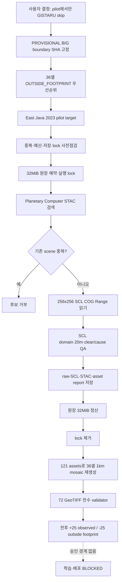

# 363 — 승인 전 BIG 기준의 제한적 Sentinel-2 SCL pilot

- updated_at: 2026-10-27, Unit363 구현·실행·검증 인계 기준
- source_commit: `375f037379ac878353b652591d87a17efa51f021` 위 공유 작업트리의 Unit363 구현. 제품 코드는 이 이해자료 작업에서 수정하지 않았다.
- evidence_paths: [완료 요약](../../evidence/integration/unit363-provisional-sentinel-pilot-20261027/completion.json), [교차검증 결정](../../evidence/integration/unit363-provisional-sentinel-pilot-20261027/cross-check-decision.json), [36셀 우선순위](../../evidence/integration/unit363-provisional-sentinel-pilot-20261027/36-cell-gap-priority.json), [pilot 사전점검](../../evidence/integration/unit363-provisional-sentinel-pilot-20261027/pilot-preflight.json), [취득 보고서](../../evidence/integration/unit363-provisional-sentinel-pilot-20261027/pilot-acquisition-report.json), [전후 비교](../../evidence/integration/unit363-provisional-sentinel-pilot-20261027/before-after.json), [갱신 모자이크 검증](../../evidence/integration/unit363-provisional-sentinel-pilot-20261027/updated-mosaic-validation.json), [pilot collector](../../backend/app/ml/province_year_pilot_collector.py), [planner](../../backend/app/ml/province_year_gap_acquisition_planner.py), [evidence builder](../../backend/app/ml/province_year_evidence_builder.py)
- confidence: 실제 원격 수집 보고서, 로컬 SCL·원장·lock 후상태, 전후 모자이크와 validator 결과를 읽어 확인했다. BIG 관할기관·통계 승인과 학습·배포 승인은 없다.
- status: Sentinel-2 SCL 신규 수집 1건은 **VERIFIED_REAL**, 갱신된 36셀 모자이크는 **VERIFIED_REAL_LOCAL_ARTIFACTS_BOUNDARY_APPROVAL_PENDING**이다. BIG 경계는 **PROVISIONAL_BIG_BASELINE / 승인 대기**, GISTARU는 **SKIPPED_BY_USER_DECISION**이며 pilot 범위에만 적용된다. 학습·배포는 **0 / BLOCKED**다.

## 1. 쉬운 설명

**Unit363은 승인 전 BIG 경계를 공식 경계라고 부르지 않은 채, 사용자가 허용한 제한된 pilot 범위에서 동자바 2023 Sentinel-2 장면의 SCL 256×256 창을 실제로 수집하고 품질검사·원장 정산·36셀 모자이크 갱신까지 완료했다.**

이번 결과는 “전체 수집 완료”가 아니다. 36개 주-연도 셀 중 결측 우선순위가 가장 높은 East Java 2023에서 256×256 SCL 창 하나만 받았다. 새 scene은 `S2A_MSIL2A_20230905T023531_R089_T49MFM_20230905T081430`이며, STAC 장면 cloud metadata는 0.945937%였다. 실제로 읽은 256×256 창의 65,536 SCL 픽셀은 clear class 4·5·7로 100%였다.

이 한 건을 추가하자 East Java 2023의 1km observed 셀은 194→219, **25셀 증가**했고 OUTSIDE_FOOTPRINT는 47,837→47,812, **25셀 감소**했다. 36셀 전체 observed는 10,057/1,123,578, 즉 **0.895087%**가 됐고 source asset은 120→121개가 됐다.

다만 분모로 쓴 BIG 경계는 아직 관할기관·통계 사용 승인을 받지 않은 `PROVISIONAL_BIG_BASELINE`이다. 사용자가 GISTARU 비교를 건너뛴 결정도 `PROVISIONAL_SENTINEL_PILOT_ONLY` 범위에만 유효하다. 따라서 이 수치를 공식 주 통계, 대량 수집 승인, 학습 준비 완료 또는 배포 성과로 발표하지 않는다.

## 2. 이론적 배경

### 제한적 pilot과 운영 승인은 다르다

pilot은 작은 범위에서 검색·중복 방지·예산·저장·잠금·품질검사·후속 산출물 갱신이 실제로 이어지는지 확인하는 실행이다. 한 번의 성공은 collector 경로의 실동작 근거지만, 나머지 1,613개 계획 target의 대량 수집 승인이나 36셀 전체 복구를 뜻하지 않는다.

이번 교차검증 결정은 허용·금지 행동을 함께 고정했다.

| 허용된 pilot 행동 | 여전히 금지된 행동 |
|---|---|
|36셀 gap 우선순위 계산|권위 경계 승인 주장|
|중복·예산·저장 사전점검|GISTARU verified match 주장|
|Sentinel-2 SCL 1건 제한 수집|대량 수집 승인|
|SCL QA와 1km inventory 재생성|모델 학습 승인|
|전후 observed/cause 비교|운영 배포 승인|

따라서 `SKIPPED_BY_USER_DECISION`은 GISTARU가 검증됐다는 뜻이 아니다. pilot에 한해 비교를 생략한 위험 수용 기록이며, 일반 planner와 공식 통계·학습·배포에서는 기존 GISTARU 및 경계 승인 요구를 제거하지 않는다.

### 장면 cloud metadata와 SCL 창 품질

0.945937%는 STAC가 제공한 장면 수준 cloud metadata이고, clear 100%는 선택한 256×256, 20m SCL 창의 픽셀 분류 결과다. 측정 범위가 다르므로 두 값은 모순되지 않는다. collector는 SCL 4·5·6·7·11을 clear, 8·9·10을 cloud, 2·3을 shadow, 0·1을 nodata로 분리한다. 이번 창은 class 4가 37,533, class 5가 27,954, class 7이 49픽셀로 모두 clear였다.

### 보수적 byte 회계

원격 COG Range 응답에서 Python이 실제 읽은 본문은 196,608B이고, 압축해 저장된 로컬 `raw-SCL.tif`는 4,872B다. 두 값이 다른 것은 전송 본문과 로컬 압축 파일의 측정 대상이 다르기 때문이다.

STAC 검색, SAS 발급, HEAD, 오류 본문과 TLS overhead는 정확히 계측하지 못했으므로 원장은 작은 파일 크기나 Range 본문만 청구하지 않았다. 사전 예약한 33,554,432B 전체를 보수적으로 charge하고 `settled`로 닫았다. 이는 사용량을 축소 보고하지 않는 fail-closed 예산 정책이다.

### 동일 격자 전후 비교

새 raw SCL을 기존 120개와 함께 다시 읽어 동일한 EPSG:6933 1km 격자의 observed/cause를 재생성했다. 동일 boundary SHA, CRS, shape, affine과 원인 값 계약을 유지해야만 194→219와 OUTSIDE_FOOTPRINT -25를 직접 비교할 수 있다. 이 1km 격자는 수집 누락을 찾는 inventory이며 최종 Sentinel-2 10m/20m 과학 제품은 아니다.

## 3. 코드·데이터 동작

### 실행 흐름

### planner와 고정 결정

[`province_year_gap_acquisition_planner.py`](../../backend/app/ml/province_year_gap_acquisition_planner.py)는 `PROVISIONAL_REAL` 경로를 별도로 둔다. 이 경로는 BIG 후보 status·공식 공개 출처·`approved_for_project_statistics=false`를 확인하고, boundary SHA와 결합된 `cross-check-decision.json` 없이는 진행하지 않는다. 결정 파일의 scope가 pilot 전용이고 boundary SHA가 다르면 fail-closed로 거부한다.

생성된 provisional plan은 target 1,614개를 계산하지만 `PROVISIONAL_PILOT_PLANNED_NO_EXECUTION`, `execution_authorized=false`다. 즉 plan 자체가 대량 collector를 실행하지 않는다. 별도 [`run_provisional_sentinel_pilot.py`](../../scripts/run_provisional_sentinel_pilot.py)가 고정 boundary·mosaic·결정 SHA를 받아 한 건만 실행한다. 일반 [`plan_province_year_gap_acquisition.py`](../../scripts/plan_province_year_gap_acquisition.py)는 GISTARU reference와 pilot decision을 상호 배타 입력으로 다룬다.

### target 선택과 사전점검

[`province_year_pilot_collector.py`](../../backend/app/ml/province_year_pilot_collector.py)는 36셀을 OUTSIDE_FOOTPRINT 수 내림차순, province/year 순으로 정렬했다. East Java 2023은 47,837셀, 99.596094%로 1순위였다. 그 안에서 기존 관측 또는 경계와 가장 먼 OUTSIDE_FOOTPRINT 셀을 선택해 0.07°×0.07° 검색 bbox를 만들었다.

사전점검은 127개 기존 STAC item id를 읽고 선택 픽셀이 기존 footprint 밖인지 확인했다. 원장 rate-limit은 비활성, pilot 예약 뒤에도 예산이 남고, 필요한 128MiB보다 디스크 여유가 컸으며 실행 lock은 없어서 PASS했다.

기존 원장에는 이미 다음 두 pending batch가 있었다.

- `parallel-v2-extra-banten-2023-v2-laneB-banten-boundary-01`
- `parallel-v2-extra-west_java-2023-v2-laneB-west_java-boundary-01`

둘은 이번 `unit363-pilot-east_java-2023-p00`과 다른 key다. collector는 두 기존 pending을 정산·취소·수정하지 않았다. Unit363 key만 33,554,432B reserved/charged, `settled`가 됐다. 실행 종료 뒤 lock 파일은 제거됐고 별도 active collector는 0이다.

### 검색·중복 거부·SCL 저장

STAC 검색은 East Java 2023 건기 6월 1일~9월 30일, cloud cover ≤20%, 최대 20개를 cloud 오름차순으로 요청했다. 첫 후보는 cloud 0.636325%였지만 기존 scene id 중복이라 거부했다. 다음 비중복 scene의 cloud metadata는 0.945937%였고, 20m SCL 창·값 domain·clear/cause QA를 통과했다.

collector는 signed query를 저장하지 않고 공개 URL만 보존한다. `raw-SCL.tif`, redacted `stac-item.json`, `pilot-asset.json`, 취득 보고서를 기록하고 SHA-256으로 pin한다. 수집 실패 뒤에도 예약분을 자동 환불하지 않고 전액 정산하는 실패 정책이 구현돼 있다.

### 36셀 mosaic 갱신

[`province_year_evidence_builder.py`](../../backend/app/ml/province_year_evidence_builder.py)는 source asset 121개로 36 observed + 36 cause GeoTIFF를 다시 만들었다. validator의 `allow_execution=true`는 manifest에 collector·ledger 실행 사실이 기록된 이번 실행 산출물을 검증하기 위한 명시적 경로다. 모든 파일의 pin, EPSG:6933, 같은 grid, nodata unset, 값 domain, 경계 밖 0, gap 원인 전수 분류를 재확인했다.

| 지표 | Unit362 이전 | Unit363 이후 | 변화 |
|---|---:|---:|---:|
|East Java 2023 source assets|2|3|+1|
|East Java 2023 observed|194|219|+25|
|East Java 2023 OUTSIDE_FOOTPRINT|47,837|47,812|-25|
|36셀 전체 observed|10,032|10,057|+25|
|36셀 전체 observed 비율|0.892862%|0.895087%|+0.002225%p|
|36셀 전체 source assets|120|121|+1|

갱신 후 전체 gap은 1,113,521셀이고 원인은 CLOUD 607, SHADOW 374, NODATA 0, OUTSIDE_FOOTPRINT 1,112,540이다.

### 코드 지도

| 파일 | 책임 |
|---|---|
|`backend/app/ml/province_year_pilot_collector.py`|우선순위, 사전점검, lock·ledger, STAC/COG 수집, SCL QA, 전후 orchestration|
|`backend/app/ml/province_year_gap_acquisition_planner.py`|SHA 고정 pilot decision과 `PROVISIONAL_REAL` fail-closed 계획|
|`backend/app/ml/province_year_evidence_builder.py`|실행 metadata를 보존한 36셀 mosaic 재생성과 독립 validator|
|`scripts/run_provisional_sentinel_pilot.py`|한 건 제한 pilot CLI|
|`scripts/plan_province_year_gap_acquisition.py`|일반 GISTARU 또는 pilot decision 기반 비실행 plan CLI|
|`tests/test_province_year_pilot_collector.py`|OUTSIDE_FOOTPRINT 우선순위와 SCL class 분리|
|`tests/test_province_year_gap_acquisition_planner.py`|pilot scope·boundary SHA·GISTARU skip·비실행 gate|
|`tests/test_province_year_evidence_builder.py`|36셀 동일 격자와 전수 validator 회귀|

## 4. 테스트 증거와 남은 개발

### 실행·검증 결과

| 항목 | 결과 | 증거 상태 |
|---|---:|---|
|신규 Sentinel-2 SCL 원격 수집|1건|**VERIFIED_REAL**|
|수집 창|256×256, 20m, 65,536픽셀|실제 COG Range·로컬 QA|
|SCL 품질|clear 65,536, cloud/shadow/nodata 0|clear 100%, `OBSERVATION_ELIGIBLE`|
|전송·저장|Range body 196,608B, local TIFF 4,872B|서로 다른 측정 범위|
|원장|33,554,432B reserved/charged, settled|보수적 전액 charge|
|lock·프로세스 후상태|lock 제거, active collector 0|실행 종료 후 확인|
|36셀 갱신|121 assets, observed 10,057/1,123,578=0.895087%|**VERIFIED_REAL_LOCAL_ARTIFACTS_BOUNDARY_APPROVAL_PENDING**|
|validator|36셀·72 TIFF·pin·grid·domain·경계·원인 전수 PASS|실제 로컬 산출물 검증|
|집중 회귀|29 PASS, 105 warnings, 90.18초|구현·계약 회귀 통과|
|정적 검사|`compileall` PASS, `git diff --check` PASS|구문·diff 형식 확인|
|학습·배포|0|**BLOCKED**|

시험은 pilot decision이 다른 boundary SHA에 재사용되지 않는지, provisional plan이 실행 권한을 열지 않는지, OUTSIDE_FOOTPRINT 최대 셀을 선택하는지, SCL clear와 결측 원인을 분리하는지, 36셀 동일 격자와 validator 계약을 유지하는지를 포함한다. 105 warnings는 시험 실패가 아니며, 시험 통과를 경계 승인·과학 정확도·학습 준비나 운영 배포 증거로 확대하지 않는다.

### 상태별 해석

- **VERIFIED_REAL**: Planetary Computer에서 비중복 Sentinel-2 L2A SCL 창 하나를 실제 Range 읽기하고 로컬 파일·해시·QA·원장 정산 근거를 남겼다.
- **VERIFIED_REAL_LOCAL_ARTIFACTS_BOUNDARY_APPROVAL_PENDING**: 새 asset을 포함해 36셀 72개 GeoTIFF를 재생성·재검증했다. 파일은 실제지만 boundary 승인 전이다.
- **PROVISIONAL_BIG_BASELINE**: Unit362 BIG 후보 SHA를 pilot 분모로 사용했다. 승인된 최신 통계 경계라는 뜻이 아니다.
- **SKIPPED_BY_USER_DECISION**: GISTARU 교차검증을 pilot 한 건에 한해 생략했다. GISTARU match 또는 일반 면제로 해석하지 않는다.
- **BLOCKED / 0**: 대량 수집, immutable training dataset pin, 모델 학습, 독립 평가, 승인, 승격, 배포.

### 앞으로 완성해야 할 개발 항목

1. 관할기관·통계 사용 승인을 받은 최신 6개 주 경계 판본과 유효일자를 고정한다.
2. pilot 밖에서는 GISTARU exact layer/query/metadata와 BIG 비교 판정을 확보하거나, 별도의 정식 승인 결정을 기록한다.
3. 기존 pending 원장 2건은 각 소유 작업의 상태·실행 프로세스·증거를 확인해 별도로 정산한다. Unit363 성공을 근거로 임의 변경하지 않는다.
4. 나머지 target은 승인된 수집 정책·예산·동시성·중복 방지·중단 복구 규격 뒤 단계적으로 실행한다. 이번 1건 성공은 bulk authorization이 아니다.
5. 동일 격자 before/after와 원해상도 SCL QA를 누적하고, 36셀 전체의 실제 복구량을 승인 boundary로 다시 계산한다.
6. 학습 전에 immutable dataset/split pin, provenance·품질 gate와 명시적 training authorization을 충족한다.
7. 최종 과학 제품은 1km inventory를 확대 해석하지 않고 Sentinel-2 10m/20m 원해상도 처리·독립 검증으로 별도 완성한다.
8. UI가 이 결과를 표시할 경우 실제 pilot 1건, 승인 전 경계, pilot-only GISTARU skip, 학습·배포 차단을 각각 다른 상태로 보여야 한다. Unit363에는 UI 변경·브라우저 검증이 포함되지 않았다.

## 5. 발표 스크립트

### 1분 발표

“Unit363에서는 승인 전 BIG 경계를 provisional baseline으로 사용하고, 사용자가 GISTARU 비교를 pilot 범위에 한해 생략하도록 결정한 뒤 Sentinel-2 SCL 한 건을 실제 수집했습니다. 대상은 East Java 2023이며 scene id는 `S2A_MSIL2A_20230905T023531_R089_T49MFM_20230905T081430`입니다. 장면 cloud metadata는 0.945937%, 실제 256×256 SCL 창은 clear 100%였습니다. Range 본문은 196,608B, 로컬 TIFF는 4,872B였지만 계측하지 못한 metadata 비용 때문에 원장에는 예약 32MiB 전액을 보수적으로 정산했습니다. lock은 제거됐고 active collector는 0입니다. 모자이크를 121개 asset으로 다시 만들자 East Java 2023 observed가 194에서 219로 25셀 늘었고 전체 observed는 0.895087%가 됐습니다. 하지만 1km inventory이고 BIG 승인이 없으므로 공식 통계나 최종 10m/20m 과학 제품이 아닙니다. 학습과 배포는 0이며 계속 차단입니다.”

### 5분 발표

“이번 Unit은 전체 대량 수집이 아니라 수집 경로 하나를 실제로 끝까지 통과시키는 제한적 pilot입니다.

먼저 사용자의 명시적 결정으로 GISTARU 교차검증을 pilot에서만 건너뛰었습니다. 결정 파일은 scope를 `PROVISIONAL_SENTINEL_PILOT_ONLY`로 제한하고 BIG 후보 SHA와 결합합니다. 권위 경계 승인, GISTARU match, bulk 수집, 학습, 배포 주장은 금지합니다. BIG 경계 자체도 `PROVISIONAL_BIG_BASELINE`이라 승인된 공식 통계 분모가 아닙니다.

36셀 OUTSIDE_FOOTPRINT 순위를 계산한 결과 East Java 2023이 47,837셀로 1순위였습니다. 기존 footprint와 경계에서 떨어진 셀을 골라 작은 검색 bbox를 만들고, 127개 기존 scene id·원장 예산·rate limit·디스크·lock을 사전점검했습니다. 기존 원장에 Banten과 West Java의 pending 2건이 있었지만 이번 East Java key와 달라 건드리지 않았습니다.

Planetary Computer에서 2023년 건기를 검색했습니다. cloud 0.636325%의 첫 후보는 기존 scene id 중복이라 거부했고, 다음 비중복 scene을 선택했습니다. 선택 scene의 cloud metadata는 0.945937%였고 20m SCL 256×256 창은 class 4, 5, 7로 clear 100%였습니다.

실제 COG Range 본문은 196,608B, 압축된 local SCL은 4,872B였습니다. 하지만 STAC·SAS·HEAD 등 전체 전송을 정확히 재지 못했으므로 32MiB 예약분 전체를 원장에 charge하고 settled했습니다. 실행 lock은 finally에서 제거됐고 실행 후 active collector는 0입니다.

새 asset을 기존 120개와 합쳐 36셀 observed/cause를 동일한 EPSG:6933 1km 격자로 다시 만들었습니다. East Java 2023 observed는 194에서 219로 25셀 늘고 OUTSIDE_FOOTPRINT는 25셀 줄었습니다. 전체 observed는 10,057/1,123,578, 0.895087%이며 source asset은 121개입니다. validator가 72개 GeoTIFF의 pin·격자·값·경계·gap 원인을 전수 통과시켰고 회귀시험 29개도 통과했습니다.

결론은 collector 한 건과 로컬 갱신 파일은 실제라는 것입니다. 그러나 boundary 승인과 GISTARU 정식 비교, bulk 수집 승인, immutable dataset pin이 없으므로 학습·배포는 0/BLOCKED입니다. 1km 결과도 수집 inventory이지 최종 10m/20m 과학 제품이 아닙니다.”

### 권장 슬라이드 제목

1. Unit363의 pilot-only 승인 범위
2. GISTARU skip과 BIG provisional baseline의 의미
3. East Java 2023 우선순위와 안전 사전점검
4. 비중복 Sentinel-2 SCL 1건의 실제 수집
5. 196,608B 전송과 32MiB 보수적 원장 정산
6. observed +25와 36셀 validator
7. 실제 완료와 여전히 차단된 학습·배포

## 6. Q&A

### Q1. GISTARU 요구사항이 제거됐습니까?

아니다. `SKIPPED_BY_USER_DECISION`은 이번 provisional pilot에만 적용된다. GISTARU가 검증되거나 일반 planner·통계·학습·배포에서 영구 면제됐다는 뜻이 아니다.

### Q2. BIG 경계는 이제 승인된 최신 경계입니까?

아니다. 같은 SHA로 고정된 실제 후보를 `PROVISIONAL_BIG_BASELINE`으로 사용했지만 관할기관·유효일자·통계 사용 승인은 계속 대기 중이다.

### Q3. Sentinel-2를 실제로 새로 받았습니까?

그렇다. 비중복 scene 한 건의 256×256 SCL COG 창을 실제로 읽고 `raw-SCL.tif`와 STAC·asset·취득 보고서를 저장했다. 이 한 건의 상태는 **VERIFIED_REAL**이다.

### Q4. cloud metadata 0.945937%인데 SCL clear가 왜 100%입니까?

cloud metadata는 전체 장면 수준이고 clear 100%는 선택한 작은 창의 65,536픽셀에 대한 SCL 결과다. 공간 범위가 달라 동시에 성립할 수 있다.

### Q5. 왜 4,872B 파일에 33,554,432B를 청구했습니까?

4,872B는 압축된 로컬 TIFF 크기이고 196,608B는 계측된 Range 본문이다. STAC·SAS·HEAD·오류 본문·TLS 비용을 모두 정확히 측정하지 못했기 때문에 사전 예약 32MiB를 전액 charge하는 보수적 정책을 적용했다.

### Q6. 원장과 lock은 정상 종료됐습니까?

그렇다. Unit363 key는 reserved와 charged가 각각 33,554,432B이고 `settled`다. 실행 lock은 제거됐으며 active collector는 0이다.

### Q7. 기존 pending 2건도 이번에 처리됐습니까?

아니다. Banten과 West Java의 기존 pending은 다른 batch key이며 이번 East Java pilot이 시작되기 전부터 있었다. 이번 collector는 이를 수정·정산·취소하지 않았다.

### Q8. observed +25는 25개의 20m 픽셀입니까?

아니다. +25는 EPSG:6933 **1km inventory 셀** 수다. 새 256×256, 20m SCL 창의 원픽셀 수와 직접 같은 단위가 아니다.

### Q9. 전체 관측률이 이제 공식 0.895087%입니까?

아니다. 10,057/1,123,578=0.895087%는 승인 전 BIG 후보 경계를 분모로 한 로컬 1km inventory 결과다. 경계 승인 뒤 다시 계산해야 한다.

### Q10. 이제 모델을 학습하거나 배포할 수 있습니까?

아니다. 학습 run과 배포는 0이다. 승인 경계, 필요한 교차검증, 추가 취득·QA, immutable dataset/split pin, 명시적 학습 승인이 없어 계속 BLOCKED다.

### Q11. 29 PASS는 무엇을 증명합니까?

pilot 결정의 SHA·scope 검증, 비실행 planner gate, target 선택, SCL class 구분, 36셀 동일 격자와 validator 계약의 회귀 무결성을 증명한다. 공식 경계 승인, bulk 수집 완료, 모델 정확도 또는 운영 배포를 증명하지 않는다.

### Q12. 최종 과학 제품이 완성됐습니까?

아니다. 갱신 산출물은 1km 수집 inventory다. 최종 Sentinel-2 10m/20m 제품에는 원해상도 처리, 승인 경계와 추가 QA·독립 검증이 필요하다.
