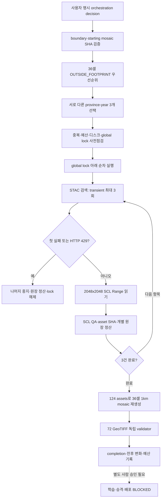

# 365 — Sentinel-2 결측 수집 one-shot guarded batch

- updated_at: 2026-10-27, Unit364 실패·Unit365 재실행 완료 인계 기준
- source_commit: `375f037379ac878353b652591d87a17efa51f021` 위 공유 작업트리의 Unit365 구현. 제품 코드는 이 이해자료 작업에서 수정하지 않았다.
- evidence_paths: [구현 문서](../implementation/365_automated_gap_collection_batch.md), [Unit364 실패](../../evidence/integration/unit364-automated-collection-batch-20261027/failure-completion.json), [Unit364 첫 항목 보고서](../../evidence/integration/unit364-automated-collection-batch-20261027/batch-item-01-report.json), [Unit365 완료](../../evidence/integration/unit365-automated-collection-retry-20261027/completion.json), [Unit365 갱신 mosaic 검증](../../evidence/integration/unit365-automated-collection-retry-20261027/updated-mosaic-validation.json), [orchestrator](../../backend/app/ml/province_year_collection_orchestrator.py), [collector](../../backend/app/ml/province_year_pilot_collector.py), [batch CLI](../../scripts/run_provisional_collection_batch.py)
- confidence: Unit364/365 실행 보고서, 실제 SCL asset·원장·lock 후상태, 갱신 mosaic와 독립 validator, 구현·시험 계약을 읽어 확인했다. BIG 경계 승인과 native-resolution 전체 completeness는 확보되지 않았다.
- status: Sentinel-2 SCL 3건 수집·QA·원장 정산·36셀 mosaic 갱신은 **VERIFIED_REAL**, 관련 회귀는 **TESTED_SYNTHETIC**, 경계 승인·전체 수집 완전성은 **BLOCKED**다. 학습·모델 승격·배포는 **0 / BLOCKED_REQUIRES_HUMAN_APPROVAL**이다.

## 1. 쉬운 설명

**Unit365는 결측이 큰 주-연도 셀 3개를 골라 Sentinel-2 SCL 창을 실제로 받고, 품질검사와 예산 원장 정산, 36셀 관측 지도의 재생성·검증까지 한 번에 수행하는 “한 번 실행형 안전 batch”를 완성했다.**

자동화는 다음 일을 한 호출 안에서 연결한다: 최신 mosaic 확인 → 우선순위 3개 선정 → 중복·예산·디스크·lock 점검 → 원격 수집 → SCL QA → 원장 정산 → 36셀 mosaic 재생성 → 독립 validator. 사람이 각 단계를 수동으로 이어 붙이지 않아도 되지만, 무기한 scheduler나 다음 batch 자동 승인 기능은 아니다.

첫 시도인 Unit364는 첫 STAC 검색에서 `RemoteDisconnected`가 발생했다. 새 다운로드는 0이고 나머지 2건은 시작하지 않았으며 lock을 해제했다. 측정하지 못한 요청 비용을 0으로 축소하지 않고 예약액 50,331,648B를 전액 charge했다.

Unit365는 새 batch run id와 최대 3회의 일시적 오류 retry를 사용했다. East Java 2021·2023·2024의 서로 다른 세 셀에서 2048×2048, 20m SCL 창 3개를 실제 수집했다. clear 비율은 각각 97.4523%, 99.5910%, 99.9855%였고 모두 `OBSERVATION_ELIGIBLE`이었다.

결과적으로 1km observed는 10,057→14,948, **4,891셀 증가**했고 OUTSIDE_FOOTPRINT는 1,112,540→1,107,605, **4,935셀 감소**했다. 전체 observed 비율은 1.330393%, 고유 source asset은 124개가 됐다. 다만 이는 승인 전 BIG 경계를 쓴 1km 수집 inventory이지 최종 10m/20m 과학 제품이나 전체 수집 완료 증거는 아니다.

## 2. 이론적 배경

### 자동화와 자율 권한은 다르다

자동화는 승인된 한 batch 안의 반복 작업을 기계적으로 수행하는 것이다. 자율 권한은 시스템이 다음 batch, 학습, 승격, 배포까지 스스로 결정할 수 있다는 뜻이다. Unit365는 전자만 구현했다.

orchestration decision에는 `collection_batch=true`, `automatic_training=false`, `automatic_deployment=false`가 고정된다. 시작 boundary와 mosaic SHA, batch 크기, 창 크기, 예약 상한, 실패 중지 정책이 다르면 실행을 거부한다. 성공 뒤에도 다음 batch에는 최신 mosaic SHA를 넣은 별도 결정이 필요하다.

### stop-on-first-failure와 bounded retry

외부 STAC 서비스는 일시적으로 연결을 끊을 수 있다. 이를 무한 재시도하면 비용과 중복 실행이 통제되지 않는다. 반대로 첫 통신 오류만으로 모든 작업을 영구 실패시키면 회복력이 부족하다.

Unit365는 연결 계층의 일시적 오류만 최대 3회 재시도한다. HTTP 429는 즉시 shared rate-limit circuit를 열고, asset·QA·원장·mosaic 단계에서 첫 실패가 나면 나머지를 중지한다. Unit364의 첫 실패와 Unit365 East Java 2021의 첫 attempt 실패 뒤 두 번째 attempt 성공은 이 두 원칙의 실제 차이를 보여준다.

### 예약 상한과 실제 charge

각 2048 창은 최대 48MiB, 세 건 합계 150,994,944B를 미리 예약할 수 있어야 한다. 성공한 Unit365는 실제로 계측한 COG Range 본문과 bounded metadata 본문만 charge해 세 건 합계 3,147,616B를 정산했다.

반면 Unit364처럼 수집 전에 통신이 실패해 실제 비용 경계를 정확히 잴 수 없으면 48MiB 예약액 50,331,648B를 전액 charge하고 자동 환불하지 않는다. 이는 성공 시 실측 charge, 불확실한 실패 시 보수적 상한 charge라는 예산 원칙이다.

### observed 증가와 OUTSIDE 감소가 같지 않은 이유

Unit365에서 observed는 4,891 늘었지만 OUTSIDE_FOOTPRINT는 4,935 줄었다. 새 SCL footprint 안에 들어온 44개 1km 셀이 모두 clear 관측으로 바뀐 것이 아니라 cloud·shadow 원인으로 재분류됐기 때문이다. 실제 전체 원인도 CLOUD 607→613, SHADOW 374→412로 변했다. 따라서 footprint 확보량을 곧바로 유효 관측 증가량으로 부르면 안 된다.

### 693 windows는 거친 크기 추정이다

256×256 pilot의 observed +25를 면적 64배인 2048×2048로 단순 확대하면 창당 약 1,600개의 1km inventory 셀을 얻는다고 가정할 수 있다. 현재 OUTSIDE_FOOTPRINT 1,107,605를 이 값으로 나누면 약 **693 windows**다.

이 계산은 해안선, MGRS tile 경계, 반복 overlap, cloud, scene edge, 실제 window 배치 효율을 무시한다. 예산 승인량·자동 실행 횟수·과학적 completeness가 아니며, full MGRS tile과 반복 window 전략을 비교하기 위한 거친 규모 감각일 뿐이다.

## 3. 코드·데이터 동작

### one-shot 실행 흐름

### orchestration decision 검증

[`province_year_collection_orchestrator.py`](../../backend/app/ml/province_year_collection_orchestrator.py)는 decision JSON과 boundary·starting mosaic SHA를 먼저 검증한다. 고정 정책은 2048×2048 SCL 창, 최대 3건, 창당 48MiB 예약, 첫 실패 중지, HTTP 429 중지, 서로 다른 province-year다. `automatic_training`이나 `automatic_deployment`가 true이거나 batch 크기가 4로 바뀌는 등의 policy drift가 있으면 실행하지 않는다.

세 target은 같은 시작 mosaic에서 뽑되 이미 고른 province-year를 제외한다. 실제 상위 target은 East Java 2021·2023·2024였다. plan은 수집 대상만 승인하며 학습·배포 권한을 포함하지 않는다.

### global lock·retry·회로

orchestrator는 한 개 global execution lock을 잡고 세 항목을 순차 실행한다. [`province_year_pilot_collector.py`](../../backend/app/ml/province_year_pilot_collector.py)는 상위 orchestrator가 lock을 보유했다는 명시 입력을 받아 중첩 lock 없이 개별 원장 key를 예약·정산한다.

STAC transport 오류는 1초 간격의 bounded retry 대상이고 최대 attempt는 3이다. HTTP 429는 retry하지 않고 shared circuit를 연다. 요청 spacing과 circuit는 성공·실패와 관계없이 `finally`에서 원상 복구된다. evidence directory가 비어 있지 않거나 기존 global lock이 있으면 시작하지 않는다.

### Unit364 안전 실패

Unit364의 첫 key `unit364-auto-01-east_java-2021`은 첫 STAC search의 `RemoteDisconnected`로 실패했다.

- status: `AUTOMATED_BATCH_STOPPED_WITHOUT_NEW_ASSET`
- remote downloads: 0
- remaining items not started: 2
- ledger: 50,331,648B reserved/charged, `settled`
- lock: release 확인
- training/deployment runs: 0/0

실패 key를 재사용하지 않고 다음 실행은 새 `unit365-auto-retry1-*` key를 사용했다. 이로써 실패 이력과 성공 이력이 원장에서 분리된다.

### Unit365 실제 세 건

| 셀 | Sentinel-2 scene | SCL clear | Range body | local SCL | ledger charge | observed 증가 |
|---|---|---:|---:|---:|---:|---:|
|East Java 2021|`S2B_MSIL2A_20210811T023549_R089_T49MFM_20210811T163939`|97.4523%|851,968B|446,308B|978,712B|+1,606|
|East Java 2023|`S2A_MSIL2A_20230905T023531_R089_T49MEM_20240916T145247`|99.5910%|917,504B|421,689B|1,226,601B|+1,640|
|East Java 2024|`S2B_MSIL2A_20240726T023529_R089_T49MFM_20240726T062840`|99.9855%|786,432B|435,375B|942,303B|+1,645|

세 파일은 각각 4,194,304 SCL 픽셀이고 모두 `OBSERVATION_ELIGIBLE`이다. Unit365 batch charge 합계는 **3,147,616B**다. Unit364 실패 charge와 이전 원장 상태까지 반영한 남은 추가 예산은 **1,712,724,244B**, 원장 SHA-256은 `2b98eadb6cff1d586fe136db2b151787ad6b8a0fa59389bf6a3d981a98065862`다.

### mosaic 갱신과 validator

124개 고유 raw SCL을 사용해 36 observed + 36 cause GeoTIFF를 EPSG:6933 1km 동일 격자로 다시 만들었다. 갱신 manifest SHA-256은 `9259b3d0d6c5da47f616b3b6ec9b45b0c8cfccf56e0095beb0a23ad1f6b93ae3`다.

| 지표 | Unit363 시작 | Unit365 완료 | 변화 |
|---|---:|---:|---:|
|고유 source assets|121|124|+3|
|observed|10,057|14,948|+4,891|
|observed 비율|0.895087%|1.330393%|+0.435306%p|
|OUTSIDE_FOOTPRINT|1,112,540|1,107,605|-4,935|
|전체 gap|1,113,521|1,108,630|-4,891|
|CLOUD / SHADOW / NODATA|607 / 374 / 0|613 / 412 / 0|+6 / +38 / 0|

독립 validator는 36셀, 124 unique asset, 모든 pin, observed/cause 같은 grid, EPSG:6933, nodata unset, 값 domain, 경계 밖 0, 모든 gap의 원인 분류를 통과시켰다. 실제 로컬 산출물이지만 경계 승인 대기 상태는 유지한다.

### 코드 지도와 서비스 영향

| 파일 | 책임 |
|---|---|
|`backend/app/ml/province_year_collection_orchestrator.py`|one-shot 3-window 계획·정책 검증·global lock·순차 실행·mosaic/validator orchestration|
|`backend/app/ml/province_year_pilot_collector.py`|bounded STAC retry, 개별 SCL 수집·QA·원장 정산|
|`scripts/run_provisional_collection_batch.py`|고정 SHA와 decision을 받는 batch CLI|
|`tests/test_province_year_collection_orchestrator.py`|승인 경계·policy drift·rough estimate 계약|
|`tests/test_province_year_pilot_collector.py`|SCL class·우선순위·bounded retry 계약|

이번 구현은 내부 CLI와 evidence 계약을 추가했으며 API/UI/WMS 계약은 바꾸지 않았다. API 8002, UI 5174, WMS 8088의 HTTP 200은 기존 서비스 가용성 확인이다. 신규 mosaic가 화면에 자동 게시·연결됐거나 브라우저에서 새 기능을 검증했다는 뜻은 아니다. 따라서 별도 web UI 변경은 필요하지 않았다.

## 4. 테스트 증거와 남은 개발

### 증거 상태

| 항목 | 결과 | 상태 |
|---|---:|---|
|Unit364 안전 실패|RemoteDisconnected, downloads 0, lock release, 50,331,648B charge|**VERIFIED_REAL** 실패 이력|
|Unit365 원격 수집|2048×2048 SCL 3건|**VERIFIED_REAL**|
|SCL QA|clear 97.4523% / 99.5910% / 99.9855%|**VERIFIED_REAL**|
|원장|Unit365 charge 3,147,616B, remaining 1,712,724,244B|**VERIFIED_REAL**|
|36셀 mosaic|14,948/1,123,578=1.330393%, 124 unique assets|**VERIFIED_REAL_LOCAL_ARTIFACTS_BOUNDARY_APPROVAL_PENDING**|
|독립 validator|36셀·72 TIFF·pin/grid/CRS/domain/경계/gap 원인 PASS|**VERIFIED_REAL** 로컬 검증|
|관련 회귀|33 PASS, 105 warnings, 87.82초|**TESTED_SYNTHETIC**|
|서비스 확인|API 8002·UI 5174·WMS 8088 HTTP 200|가용성 표본, 새 계약 없음|
|경계 승인·전체 completeness|미확보|**BLOCKED**|
|학습·승격·배포|0|**BLOCKED_REQUIRES_HUMAN_APPROVAL**|

회귀시험은 명시 사용자 결정, SHA pin, 정책 drift 거부, training/deployment false, rough estimate 한계, transient retry 상한과 SCL 분류 계약을 확인한다. 합성 fixture 기반 회귀 통과를 실제 원격 수집 증거와 합치지 않으며, 실제 수집 성공을 모델 정확도·승격·배포 증거로 확대하지 않는다.

### 현재 한계와 다음 개발 항목

1. BIG provisional 경계를 관할기관·통계 사용 승인 경계로 교체하고 새 SHA로 36셀 inventory를 재생성한다.
2. `SKIPPED_BY_USER_DECISION`인 GISTARU는 pilot/batch 범위를 넘어 검증됐다고 보지 말고 정식 비교·판정 근거를 확보한다.
3. 693-window 거친 추정을 실행 queue로 자동 변환하지 않는다. 반복 2048 window와 MGRS full-tile의 중복·전송·coverage 효율을 먼저 비교한다.
4. 다음 batch는 최신 manifest SHA, 새 batch id, 예산 상한과 명시 승인으로 별도 실행한다. scheduler나 자동 연속 실행은 추가하지 않는다.
5. 해안·tile edge·cloud·중복을 반영한 native-resolution completeness 기준과 종료 조건을 정의한다.
6. 대량 수집 뒤에도 immutable dataset/split pin, 독립 QA와 명시적 학습 승인을 충족하기 전에는 training을 열지 않는다.
7. 모델 평가·사람 승인·승격·rollback 증거 전에는 deployment를 열지 않는다.
8. UI 표출이 필요해질 때는 API 계약·상태·오류 계약을 먼저 정의하고 프론트 연결·브라우저 검증을 별도 완료한다.

## 5. 발표 스크립트

### 1분 발표

“Unit365는 Sentinel-2 결측 수집을 한 번 호출로 안전하게 처리하는 3-window batch를 구현하고 실제 실행했습니다. 첫 Unit364 시도는 STAC 연결이 끊겨 다운로드 0으로 중지했고 lock을 해제했지만, 불확실한 비용 때문에 예약 48MiB는 전액 charge했습니다. Unit365는 새 batch key와 최대 3회 retry로 East Java 2021, 2023, 2024의 2048×2048 SCL 창 3건을 받았습니다. clear는 97.4523%, 99.5910%, 99.9855%였고 실제 charge 합계는 3,147,616B였습니다. 36셀 observed는 4,891 늘어 1.330393%, 고유 asset은 124개가 됐고 독립 validator를 통과했습니다. 하지만 이것은 1km inventory의 일부 개선입니다. 경계 승인과 전체 completeness는 차단 상태이고 학습·배포는 0이며 사람 승인형입니다. 약 693 windows는 단순 면적 비례의 거친 추정이지 자동 실행 계획이 아닙니다.”

### 5분 발표

“이번 작업의 목표는 단일 pilot을 무제한 수집으로 확대하는 것이 아니라, 한 번 승인된 작은 batch 안에서 계획부터 검증까지 자동으로 이어지는지 확인하는 것이었습니다.

orchestration decision은 시작 boundary와 mosaic SHA, 2048 SCL 창 3개, 창당 48MiB 예약, 서로 다른 province-year, 첫 실패 및 HTTP 429 중지를 고정합니다. 학습과 배포 자동 승인은 false입니다. 따라서 이 파일이 바뀌거나 시작 mosaic가 달라지면 fail-closed로 멈춥니다.

첫 Unit364 실행은 East Java 2021의 첫 STAC search에서 RemoteDisconnected가 발생했습니다. 실제 다운로드는 0, 뒤의 두 항목은 시작하지 않았고 global lock은 해제했습니다. 외부 요청 비용을 정확히 측정하지 못했으므로 50,331,648B 예약을 전액 정산했습니다. 실패를 숨기거나 같은 원장 key로 덮어쓰지 않았습니다.

Unit365는 새 `unit365-auto-retry1` key와 일시적 오류 최대 3회 retry로 실행했습니다. East Java 2021은 첫 attempt가 같은 계열의 오류였지만 두 번째에 성공했고, 2023과 2024도 이어서 완료했습니다. 세 2048×2048, 20m SCL 창의 clear 비율은 97.4523%, 99.5910%, 99.9855%였습니다. 모두 observation eligible이며 실제 계측 charge 합계는 3,147,616B입니다. Unit364 실패까지 반영한 원장 잔액은 1,712,724,244B입니다.

124개 raw SCL로 36셀 observed/cause mosaic를 다시 만들었습니다. observed는 10,057에서 14,948로 4,891 늘었고 OUTSIDE_FOOTPRINT는 4,935 줄었습니다. 차이 44셀은 clear 관측이 아니라 cloud 또는 shadow 원인으로 재분류된 영역입니다. 전체 observed 비율은 1.330393%이며 manifest SHA도 고정했습니다. 독립 validator는 72개 GeoTIFF의 pin, 동일 격자, EPSG:6933, 값 domain, 경계와 gap 원인을 전수 통과시켰습니다.

남은 OUTSIDE_FOOTPRINT를 pilot gain에 단순 비례시키면 약 693개의 2048 window가 필요해 보입니다. 그러나 이는 해안선, MGRS 경계, cloud, overlap을 무시한 거친 추정입니다. 다음 batch를 자동 승인하거나 completeness를 주장하는 근거가 아닙니다. 다음 단계는 full-tile과 window 전략을 비교하고 최신 mosaic SHA와 새 승인으로 또 하나의 bounded batch를 결정하는 것입니다.

끝으로 API, UI, WMS는 HTTP 200이지만 이번 기능은 내부 CLI·evidence 계약입니다. 새 UI/API 계약은 없고 화면 자동 연결을 주장하지 않습니다. 학습·승격·배포도 0이며 계속 사람 승인형입니다.”

### 권장 슬라이드 제목

1. 수동 pilot에서 one-shot guarded batch로
2. Unit364 실패가 안전하게 남긴 증거
3. Unit365의 bounded retry와 세 개의 승인 창
4. 2048×2048 SCL 실제 QA와 예산 정산
5. observed +4,891과 원인 재분류 44셀
6. 124 assets·manifest pin·독립 validator
7. 693 windows 추정의 한계
8. 다음 batch·학습·배포의 사람 승인 경계

## 6. Q&A

### Q1. “자동 batch”는 계속 돌고 있는 scheduler입니까?

아니다. CLI를 한 번 호출하면 고정된 3-window batch 하나만 수행하는 one-shot 자동화다. 무기한 scheduler, background loop, 다음 batch 자동 승인은 없다.

### Q2. Unit364 실패는 데이터나 lock을 남겼습니까?

새 Sentinel 다운로드는 0이고 뒤의 2건은 시작하지 않았다. 실패 보고서와 원장 정산은 남겼지만 execution lock은 해제됐다.

### Q3. 다운로드가 0인데 왜 50,331,648B를 charge했습니까?

STAC 연결이 끊기기 전후의 외부 요청 비용을 완전하게 계측할 수 없었기 때문이다. 비용을 0으로 축소 보고하지 않고 48MiB 예약 상한을 전액 정산하는 보수 정책이다.

### Q4. Unit365는 무엇을 실제로 받았습니까?

East Java 2021·2023·2024의 서로 다른 셀에서 Sentinel-2 L2A의 20m SCL 2048×2048 창 3건을 실제 Range 읽기하고 로컬 raw-SCL로 저장했다.

### Q5. 세 장면의 clear 품질은 어떻습니까?

각각 97.4523%, 99.5910%, 99.9855%이며 세 건 모두 `OBSERVATION_ELIGIBLE`이다. 장면 metadata와 선택 창의 SCL 픽셀 QA는 측정 범위가 다르므로 구분한다.

### Q6. Unit365에서 실제로 쓴 예산은 얼마입니까?

세 key의 charge 합계는 3,147,616B다. Unit364 실패 charge 등 기존 원장 상태를 모두 반영한 남은 추가 예산은 1,712,724,244B이고 원장 SHA는 `2b98eadb6cff1d586fe136db2b151787ad6b8a0fa59389bf6a3d981a98065862`다.

### Q7. 왜 observed +4,891과 OUTSIDE -4,935가 다릅니까?

새 footprint 안으로 들어온 셀 중 44개가 clear observed가 아니라 cloud·shadow 원인으로 분류됐기 때문이다. footprint 확보와 유효 관측 확보를 같은 지표로 보지 않는다.

### Q8. observed 1.330393%는 공식 통계입니까?

아니다. 승인 전 BIG provisional 경계를 분모로 한 EPSG:6933 1km inventory 수치다. 실제 파일·계산은 검증됐지만 관할기관·통계 승인 전이다.

### Q9. 693 windows만 더 받으면 전체 수집이 끝납니까?

그렇게 결론낼 수 없다. pilot +25를 면적 64배로 확대한 창당 1,600셀 가정에 현재 OUTSIDE를 나눈 거친 값이다. 해안선·tile edge·cloud·overlap·MGRS 구조를 반영하지 않아 실행 계획이나 completeness 증거가 아니다.

### Q10. 다음 batch도 자동으로 실행됩니까?

아니다. 최신 mosaic SHA, 새 batch id, 예산·규모 정책과 사람의 명시 승인이 필요하다. 이번 성공이 다음 실행 권한을 자동으로 만들지 않는다.

### Q11. 모델 학습이나 배포가 시작됐습니까?

아니다. training/deployment run은 각각 0이다. 두 단계 모두 `BLOCKED_REQUIRES_HUMAN_APPROVAL`이며 dataset pin·QA·평가·승인 근거가 추가로 필요하다.

### Q12. API/UI/WMS가 200이면 새 결과가 화면에 연결된 것입니까?

아니다. 8002·5174·8088의 HTTP 200은 기존 서비스 가용성 표본이다. 이번에는 API/UI 계약을 바꾸지 않았고 신규 mosaic 자동 게시·프론트 연결·실제 브라우저 표출을 검증하지 않았다.

### Q13. 33 PASS는 실제 원격 수집을 증명합니까?

회귀 33건은 **TESTED_SYNTHETIC** 계약 증거다. 실제 원격 수집은 별도의 asset, Range, SHA, QA, 원장과 completion evidence가 **VERIFIED_REAL** 근거다. 둘을 합쳐 모델 성능이나 공식 승인을 주장하지 않는다.
