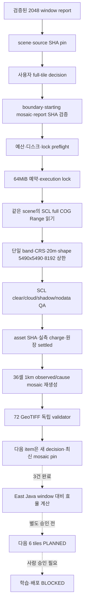

# 367 — Sentinel-2 SCL full-tile 전략과 제한 batch

- updated_at: 2026-10-27, Unit366 pilot·Unit367 후속 2건 완료 인계 기준
- source_commit: `375f037379ac878353b652591d87a17efa51f021` 위 공유 작업트리의 Unit366–367 구현. 제품 코드는 이 이해자료 작업에서 수정하지 않았다.
- evidence_paths: [구현 문서](../implementation/367_full_tile_strategy_and_batch.md), [Unit367 합산 요약](../../evidence/integration/unit367-full-tile-batch-summary-20261027.json), [Unit366 pilot 완료](../../evidence/integration/unit366-full-tile-strategy-pilot-20261027/completion.json), [Unit366 수집 보고서](../../evidence/integration/unit366-full-tile-strategy-pilot-20261027/full-tile-acquisition-report.json), [Unit367 item1 완료](../../evidence/integration/unit367-full-tile-batch-item1-20261027/completion.json), [Unit367 item1 수집 보고서](../../evidence/integration/unit367-full-tile-batch-item1-20261027/full-tile-acquisition-report.json), [Unit367 item2 완료](../../evidence/integration/unit367-full-tile-batch-item2-20261027/completion.json), [Unit367 item2 수집 보고서](../../evidence/integration/unit367-full-tile-batch-item2-20261027/full-tile-acquisition-report.json), [service reader](../../backend/app/data/service.py), [full-tile collector](../../backend/app/ml/province_year_full_tile_collector.py), [CLI](../../scripts/run_provisional_full_tile_pilot.py), [collector 시험](../../tests/test_province_year_full_tile_collector.py), [service 시험](../../tests/test_data_service.py)
- confidence: 세 실제 full-tile 수집 보고서, 순차 mosaic·validator, 최종 원장·lock/rate 상태와 구현·회귀 계약을 읽어 확인했다. 세 표본은 모두 East Java이며 BIG 경계 승인과 전체 수집 completeness는 없다.
- status: SCL full tile 3건 수집·QA·원장·mosaic는 **VERIFIED_REAL**, 관련 회귀는 **TESTED_SYNTHETIC**이다. BIG 경계 승인과 전체 completeness는 **BLOCKED**, 학습·승격·배포는 **0 / BLOCKED_REQUIRES_HUMAN_APPROVAL**이다. 다음 6 full tiles/384MiB는 **PLANNED_REQUIRES_PINNED_CANDIDATE_SELECTION_AND_PREFLIGHT**다.

## 1. 쉬운 설명

**Unit366–367은 작은 2048×2048 창을 반복해서 받는 방법과 같은 Sentinel-2 장면의 5490×5490 SCL 전체 타일을 받는 방법을 실제 전송량과 관측 증가량으로 비교하고, East Java 3개 연도에서 full tile 수집·검증을 완료했다.**

Unit366은 East Java 2021 한 건으로 전략을 시험했다. 그 결과를 확인한 뒤 Unit367에서 East Java 2023과 2024 두 건만 추가 실행했다. 세 건 모두 20m SCL 단일 band 전체 타일이며 Sentinel-2의 모든 반사도 band를 받은 것은 아니다.

세 full tile의 실제 합계는 Range 본문 8,717,673B, 원장 charge 8,718,877B, 1km observed +22,755셀이다. 같은 장면의 기존 2048 windows 세 건은 Range 2,555,904B, observed +4,891이었다. full tile은 전송량을 3.410798배 쓰고 observed를 4.652423배 늘려, 이 East Java 표본에서 바이트당 관측 증가 효율이 **1.364028배**였다.

최종 36셀 inventory는 observed 37,703/1,123,578=**3.355619%**, gap 1,085,875, 고유 asset 127개다. 실제 개선은 확인됐지만 아직 대부분이 비어 있고, 승인 전 BIG 경계를 사용했다. 따라서 “전체 수집 완료”나 “공식 관측률”이 아니다.

다음 단계로 최대 6개 full tile과 384MiB 상한이 권고됐지만 아직 후보 scene·tile·year pin과 preflight 전의 **PLANNED** 상태다. 자동 실행됐거나 승인됐다고 말하면 안 된다.

## 2. 이론적 배경

### 부분 window와 full tile의 효율

부분 window는 필요한 곳만 읽어 한 번의 비용이 작지만, 같은 COG의 메타데이터와 인접 Range를 여러 번 요청하거나 footprint 사이에 틈이 남을 수 있다. full tile은 한 번의 전송량이 크지만 같은 MGRS tile 안의 넓은 범위를 동시에 확보한다.

이번 비교의 효율은 다음과 같다.

\[
\text{효율 factor}
=\frac{22{,}755/8{,}717{,}673}{4{,}891/2{,}555{,}904}
=1.364028
\]

이는 “전송한 Range byte당 새 observed 1km 셀”의 비율이다. 네트워크 시간, 전체 HTTP overhead, 저장공간, 다른 지역의 해안·tile 배치까지 포함하는 보편적 비용 효율은 아니다.

### clear 비율과 NoData

각 full tile은 5490×5490=30,140,100개의 20m SCL 픽셀이다. clear는 SCL 4·5·6·7·11이고, NoData class 0은 clear가 아니다.

2021과 2024의 clear 비율 72.5252%, 77.0732%는 타일 전체를 분모로 하며 위성 swath 밖 NoData 5,985,608픽셀과 6,057,587픽셀도 분모에 들어간다. 이를 cloud로 바꾸지 않고 NODATA 원인으로 보존했다. 2023은 NoData 0으로 clear 99.5867%였다.

기존 학습 patch의 80% 기준은 잘라낸 patch의 최종 유효 품질 gate이고, full-tile clear 비율은 swath 밖을 포함하는 전체 SCL 타일 진단이다. 분모와 목적이 달라 72.5252%가 “80% 기준 실패”라는 결론을 내릴 수 없다.

### 실제 파일 검증과 경계 승인은 별개다

full tile의 원격 Range, SCL histogram, 로컬 SHA, 원장 charge, 36셀 mosaic는 실제로 검증됐다. 하지만 mosaic 분모의 BIG 경계는 여전히 provisional baseline이다. 실제 파일이 있다는 사실은 관할기관의 경계·통계 사용 승인이나 native-resolution 전국 completeness를 대신하지 않는다.

### 표본 외 일반화 제한

세 결과가 모두 East Java이고 사용한 MGRS tile도 `T49MFM` 또는 `T49MEM`이다. 섬이 많거나 해안선이 복잡한 다른 주, 다른 cloud 계절, 여러 MGRS tile에 걸친 셀에서는 효율이 달라질 수 있다. 1.364028을 6개 주 전체의 확정 계수로 사용하지 않는다.

## 3. 코드·데이터 동작

### 실행 흐름

### `read_cog_full_tile`

[`service.py`](../../backend/app/data/service.py)의 `read_cog_full_tile()`은 기존 `HTTPRangeReader`를 사용해 실제 받은 Range body byte를 누적한다. URL·SAS token 처리 뒤 단일 band, CRS 존재, 가로·세로 최대 8192, 전송량 상한을 검사한다. 원격 파일이 Range를 지원하지 않거나 Content-Range가 다르거나 byte 상한을 넘으면 실패한다.

오류가 GDAL/rasterio 예외로 감싸져도 원래 HTTP 원인, 실패 stage, 이미 측정한 body byte를 `AssetTransferError`에 보존한다. 이는 실패 비용과 HTTP 429를 숨기지 않기 위한 계약이다.

### 고정된 한 건 실행기

[`province_year_full_tile_collector.py`](../../backend/app/ml/province_year_full_tile_collector.py)는 기존에 검증된 2048 window 보고서를 source로 삼는다. boundary SHA, 시작 mosaic SHA, source report SHA, scene id, province/year, batch key, 한 타일 64MiB 예약, 최대 side 8192, stop-on-failure와 training/deployment false를 모두 확인한다.

preflight가 통과하면 execution lock과 64MiB 원장 예약을 잡고 동일 scene의 SCL 전체 타일만 읽는다. 성공 시 Range와 bounded metadata의 실측량을 charge하고, 실패 시 예약 전액을 보수 정산한다. 출력은 deflate 압축 raw-SCL, STAC, full-tile asset·acquisition report다. [`run_provisional_full_tile_pilot.py`](../../scripts/run_provisional_full_tile_pilot.py)는 모든 path와 SHA를 명시하는 one-shot CLI다.

Unit367의 “2건 batch”는 한 번에 무제한 병렬 실행한 것이 아니다. Unit366 결과 mosaic를 시작 pin으로 2023 한 건을 실행·검증한 뒤, 그 새 mosaic를 다시 시작 pin으로 2024 한 건을 실행·검증했다. 각 단계는 새 decision·batch key·evidence directory를 가진다.

### 실제 세 full tiles

| 단위 | 셀·scene | clear | NoData | Range body | charge | observed 증가 |
|---|---|---:|---:|---:|---:|---:|
|Unit366 pilot|East Java 2021 · `S2B_MSIL2A_20210811T023549_R089_T49MFM_20210811T163939`|72.5252%|5,985,608|3,399,268B|3,399,668B|+7,033|
|Unit367 item1|East Java 2023 · `S2A_MSIL2A_20230905T023531_R089_T49MEM_20240916T145247`|99.5867%|0|2,886,467B|2,886,869B|+8,211|
|Unit367 item2|East Java 2024 · `S2B_MSIL2A_20240726T023529_R089_T49MFM_20240726T062840`|77.0732%|6,057,587|2,431,938B|2,432,340B|+7,511|
|합계|3 full tiles|—|—|**8,717,673B**|**8,718,877B**|**+22,755**|

### window 비교

| 전략 | 실제 Range body | observed 증가 | 상대량 |
|---|---:|---:|---:|
|대응 2048 windows 3건|2,555,904B|4,891|기준 1.0|
|5490 full tiles 3건|8,717,673B|22,755|Range 3.410798배, gain 4.652423배|
|바이트당 gain 효율|—|—|**1.364028배**|

이 표는 같은 East Java source scenes의 실제 결과 비교다. 다른 주에 동일 계수를 적용하는 모델이나 보장은 아니다.

### 최종 mosaic·원장

세 full tile을 추가해 고유 source asset은 124→127개가 됐다. 최종 mosaic manifest SHA-256은 `8285cffc8e151ee6bc79abde1ab50ad1eeebedb3aac6977f0bbfb0cdef789a11`다.

| 지표 | Unit365 시작 | Unit367 최종 | 변화 |
|---|---:|---:|---:|
|observed|14,948|37,703|+22,755|
|observed 비율|1.330393%|3.355619%|+2.025226%p|
|gap|1,108,630|1,085,875|-22,755|
|OUTSIDE_FOOTPRINT|1,107,605|1,079,260|-28,345|
|CLOUD / SHADOW / NODATA|613 / 412 / 0|1,377 / 901 / 4,337|+764 / +489 / +4,337|

원장의 남은 추가 예산은 1,704,005,367B, SHA-256은 `97f04bbba9e1e8c6e8ed2e6a58592a8c7e1ddefe6775bc2b770a8da7e1da8448`이다. 이전부터 있던 Banten·West Java pending 2건은 그대로 보존됐다. 실행 후 active collector 0, execution lock 없음, rate-limit false다.

### 코드 지도와 UI 영향

| 파일 | 책임 |
|---|---|
|`backend/app/data/service.py`|bounded 단일-band COG full-tile Range reader와 오류·byte 계측 보존|
|`backend/app/ml/province_year_full_tile_collector.py`|decision/source pin, preflight, 원장·lock, full SCL QA, mosaic·validator|
|`scripts/run_provisional_full_tile_pilot.py`|한 full tile의 모든 입력 SHA를 요구하는 one-shot CLI|
|`tests/test_data_service.py`|full-tile 정책값, 오류 원인·측정 byte 보존|
|`tests/test_province_year_full_tile_collector.py`|승인 경계, batch 증가 거부, source report drift, window gain 입력 계약|

이번 기능은 내부 수집 CLI·evidence 계약이며 API/UI 상태·오류 계약은 변경하지 않았다. API 8002, UI 5174, WMS 8088 HTTP 200은 기존 서비스 가용성 확인일 뿐 신규 mosaic의 자동 게시·화면 연결 근거가 아니다. 따라서 별도 UI 변경은 필요하지 않았다.

## 4. 테스트 증거와 남은 개발

### 증거 상태

| 항목 | 결과 | 상태 |
|---|---:|---|
|SCL full-tile 원격 수집|East Java 2021/2023/2024, 3건|**VERIFIED_REAL**|
|SCL QA|clear 72.5252% / 99.5867% / 77.0732%|**VERIFIED_REAL**|
|전송·원장|Range 8,717,673B, charge 8,718,877B|**VERIFIED_REAL**|
|window 대비 효율|gain/Range byte 1.364028배|세 East Java 표본의 **VERIFIED_REAL** 비교|
|최종 mosaic|37,703/1,123,578=3.355619%, 127 assets|**VERIFIED_REAL_LOCAL_ARTIFACTS_BOUNDARY_APPROVAL_PENDING**|
|독립 validator|36셀·72 TIFF·127 assets·pin/grid/CRS/domain/경계/gap 원인 PASS|**VERIFIED_REAL** 로컬 검증|
|관련 회귀|45 PASS, 88 warnings, 11 subtests PASS, 55.23초|**TESTED_SYNTHETIC**|
|서비스 확인|API 8002·UI 5174·WMS 8088 HTTP 200|가용성 표본, 새 계약 없음|
|BIG 경계 승인·전체 completeness|미확보|**BLOCKED**|
|training/deployment|0/0|**BLOCKED_REQUIRES_HUMAN_APPROVAL**|
|다음 최대 6 tiles·384MiB|후보 pin·preflight 전|**PLANNED**|

회귀시험은 full-tile reader가 잘못된 side/byte 정책을 네트워크 전에 거부하는지, Range 실패의 원인과 byte를 보존하는지, decision의 max_full_tiles 증가·source report SHA drift·학습/배포 자동 승인을 거부하는지를 확인한다. 합성 회귀와 실제 원격 수집 evidence를 구분하며, 어느 쪽도 BIG 승인이나 모델 성능 근거가 아니다.

### 앞으로 완성해야 할 개발 항목

1. BIG provisional boundary를 관할기관·통계 승인 SHA로 교체하고 36셀 inventory를 다시 산출한다.
2. 다른 주와 다른 MGRS/해안 구조에서 full tile 대 window의 실제 byte·gain 효율을 측정해 East Java 편향을 해소한다.
3. 다음 6개 후보는 최신 manifest에서 고공백·서로 다른 province-year를 고르고, local STAC·scene·source report SHA를 먼저 pin한다.
4. 384MiB 예약 가능, 기존 pending·active collector·lock·rate circuit·disk와 중복 scene을 preflight한다.
5. 별도 승인 뒤에도 첫 실패/HTTP 429 중지, 각 tile 검증, batch 종료 후 mosaic 전수 validator를 유지한다.
6. 95%가 공식 인수 기준으로 승인된 사실은 없으므로 권고 목표와 계약 기준을 구분하고 native-resolution completeness 정의를 확정한다.
7. immutable dataset/split pin과 독립 QA·평가·사람 승인이 있기 전 training, 승격, deployment를 실행하지 않는다.
8. UI 표출이 필요해지면 API 상태·오류 계약, 게시 layer, 프론트 연결과 실제 브라우저 검증을 별도 완료한다.

## 5. 발표 스크립트

### 1분 발표

“Unit366–367에서는 기존 2048 창과 Sentinel-2 SCL 전체 타일의 효율을 실제로 비교했습니다. East Java 2021, 2023, 2024의 5490×5490, 20m SCL full tile 3건을 수집했고 clear는 72.5252%, 99.5867%, 77.0732%였습니다. 2021과 2024는 swath 밖 NoData가 전체 분모에 포함돼 기존 patch 80% 기준과 같은 지표가 아닙니다. full tile 3건은 Range 8,717,673B로 observed 22,755셀을 늘렸고, 대응 2048 windows는 2,555,904B로 4,891셀을 늘렸습니다. 이 East Java 표본에서 바이트당 gain 효율은 1.364028배였습니다. 최종 observed는 37,703셀, 3.355619%, 고유 asset은 127개이며 validator를 통과했습니다. 다만 경계 승인과 전체 completeness는 차단 상태이고 학습·배포는 0입니다. 다음 6 tiles와 384MiB는 후보 pin과 preflight 전의 계획일 뿐 실행 완료가 아닙니다.”

### 5분 발표

“Unit365에서 2048×2048 창 세 개를 수집한 뒤, 반복 window가 최선인지 실제로 확인하기 위해 같은 장면의 SCL full MGRS tile 전략을 시험했습니다.

구현은 검증된 window 보고서의 scene, asset SHA, 관측 gain과 최신 mosaic SHA를 decision에 고정합니다. `read_cog_full_tile`은 단일 band·CRS·최대 8192 side·Range byte 상한을 확인하고, 오류가 감싸져도 원래 HTTP 원인과 이미 읽은 byte를 보존합니다. collector는 한 tile마다 64MiB를 예약하고, 성공하면 실제 Range와 metadata만 charge하며 실패하면 전액을 보수 정산합니다. 학습과 배포 자동 승인은 false입니다.

Unit366은 East Java 2021 한 건을 실행했습니다. 이어 Unit367은 2023을 새 mosaic pin으로 실행·검증한 뒤, 다시 갱신된 mosaic를 pin해 2024를 실행했습니다. 세 타일은 모두 5490×5490, 20m SCL이고 실제 clear는 72.5252%, 99.5867%, 77.0732%였습니다. 2021과 2024 타일에는 swath 밖 NoData가 각각 약 599만, 606만 픽셀 있어 전체 clear 분모를 낮춥니다. 이를 cloud로 바꾸지 않았고, patch 유효 80% gate와 직접 비교하지 않습니다.

세 full tile의 Range 합계는 8,717,673B, charge는 8,718,877B, observed 증가는 22,755셀입니다. 동일한 세 장면의 기존 2048 window는 Range 2,555,904B, observed +4,891이었습니다. 전송량은 3.410798배, gain은 4.652423배라 이 표본의 gain-per-byte는 1.364028배였습니다. 그러나 모두 East Java라 다른 주의 확정 효율로 일반화하지 않습니다.

최종 36셀 mosaic는 observed 37,703/1,123,578, 3.355619%, gap 1,085,875, 고유 asset 127개입니다. 독립 validator가 72개 GeoTIFF의 pin, 동일 grid, EPSG:6933, 값 domain, 경계 밖 0과 모든 gap 원인을 통과시켰습니다. 원장 잔액은 1,704,005,367B이고 pending 2건은 그대로이며 lock과 active collector는 0, rate-limit은 false입니다.

다음 권고는 최대 6개 full tile, 384MiB지만 아직 계획입니다. 후보 scene·source report를 pin하지 않았고 preflight와 실행 승인이 없습니다. 다른 주 표본으로 효율을 검증하고, BIG 승인 경계와 completeness 기준을 확정한 뒤 별도 batch를 결정해야 합니다. API/UI 계약은 바뀌지 않았고 서비스 200을 새 화면 게시로 해석하지 않습니다. 학습·승격·배포도 0이며 계속 사람 승인형입니다.”

### 권장 슬라이드 제목

1. 2048 window 반복과 full SCL tile의 질문
2. 고정 scene에서 5490×5490을 안전하게 읽는 방법
3. East Java 3개 full tile 실제 QA
4. NoData 포함 clear와 patch 80%의 차이
5. Range 3.41배·gain 4.65배·효율 1.364배
6. observed 3.355619%와 여전히 큰 gap
7. East Java 표본의 일반화 한계
8. 다음 6 tiles는 PLANNED, 학습·배포는 승인형

## 6. Q&A

### Q1. “full tile”은 Sentinel-2의 모든 band를 전부 받은 것입니까?

아니다. 고정된 Sentinel-2 L2A scene의 **20m SCL 단일 band MGRS tile 5490×5490**을 받은 것이다. 반사도 band 전체 제품이나 최종 10m/20m 과학 산출물이 아니다.

### Q2. 실제 수집한 full tile은 몇 건입니까?

East Java 2021, 2023, 2024의 3건이다. Unit366에서 2021 pilot, Unit367에서 2023과 2024를 순차 실행했다.

### Q3. clear 72.5252%와 77.0732%는 품질 80% 미달입니까?

기존 patch 80%와 직접 비교할 수 없다. full-tile 비율은 swath 밖 NoData까지 포함한 30,140,100픽셀 전체가 분모이고, patch 80%는 잘라낸 학습 patch의 최종 유효 기준이다. NoData를 cloud로도 보지 않는다.

### Q4. 2021·2024 NoData는 얼마입니까?

각각 5,985,608픽셀과 6,057,587픽셀이다. cause mosaic에서는 NODATA로 보존하며 clear나 cloud로 둔갑시키지 않는다.

### Q5. full tile이 window보다 얼마나 효율적이었습니까?

세 East Java 표본에서 Range는 3.410798배, observed gain은 4.652423배였고 gain-per-Range-byte는 1.364028배였다. 네트워크 전체 비용이나 다른 주까지 보장하는 계수는 아니다.

### Q6. 왜 다른 주에 같은 1.364028을 적용할 수 없습니까?

세 표본이 모두 East Java이고 두 MGRS tile에만 속한다. 다른 주의 해안선, 섬, tile 수, cloud와 overlap 구조가 다르므로 직접 측정 전 일반화할 수 없다.

### Q7. 최종 관측률 3.355619%는 공식입니까?

아니다. 승인 전 BIG provisional 경계를 분모로 한 1km inventory다. 실제 계산·파일은 검증됐지만 관할기관·통계 승인 수치가 아니다.

### Q8. 원장과 실행 상태는 정상입니까?

남은 예산은 1,704,005,367B, 원장 SHA는 `97f04bbba9e1e8c6e8ed2e6a58592a8c7e1ddefe6775bc2b770a8da7e1da8448`이다. 기존 pending 2건은 보존됐고 active collector 0, lock 없음, rate-limit false다.

### Q9. 다음 6 full tiles는 실행됐습니까?

아니다. 최대 6 tiles·384MiB는 `PLANNED_REQUIRES_PINNED_CANDIDATE_SELECTION_AND_PREFLIGHT`다. 후보 scene/tile/year와 source SHA pin, 중복 제외, 예산·disk·lock·rate preflight와 별도 승인이 모두 남았다.

### Q10. 왜 한 번에 6개를 자동 실행하지 않습니까?

세 표본이 한 주에 편중됐고 전체 completeness가 낮다. 다른 지역 효율·중복·MGRS 배치와 예산을 확인하지 않고 상한을 자동 확대하면 근거 없는 자율 실행이 된다.

### Q11. 학습이나 배포가 시작됐습니까?

아니다. training/deployment run은 0/0이고 둘 다 `BLOCKED_REQUIRES_HUMAN_APPROVAL`이다. 수집 증거는 모델 정확도·승격·배포 승인이 아니다.

### Q12. 회귀 45 PASS는 실제 수집 증거입니까?

회귀는 45 PASS·88 warnings·11 subtests PASS의 **TESTED_SYNTHETIC** 계약 증거다. 실제 수집은 Range byte, asset SHA, SCL QA, 원장, completion과 validator의 **VERIFIED_REAL** 근거로 별도 확인한다.

### Q13. API/UI/WMS 200이면 새 mosaic가 화면에 나옵니까?

아니다. 8002·5174·8088 HTTP 200은 기존 서비스 가용성 표본이다. API/UI 계약 변경, 신규 layer 게시·프론트 연결·브라우저 표출 검증은 이번 범위에 없다.
