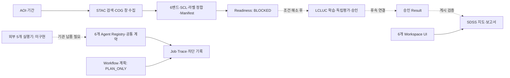

# 현재 플랫폼의 구조와 경계

| 필드 | 값 |
|---|---|
| updated_at | 2026-10-18 05:42:27 KST — 137 최종 API/UI·전체 회귀·실제 HTTP/browser·보존 반영 |
| source_commit | 기준 bec226ec460ca2497e092e34c21c64bd9ab0da99 + 137 작업파일 raw SHA (게시 전 검증 시점; 후속 Git 게시에서 같은 바이트 보존을 별도 확인); 인증 연결과 실행 승인 구분 |
| evidence_paths | `docs/implementation/00_next_session_handoff.md`; `evidence/integration/ml-readiness-resume-20261017.json`; `evidence/integration/resume-tests-script-20261017.log`; `backend/app/gmais_api.py`; `backend/app/sdss_results.py`; `backend/app/ml/network.py`; `docs/implementation/25_ml_split_repair_plan.md`; `evidence/integration/ml-split-repair-plan-20261017.json`; `docs/implementation/26_dataset_version_registry_core.md`; `evidence/integration/dataset-versions-tests-20261017.log`; `docs/implementation/24_collection_recovery_plan.md`; `evidence/integration/continuous-tests-20261017.log`; `evidence/integration/collection-recovery-plans/validation-20261017T003037618057Z.json`; `evidence/integration/collection-recovery-plans/integrity-20261017T003101447624Z.json`; `backend/app/job_inputs.py`; `docs/implementation/27_job_input_resolution.md`; `evidence/integration/job-input-core-tests-20261017.log`; `evidence/integration/job-input-api-tests-20261017.log`; `evidence/integration/job-input-full-tests-20261017.log`; `docs/implementation/28_workflow_input_resolution.md`; `tests/test_gmais_workflow_extension.py`; `evidence/integration/workflow-input-tests-20261017.log`; `evidence/integration/workflow-input-full-tests-20261017.log`; `backend/app/workflow_policy.py`; `docs/implementation/29_workflow_blocking_policy.md`; `evidence/integration/workflow-policy-core-tests-20261017.log`; `evidence/integration/workflow-policy-api-tests-20261017.log`; `evidence/integration/workflow-policy-full-tests-20261017.log`; `docs/implementation/30_workflow_diagnostics_ui.md`; `frontend/src/InputDiagnostics.tsx`; `frontend/src/inputDiagnosticsAdapter.ts`; `evidence/integration/workflow-policy-ui-build-20261017.log`; `evidence/integration/workflow-policy-live-ui-20261017.json`; `evidence/ui-20261017/workflow-diagnostics-live.png`; `backend/app/job_snapshot.py`; `docs/implementation/31_job_input_snapshot_read.md`; `docs/implementation/32_job_snapshot_ui.md`; `evidence/integration/job-snapshot-tests-20261017.log`; `evidence/integration/job-snapshot-full-tests-20261017.log`; `evidence/integration/job-snapshot-ui-build-20261017.log`; `evidence/integration/job-snapshot-live-ui-20261017.json`; `backend/app/dataset_lineage.py`; `docs/implementation/35_dataset_lineage_verification.md`; `evidence/integration/dataset-lineage-tests-20261017.log`; `evidence/integration/dataset-lineage-full-tests-20261017.log`; `evidence/integration/dataset-lineage-synthetic-20261017.json`; `docs/implementation/33_dashboard_reference_ui.md`; `docs/implementation/34_data_catalog_reference_ui.md`; `evidence/integration/dashboard-reference-build-20261017.log`; `evidence/integration/data-catalog-reference-build-20261017.log`; `evidence/integration/reference-ui-live-20261017.json`; `backend/app/dataset_lineage_api.py`; `docs/implementation/36_dataset_lineage_api_plan.md`; `docs/implementation/37_dataset_lineage_ui.md`; `evidence/integration/dataset-lineage-api-independent-tests-20261017.log`; `evidence/integration/dataset-lineage-api-full-tests-20261017.log`; `evidence/integration/dataset-lineage-ui-build-20261017.log`; `evidence/integration/dataset-lineage-api-live-20261017.json`; `backend/app/job_lineage.py`; `backend/app/job_lineage_api.py`; `docs/implementation/38_job_lineage_validation.md`; `docs/implementation/39_job_lineage_ui.md`; `evidence/integration/job-lineage-tests-20261017.log`; `evidence/integration/job-lineage-full-tests-20261017.log`; `evidence/integration/job-lineage-ui-build-20261017.log`; `evidence/integration/job-lineage-live-20261017.json`; `backend/app/workflow_lineage.py`; `backend/app/workflow_lineage_api.py`; `backend/app/lineage_batch.py`; `docs/implementation/40_workflow_lineage_validation.md`; `docs/implementation/41_workflow_lineage_ui.md`; `evidence/integration/workflow-lineage-independent-tests-20261017.log`; `evidence/integration/workflow-lineage-full-tests-20261017.log`; `evidence/integration/workflow-lineage-ui-build-20261017.log`; `evidence/integration/workflow-lineage-live-20261017.json`; `docs/implementation/42_catalog_insights_navigation.md`; `docs/implementation/43_catalog_insight_data_contract.md`; `frontend/src/CatalogInsights.tsx`; `frontend/src/catalogNavigation.ts`; `evidence/integration/catalog-insights-navigation-tests-20261017.log`; `evidence/integration/catalog-navigation-independent-ui-tests-20261017.log`; `evidence/integration/catalog-insights-navigation-build-20261017.log`; `evidence/integration/catalog-insights-browser-20261017.json`; `evidence/integration/catalog-insights-live-20261017.json`; `backend/app/ml/split_validation.py`; `scripts/validate_training_split_repair.py`; `docs/implementation/44_ml_split_repair_validation.md`; `evidence/integration/ml-split-validation-tests-20261017.log`; `evidence/integration/ml-split-validation-independent-20261017.log`; `evidence/integration/ml-split-validation-full-tests-20261017.log`; `evidence/integration/ml-split-repair-validation-live-final-20261017.json`; `evidence/integration/ml-split-validation-live-integrity-20261017.json`; `backend/app/data/recovery_terminal.py`; `scripts/inspect_recovery_terminal.py`; `docs/implementation/45_recovery_terminal_reconciliation.md`; `evidence/integration/recovery-terminal-tests-20261017.log`; `evidence/integration/recovery-terminal-independent-20261017.log`; `evidence/integration/recovery-terminal-full-tests-20261017.log`; `evidence/integration/recovery-terminal-live-final-20261017.json`; `evidence/integration/recovery-terminal-live-integrity-20261017.json`; `backend/app/data/recovery_aggregate.py`; `scripts/inspect_recovery_aggregate.py`; `docs/implementation/46_recovery_aggregate_reconciliation.md`; `evidence/integration/recovery-aggregate-tests-20261017.log`; `evidence/integration/recovery-aggregate-independent-20261017.log`; `evidence/integration/recovery-aggregate-full-tests-20261017.log`; `evidence/integration/recovery-aggregate-live-final-20261017.json`; `evidence/integration/recovery-aggregate-live-integrity-20261017.json`; `backend/app/data/recovery_crop.py`; `scripts/inspect_recovery_crop.py`; `docs/implementation/47_recovery_crop_reconciliation.md`; `evidence/integration/recovery-crop-tests-20261017.log`; `evidence/integration/recovery-crop-independent-20261017.log`; `evidence/integration/recovery-crop-full-tests-20261017.log`; `evidence/integration/recovery-crop-live-final-20261017.json`; `evidence/integration/recovery-crop-live-integrity-20261017.json`; `backend/app/data/recovery_raster_headers.py`; `scripts/inspect_recovery_raster_headers.py`; `docs/implementation/48_recovery_raster_header_validation.md`; `evidence/integration/recovery-raster-headers-tests-20261017.log`; `evidence/integration/recovery-raster-headers-independent-20261017.log`; `evidence/integration/recovery-raster-headers-live-final-20261017.json`; `evidence/integration/recovery-raster-headers-full-tests-20261017.log`; `evidence/integration/recovery-raster-headers-live-integrity-20261017.json`; `backend/app/data/recovery_raster_content.py`; `scripts/inspect_recovery_raster_content.py`; `docs/implementation/49_recovery_raster_content_validation.md`; `evidence/integration/recovery-raster-content-tests-20261017.log`; `evidence/integration/recovery-raster-content-independent-20261017.log`; `evidence/integration/recovery-raster-content-live-final-20261017.json`; `evidence/integration/recovery-raster-content-full-tests-20261017.log`; `evidence/integration/recovery-raster-content-live-integrity-20261017.json`; `backend/app/data/recovery_auxiliary_content.py`; `scripts/inspect_recovery_auxiliary_content.py`; `docs/implementation/50_recovery_auxiliary_content_validation.md`; `evidence/integration/recovery-auxiliary-content-tests-20261017.log`; `evidence/integration/recovery-auxiliary-content-independent-20261017.log`; `evidence/integration/recovery-auxiliary-content-live-final-20261017.json`; `evidence/integration/recovery-auxiliary-content-full-tests-20261017.log`; `evidence/integration/recovery-auxiliary-content-live-integrity-20261017.json`; `backend/app/data/recovery_auxiliary_headers.py`; `scripts/inspect_recovery_auxiliary_headers.py`; `docs/implementation/51_recovery_auxiliary_headers_validation.md`; `evidence/integration/recovery-auxiliary-headers-tests-20261017.log`; `evidence/integration/recovery-auxiliary-headers-independent-20261017.log`; `evidence/integration/recovery-auxiliary-headers-live-final-20261017.json`; `evidence/integration/recovery-auxiliary-headers-full-tests-20261017.log`; `evidence/integration/recovery-auxiliary-headers-live-integrity-20261017.json`; `backend/app/data/recovery_boundary.py`; `scripts/inspect_recovery_boundary.py`; `docs/implementation/52_recovery_boundary_validation.md`; `evidence/integration/recovery-boundary-tests-20261017.log`; `evidence/integration/recovery-boundary-independent-20261017.log`; `evidence/integration/recovery-boundary-live-final-20261017.json`; `evidence/integration/recovery-boundary-full-tests-20261017.log`; `evidence/integration/recovery-boundary-live-integrity-20261017.json`; `backend/app/data/recovery_boundary_topology.py`; `scripts/inspect_recovery_boundary_topology.py`; `docs/implementation/53_recovery_boundary_topology_validation.md`; `evidence/integration/recovery-boundary-topology-tests-20261017.log`; `evidence/integration/recovery-boundary-topology-independent-20261017.log`; `evidence/integration/recovery-boundary-topology-live-final-20261017.json`; `evidence/integration/recovery-boundary-topology-full-tests-20261017.log`; `evidence/integration/recovery-boundary-topology-live-integrity-20261017.json`; `backend/app/data/recovery_boundary_relations.py`; `scripts/inspect_recovery_boundary_relations.py`; `docs/implementation/54_recovery_boundary_relations_validation.md`; `evidence/integration/recovery-boundary-relations-tests-20261017.log`; `evidence/integration/recovery-boundary-relations-independent-20261017.log`; `evidence/integration/recovery-boundary-relations-live-final-20261017.json`; `evidence/integration/recovery-boundary-relations-full-tests-20261017.log`; `evidence/integration/recovery-boundary-relations-live-integrity-20261017.json`; `backend/app/data/recovery_source_footprints.py`; `scripts/inspect_recovery_source_footprints.py`; `docs/implementation/55_recovery_source_footprints_validation.md`; `evidence/integration/recovery-source-footprints-tests-20261017.log`; `evidence/integration/recovery-source-footprints-independent-20261017.log`; `evidence/integration/recovery-source-footprints-live-final-20261017.json`; `evidence/integration/recovery-source-footprints-full-tests-20261017.log`; `evidence/integration/recovery-source-footprints-live-integrity-20261017.json`; `backend/app/data/recovery_source_split_overlap.py`; `scripts/inspect_recovery_source_split_overlap.py`; `docs/implementation/56_recovery_source_split_overlap_validation.md`; `evidence/integration/recovery-source-split-overlap-tests-20261017.log`; `evidence/integration/recovery-source-split-overlap-independent-20261017.log`; `evidence/integration/recovery-source-split-overlap-plan-check-20261017.log`; `evidence/integration/recovery-source-split-overlap-live-final-20261017.json`; `evidence/integration/recovery-source-split-overlap-full-tests-20261017.log`; `evidence/integration/recovery-source-split-overlap-live-integrity-20261017.json`; `backend/app/data/recovery_readiness_comparison.py`; `scripts/inspect_recovery_readiness_comparison.py`; `docs/implementation/57_recovery_readiness_comparison_validation.md`; `evidence/integration/recovery-readiness-comparison-tests-20261017.log`; `evidence/integration/recovery-readiness-comparison-independent-20261017.log`; `evidence/integration/recovery-readiness-comparison-live-final-20261017.json`; `evidence/integration/recovery-readiness-comparison-full-tests-20261017.log`; `evidence/integration/recovery-readiness-comparison-live-integrity-20261017.json`; `backend/app/data/readiness_connectivity_witness.py`; `tests/test_readiness_connectivity_witness.py`; `docs/implementation/58_readiness_connectivity_witness_validation.md`; `evidence/integration/readiness-connectivity-witness-related-20261017.log`; `evidence/integration/readiness-connectivity-witness-independent-20261017.log`; `evidence/integration/readiness-connectivity-witness-live-absence-20261017.json`; `evidence/integration/readiness-connectivity-witness-full-tests-20261017.log`; `evidence/integration/readiness-connectivity-witness-live-integrity-20261017.json`; `backend/app/data/readiness_connectivity_envelope.py`; `tests/test_readiness_connectivity_envelope.py`; `docs/implementation/59_readiness_connectivity_envelope_validation.md`; `evidence/integration/readiness-connectivity-envelope-related-20261017.log`; `evidence/integration/readiness-connectivity-envelope-independent-20261017.log`; `evidence/integration/readiness-connectivity-envelope-live-absence-20261017.json`; `evidence/integration/readiness-connectivity-envelope-live-validation-20261017.json`; `evidence/integration/readiness-connectivity-envelope-full-tests-20261017.log`; `evidence/integration/readiness-connectivity-envelope-live-integrity-20261017.json`; `backend/app/ml/readiness.py`; `backend/app/ml/readiness_connectivity_adapter.py`; `tests/test_readiness_connectivity_adapter.py`; `docs/implementation/60_readiness_connectivity_adapter_validation.md`; `evidence/integration/readiness-connectivity-adapter-related-20261017.log`; `evidence/integration/readiness-connectivity-adapter-independent-20261017.log`; `evidence/integration/readiness-connectivity-adapter-ast-parity-20261017.json`; `evidence/integration/readiness-connectivity-adapter-live-saved-state-20261017.json`; `evidence/integration/readiness-connectivity-adapter-full-tests-20261017.log`; `evidence/integration/readiness-connectivity-adapter-live-integrity-20261017.json`; `scripts/run_experiment.py`; `tests/test_readiness_connectivity_cli.py`; `docs/implementation/61_readiness_connectivity_cli_validation.md`; `evidence/integration/readiness-connectivity-cli-related-20261017.log`; `evidence/integration/readiness-connectivity-cli-independent-20261017.log`; `evidence/integration/readiness-connectivity-cli-live-help-20261017.json`; `evidence/integration/readiness-connectivity-cli-ast-parity-20261017.json`; `evidence/integration/readiness-connectivity-cli-full-tests-20261017.log`; `evidence/integration/readiness-connectivity-cli-live-integrity-20261017.json`; `docs/implementation/62_readiness_connectivity_real_validation.md`; `data/first-group/readiness-connectivity-20261017.json`; `evidence/integration/readiness-connectivity-real-preflight-20261017.json`; `evidence/integration/readiness-connectivity-real-execution-20261017.json`; `evidence/integration/readiness-connectivity-real-validation-20261017.json`; `evidence/integration/readiness-connectivity-real-independent-20261017.log`; `evidence/integration/readiness-connectivity-real-token-membership-20261017.json`; `evidence/integration/readiness-connectivity-real-live-integrity-20261017.json`; `backend/app/data/readiness_connectivity_lineage.py`; `scripts/inspect_readiness_connectivity_lineage.py`; `tests/test_readiness_connectivity_lineage.py`; `docs/implementation/63_readiness_connectivity_lineage_validation.md`; `evidence/integration/readiness-connectivity-lineage-related-20261017.log`; `evidence/integration/readiness-connectivity-lineage-independent-20261017.log`; `evidence/integration/readiness-connectivity-lineage-live-cli-20261017.log`; `evidence/integration/readiness-connectivity-lineage-live-20261017.json`; `evidence/integration/readiness-connectivity-lineage-full-tests-20261017.log`; `evidence/integration/readiness-connectivity-lineage-live-integrity-20261017.json`; `docs/implementation/64_readiness_source_identity_contract.md`; `evidence/integration/readiness-source-identity-related-20261017.log`; `evidence/integration/readiness-source-identity-independent-20261017.log`; `evidence/integration/readiness-source-identity-full-tests-20261017.log`; `evidence/integration/readiness-source-identity-live-integrity-20261017.json`; `docs/implementation/65_readiness_source_identity_consumer.md`; `evidence/integration/readiness-source-identity-consumer-related-20261017.log`; `evidence/integration/readiness-source-identity-consumer-independent-20261017.log`; `evidence/integration/readiness-source-identity-consumer-live-cli-20261017.log`; `evidence/integration/readiness-source-identity-consumer-live-legacy-20261017.json`; `evidence/integration/readiness-source-identity-consumer-live-legacy-validation-20261017.json`; `evidence/integration/readiness-source-identity-consumer-full-tests-20261017.log`; `evidence/integration/readiness-source-identity-consumer-live-integrity-20261017.json`; `data/first-group/readiness-source-identity-20261017.json`; `evidence/integration/readiness-source-identity-real-preflight-20261017.json`; `evidence/integration/readiness-source-identity-real-execution-20261017.json`; `evidence/integration/readiness-source-identity-real-cli-20261017.log`; `evidence/integration/readiness-source-identity-real-lineage-20261017.json`; `evidence/integration/readiness-source-identity-real-lineage-cli-20261017.log`; `evidence/integration/readiness-source-identity-real-validation-20261017.json`; `evidence/integration/readiness-source-identity-real-independent-20261017.json`; `evidence/integration/readiness-source-identity-real-live-integrity-20261017.json`; `docs/implementation/66_readiness_source_identity_real_validation.md`; `backend/app/readiness_source_identity_api.py`; `backend/app/main.py`; `tests/test_readiness_source_identity_api.py`; `frontend/src/AgentCenter.tsx`; `frontend/src/ReadinessSourceIdentityDiagnostics.tsx`; `frontend/src/readinessSourceIdentityAdapter.ts`; `frontend/src/readinessSourceIdentityAdapter.test.mjs`; `frontend/src/readiness-source-identity.css`; `docs/implementation/67_readiness_source_identity_api.md`; `docs/implementation/68_readiness_source_identity_ui.md`; `evidence/integration/readiness-source-identity-api-related-20261017.log`; `evidence/integration/readiness-source-identity-api-independent-20261017.log`; `evidence/integration/readiness-source-identity-api-live-20261017.json`; `evidence/integration/readiness-source-identity-api-ui-full-tests-20261017.log`; `evidence/integration/readiness-source-identity-ui-adapter-20261017.log`; `evidence/integration/readiness-source-identity-ui-tests-20261017.log`; `evidence/integration/readiness-source-identity-ui-build-20261017.log`; `evidence/integration/readiness-source-identity-ui-independent-20261017.log`; `evidence/integration/readiness-source-identity-ui-live-20261017.json`; `evidence/integration/readiness-source-identity-ui-console-20261017.json`; `evidence/integration/readiness-source-identity-api-ui-live-integrity-20261017.json`; `backend/app/ml/candidate_plan_lineage.py`; `scripts/inspect_candidate_plan_lineage.py`; `tests/test_candidate_plan_lineage.py`; `docs/implementation/69_candidate_plan_lineage.md`; `evidence/integration/candidate-plan-lineage-related-20261017.log`; `evidence/integration/candidate-plan-lineage-independent-20261017.log`; `evidence/integration/candidate-plan-lineage-live-20261017.json`; `evidence/integration/candidate-plan-lineage-live-cli-20261017.log`; `evidence/integration/candidate-plan-lineage-full-tests-20261017.log`; `evidence/integration/candidate-plan-lineage-live-integrity-20261017.json`; `backend/app/ml/split_planning.py`; `backend/app/ml/split_json_io.py`; `tests/test_split_bounded_io.py`; `docs/implementation/70_split_bounded_io.md`; `evidence/integration/split-bounded-io-related-20261017.log`; `evidence/integration/split-bounded-io-independent-20261017.log`; `evidence/integration/split-bounded-io-live-20261017.json`; `evidence/integration/split-bounded-io-live-run-20261017.log`; `evidence/integration/split-bounded-io-full-tests-20261017.log`; `evidence/integration/split-bounded-io-live-integrity-20261017.json`; `backend/app/ml/candidate_materialization.py`; `scripts/materialize_split_candidate.py`; `tests/test_candidate_materialization.py`; `docs/implementation/71_candidate_materialization.md`; `evidence/integration/candidate-materialization-related-20261017.log`; `evidence/integration/candidate-materialization-independent-20261017.log`; `evidence/integration/candidate-materialization-live-cli-20261017.log`; `evidence/integration/candidate-materialization-live-validation-20261017.json`; `evidence/integration/candidate-materialization-full-tests-20261017.log`; `evidence/integration/candidate-materialization-live-integrity-20261017.json`; `evidence/integration/candidate-materialization-live-20261017/plan.json`; `evidence/integration/candidate-materialization-live-20261017/candidate.json`; `evidence/integration/candidate-materialization-live-20261017/receipt.json`; `backend/app/ml/candidate_staging.py`; `scripts/stage_split_candidate.py`; `tests/test_candidate_staging.py`; `docs/implementation/72_candidate_staging.md`; `evidence/integration/candidate-staging-related-20261017.log`; `evidence/integration/candidate-staging-independent-20261017.log`; `evidence/integration/candidate-staging-live-cli-20261017.log`; `evidence/integration/candidate-staging-live-validation-20261017.json`; `evidence/integration/candidate-staging-full-tests-20261017.log`; `evidence/integration/candidate-staging-live-integrity-20261017.json`; `data/first-group-candidate-qa-stage-20261017/candidate.json`; `data/first-group-candidate-qa-stage-20261017/staging-receipt.json`; `backend/app/ml/candidate_readiness_qa.py`; `scripts/assess_staged_candidate.py`; `tests/test_candidate_readiness_qa.py`; `docs/implementation/73_candidate_readiness_qa.md`; `evidence/integration/candidate-readiness-qa-related-20261017.log`; `evidence/integration/candidate-readiness-qa-independent-20261017.log`; `evidence/integration/candidate-readiness-qa-live-cli-20261017.log`; `evidence/integration/candidate-readiness-qa-live-execution-20261017.json`; `evidence/integration/candidate-readiness-qa-live-validation-20261017.json`; `evidence/integration/candidate-readiness-qa-full-tests-20261017.log`; `evidence/integration/candidate-readiness-qa-live-integrity-20261017.json`; `data/first-group-candidate-readiness-qa-20261017/readiness.json`; `data/first-group-candidate-readiness-qa-20261017/qa-receipt.json`; `backend/app/ml/candidate_qa_comparison.py`; `backend/app/candidate_qa_comparison_api.py`; `tests/test_candidate_qa_comparison.py`; `frontend/src/CandidateQaComparisonDiagnostics.tsx`; `frontend/src/candidateQaComparisonAdapter.ts`; `frontend/src/candidateQaComparisonAdapter.test.mjs`; `frontend/src/candidate-qa-comparison.css`; `docs/implementation/74_candidate_qa_comparison_api.md`; `docs/implementation/75_candidate_qa_comparison_ui.md`; `evidence/integration/candidate-qa-comparison-related-20261017.log`; `evidence/integration/candidate-qa-comparison-independent-20261017.log`; `evidence/integration/candidate-qa-comparison-ui-adapter-20261017.log`; `evidence/integration/candidate-qa-comparison-ui-tests-20261017.log`; `evidence/integration/candidate-qa-comparison-ui-build-20261017.log`; `evidence/integration/candidate-qa-comparison-ui-independent-20261017.log`; `evidence/integration/candidate-qa-comparison-live-http-20261017.json`; `evidence/integration/candidate-qa-comparison-ui-live-20261017.json`; `evidence/integration/candidate-qa-comparison-ui-console-before-fix-20261017.json`; `evidence/integration/candidate-qa-comparison-ui-console-after-fix-20261017.json`; `evidence/integration/candidate-qa-comparison-full-tests-20261017.log`; `evidence/integration/candidate-qa-comparison-live-integrity-20261017.json`; `backend/app/ml/bare_class_requirements.py`; `scripts/inspect_bare_class_requirements.py`; `tests/test_bare_class_requirements.py`; `docs/implementation/76_bare_class_requirements.md`; `evidence/integration/bare-class-requirements-related-20261017.log`; `evidence/integration/bare-class-requirements-independent-20261017.log`; `evidence/integration/bare-class-requirements-independent-arithmetic-20261017.json`; `evidence/integration/bare-class-requirements-live-20261017.json`; `evidence/integration/bare-class-requirements-live-cli-20261017.log`; `evidence/integration/bare-class-requirements-live-validation-20261017.json`; `evidence/integration/bare-class-requirements-full-tests-20261017.log`; `evidence/integration/bare-class-requirements-live-integrity-20261017.json`; `backend/app/execution_input_binding.py`; `tests/test_execution_input_binding.py`; `docs/implementation/77_execution_input_binding.md`; `evidence/integration/execution-input-binding-related-20261017.log`; `evidence/integration/execution-input-binding-independent-20261017.log`; `evidence/integration/execution-input-binding-live-validation-20261017.json`; `evidence/integration/execution-input-binding-live-replay-20261017.py`; `evidence/integration/execution-input-binding-full-tests-20261017.log`; `evidence/integration/execution-input-binding-live-integrity-20261017.json`; `backend/app/execution_binding_capture.py`; `tests/test_execution_binding_capture.py`; `docs/implementation/78_submission_binding_capture.md`; `evidence/integration/submission-binding-capture-related-20261017.log`; `evidence/integration/submission-binding-capture-independent-20261017.log`; `evidence/integration/submission-binding-capture-compat-before-20261017.json`; `evidence/integration/submission-binding-capture-compat-after-20261017.json`; `evidence/integration/submission-binding-capture-compat-runner-20261017.py`; `evidence/integration/submission-binding-capture-live-legacy-20261017.json`; `evidence/integration/submission-binding-capture-full-tests-20261017.log`; `evidence/integration/submission-binding-capture-live-integrity-20261017.json`; `backend/app/job_execution_binding_capture.py`; `backend/app/job_execution_binding_capture_api.py`; `tests/test_job_execution_binding_capture.py`; `frontend/src/StoredExecutionBindingCapture.tsx`; `frontend/src/storedExecutionBindingCaptureAdapter.ts`; `frontend/src/storedExecutionBindingCaptureAdapter.test.mjs`; `frontend/src/stored-execution-binding-capture.css`; `docs/implementation/79_stored_binding_capture_api.md`; `docs/implementation/80_stored_binding_capture_ui.md`; `evidence/integration/stored-binding-capture-related-20261017.log`; `evidence/integration/stored-binding-capture-live-api-20261017.json`; `evidence/integration/stored-binding-capture-live-ui-20261017.json`; `evidence/integration/stored-binding-capture-ui-adapter-20261017.log`; `evidence/integration/stored-binding-capture-ui-tests-20261017.log`; `evidence/integration/stored-binding-capture-ui-build-20261017.log`; `evidence/integration/job-execution-binding-capture-independent-20261017.log`; `evidence/integration/stored-execution-binding-capture-ui-independent-20261017.log`; `evidence/integration/stored-binding-capture-full-tests-20261017.log`; `evidence/integration/stored-binding-capture-live-integrity-20261017.json`; `backend/app/stored_job_binding_handoff.py`; `tests/test_stored_job_binding_handoff.py`; `docs/implementation/81_stored_job_binding_handoff.md`; `evidence/integration/stored-job-binding-handoff-related-20261017.log`; `evidence/integration/stored-binding-handoff-independent-20261017.log`; `evidence/integration/stored-binding-handoff-live-validation-20261017.json`; `evidence/integration/stored-binding-handoff-live-replay-20261017.py`; `evidence/integration/stored-binding-handoff-full-tests-20261017.log`; `evidence/integration/stored-binding-handoff-live-integrity-20261017.json`; `backend/app/stored_job_binding_handoff_store.py`; `tests/test_stored_job_binding_handoff_store.py`; `docs/implementation/82_stored_job_binding_handoff_store.md`; `evidence/integration/stored-binding-store-adapter-related-20261017.log`; `evidence/integration/stored-binding-store-adapter-independent-20261017.log`; `evidence/integration/stored-binding-store-adapter-live-validation-20261017.json`; `evidence/integration/stored-binding-store-adapter-live-check-20261017.py`; `evidence/integration/stored-binding-store-adapter-full-tests-20261017.log`; `evidence/integration/stored-binding-store-adapter-live-integrity-20261017.json`; `backend/app/stored_current_binding_preflight.py`; `tests/test_stored_current_binding_preflight.py`; `docs/implementation/83_stored_current_binding_preflight.md`; `evidence/integration/stored-current-binding-preflight-related-20261017.log`; `evidence/integration/stored-current-binding-independent-20261017.log`; `evidence/integration/stored-current-binding-live-validation-20261017.json`; `evidence/integration/stored-current-binding-live-check-20261017.py`; `evidence/integration/stored-current-binding-full-tests-20261017.log`; `evidence/integration/stored-current-binding-live-integrity-20261017.json`; `backend/app/stored_current_binding_preflight_api.py`; `tests/test_stored_current_binding_preflight_api.py`; `docs/implementation/84_current_input_preflight_api.md`; `docs/implementation/85_current_input_preflight_ui.md`; `frontend/src/CurrentInputPreflight.tsx`; `frontend/src/currentInputPreflightAdapter.ts`; `frontend/src/currentInputPreflightAdapter.test.mjs`; `frontend/src/current-input-preflight.css`; `evidence/integration/current-input-preflight-api-related-20261017.log`; `evidence/integration/stored-current-binding-api-independent-20261017.log`; `evidence/integration/current-input-preflight-live-api-20261017.json`; `evidence/integration/current-input-preflight-live-ui-20261017.json`; `evidence/integration/current-input-preflight-ui-desktop-20261017.jpg`; `evidence/integration/current-input-preflight-ui-adapter-20261017.log`; `evidence/integration/current-input-preflight-ui-tests-20261017.log`; `evidence/integration/current-input-preflight-ui-independent-20261017.log`; `evidence/integration/current-input-preflight-ui-build-20261017.log`; `evidence/integration/current-input-preflight-full-tests-20261017.log`; `evidence/integration/current-input-preflight-live-integrity-20261017.json`; `backend/app/workflow_node_input_handoff.py`; `tests/test_workflow_node_input_handoff.py`; `docs/implementation/86_workflow_node_input_handoff.md`; `evidence/integration/workflow-node-handoff-related-20261017.log`; `evidence/integration/workflow-node-handoff-independent-20261017.log`; `evidence/integration/workflow-node-handoff-full-tests-20261017.log`; `evidence/integration/workflow-node-handoff-live-integrity-20261017.json`; `evidence/integration/workflow-node-handoff-catalog-observation-20261017.json`; `evidence/integration/workflow-node-handoff-runtime-start-20261017.json`; `evidence/integration/workflow-node-handoff-full-interrupted-before-final-freeze-20261017.log`; `backend/app/workflow_node_input_handoff_api.py`; `tests/test_workflow_node_input_handoff_api.py`; `docs/implementation/87_workflow_node_handoff_api.md`; `docs/implementation/88_workflow_node_handoff_ui.md`; `frontend/src/WorkflowNodeHandoff.tsx`; `frontend/src/workflowNodeHandoffAdapter.ts`; `frontend/src/workflowNodeHandoffAdapter.test.mjs`; `frontend/src/workflow-node-handoff.css`; `frontend/src/GeoQuery.tsx`; `evidence/integration/workflow-node-handoff-canonical-fixture-20261017.json`; `evidence/integration/workflow-node-handoff-api-related-20261017.log`; `evidence/integration/workflow-node-handoff-api-independent-20261017.log`; `evidence/integration/workflow-node-handoff-api-live-api-20261017.json`; `evidence/integration/workflow-node-handoff-api-live-ui-20261017.json`; `evidence/integration/workflow-node-handoff-api-full-tests-20261017.log`; `evidence/integration/workflow-node-handoff-api-live-integrity-20261017.json`; `evidence/integration/workflow-node-handoff-ui-adapter-20261017.log`; `evidence/integration/workflow-node-handoff-ui-tests-20261017.log`; `evidence/integration/workflow-node-handoff-ui-independent-20261017.log`; `evidence/integration/workflow-node-handoff-ui-build-20261017.log`; `evidence/integration/workflow-node-handoff-ui-desktop-20261017.jpg`; `backend/app/workflow_job_request_handoff.py`; `tests/test_workflow_job_request_handoff.py`; `docs/implementation/89_workflow_job_request_handoff.md`; `evidence/integration/full-job-handoff-related-20261017.log`; `evidence/integration/full-job-handoff-independent-20261017.log`; `evidence/integration/full-job-handoff-initial-format-gap-20261017.log`; `evidence/integration/full-job-handoff-full-tests-20261017.log`; `evidence/integration/full-job-handoff-live-integrity-20261017.json`; `evidence/integration/full-job-handoff-catalog-observation-20261017.json`; `evidence/integration/full-job-handoff-runtime-start-20261017.json`; `backend/app/workflow_job_request_handoff_api.py`; `tests/test_workflow_job_request_handoff_api.py`; `docs/implementation/90_full_job_handoff_api.md`; `docs/implementation/91_full_job_handoff_ui.md`; `frontend/src/FullJobHandoff.tsx`; `frontend/src/fullJobHandoffAdapter.ts`; `frontend/src/fullJobHandoffAdapter.test.mjs`; `frontend/src/full-job-handoff.css`; `evidence/integration/full-job-handoff-api-related-20261017.log`; `evidence/integration/full-job-handoff-api-independent-20261017.log`; `evidence/integration/full-job-handoff-api-live-api-20261017.json`; `evidence/integration/full-job-handoff-api-live-ui-20261017.json`; `evidence/integration/full-job-handoff-api-full-tests-20261017.log`; `evidence/integration/full-job-handoff-api-live-integrity-20261017.json`; `evidence/integration/full-job-handoff-ui-adapter-20261017.log`; `evidence/integration/full-job-handoff-ui-tests-20261017.log`; `evidence/integration/full-job-handoff-ui-independent-20261017.log`; `evidence/integration/full-job-handoff-ui-build-20261017.log`; `evidence/integration/full-job-handoff-ui-desktop-20261017.jpg`; `backend/app/schema_formats.py`; `tests/test_schema_formats.py`; `docs/implementation/92_common_datetime_validation.md`; `evidence/integration/common-datetime-related-20261017.log`; `evidence/integration/common-datetime-independent-20261017.log`; `evidence/integration/common-datetime-source-runtime-20261017.json`; `evidence/integration/common-datetime-catalog-observation-20261017.json`; `evidence/integration/common-datetime-next-review-20261017.json`; `evidence/integration/common-datetime-full-tests-20261017.log`; `evidence/integration/common-datetime-live-integrity-20261017.json`; `backend/app/agent_capability_contract.py`; `tests/test_agent_capability_contract.py`; `docs/implementation/93_agent_capability_contract.md`; `evidence/integration/agent-capability-original-gmais-20261017.py`; `evidence/integration/agent-capability-related-20261017.log`; `evidence/integration/agent-capability-independent-20261017.log`; `evidence/integration/agent-capability-source-runtime-20261017.json`; `evidence/integration/agent-capability-next-review-20261017.json`; `evidence/integration/agent-capability-full-tests-20261017.log`; `evidence/integration/agent-capability-live-integrity-20261017.json`; `backend/app/workflow_job_registration_handoff.py`; `tests/test_workflow_job_registration_handoff.py`; `tests/test_workflow_job_registration_handoff_api.py`; `docs/implementation/94_full_job_registration_api.md`; `docs/implementation/95_full_job_registration_ui.md`; `frontend/src/fullJobRegistrationAdapter.ts`; `frontend/src/fullJobRegistrationAdapter.test.mjs`; `evidence/integration/full-job-registration-api-related-20261017.log`; `evidence/integration/full-job-registration-api-independent-20261017.log`; `evidence/integration/full-job-registration-api-live-api-20261017.json`; `evidence/integration/full-job-registration-api-live-ui-20261017.json`; `evidence/integration/full-job-registration-api-full-tests-20261017.log`; `evidence/integration/full-job-registration-api-live-integrity-20261017.json`; `evidence/integration/full-job-registration-api-original-20261017.py`; `evidence/integration/full-job-registration-ui-related-20261017.log`; `evidence/integration/full-job-registration-ui-tests-20261017.log`; `evidence/integration/full-job-registration-ui-independent-20261017.log`; `evidence/integration/full-job-registration-ui-build-20261017.log`; `evidence/integration/full-job-registration-ui-desktop-20261017.png`; `evidence/integration/full-job-registration-ui-blocked-20261017.png`; `backend/app/model_reference_contract.py`; `tests/test_model_reference_contract.py`; `docs/implementation/96_model_reference_contract.md`; `evidence/integration/model-ref-related-20261017.log`; `evidence/integration/model-ref-independent-20261017.log`; `evidence/integration/model-ref-source-runtime-20261017.json`; `evidence/integration/model-ref-full-tests-20261017.log`; `evidence/integration/model-ref-live-integrity-20261017.json`; `evidence/integration/model-ref-next-review-20261017.json`; `evidence/integration/model-ref-original-gmais-20261017.py`; `evidence/integration/model-ref-original-handoff-20261017.py`; `backend/app/experiment_registry.py`; `tests/test_model_version_declaration.py`; `docs/implementation/97_model_version_declaration.md`; `evidence/integration/model-version-related-20261017.log`; `evidence/integration/model-version-independent-20261017.log`; `evidence/integration/model-version-catalog-observation-20261017.json`; `evidence/integration/model-version-original-registry-20261017.py`; `evidence/integration/model-version-initial-tests-20261017.log`; `evidence/integration/model-version-full-tests-20261017.log`; `evidence/integration/model-version-live-integrity-20261017.json`; `evidence/integration/model-version-next-review-20261017.json`; `frontend/src/ModelReview.tsx`; `frontend/src/modelVersionRegistrationAdapter.ts`; `frontend/src/modelVersionRegistrationAdapter.test.mjs`; `frontend/src/model-version-registration.css`; `docs/implementation/98_model_version_registration_api.md`; `docs/implementation/99_model_version_registration_ui.md`; `evidence/integration/model-version-api-related-20261017.log`; `evidence/integration/model-version-api-independent-20261017.log`; `evidence/integration/model-version-api-live-api-20261017.json`; `evidence/integration/model-version-api-live-ui-20261017.json`; `evidence/integration/model-version-api-full-tests-20261017.log`; `evidence/integration/model-version-api-full-tests-corrected-20261017.log`; `evidence/integration/model-version-api-live-integrity-20261017.json`; `evidence/integration/model-version-api-original-main-20261017.py`; `evidence/integration/model-version-api-original-ui-20261017.tsx`; `evidence/integration/model-version-api-next-review-20261017.json`; `evidence/integration/model-version-ui-related-20261017.log`; `evidence/integration/model-version-ui-tests-20261017.log`; `evidence/integration/model-version-ui-independent-20261017.log`; `evidence/integration/model-version-ui-build-20261017.log`; `evidence/integration/model-version-ui-related-layout-20261017.log`; `evidence/integration/model-version-ui-tests-layout-20261017.log`; `evidence/integration/model-version-ui-build-layout-20261017.log`; `evidence/integration/model-version-ui-desktop-final-20261017.png`; `backend/app/model_registration_provenance.py`; `tests/test_model_registration_provenance.py`; `docs/implementation/100_model_registration_provenance_observation.md`; `evidence/integration/model-provenance-focused-20261017.log`; `evidence/integration/model-provenance-related-20261017.log`; `evidence/integration/model-provenance-independent-20261017.log`; `evidence/integration/model-provenance-catalog-observation-20261017.json`; `evidence/integration/model-provenance-live-integrity-20261017.json`; `tests/test_model_registration_provenance_api.py`; `docs/implementation/101_model_registration_provenance_api.md`; `docs/implementation/102_model_registration_provenance_ui.md`; `frontend/src/ModelRegistrationProvenance.tsx`; `frontend/src/modelRegistrationProvenanceAdapter.ts`; `frontend/src/modelRegistrationProvenanceAdapter.test.mjs`; `frontend/src/model-registration-provenance.css`; `evidence/integration/model-provenance-api-focused-20261017.log`; `evidence/integration/model-provenance-api-focused-corrected-20261017.log`; `evidence/integration/model-provenance-api-focused-final-20261017.log`; `evidence/integration/model-provenance-api-related-20261017.log`; `evidence/integration/model-provenance-api-independent-20261017.log`; `evidence/integration/model-provenance-api-live-api-20261017.json`; `evidence/integration/model-provenance-api-live-ui-20261017.json`; `evidence/integration/model-provenance-api-full-tests-20261017.log`; `evidence/integration/model-provenance-api-live-integrity-20261017.json`; `evidence/integration/model-provenance-api-next-review-20261017.json`; `evidence/integration/model-provenance-ui-related-20261017.log`; `evidence/integration/model-provenance-ui-tests-20261017.log`; `evidence/integration/model-provenance-ui-independent-20261017.log`; `evidence/integration/model-provenance-ui-build-20261017.log`; `evidence/integration/model-provenance-ui-desktop-20261017.png`; `backend/app/model_reference_record_comparison.py`; `tests/test_model_reference_record_comparison.py`; `docs/implementation/103_model_reference_record_comparison.md`; `evidence/integration/model-reference-record-focused-20261017.log`; `evidence/integration/model-reference-record-related-20261017.log`; `evidence/integration/model-reference-record-independent-20261017.log`; `evidence/integration/model-reference-record-catalog-observation-20261017.json`; `evidence/integration/model-reference-record-live-integrity-20261017.json`; `backend/app/workflow_job_model_record_handoff.py`; `tests/test_workflow_job_model_record_handoff.py`; `docs/implementation/104_workflow_job_model_record_handoff.md`; `evidence/integration/workflow-model-record-focused-20261017.log`; `evidence/integration/workflow-model-record-related-20261017.log`; `evidence/integration/workflow-model-record-independent-20261017.log`; `evidence/integration/workflow-model-record-catalog-observation-20261017.json`; `evidence/integration/workflow-model-record-live-integrity-20261017.json`; `backend/app/workflow_job_model_record_handoff_api.py`; `tests/test_workflow_job_model_record_handoff_api.py`; `docs/implementation/105_workflow_job_model_record_handoff_api.md`; `docs/implementation/106_workflow_model_record_handoff_ui.md`; `frontend/src/WorkflowModelRecordHandoff.tsx`; `frontend/src/workflowModelRecordHandoffAdapter.ts`; `frontend/src/workflowModelRecordHandoffAdapter.test.mjs`; `frontend/src/workflow-model-record-handoff.css`; `evidence/integration/workflow-model-record-api-focused-20261017.log`; `evidence/integration/workflow-model-record-api-related-20261017.log`; `evidence/integration/workflow-model-record-api-independent-20261017.log`; `evidence/integration/workflow-model-record-api-full-tests-20261017.log`; `evidence/integration/workflow-model-record-api-full-tests-final-20261017.log`; `evidence/integration/workflow-model-record-api-live-api-20261017.json`; `evidence/integration/workflow-model-record-api-live-ui-20261017.json`; `evidence/integration/workflow-model-record-api-live-integrity-20261017.json`; `evidence/integration/workflow-model-record-api-test-compat-baseline-20261017.json`; `evidence/integration/workflow-model-record-api-test-compat-focused-20261017.log`; `evidence/integration/workflow-model-record-api-test-compat-original-20261017.py`; `evidence/integration/workflow-model-record-api-test-compat-result-20261017.json`; `evidence/integration/workflow-model-record-api-next-queue-review-20261017.json`; `evidence/integration/workflow-model-record-ui-related-initial-failure-20261017.log`; `evidence/integration/workflow-model-record-ui-related-20261017.log`; `evidence/integration/workflow-model-record-ui-independent-20261017.log`; `evidence/integration/workflow-model-record-ui-tests-20261017.log`; `evidence/integration/workflow-model-record-ui-build-20261017.log`; `evidence/integration/workflow-model-record-ui-desktop-20261017.png`; `backend/app/workflow_dependency_order.py`; `tests/test_workflow_dependency_order.py`; `docs/implementation/107_workflow_dependency_order.md`; `evidence/integration/workflow-dependency-order-focused-20261017.log`; `evidence/integration/workflow-dependency-order-focused-final-20261017.log`; `evidence/integration/workflow-dependency-order-related-20261017.log`; `evidence/integration/workflow-dependency-order-independent-20261017.log`; `evidence/integration/workflow-dependency-order-independent-review-20261017.json`; `evidence/integration/workflow-dependency-order-full-tests-20261017.log`; `evidence/integration/workflow-dependency-order-live-integrity-20261017.json`; `evidence/integration/workflow-dependency-order-preflight-20261017.json`; `evidence/integration/workflow-dependency-order-original-gmais_api-20261017.py`; `evidence/integration/workflow-dependency-order-original-workflow_lineage-20261017.py`; `evidence/integration/workflow-dependency-order-original-workflow_policy-20261017.py`; `backend/app/ml/bare_patch_feasibility.py`; `scripts/inspect_bare_patch_feasibility.py`; `tests/test_bare_patch_feasibility.py`; `docs/implementation/108_bare_patch_feasibility.md`; `evidence/integration/bare-class-patch-feasibility-focused-20261017.log`; `evidence/integration/bare-class-patch-feasibility-related-20261017.log`; `evidence/integration/bare-class-patch-feasibility-related-corrected-20261017.log`; `evidence/integration/bare-class-patch-feasibility-independent-20261017.log`; `evidence/integration/bare-class-patch-feasibility-independent-review-20261017.json`; `evidence/integration/bare-class-patch-feasibility-live-20261017.json`; `evidence/integration/bare-class-patch-feasibility-live-cli-20261017.log`; `evidence/integration/bare-class-patch-feasibility-live-integrity-20261017.json`; `evidence/integration/bare-class-patch-feasibility-collection-next-review-20261017.json`; `backend/app/data/recovery_commit_contract.py`; `tests/test_recovery_commit_contract.py`; `docs/implementation/109_area_completion_audit.md`; `docs/implementation/110_recovery_commit_contract.md`; `scripts/collect_training_parallel.py`; `backend/app/data/budget.py`; `evidence/integration/recovery-commit-contract-focused-20261017.log`; `evidence/integration/recovery-commit-contract-focused-final-20261017.log`; `evidence/integration/recovery-commit-contract-focused-final2-20261017.log`; `evidence/integration/recovery-commit-contract-related-20261017.log`; `evidence/integration/recovery-commit-contract-related-final-20261017.log`; `evidence/integration/recovery-commit-contract-related-final2-20261017.log`; `evidence/integration/recovery-commit-contract-independent-before-key-guard-20261017.log`; `evidence/integration/recovery-commit-contract-independent-20261017.log`; `evidence/integration/recovery-commit-contract-independent-final3-20261017.log`; `evidence/integration/recovery-commit-contract-preflight-20261017.json`; `evidence/integration/recovery-commit-contract-live-integrity-20261017.json`; `evidence/integration/recovery-commit-contract-external-dependencies-20261017.json`; `docs/implementation/111_data_pipeline_completion.md`; `docs/implementation/112_lcluc_ml_completion.md`; `docs/implementation/113_lcluc_integration_acceptance.md`; `docs/implementation/114_geollm_technical_review.md`; `backend/app/data/collection_registration.py`; `scripts/register_collection.py`; `tests/test_collection_version_registration.py`; `backend/app/ml/error_analysis.py`; `backend/app/ml/service.py`; `tests/test_ml_error_analysis.py`; `scripts/evaluate_geollm_local.py`; `scripts/evaluate_geollm_tools.py`; `tests/test_geollm_local_evaluation.py`; `tests/test_geollm_tool_evaluation.py`; `evidence/integration/data-pipeline-inventory-20261018.json`; `evidence/integration/data-pipeline-focused-final-20261018.log`; `evidence/integration/data-pipeline-related-final-20261018.log`; `evidence/integration/data-pipeline-independent-20261018.log`; `evidence/integration/data-pipeline-independent-review-20261018.json`; `evidence/integration/lcluc-ml-architecture-20261018.json`; `evidence/integration/lcluc-ml-error-analysis-focused-20261018.log`; `evidence/integration/lcluc-ml-error-analysis-related-20261018.log`; `evidence/integration/lcluc-ml-error-analysis-integrity-20261018.json`; `evidence/integration/lcluc-ml-existing-report-error-analysis-20261018.json`; `evidence/integration/geollm-local-evaluation-20261018.json`; `evidence/integration/geollm-native-tools-20261018.json`; `evidence/integration/geollm-runtime-audit-20261018.json`; `evidence/integration/geollm-evaluation-tests-final3-20261018.log`; `evidence/integration/geollm-independent-tests-final-20261018.log`; `evidence/integration/geollm-independent-review-20261018.json`; `evidence/integration/lcluc-geollm-full-tests-20261018.log`; `evidence/integration/lcluc-geollm-live-integrity-final-20261018.json`; `backend/app/lcluc_workflow.py`; `scripts/run_lcluc_workflow.py`; `tests/test_lcluc_workflow.py`; `docs/implementation/115_lcluc_workflow_executor.md`; `evidence/integration/lcluc-workflow-source-freeze-20261018.json`; `evidence/integration/lcluc-workflow-focused-final4-20261018.log`; `evidence/integration/lcluc-workflow-independent-final2-20261018.log`; `evidence/integration/lcluc-workflow-independent-related-20261018.log`; `evidence/integration/lcluc-workflow-independent-review-20261018.json`; `evidence/integration/lcluc-workflow-full-tests-20261018.log`; `evidence/integration/lcluc-workflow-live-integrity-20261018.json`; `backend/app/lcluc_workflow_api.py`; `tests/test_lcluc_workflow_api.py`; `frontend/src/LclucWorkflowPanel.tsx`; `frontend/src/lclucWorkflowAdapter.ts`; `frontend/src/lclucWorkflowClient.ts`; `frontend/src/lcluc-workflow.css`; `frontend/src/ModelAnalysisWorkspace.tsx`; `docs/implementation/116_lcluc_workflow_api.md`; `docs/implementation/117_lcluc_workflow_ui.md`; `evidence/integration/lcluc-workflow-api-focused-final2-20261018.log`; `evidence/integration/lcluc-workflow-api-independent-tests-20261018.log`; `evidence/integration/lcluc-workflow-api-route-preservation-tests-20261018.log`; `evidence/integration/lcluc-workflow-ui-related-final-20261018.log`; `evidence/integration/lcluc-workflow-ui-tests-final-20261018.log`; `evidence/integration/lcluc-workflow-ui-build-final-20261018.log`; `evidence/integration/lcluc-workflow-ui-browser-20261018.json`; `evidence/integration/lcluc-workflow-api-live-integrity-20261018.json`; `evidence/integration/lcluc-workflow-api-live-route-20261018.json`; `evidence/integration/lcluc-workflow-ui-related-final3-20261018.log`; `evidence/integration/lcluc-workflow-ui-tests-final2-20261018.log`; `evidence/integration/lcluc-workflow-ui-build-final2-20261018.log`; `evidence/integration/lcluc-workflow-api-full-tests-20261018.log`; `evidence/integration/lcluc-workflow-api-related-20261018.log`; `evidence/integration/lcluc-workflow-ui-build-final3-20261018.log`; `evidence/integration/lcluc-workflow-ui-synthetic-desktop-final2-20261018.png`; `frontend/src/lclucChangeMapAdapter.ts`; `frontend/src/LclucWorkflowChangeMap.tsx`; `docs/implementation/118_lcluc_workflow_change_map.md`; `evidence/integration/lcluc-change-map-adapter-focused-20261018.log`; `evidence/integration/lcluc-change-map-ui-related-final-20261018.log`; `evidence/integration/lcluc-change-map-generated-fixture-20261018.json`; `evidence/integration/lcluc-change-map-independent-20261018.log`; `evidence/integration/lcluc-change-map-core-focused-20261018.log`; `evidence/integration/lcluc-change-map-core-api-final-20261018.log`; `evidence/integration/lcluc-change-map-nonempty-initial-diagnostic-20261018.log`; `evidence/integration/lcluc-change-map-ui-tests-20261018.log`; `evidence/integration/lcluc-change-map-ui-build-20261018.log`; `evidence/integration/lcluc-change-map-full-backend-20261018.log`; `evidence/integration/lcluc-change-map-live-integrity-20261018.json`; `evidence/integration/lcluc-change-map-browser-20261018.json`; `evidence/integration/lcluc-change-map-nonempty-20261018.png`; `evidence/integration/lcluc-change-map-empty-20261018.png`; `frontend/src/lclucTransitionAdapter.ts`; `frontend/src/LclucTransitionSummary.tsx`; `evidence/integration/lcluc-transition-adapter-focused-final-20261018.log`; `evidence/integration/lcluc-transition-ui-related-20261018.log`; `evidence/integration/lcluc-transition-independent-20261018.log`; `evidence/integration/lcluc-transition-generated-fixture-20261018.json`; `docs/implementation/119_lcluc_transition_matrix.md`; `evidence/integration/lcluc-transition-ui-tests-20261018.log`; `evidence/integration/lcluc-transition-ui-build-20261018.log`; `evidence/integration/lcluc-transition-ui-build-initial-20261018.log`; `evidence/integration/lcluc-transition-browser-20261018.json`; `evidence/integration/lcluc-transition-live-integrity-20261018.json`; `evidence/integration/lcluc-transition-matrix-final-20261018.png`; `evidence/integration/lcluc-transition-class-map-20261018.png`; `backend/app/model_error_analysis_api.py`; `tests/test_model_error_analysis_api.py`; `docs/implementation/120_model_error_analysis_read.md`; `evidence/integration/model-error-analysis-api-focused-final-20261018.log`; `evidence/integration/model-error-analysis-api-related-20261018.log`; `evidence/integration/model-error-read-route-guards-20261018.log`; `frontend/src/ModelErrorAnalysis.tsx`; `frontend/src/modelErrorAnalysisAdapter.ts`; `frontend/src/modelErrorAnalysisClient.ts`; `frontend/src/model-error-analysis.css`; `docs/implementation/121_model_error_analysis_ui.md`; `evidence/integration/model-error-analysis-ui-related-final2-20261018.log`; `evidence/integration/model-error-analysis-ui-tests-final-20261018.log`; `evidence/integration/model-error-analysis-ui-build-final-20261018.log`; `evidence/integration/model-error-read-independent-20261018.json`; `evidence/integration/model-error-read-browser-20261018.json`; `evidence/integration/model-error-read-live-integrity-20261018.json`; `evidence/integration/model-error-read-backend-all-20261018.log`; `backend/app/ml/per_scene_normalization_contract.py`; `tests/test_per_scene_normalization_contract.py`; `backend/app/ml/normalization.py`; `evidence/integration/per-scene-contract-focused-20261018.log`; `evidence/integration/per-scene-contract-existing-boundaries-20261018.log`; `docs/implementation/122_per_scene_normalization_contract.md`; `evidence/integration/per-scene-contract-independent-20261018.json`; `evidence/integration/per-scene-contract-independent-20261018.log`; `evidence/integration/per-scene-contract-runtime-boundary-20261018.json`; `evidence/integration/per-scene-contract-runtime-boundary-20261018.log`; `evidence/integration/per-scene-contract-live-integrity-20261018.json`; `backend/app/ml/per_scene_normalization_files.py`; `tests/test_per_scene_normalization_files.py`; `evidence/integration/per-scene-files-focused-final-20261018.log`; `evidence/integration/per-scene-files-related-20261018.log`; `evidence/integration/per-scene-files-runtime-comparison-20261018.json`; `evidence/integration/per-scene-files-live-integrity-20261018.json`; `docs/implementation/123_per_scene_normalization_files.md`; `evidence/integration/per-scene-files-independent-20261018.json`; `evidence/integration/per-scene-files-independent-20261018.log`; `evidence/integration/per-scene-files-independent-initial-20261018.json`; `evidence/integration/per-scene-files-independent-initial-20261018.log`; `backend/app/ml/model_checkpoint_manifest.py`; `tests/test_model_checkpoint_manifest.py`; `evidence/integration/model-manifest-read-agent-focused-final-20261018.log`; `evidence/integration/model-manifest-read-root-related-20261018.log`; `evidence/integration/model-manifest-read-runtime-20261018.json`; `evidence/integration/model-manifest-read-live-integrity-20261018.json`; `docs/implementation/124_model_checkpoint_manifest.md`; `evidence/integration/model-manifest-read-independent-20261018.json`; `evidence/integration/model-manifest-read-independent-20261018.log`; `evidence/integration/model-manifest-read-agent-focused-20261018.log`; `backend/app/ml/registered_per_scene_files.py`; `tests/test_registered_per_scene_files.py`; `docs/implementation/125_registered_per_scene_files.md`; `backend/app/dataset_registry.py`; `evidence/integration/registry-normalization-agent-focused-20261018.log`; `evidence/integration/registry-normalization-root-related-20261018.log`; `evidence/integration/registry-normalization-runtime-20261018.json`; `evidence/integration/registry-normalization-live-integrity-20261018.json`; `evidence/integration/registry-normalization-independent-20261018.json`; `evidence/integration/registry-normalization-independent-20261018.log`; `backend/app/ml/pinned_scene_normalization.py`; `tests/test_pinned_scene_normalization.py`; `evidence/integration/pinned-scene-agent-20261018-focused.log`; `evidence/integration/pinned-scene-runtime-20261018.json`; `evidence/integration/pinned-scene-operating-inventory-20261018.json`; `docs/implementation/126_pinned_scene_normalization.md`; `evidence/integration/pinned-scene-root-related-20261018.log`; `evidence/integration/pinned-scene-runtime-initial-20261018.log`; `evidence/integration/pinned-scene-live-integrity-20261018.json`; `evidence/integration/pinned-scene-independent-20261018.json`; `evidence/integration/pinned-scene-independent-20261018.log`; `backend/app/ml/pinned_annual_normalization.py`; `tests/test_pinned_annual_normalization.py`; `evidence/integration/annual-normalization-agent-20261018-focused.log`; `evidence/integration/annual-normalization-operating-inventory-20261018.json`; `docs/implementation/127_pinned_annual_normalization.md`; `evidence/integration/annual-normalization-root-related-20261018.log`; `evidence/integration/annual-normalization-runtime-20261018.json`; `evidence/integration/annual-normalization-live-integrity-20261018.json`; `evidence/integration/annual-normalization-independent-20261018.json`; `evidence/integration/annual-normalization-independent-20261018.log`; `backend/app/ml/registry_temporal_normalization.py`; `tests/test_registry_temporal_normalization.py`; `evidence/integration/temporal-normalization-agent-20261018-focused-final.log`; `evidence/integration/temporal-normalization-agent-20261018-focused.log`; `evidence/integration/temporal-normalization-live-integrity-20261018.json`; `evidence/integration/temporal-normalization-operating-inventory-20261018.json`; `docs/implementation/128_registry_temporal_normalization.md`; `evidence/integration/temporal-normalization-root-related-20261018.log`; `evidence/integration/temporal-normalization-runtime-20261018.json`; `evidence/integration/temporal-normalization-independent-20261018.json`; `evidence/integration/temporal-normalization-independent-20261018.log`; `backend/app/ml/registry_raster_grid_normalization.py`; `tests/test_registry_raster_grid_normalization.py`; `evidence/integration/raster-grid-agent-20261018-focused-final.log`; `evidence/integration/raster-grid-agent-20261018-focused.log`; `evidence/integration/raster-grid-live-integrity-20261018.json`; `evidence/integration/raster-grid-operating-inventory-20261018.json`; `docs/implementation/129_registry_raster_grid_normalization.md`; `evidence/integration/raster-grid-root-related-20261018.log`; `evidence/integration/raster-grid-runtime-20261018.json`; `evidence/integration/raster-grid-independent-20261018.json`; `evidence/integration/raster-grid-independent-20261018.log`; `backend/app/ml/registry_spatial_normalization.py`; `tests/test_registry_spatial_normalization.py`; `evidence/integration/registry-spatial-agent-20261018-focused.log`; `evidence/integration/registry-spatial-live-integrity-20261018.json`; `evidence/integration/registry-spatial-operating-inventory-20261018.json`; `docs/implementation/130_registry_spatial_normalization.md`; `evidence/integration/registry-spatial-root-related-20261018.log`; `evidence/integration/registry-spatial-runtime-20261018.json`; `evidence/integration/registry-spatial-independent-20261018.json`; `evidence/integration/registry-spatial-independent-20261018.log`; `backend/app/ml/registered_quality_mask_files.py`; `tests/test_registered_quality_mask_files.py`; `evidence/integration/quality-mask-agent-20261018-focused.log`; `evidence/integration/quality-mask-operating-inventory-20261018.json`; `docs/implementation/131_registered_quality_mask_files.md`; `evidence/integration/quality-mask-agent-20261018-focused-final.log`; `evidence/integration/quality-mask-root-related-20261018.log`; `evidence/integration/quality-mask-runtime-20261018.json`; `evidence/integration/quality-mask-live-integrity-20261018.json`; `evidence/integration/quality-mask-independent-20261018.json`; `evidence/integration/quality-mask-independent-20261018.log`; `backend/app/ml/registered_quality_mask_grid.py`; `tests/test_registered_quality_mask_grid.py`; `docs/implementation/132_registered_quality_mask_grid.md`; `evidence/integration/mask-grid-agent-20261018-focused.log`; `evidence/integration/mask-grid-independent-20261018.json`; `evidence/integration/mask-grid-independent-20261018.log`; `evidence/integration/mask-grid-operating-inventory-20261018.json`; `evidence/integration/mask-grid-root-related-final-20261018.log`; `evidence/integration/mask-grid-root-related-20261018.log`; `evidence/integration/mask-grid-runtime-20261018.json`; `evidence/integration/mask-grid-live-integrity-20261018.json`; `backend/app/ml/registered_binary_mask_values.py`; `tests/test_registered_binary_mask_values.py`; `evidence/integration/binary-mask-agent-20261018-focused.log`; `docs/implementation/133_registered_binary_mask_values.md`; `evidence/integration/binary-mask-root-related-20261018.log`; `evidence/integration/binary-mask-runtime-20261018.json`; `evidence/integration/binary-mask-live-integrity-20261018.json`; `evidence/integration/binary-mask-operating-inventory-20261018.json`; `evidence/integration/binary-mask-independent-20261018.json`; `evidence/integration/binary-mask-independent-20261018.log`; `backend/app/ml/annual_quality_mask_diagnostics.py`; `tests/test_annual_quality_mask_diagnostics.py`; `docs/implementation/134_annual_quality_mask_diagnostics.md`; `evidence/integration/annual-mask-agent-20261018-focused-final.log`; `evidence/integration/annual-mask-agent-20261018-focused.log`; `evidence/integration/annual-mask-root-related-20261018.log`; `evidence/integration/annual-mask-runtime-20261018.json`; `evidence/integration/annual-mask-live-integrity-20261018.json`; `evidence/integration/annual-mask-operating-inventory-20261018.json`; `evidence/integration/annual-mask-independent-20261018.json`; `evidence/integration/annual-mask-independent-20261018.log`; `backend/app/ml/annual_mask_policy.py`; `tests/test_annual_mask_policy.py`; `docs/implementation/135_annual_mask_policy.md`; `evidence/integration/annual-mask-policy-agent-20261018-focused.log`; `evidence/integration/mask-policy-root-related-20261018.log`; `evidence/integration/mask-policy-runtime-20261018.json`; `evidence/integration/mask-policy-live-integrity-20261018.json`; `evidence/integration/mask-policy-operating-inventory-20261018.json`; `evidence/integration/mask-policy-independent-20261018.json`; `evidence/integration/mask-policy-independent-20261018.log`; `backend/app/annual_diagnostics_service.py`; `tests/test_annual_diagnostics_service.py`; `docs/implementation/136_annual_diagnostics_service.md`; `contracts/internal/lcluc-annual-diagnostics-request.schema.json`; `contracts/internal/lcluc-annual-diagnostics-response.schema.json`; `evidence/integration/diagnostic-service-agent-20261018-focused-final.log`; `evidence/integration/diagnostic-service-agent-20261018-focused-final2.log`; `evidence/integration/diagnostic-service-runtime-20261018.json`; `evidence/integration/diagnostic-service-runtime-final-20261018.log`; `evidence/integration/diagnostic-service-live-integrity-20261018.json`; `evidence/integration/diagnostic-service-operating-inventory-20261018.json`; `evidence/integration/diagnostic-service-root-related-final-20261018.log`; `evidence/integration/diagnostic-service-root-related-20261018.log`; `evidence/integration/diagnostic-service-runtime-20261018.log`; `evidence/integration/diagnostic-service-independent-20261018.json`; `evidence/integration/diagnostic-service-independent-20261018.log`; `backend/app/annual_diagnostics_api.py`; `tests/test_annual_diagnostics_api.py`; `frontend/src/AnnualInputDiagnostics.tsx`; `frontend/src/annualInputDiagnosticsAdapter.ts`; `frontend/src/annualInputDiagnosticsClient.ts`; `frontend/src/annual-input-diagnostics.css`; `evidence/integration/diagnostic-api-agent-20261018-focused-final3.log`; `evidence/integration/annual-input-diagnostics-ui-front-20261018.log`; `evidence/integration/annual-input-diagnostics-ui-build-final2-20261018.log`; `docs/implementation/137_annual_diagnostics_api_ui.md`; `evidence/integration/diagnostic-api-live-http-20261018.json`; `evidence/integration/diagnostic-api-browser-20261018.json`; `evidence/integration/diagnostic-api-operating-inventory-20261018.json`; `evidence/integration/diagnostic-api-live-integrity-20261018.json`; `evidence/integration/diagnostic-api-compat-tests-final2-20261018.log`; `evidence/integration/diagnostic-api-compat-tests-final-20261018.log`; `evidence/integration/diagnostic-api-compat-test-update-20261018.json`; `evidence/integration/diagnostic-api-live-integrity-final-20261018.json`; `evidence/integration/diagnostic-api-root-full-backend-20261018.log`; `evidence/integration/diagnostic-api-root-full-backend-final2-20261018.log`; `evidence/integration/diagnostic-api-final-processes-20261018.json` |
| confidence | 완료 API/UI·API11/보존시험36/전체1359(1358 PASS·기존1 SKIP)·front271/build112·실제 브라우저6체크/보존 확인 |
| status | TESTED_SYNTHETIC 실제 임시 HTTP/UI 진단 연결 확인; 운영 Draft 핀 미확보 BLOCKED·품질/과학/실행 미승인 |

> 경로는 프로젝트 루트 기준이다. 2026-10-17 기존 파일·로그의 기록을 설명한다. 이번 문서 작성 중 학습·수집·시험·배포를 새로 실행하지 않았다. 근거의 수치와 상태는 해당 스냅샷 범위이며 운영 승인과 구별한다.

## 1분: 지도 공장과 검사소

위성자료는 원재료, 데이터 파이프라인은 손질 공정, 모델은 분석 장비, SDSS는 결과를 보는 작업대다. 지금은 원재료 검사와 화면·공통 인터페이스가 있고, 학습 허가 검사에서 멈춰 있다. 작업대 6개가 있다고 분석 장비 6개가 승인된 것은 아니다.

## 5분: 입력 → 검사 → 실행 자격 → 표시

AOI·기간으로 Sentinel-2를 찾고 필요한 영상 창을 받아 밴드·품질·참조라벨을 정합한다. 해시와 출처를 고정한 manifest를 readiness 검사에 넣는다. 충분한 수량 다음에는 원본 scene 독립성, 클래스 대표성, 독립 평가와 모델 승인이 필요하다. 공통 Agent 계약은 ID·버전·SHA·Trace를 이어 주고, SDSS는 검증된 결과만 게시하도록 검사한다. 현재 승인 Result를 운영 Registry에 새로 생성한 증거는 없다.

실선은 현재 코드상의 연결이며 운영 승인 완료를 뜻하지 않는다. 점선은 조건부/후속 실행 경로다.

## 실제 코드 지도

| 층 | 실제 위치·이름 | 범위 |
|---|---|---|
| 수집 | `backend/app/data/service.py:search_stac`, `read_cog_window`, `align_labels` | 카탈로그와 영상 바이트 수집 분리 |
| 공유 전송 | `backend/app/data/budget.py:CollectionLedger`, `parallel.py:run_two_workers` | 예산·병렬 제어 |
| ML 검사 | `backend/app/ml/readiness.py:assess`, `validate_prepared_training` | 자료 적격·누출·대표성 gate |
| LCLUC | `backend/app/ml/network.py:TinyUNet`, `service.py:train_model`, `infer_raster`, `analyze_change` | 소형 U-Net 계열 코드; U-Net++ 구현 근거 없음 |
| 공통 계약 | `backend/app/gmais_api.py:create_router` | Agent/Job/Workflow/Result API |
| 결과 게시 | `backend/app/sdss_results.py:project_result`, `download_snapshot` | 신원·독립 검증·자산 SHA 검사 |
| 화면 | `frontend/src/PlatformShell.tsx`, `ModelAnalysisWorkspace.tsx`, `SDSSChrome.tsx` | 7개 메뉴·6개 분야 화면 |
| 근거 질의 | `frontend/src/GeoQuery.tsx`, `backend/app/main.py:query` | 정형 읽기 fallback; 정책 RAG 미연결 |
| 생명주기 | `backend/app/lifecycle.py:transition`, `deploy` | 상태·배포 gate; 실클러스터 운영 미확인 |

## 10분 기술발표: 검증 범위를 분리하기

1. 2분: [데이터](01_DATA_PIPELINE.md)의 검색/다운로드·공간정합.
2. 2분: [ML](02_LCLUC_ML.md)의 고정 holdout·클래스 대표성·5개 blocker.
3. 2분: [계약](03_MODEL_AGENT_CONTRACT.md)의 Job/Result/Trace·버전·SHA와 [계획기](04_ORCHESTRATOR.md)의 실행 경계.
4. 2분: [운영](05_MLOPS_KUBERNETES.md)의 독립 평가·승인·배포와 미검증 환경.
5. 2분: [화면·근거 질의](06_GEOLLM_SDSS.md) 시연 후 FAQ. 197 PASS는 과거 로그이고 합성/모의 코드 계약 검증을 포함한다고 말한다.

## 실패 사례와 대안

같은 위성 scene을 학습/평가 지역에 나누면 독립 평가처럼 보여도 비슷한 정보가 섞인다. 무작위 패치 분할은 쉽지만 이 위험이 커서 고정 지역 holdout과 원본 scene 검사를 함께 쓴다. 그 검사에서 충돌이 발견되어 학습이 차단된 상태다. 배포 템플릿이나 HTTP200으로 이 차단을 대체할 수 없다.

## 발표·Q&A

슬라이드 제목: 원재료와 검사 / 6개 화면과 1개 기준 모델 / 승인까지의 남은 문턱 / 증거로 답하는 SDSS.

Q. 모든 화살표가 실제로 실행됐나? A. 아니다. 실자료 검사·로컬 화면·계약시험과 조건부 실행을 도식에서 구분했다.

Q. 다음 우선순위는? A. pending 근거 보존·복구 설계, 새 manifest의 scene 누출·bare 대표성 해소, readiness 후 독립 평가·승인 Result 연결이다.

## 2026-10-17 지속 개발 추가: 두 코어 단위

| 추가 단위 | 실제 코드·근거 | 상태·현재 연결 범위 |
|---|---|---|
| 충돌 행의 파생 후보계획 | `backend/app/ml/split_planning.py:plan_split_repair`, `write_plan`; 실제 메타데이터 plan JSON; 임시 JSON8 PASS | 계획기 구현·계약시험 완료. 후보 발행/기하 중첩 QA/학습은 PLANNED·BLOCKED |
| Dataset 버전 등록 | `backend/app/dataset_registry.py:register_version`, `resolve_version`; 임시 fixture10 PASS | Python 코어·계약시험 완료. HTTP/ACL/운영 카탈로그/Job 연결은 PLANNED |

실제 재고1,111과 원본 split628/233/250은 유지한다.1,095/628·217·250은 validation16행 제외 **계획의 후보 예상치**다. source identity를 기준으로 계획했으며 전체 공간누출 검증이나 bare 부족 해결이 아니다. Registry 코어는 해시·불변 manifest 등록이며 자산 자체 복제·lineage 부모 존재·과학적 보고서 검증은 후속이다. 기존 도식의 조건부 학습·승인·운영 화살표는 그대로 조건부다. 신규8/10 시험을 과거197개에 더해 전체 회귀 통과 수로 발표하지 않는다.

### Registry 독립 검토 후 보완

`resolve_version`에 요청 dataset ID/version과 저장 manifest의 ID/version·저장 key를 비교하는 검사를 추가했다. 다른 버전의 유효 manifest가 잘못된 요청의 결과로 해석되는 문제를 막기 위한 수정이다. `tests/test_dataset_registry_versions.py:test_valid_manifest_from_other_version_cannot_replace_requested_identity`가 추가되어 시험 정의는11개다. 앞서 기록한10 PASS는 수정 전 시험 이력이며, 수정 후 `dataset-versions-tests-20261017.log`를 읽어11 PASS/1.335초를 확인했다. 최종 전체 통합 실행 결과는 별도 인계 대기다.

## 최종 후속: 복구계획·신원 검사·전체회귀

수집에는 `recovery.py:build_recovery_plan`/`validate_recovery_plan`의 읽기 전용 snapshot→동일 ID 계획→현재근거/정책 재검증 단계가 추가됐다. 실제 검증은 VALID_BLOCKED·실행허가false며 적용 coordinator와 terminal/전송·정산 근거는 후속이다. Dataset 코어는 요청 ID/version/key와 저장 manifest 신원 비교를 보완했고 수정 후11 PASS다. 최신 전체회귀는225건 중224 PASS·1 SKIP/60.950초(실제 symlink 권한1건 SKIP, mock 경계시험PASS)다. 기존197 PASS와 신규 단위시험을 합산하지 않는다. 전체 code suite 통과와 실자료 학습·과학 승인·운영 인수는 별개다.

## 최신 아키텍처 증분: Dataset 코어 → Job 접수 진단

`Dataset register/resolve 코어 → resolve_job_inputs → 새Job의input_resolution snapshot/409 details` 연결이추가됐다. 기존JobStatus schema와BLOCKED실행상태는유지한다. 같은자료의T1/T2고정버전은허용하며동일(id,version)다른SHA만충돌한다. 제한자료내부경로를공개하지않고기관권한·실행·과학승인은false다. 같은멱등요청의재생은처음기록이지현재상태재인증이아니다.

이전“Jobresolver연결후속”의일부인제출진단은구현됐으나등록HTTPAPI·실자료등록·실행직전검사·기관ACL·Workflow입력바인딩/실행은남는다. 최신전체시험은240건중239 PASS·1 SKIP/48.174초로갱신됐고225건및197건은이력이다. 원본1111/후보계획1095와학습BLOCKED는유지한다.

## 최신 구조 증분: Workflow 고정 입력의 노드별 진단

`유효한 DAG → 각 node.input_bindings → resolve_job_inputs → Dataset 버전/자산 대조 → node.input_resolution`이 연결됐다. 잘못된 DAG는 자료 조회 전 거부한다. 정상 입력의 무조건 DATA_MISSING 사유는 제거하되 Agent·모델·실행기 gate를 유지한다. PLAN_ONLY·BLOCKED와 실행 false는 변함없다.

Job의 멱등 재생은 최초 저장 snapshot, Workflow 계획은 매 요청 현재 파일 검사라는 차이가 있다. 노드 출력이 다음 노드 입력으로 동적으로 이어지는 실행 바인딩, 의존 상태 전파·스케줄링·retry/cancel·Result 생성은 미구현이다. 문서27의 개별 Job 진단에 이어 문서28은 계획의 고정 입력 진단까지 확장한 범위다. 관련 14 PASS는 TestClient/임시 fixture이며 실제 API 프로세스 재시작·실자료 실행은 하지 않았다.

### Workflow 입력 연결 후 최종 전체시험

`workflow-input-full-tests-20261017.log`를 읽어 `scripts/test.ps1`의247건/139.318초/OK(skipped=1), 즉 **246 PASS·1 SKIP**를 확인했다. SKIP은 기존 실제 OS symlink 생성권한 부족이며 대체 mock 경계시험은 통과했다. 관련 Workflow14 PASS·3.910초는 이 전체시험에 포함된 부분이며 이전240건·225건·197건에 산술 합산하지 않는다. 이해 에이전트가 재실행한 것이 아니라 개발팀의 완료 로그를 읽은 근거다. 이전 전체시험 수치는 개발 이력이고 현재 판정은 이 절이 우선한다.

실제 API 프로세스 재시작·실자료 수집/학습·Job/Result 실행은 하지 않았다. 고정 입력 진단은 PLAN_ONLY·BLOCKED 범위이고 과학·기관·운영 승인 및 실제 DAG 실행 gate는 유지한다.

## 최신 증분: 의존성과 정책의 차단 원인

`기존 노드별 입력·Agent 진단 → local blocker snapshot → diagnose_workflow_blocking → policy_resolution/노드 dependency_resolution`이 추가됐다. STOP_DEPENDENTS의 실제 선행 원인과 FAIL_ALL의 다른 분기 정책 원인을 구분하며 자기 원인·diamond 중복을 제거한다. 순수 진단으로 원본·Store·네트워크를 바꾸지 않고 실행 허가는 false다. 실제 scheduler·취소·retry는 미구현이다.

최신 전체시험은262건 중261 PASS·1 SKIP/85.881초이며 이전247/240/225/197은 이력이다. 관련 UI 진단카드는 별도 web_ui 담당이 구현·검증 중이다. backend 코드/API 시험, frontend build, 실제 실행 서버와 브라우저 표시를 각각 증거로 구분하며 UI 완료는 최종 근거 확인 전까지 주장하지 않는다.

## 현재 개발 화면까지의 최종 연결

새 UI5174의 동일 출처 `/api`·`/v1`이 Vite 개발 proxy를 거쳐 새 API8001에 연결된다. 기존8000/5173은 보존했다. API 코드시험만이 아니라 실제 브라우저에서 GeoLLM 실행계획·입력/정책 카드·STOP_DEPENDENTS/FAIL_ALL 차이·PLAN_ONLY/BLOCKED·실행 비활성을 확인했다. 빈 입력 진단용 계획이며 과학 분석은 아니다.

frontend adapter10 PASS, 마지막 build52 modules/18.95초 PASS와 실제 브라우저 확인은 서로 다른 근거다. 같은 Catalog·원장·원본 manifest 전후 SHA는 동일하고 이번 신규 Job/Result/Trace 생성은0이다. 자료1,111·후보계획1,095·학습 차단은 유지한다. 현재 검증 주소와 시연은 [DEMO_STORY](presentations/DEMO_STORY.md)를 따른다.

## 최신 연결: Job 입력 기록 조회와 API8002

`AgentCenter의 Job ID → 표준 status + 별도 input-resolution 읽기 → Job/Trace/저장 input_refs 신원·내부일관성 검증 → 당시 기록/LEGACY/INVALID 표시` 경로를 추가했다. 현재 파일을 다시 해시하는 것이 아니며 Workflow의 매 요청 현재파일 검사와 구분한다. Job ID나 Agent가 바뀌면 이전 상태·기록·Result·게시판정을 지우고 늦은 응답도 세대 guard로 차단한다.

현재 검증한 개발 연결은 **UI5174 → 동일출처proxy → API8002(--reload)**다. 이전8000/8001은 보존하며 아래 시점의8001 연결은 과거 기록이다. 최신 전체274건 중273 PASS·1 SKIP/70.655초, UIadapter13 PASS·build52modules/15.97초다. 실제 성공 snapshot은 fixture 범위이며 브라우저는 legacy2건/404/ID변경만 확인했다. Catalog·원장·manifest전후SHA같음·이번신규실행기록0·실자료학습gate불변이다. 새 대시보드 PNG 작업은 별도 진행 중으로 완료 주장하지 않는다.

## 최신 내부 코어: Dataset 전이 계보의 현재 검사

기존 Dataset 버전 resolve 옆에 읽기 전용 `verify_dataset_lineage`를 추가했다. root→부모→조상의 고정 참조와 현재 로컬자산을 검사하고 부모→자식그래프/차단을 반환한다. 중복·diamond는 한 번 읽고 깊은 경로의 한도를 다시 검사한다. 제한노드의 더 위 계보는 숨긴다. 새 API/Job/Workflow/UI에는 아직 연결하지 않았다.

합성13 PASS, 최신 전체287건 중286 PASS·1 SKIP/103.726초다. 운영 계보 인수나 권한·학습·과학승인은 아니다. 순차 파일검사이며 원자적 불변 저장/서명 출처와 실행직전 고정은 후속이다. 사용자가 요청한 PNG 대시보드·데이터카탈로그는 별도UI작업으로 진행 중이며 최종화면·build근거를 받아 완료범위를 갱신한다.

## 최신 화면 계층: 참조 PNG 두 화면 연결

App의step0는DashboardReference,step1은DataCatalogReference로연결됐다. 공통230px shell·SVG·공개6주Map을재사용하고 실제Registry metadata를읽는다. 기존모델6Workspace·Job/Workflow진단·위성검색경로는보존했다. 카탈로그는명시metadata projection→필터/선택→상세/안전CSV의읽기경로다. 계보코어는API에연결하지않았으므로새화면이운영계보를검증했다고표시하지않는다.

최종UI19 PASS·build57modules/19.20초와실제desktop/mobile기록을확인했다. desktop요청1672×941/실측1673×941, mobile요청390×844/실측390×845이며전체수평넘침없음이다. 픽셀완전동일성·공식경계·과학위험지표/승인은주장하지않는다. backend전체는287건286 PASS·1 SKIP/103.726초다.

## 최신 계보 경로: 수동 고정 참조 → API → 현재 읽기 진단

`Catalog 상세의 빈 수동폼 → POST /v1/datasets/lineage/verify → 엄격요청검사 → thread pool의 현재계보코어 → allowlist/비승인응답 → UI진단`이 추가됐다. 이전 “API/UI 미연결”은 코어 Gate의 당시이력이다. legacy `datasets`6행을 `dataset_versions`로 자동변환·등록하지 않는다.

계보요청은 현재자산을 매번 검사하고 Job기록조회는 제출당시snapshot을 읽는다. 둘을 구분하며 순차검사·권한/실행/과학false를 유지한다. 실제브라우저는 미등록/입력차단만 확인했고 성공운영계보는 fixture를 넘어서 검증하지 않았다. 최신전체298건297 PASS·1 SKIP/88.188초, UI25 PASS·build60modules/22.09초다.5174→API8002와 보호5SHA/기존Job2건불변·신규실행0을 확인했다.

## 최신 경로: 저장 Job → 현재 입력 계보 companion

`AgentCenter의 명시 버튼 → GET /v1/jobs/{id}/lineage-validation → 저장Job/원요청 신원검사 → 고정refs의 현재 전이계보 → 예산/부분검사·차단 표시`를 추가했다. 제출snapshot companion은 그대로 과거기록을 읽는다. 원 요청이 남아 있으면 snapshot이 LEGACY여도 현재검사는 가능하며, 원 요청 자체가 없으면 다른LEGACY 사유로 설명한다.

요청당 root cache·합산노드예산과 no-store·thread pool을 사용하고 자동반복해시는 하지 않는다. 현재결과가 저장Job상태·snapshot·실행권한을 바꾸지 않는다. 최신전체310건 중309 PASS·1 SKIP/101.622초, UI32 PASS·build63modules/24.15초다. 실제기존Job은 미등록BLOCKED, 성공은fixture이며 보호5SHA/Job2건불변·신규실행0이다.5174→API8002와 과학/기관/운영gate는 유지한다.

## 최신 Workflow 현재 계보 경로

`GeoQuery의 명시버튼 → POST /v1/workflows/lineage-validation → 원문schema/DAG → 공유lineage_batch(cache/예산) → 노드입력/고유진단·raw본문SHA → 별도현재카드`가추가됐다. Job도공유helper를쓰지만기존응답은보존했다. 기존plan의입력/Agent/정책카드와현재계보는서로대체하지않는다.

현재계보가일치해도Workflow전체는PLAN_ONLY/BLOCKED·실행false다. node상한사전종료의dag_validated=false·부분미검사·빈입력/상충을표시한다. 요청본문SHA는실제wirebytes이며canonical/textarea원문hash가아니다. 최신전체321건320PASS·1SKIP72.556초,UI38PASS·build66modules19.37초다. 실제공유미등록/빈노드검사·기존plan보존·초안복원·보호5SHA/Job2불변/신규실행0만확인했고성공과학실행은없다.

## 최신 UI 계층: 전역7개 아래 카탈로그 검색+5인사이트

`catalogNavigation`의hash route가검색·선택ID·5개검토목적·기존Workspace경로를연결한다. App/PlatformShell은전역7개를유지하고CatalogInsights가명시metadata와공개참조지도·기존도구이동을제공한다. 검색/체크session과모델/참조지역session은분리하고상세ID는최신rows로해석한다. URL·요청세대guard가이전화면의늦은응답을막는다.

실제back/forward/reload/direct/invalidfallback·Climate/WebGIS왕복과mobile을확인했다. UI49 PASS·독립49 PASS/build69modules18.53초다. 이번에는backend수정이없어직전321건320PASS/1SKIP회귀를반복하지않았다. legacy6행≠불변버전0행·미확인권한/품질/AOI를유지하고Workspace이동을자동자료주입/실행으로승격하지않는다.

### 최종 보존·검증 범위

`catalog-insights-live-20261017.json`에서 보호5개파일·기존2Job·참조PNG5개의SHA불변과신규실행기록0을확인했다. 직전snapshot이추적한backendPython21파일도같았으며이번단위는frontend/문서변경이라backend321회귀를다시실행하지않았다. UI49PASS·독립49PASS/build69modules18.53초와실제브라우저QA를이번근거로구분한다. QA임시2탭을닫고원래사용자LCLUC선택화면/viewport를복원했다는Root인계를받았다.

원본PNG의목적/배치를참조한DOM화면이며fullpage캡처높이·뷰포트가다르므로픽셀완전동일성을주장하지않는다. 권한·품질·AOI·모델준비/실행·과학/운영승인도이번화면검증의성과로바꾸지않는다.

## 최신 내부 ML 경로: 저장계획의 읽기 검산

`별도고정source/readiness SHA·province정책 → split_validation의planner재계산 → 전체typed JSON대조 → 선택후보정확메타검증/미요청표시 → stdout/새evidence`가추가됐다. 외부API/화면계약은없어UI를변경하지않았다. 실제CP949최종명령exit0·계획1,095/628·217·250일치이지만원본1,111과학습차단은그대로다. 후보미요청은존재확인이아니고raster/공간/정확클래스재검사는없다.

최신backend전체338건337 PASS·1SKIP113.601초,관련17PASS·독립17PASS다. 프론트49PASS/build69modules18.53초는직전카탈로그단위의검증기록으로이번에반복하지않았다. 수집복구도fresh조사에서VALID_BLOCKED/예약136,314,880B보존이며보호6SHA불변·수집/학습없음을확인했다.

## 최신 내부 데이터 경로: terminal companion 읽기 대조

`원장/config/window/worker/source report → recovery_terminal의형식·신원·계수/예산대조 → 분류와미확인근거 → 전액예약보존/BLOCKED`를추가했다. 기존recovery계획/ID·collector·budget·공개API/화면은보존했다. 실제2batch는terminal쌍이없어MISSING이고각차이33,554,432B를환불로취급하지않는다.

메타일치fixture도완전전송·source-report신원연결·프로세스종료·aggregate정확히한번반영이확정되지않아정산/재개false다. 최신backend356건355 PASS·1SKIP110.069초·관련/독립18시험,보호19refs/기존계약5SHA불변을확인했다. 직전UI49PASS/build69modules18.53초는변경없는기존프론트근거이며이번내부CLI에UI재검증은필요없었다. 실자료재고1,111·학습차단은유지한다.

## 최신 내부 경로: aggregate·source report·원장 양방향 대조

`source_manifests/ledger report_path → canonical참조/파일형식대조 → patchID/imagepath중복 → source_window.path+scene_id쌍연결 → 메타일관성/차단보고서`를추가했다. 다른실험4개는현재aggregate누락으로오판하지않고정상다중patch/patch0report계약을보존한다. 기존recovery/terminal/budget/collector와저장계획ID·API/UI는변경하지않았다.

실제113source참조·1,384명세행의메타연결은일치/issues0이지만year/province/cropwindow/raster는미검사다. 원자적journal·정확히한번정산/반영은UNKNOWN이고정산/재개false다. 최신전체372건371PASS/1SKIP71.714초·관련/독립16시험·보호132refs/기존계약7SHA불변을확인했다. 내부CLI라새UI적용은없고수집/학습도실행하지않았다.

## Crop 메타데이터 companion 추가

`recovery_crop.inspect_recovery_crop` → 내부 CLI → 새 evidence 보고서의 읽기 전용 경로를 추가했다. 원본 source report113참조와 aggregate1,384행의 유일 연결·typed year/province·256격자 좌표 기록을 비교한다. 기존 aggregate/terminal/recovery와 API/UI 계약은 보존하며 모든 결과는 BLOCKED다. source 경로 resolve와 JSON fingerprint는 raster 내용 검사가 아니다.

전체386건385 PASS·1 SKIP/111.108초, 보호132참조·기존 계약8SHA 불변이 최종 근거다. [Crop Gate](gate-notes/GATE_RECOVERY_CROP_20261017.md)를 참조한다. 다음 로컬 GTiff 헤더 dimensions/CRS/transform·원본91이미지/patch1,384 crop bounds 대조는 **PLANNED** 별도 Gate다. 이번 단위에서는 raster 헤더도 읽지 않았다.

## 로컬 GTiff 헤더 companion 연결

`recovery_raster_headers.inspect_recovery_raster_headers` → 내부CLI → 새 evidence 경로를 추가했다. 기존 API/UI와 crop/aggregate/terminal 출력은 보존한다. 원본91+patch1,384의 고유1,475 GTiff가 모두 VALID_HEADER·1,384행 HEADER_CONTRACT_MATCH·issue0이지만 BLOCKED다. 로컬 내부 georef의 크기/CRS/affine·bounds만 확인했고 pixel/label/내용 SHA/독립 기하는 미검증이다.

이전 절의 GTiff 헤더 PLANNED는 당시 계획이며 이번 [헤더 Gate](gate-notes/GATE_RASTER_HEADERS_20261017.md)에서 해당 한정 범위가 구현·실제 대조됐다. 운영 정산·exactly-once·학습/과학 승인은 여전히 후속이다. 새API/화면 계약 없는 내부CLI라 UI 연계 변경은 필요 없었다.

최종 전체 `scripts/test.ps1`은 **403건 중402 PASS·1 SKIP/95.828초/종료0**다. 기존 OS symlink 생성 권한1건을 건너뛰었으며 deterministic 경계 시험은 통과했다. 관련17·독립17은 전체403에 중복 합산하지 않는다. 보호132 JSON/원장참조의 SHA·존재와 기존 계약9SHA는 불변이고 이전 추적 코드/데이터/계약 변경0이다.1,475 raster의 stat·처음16바이트 및 기록된1,475 부모 파일목록 관측도 변경0이었다. 이는 **전체 raster 바이트 SHA 동일성 증명이 아니다**. 보존 로그와 실제 근거를 읽은 기록이며 이해자료 작성 중 재실행하지 않았다.

다음 고정 JSON의 `source_window.sha256`·`patch_sha256.image`와 로컬 파일의 streaming SHA를 대조하는 단위는 **PLANNED**다. 대상 예상1,475파일/2,332,461,937B이며 현재 수행 결과가 아니다. 네트워크·픽셀 해석 없이 내용 지문을 읽는 계획이고, 그 결과도 픽셀/라벨 품질·과학/학습 승인과 구분한다.

## 고정 manifest 기반 streaming SHA companion

`recovery_raster_content.inspect_recovery_raster_content(data_root, expected_manifest_sha256, max_local_bytes)` → 내부CLI → 새 evidence 보고서를 추가했다. caller pin→전수 계획→bounded byte streaming→기대/관측 SHA와 동일digest 경로 진단 순서다. GDAL/픽셀 decoder·네트워크를 사용하지 않으며 기존 header/crop/aggregate 계약과 원본/API/UI는 보존한다. 기존 헤더의 내용SHA 미검사flag는 그 모듈 범위 그대로다. [내용 SHA Gate](gate-notes/GATE_RASTER_CONTENT_20261017.md)에서 새 증거를 구분한다.

최종 실제 CP949 CLI exit0에서 고유1,475파일이 모두 MATCH·RECORDED_SHA_MATCH였다. 계획 크기와 실제 반환byte는 각각2,332,461,937B로 같고 명시 예산3,000,000,000B 이내다. issue0·관측 동일digest의 다른 경로그룹0이지만 **전체상태는 BLOCKED**다. caller가 고정한 manifest SHA는 `cdc374b2779dee749b57689fd90ef27e3525a48e59062343537327d0f4859a8f`다.

최종 관련15 PASS/1.477초·독립15 PASS/2.365초, 전체 `scripts/test.ps1` **418건 중417 PASS·1 SKIP/92.959초/종료0**다. 최종15개는 전체 시작 전에 작성되어418건에 포함됐으며 관련/독립/추가 early-EOF 확인을 중복 합산하지 않는다. SKIP은 기존 OS symlink 생성 권한이고 deterministic 경계 시험은 통과했다. 보호132 JSON/원장참조의 SHA·존재와 기존 계약10SHA는 불변이며 이전 추적 코드/데이터/계약 변경0이다.1,475파일 stat/처음16바이트·기록된1,475 부모목록 관측 변경0도 확인했다.

이번에는1,475 image 파일의 전체 byte SHA를 순차 streaming 시점에 기대값과 대조했다. label/quality·과거4,335파일 전체 감사·다중파일 원자적 snapshot·픽셀 의미·장면 공간/split 독립성 승인은 아니다. 같은digest 경로그룹0도 서로 다른 파일 표현의 같은 영상이나 기하 누출이 없다는 증거는 아니다. pixel decoder/GDAL/네트워크0·실행/정산/재개/학습/과학 승인false·exactly-once UNKNOWN·환불0을 유지한다.

## 보조자산 streaming과 부분 coverage 경로

`recovery_auxiliary_content.inspect_recovery_auxiliary_content` → 내부 CLI → 새 evidence를 추가했다. image streaming의 작은 chunk·예산·fdstat/target 검사를 변경 없이 재사용하며4역할의 명시 경로/SHA만 계획한다. 양키부재 UNKNOWN과 손상 INVALID를 분리하고 내용 결과와 coverage 상태를 별도 반환한다. 실제2,855 MATCH라도 UNKNOWN160·INCOMPLETE_REFERENCES·BLOCKED다. [보조자산 Gate](gate-notes/GATE_AUXILIARY_CONTENT_20261017.md)에서 시험/실제/한계를 구분한다. 기존 API/UI·원본·원장·lock·코어는 보존하며 내부CLI라 UI 변경은 불필요하다.

최종 전체 `scripts/test.ps1`은 **432건 중431 PASS·1 SKIP/103.139초/종료0**다. SKIP은 기존 OS symlink 생성 권한이며 deterministic 경계 시험은 통과했다. 관련14 PASS/3.996초·독립14 PASS/3.534초는 전체432에 중복 합산하지 않는다. 보호132참조와 기존 계약11SHA는 불변이고 이전 추적 코드/데이터/계약 변경0이다.2,855보조파일 stat/처음16바이트와1,471부모 파일목록의 관측 변화도0이다. 전체aux SHA 확인 범위는 명시된2,855파일의 순차 읽기이며 원자적 snapshot은 아니다.

## 보조 헤더 companion 연결

`recovery_auxiliary_headers` → 내부CLI → 새 evidence 경로를 추가했다. 고정 manifest로 image/auxiliary 역할을 계획하고 GTiff 내부헤더의 영상짝 정합을 읽는다. contentSHA는 FORMAT_AND_CONFLICT_ONLY, readiness 전체 재검증false, exact affine과 tolerance일치는 별도다. sourcequality미기재 UNKNOWN·boundary OUT_OF_SCOPE·BLOCKED를 유지한다. 기존 API/UI·코어·원본/원장/lock을 보존하며 UI 변경은 필요 없다. [보조 헤더 Gate](gate-notes/GATE_AUXILIARY_HEADERS_20261017.md)에서 최종 근거를 구분한다.

실제 최종 CP949 CLI exit0에서 명시 보조TIFF2,854+영상짝1,475=고유4,329개 모두 VALID_HEADER, 역할별4,072 pairing 모두 HEADER_ALIGNMENT_MATCH·affine_exact_match=true였다. patch label/quality는 각각1,384행 일치/정확일치, sourcequality는1,304행 일치/정확일치(고유86파일)다. issue0이지만 sourcequality80 UNKNOWN이 남아 KNOWN_HEADERS_MATCH_PARTIAL/INCOMPLETE_REFERENCES·BLOCKED이며 boundary는 OUT_OF_SCOPE다.

최종 전체 `scripts/test.ps1`은 **446건 중445 PASS·1 SKIP/116.342초/종료0**다. SKIP은 기존 OS symlink 생성 권한이며 deterministic 경계 시험은 통과했다. 관련14 PASS/5.580초·독립14 PASS/9.720초는 전체446에 중복 합산하지 않는다. 보호132참조와 기존 계약12SHA는 불변이며 이전 추적 코드/데이터/계약 변경0이다.4,329파일 stat/처음16바이트 및1,475부모목록 관측도 불변이었다. 전체 rasterSHA 재검증false·원자적 snapshotfalse이며 이번 문서 작업은 보존 근거를 읽었고 재실행하지 않았다.

다음 boundary JSON 구조/출처 진단은 **PLANNED**이며 아직 구현/검증 결과가 아니다. 공식 경계 승인이나 기하 독립성 보장을 뜻하지 않으며 legacy미기재80행은 UNKNOWN으로 유지할 계획이다.

## 명시 경계 JSON companion

`recovery_boundary` → 내부CLI → 새 evidence를 추가했다. caller manifest pin→명시경로/SHA계획→경계raw1회 SHA/JSON→province_id 고유성/row연결→coverage보고 순서다. 기존auxiliary 헤더의 boundary OUT_OF_SCOPE는 해당모듈 범위로 보존하며 새검사를 별도 근거로 읽는다. [경계 구조 Gate](gate-notes/GATE_BOUNDARY_STRUCTURE_20261017.md)의 공식승인/topology/독립성 한계와 BLOCKED를 유지한다. 새API/UI계약 없는 내부CLI라 UI변경은 불필요하다.

최종 실제 CP949 CLI exit0에서 명시 경계1파일/482,365B의 기대·관측SHA `de7722bfa88ddff3e12137d271c28717c23b3077a87b7dc36c66d1d8c522c909`가 일치했다.6feature·17,940position의 지원 구조는 STRUCTURE_MATCH·issue0이고1,304행 모두 UNIQUE_PROVINCE_MATCH다. legacy80행 UNKNOWN으로 KNOWN_STRUCTURE_MATCH_PARTIAL/INCOMPLETE_REFERENCES·BLOCKED다. 지역연결 한 건만으로 전체파일의 다른feature/rootCRS issue를 무시하지 않으며 이번 실제결과는 전체issues도0임을 별도로 확인했다.

최종 전체 `scripts/test.ps1`은 **462건 중461 PASS·1 SKIP/107.796초/종료0**다. SKIP은 기존 OS symlink 생성 권한이고 deterministic 경계 시험은 통과했다. 관련16 PASS/2.365초·독립16 PASS/2.304초는 전체462에 중복 합산하지 않는다. 보호132참조의 SHA·존재와 기존 계약13SHA는 불변이며 이전 추적 코드/데이터/계약 변경0이다. boundary1파일 stat/처음16바이트와1부모목록 관측변화도0이다. raw/SHA·구조·키연결의 순차읽기 범위이며 원자적 snapshot은 아니다. 이해자료 작성에서는 보존 근거를 읽었고 재실행하지 않았다.

다음 경계도형 topology 진단(`.is_valid` 등)은 **PLANNED** 별도 단위이며 현재 검증 결과가 아니다. geometry 자동보정·공식/기관 승인·기하 독립성 보장을 뜻하지 않으며 기존분할·원본과 UNKNOWN80을 유지한다.

## 경계 feature별 topology companion

`recovery_boundary_topology` → 내부CLI → 새 evidence가 추가됐다. pinned raw1회로 SHA/구조/지역검사 뒤 issue없을때만 GEOS로 feature별 진단한다. 기존 public 구조inspector를 재호출하거나 원본geometry를 수정하지 않는다. runtime/버전·UNKNOWN/NOT_CHECKED를 기록하며 과거 구조모듈 topologyfalse는 해당모듈 범위로 유지한다. [Topology Gate](gate-notes/GATE_BOUNDARY_TOPOLOGY_20261017.md)에서 topology와 교차feature중첩/공식승인/독립성 한계를 구분한다. 새API/UI계약 없는 내부CLI라 UI변경은 불필요하다.

실제 최종 CP949 CLI exit0에서 명시1경계/482,365B의 SHA·6feature/17,940position·1,304지역키연결은 issue0이었다. 실행관측은 Shapely2.1.2/GEOS3.13.1이며 feature별6시도 모두 VALID_TOPOLOGY·is_empty=false/is_valid=true·유한양수 평면면적·Valid Geometry였다. legacy80 UNKNOWN으로 KNOWN_TOPOLOGY_VALID_PARTIAL/INCOMPLETE_REFERENCES·BLOCKED다. 평면 degree² 숫자를 실제 사업면적·km²로 전달하지 않는다.

최종 전체 `scripts/test.ps1`은 **475건 중474 PASS·1 SKIP/103.359초/종료0**다. SKIP은 기존 OS symlink 생성 권한이며 deterministic 경계 시험은 통과했다. 관련13 PASS/1.829초·독립13 PASS/1.809초와 추가상충SHA/설명함수예외 합성확인을 전체475에 중복 합산하지 않는다. 보호132참조와 기존 계약14SHA는 불변이며 이전 추적 코드/데이터/계약 변경0이다. boundary1파일 stat/처음16바이트와1부모목록 관측변화도0이다. 순차진단이며 원자적 snapshot은 아니다. 이해자료 작성은 보존 근거를 읽었고 재실행하지 않았다.

다음 서로다른 feature 경계 교차진단은 **PLANNED** 별도 단위다. 접촉과 면적중첩을 구분하고 입력/쌍예산을 제한하며 자동수선하지 않는 계획이다. 현재 그 검증 결과나 공식/독립성 승인으로 표현하지 않는다.

## Within-file feature pair companion

`recovery_boundary_relations` → 내부CLI → 새evidence를 추가했다. pinned raw1회/구조/지역검사→전체쌍예산→featuregeometry캐시/topology→pairintersection1회→disjoint/contact/areaoverlap/UNKNOWN진단 순서다. 이전topology모듈 crossfeaturefalse는 해당모듈범위로 보존하고 새within-file범위와 구분한다. [관계 Gate](gate-notes/GATE_BOUNDARY_RELATIONS_20261017.md)를 참조한다. 다른파일쌍·공식권한·raster포함·독립성은범위밖이며 BLOCKED·UI변경불필요를 유지한다.

실제 최종 CP949 CLI exit0에서 쌍 예산15·계획15·시도15였으며, **13 DISJOINT·2 BOUNDARY_CONTACT·양수 면적 중첩0·issue0**이었다. 접촉 쌍은 South Sulawesi–Southeast Sulawesi와 Banten–West Java이며 교차 면적은0이다. Shapely2.1.2/GEOS3.13.1에서 명시 경계1파일482,365B의 SHA·6개 유효 feature·1,304지역 연결을 확인했지만 legacy80 UNKNOWN으로 KNOWN_RELATIONS_DIAGNOSED_PARTIAL/INCOMPLETE_REFERENCES·BLOCKED다. 다른 파일의 쌍은 OUT_OF_SCOPE이며 실제 제외 쌍은0이다.

최종 전체 `scripts/test.ps1`은 **490건 중489 PASS·1 SKIP/107.418초/종료0**다. SKIP은 기존 OS symlink 생성 권한이며 deterministic 경계 시험은 통과했다. 관련15 PASS/1.791초·독립15 PASS/1.764초는 전체490에 중복 합산하지 않는다. 보호132참조와 기존 계약15SHA는 불변이고 이전 추적 코드·데이터·계약 변경0이다. 경계1파일의 stat·처음16바이트와1부모 파일목록 관측 변화도0이다. 이는 순차 진단이며 원자적 snapshot은 아니다. 이해자료 작성은 보존 근거를 읽었고 재실행하지 않았다.

다음 source_window 원본영상의 헤더 기반 footprint·주 연결 최소 진단은 **PLANNED**다. 실제 소비 CRS/affine/변환 계약을 먼저 확인하고 고정 manifest·명시 경계·한도를 유지하는 계획이며 현재 수행 결과가 아니다. 임시 파생 footprint는 픽셀 내부 포함 비율·면적 정확성·표본 독립성 증명이 아니고 원본 raster·geometry·분할은 변경하지 않는다.

## Header-corner source footprint companion

`recovery_source_footprints` → 내부CLI → 새evidence가 추가됐다. 명시계획→boundary raw1회/구조/topology와 source GTiff헤더→offline 네edgecorner좌표변환→명시주와관계진단 순서다. boundary후속issue와sourceheader독립진단을 구분하며 preplan오류는header0이다. [원본 footprint Gate](gate-notes/GATE_SOURCE_FOOTPRINTS_20261017.md)를 참조한다. 임시직선근사이고 픽셀inside·정확면적·분할독립승인이 아니며 원본재투영/쓰기없음·BLOCKED·UI변경불필요를 유지한다.

실제 최종 CP949 CLI exit0에서 source header91개와 네 모서리 직선근사 footprint91개가 모두 유효했고, 고유(source,boundary,province)관계86개는 모두 POSITIVE_AREA_OVERLAP·issue0이었다. 명시1,304참조와 legacy80 UNKNOWN으로 KNOWN_CORNER_DIAGNOSTICS_PARTIAL/INCOMPLETE_BOUNDARY_REFERENCES·BLOCKED다. 실행관측은 Shapely2.1.2/GEOS3.13.1·pyproj3.7.2/PROJ9.5.1이며 projection network는 entry=false/exit=false·복원true였다. 양수 교차는 원본영상 전체가 주 안에 있다는 뜻이나 픽셀 포함 비율·정확 footprint·자료 독립성 증명이 아니다.

최종 전체 `scripts/test.ps1`은 **506건 중505 PASS·1 SKIP/161.521초/종료0**다. SKIP은 기존 OS symlink 생성 권한이고 deterministic 경계 시험은 통과했다. 관련16 PASS/9.217초·독립16 PASS/10.829초는 전체506에 중복 합산하지 않는다. 초기14시험은 오류계층·최종 network복원 확인2개를 보완하기 전 이력이다. 보호132참조와 기존 계약16SHA는 불변이며 이전 추적 코드·데이터·계약 변경0이다.91 source+1 boundary의 stat·처음16바이트와92부모 파일목록 관측도 변하지 않았다. 원자적 snapshot·현재 source 전체SHA 보존 증명은 아니며 이해자료 작성은 보존 근거를 읽고 재실행하지 않았다.

다음 source대source 모서리근사와 고정split 연결·교차후보 진단은 **PLANNED**다. readiness.default_policy의 실제 province_splits 계약을 먼저 확인하고 물리1,384행의 source맥락과 적격patch집합을 구분해 mapping·전체pair예산을 계획한다. 원본 분할 재배정·후보발행·학습을 수행하지 않는 별도단위이며 근사교차finding은 표본독립성 증명이나 기존5차단 해제가 아니다. 현재 source_to_source_intersections_checked/training_split_leakage_resolved=false를 유지한다.

## Physical source fixed-split 후보 companion

`recovery_source_split_overlap` → 내부CLI → 새 evidence 경로가 추가됐다. 실제policy/SHA·전체물리행 mapping→sharedsource finding과7cohort교차split쌍계획→sourceheader/offlinecorner→실제가능쌍만intersection 순서다. boundary미사용이며 이전주관계80 UNKNOWN과 다른범위다. [고정 split 후보 Gate](gate-notes/GATE_SOURCE_SPLIT_OVERLAP_20261017.md)에서 적격subset누출검사·정확geometry승인과 구분한다. 원본/분할/모델·API/UI보존, BLOCKED·UI변경불필요를 유지한다.

실제 최종 CP949 CLI exit0에서 전체 물리1,384행은 고정정책상 train848/val272/test264였고91 source 헤더·모서리근사가 유효했다. 교차split 계획2,227쌍·진단기록2,227개·실제intersection2,227회는 모두 DISJOINT, 접촉/양수중첩/issue0·다중split canonical source finding0이었다. 같은 단일split1,868쌍은 OUT_OF_SCOPE다. boundary는 BOUNDARY_NOT_USED이며 이전 경계미기재80행을 이번 누락source로 부르지 않는다. CROSS_SPLIT_CORNER_CANDIDATES_DIAGNOSED라도 전체 BLOCKED다.

최종 전체 `scripts/test.ps1`은 **521건 중520 PASS·1 SKIP/160.195초/종료0**다. SKIP은 기존 OS symlink 생성 권한이고 deterministic 경계 시험은 통과했다. 관련15 PASS/9.129초·독립15 PASS/10.368초와 별도고정seed40사례/4,532후보쌍 계획대조를 전체521에 중복 합산하지 않는다. 보호132참조·기존 계약17SHA는 불변이며 이전 추적 코드·데이터·계약 변경0이다. source91개 stat·처음16바이트와91부모목록 관측도 불변이었다. 현재 source 전체SHA·원자적 snapshot 증명은 아니며 이해자료 작성은 보존 근거를 읽고 재실행하지 않았다.

다음 저장readiness 차단근거와 이번corner진단의 scope차이를 읽기 대조하는 최소리포트는 **PLANNED**다. 원본group/scene token과 적격bbox교차의 근거를 분리해 살피되 기존gate/policy/원장/분할을 바꾸지 않고 원인·적격성 상태를 추측하지 않는 별도단위다.

## Pinned JSON scope 비교 companion

`recovery_readiness_comparison` → 내부CLI → 새evidence 경로가 추가됐다. 세JSON pin→고정policy/codeSHA·manifest재구성→저장source/pair완전성·최소schema→scope/차단/원인UNKNOWN 보고 순서다. 현재raster stat/header/픽셀·GEOS·readiness.assess는0이며 source경로해석만 한다. [Readiness 범위 대조 Gate](gate-notes/GATE_READINESS_COMPARISON_20261017.md)를 참조한다. snapshot현재성과현재영상승인을 분리하고 기존gate/policy/분할·BLOCKED·UI변경불필요를 유지한다.

실제 최종 CP949 CLI exit0에서 세 pinned JSON은 CONSISTENT_SAVED_SCOPE_METADATA·issue0이었다. 저장5개 blocker와 적격1,111/628·233·250을 보존하고 물리1,384/848·272·264와 구분했다. 차이220·39·14는 산술비교이며 제외행 목록이나 원인 복원이 아니다. 저장corner의 완전성·2,227개 recorded DISJOINT·후보없음 요약은true지만 현재영상/기하를 다시 검사한 결과가 아니다. prepared_payload=null·적격scene witness와 token/bbox 실제원인분기는 UNKNOWN_NOT_PERSISTED이며 저장component 연결도 분기증거가 아니다.

최종 전체 `scripts/test.ps1`은 **538건 중537 PASS·1 SKIP/174.829초/종료0**다. SKIP은 기존 OS symlink 생성 권한이며 deterministic 경계 시험은 통과했다. 관련17 PASS/9.343초·독립17 PASS/8.723초는 전체538에 중복 합산하지 않는다. 초기16과 중간17/8.876초는 검토 보완 전 이력이다. 보호132참조·기존 계약18SHA·입력3JSON의 SHA와 존재는 불변이고 이전 추적 코드·데이터·계약 변경0이다. 저장5개 blocker의 순서와 내용은 원형 그대로 보존했다. 이해자료 작성은 보존 근거를 읽었고 재실행하지 않았다.

다음 향후준비성 검사의 source-group/scene-token/bbox 연결witness를 제한 저장할 계약·순수진단helper는 **PLANNED**다. 적격성 증거입력이 없으면 부재로 표시하고 과거원인을 소급추정하지 않는다. 기존assess/gate/policy/분할 변경·통합·재실행은 별도후속이며 현재 미수행이다.

## 순수 prospective connectivity witness 모듈

`readiness_connectivity_witness.diagnose_readiness_connectivity`가추가됐다. caller metadata→전체검증/쌍예산→sharednamespace token/bbox union→한도내witness와전체component/충돌진단을 반환한다. 파일/CLI/API/UI·assess연결은없으며 기존gate/정책을변경하지않는다. [Connectivity witness Gate](gate-notes/GATE_CONNECTIVITY_WITNESS_20261017.md)를 참조한다. 실제과거scene는없어None/UNKNOWN만확인했고 callerprovenance·eligibleidentity·통합/보존계약은PLANNED다.

이번 실제 확인은 고정SHA의 저장readiness에서 prepared_payload=null·eligible scene/witness부재를 읽고 순수helper(None)를1회 연결한 범위다. 결과는 UNKNOWN_NOT_PERSISTED·union_complete=false이며 실제적격장면의 token/bbox연결을 실행하거나 과거원인을 복원하지 않았다. 기존5 blocker와 적격1,111/628·233·250은 원형 그대로 보존됐다. supplied metadata의 연결계산은 합성자료로 검증했으며 적격성은 CALLER_ASSERTED_NOT_VERIFIED다.

최종 전체 `scripts/test.ps1`은 **554건 중553 PASS·1 SKIP/197.097초/종료0**다. SKIP은 기존 Windows symlink 생성 권한이며 deterministic 경계 시험은 통과했다. 관련16 PASS/0.006초·독립16 PASS/0.007초·별도BFS300사례/3,917이벤트 실험은 전체554에 중복 합산하지 않는다. 보호132참조·기존19계약SHA·저장readiness SHA는 불변이고 이전 추적 코드·데이터·계약 변경0이다. 저장5 blocker의 순서/내용과 적격계수는 그대로이며 신규core/test의 freeze SHA도 일치했다. 이해자료 작성은 보존 근거를 읽었고 재실행하지 않았다.

다음 별도연결 통합설계·입력provenance/eligibleidentity·보고서 영속보존 계약은 **PLANNED**다. 기존assess/gate 실제통합·적격성 재평가는 아직 수행하지 않았고 과거저장보고서의 원인을 소급추정하지 않는다.

## 순수 witness envelope 프로토콜

`readiness_connectivity_envelope`는 build→validate(helper재계산)→canonical encode/decode를메모리에서제공한다. 독립외부세pin과각계층digest로순서·typed입력·witness를묶는다. 실제파일/DB저장·CLI/API/UI·assess통합은없다. [Envelope Gate](gate-notes/GATE_CONNECTIVITY_ENVELOPE_20261017.md)의정확Python규약과인증false경계를읽는다. 실제는None부재입력왕복이며기존gate/원본/분할·BLOCKED를유지하고 새UI대상은없다.

실제 확인은 고정SHA의 저장readiness에서 scene근거/payload부재를 읽고, 독립구성한 None/None/defaultlimits입력의 pin으로 build→encode→decode→재encode한3,385bytes가 동일함을 확인한 범위다. 실제적격scene를 공급하거나 과거원인을 복원하지 않았으며 UNKNOWN_NOT_PERSISTED·기존5 blocker·적격1,111/628·233·250을 유지했다. Root가 raw/audit evidence파일을 새로 쓴 것은 모듈의 영속저장 구현이 아니다.

최종 전체 `scripts/test.ps1`은 **572건 중571 PASS·1 SKIP/158.325초/종료0**다. SKIP은 기존 Windows symlink 생성 권한이며 deterministic 경계 시험은 통과했다. 관련18 PASS/0.224초·최종독립18 PASS/0.217초·별도signedzero 변조거부 실험은 전체572에 중복 합산하지 않는다. 이전0.209초와 문서초안0.222초는 최종근거로 사용하지 않는다. 보호132참조·기존20계약SHA·저장readiness SHA는 불변이고 이전 추적 코드·데이터·계약 변경0이다. 저장5 blocker 원형/적격계수와 신규core/test freeze SHA도 같았다. 이해자료 작성은 보존 근거를 읽었고 재실행하지 않았다.

다음 실제assess의 장면구성/연결지점과 provenance매핑 검토 후 판정동등성을 유지하는 최소선택적 연결adapter 설계·합성검증은 **PLANNED**다. 현재기존gate 통합·실자료준비도 재평가는 수행하지 않았고 과거원인을 소급추정하지 않는다.

후속adapter 계획의 추가조건: 저장1,111은 적격patch 통계이며 역사적연결scene수는 미확인이다. 실제assess는0patch도scene으로 구성할수있고 전체scenes를union하므로0patch필터를 임의추가하면 판정동등성을 훼손할수있다. 실제과거0patch scene이있다고 추정하지 않고 장면구성/연결지점부터 확인한다. 현재adapter통합·실자료재평가는미수행이다.

## Assess 내부 선택적 connectivity adapter

기본off keyword→원assess판정완료→True만deepcopy→adapter/58helper→별도report필드가추가됐다. 순수58/59에대한과거미통합기록은당시범위이며 이번에내부선택hook만연결했다. [Adapter Gate](gate-notes/GATE_CONNECTIVITY_ADAPTER_20261017.md)를참조한다.59envelope/영속저장·CLI/API/UI·실자료재평가는미연결/미수행이다. readiness코드SHA는의도변경됐고56/57역사보고서를현재SHA로재작성하지않는다. 공개화면계약이없어UI변경은불필요하다.

기본off의 내부 `assess(..., connectivity_diagnostics=True)` 선택연결은 구현했고 합성 on/off 판정동등성과 격리를 확인했다. 실제전체자료 assess/on진단은 재실행하지 않았다. 실제확인은 기존저장report SHA동일·prepared_payload=null·새diagnostics부재·5 blocker 원형과 적격patch628·233·250 보존이다. 역사적union scene수·실제0patch scene존재·token/bbox 원인은 UNKNOWN_NOT_PERSISTED다.1,111은 저장patch통계이며 scene수가아니다.

최종 전체 `scripts/test.ps1`은 **589건 중588 PASS·1 SKIP/164.510초/종료0**다. SKIP은 기존 Windows symlink 생성 권한이며 deterministic 경계 시험은 통과했다. 관련17 PASS/4.605초·독립17 PASS/4.435초·별도graph200합성사례는 전체589에 중복 합산하지 않는다. 보호132참조·기존21진단계약SHA·저장readiness는 불변이다. 기존추적파일 중 의도한 변경은 readiness.py만이며 원본assess/나머지module/default_policy AST는 선택적진입·반환을제외하고 같았다. 실제저장보고서를 재생성하지 않았으며 이해자료 작성은 보존근거를읽고 재실행하지 않았다.

현재readiness.py의 raw bytes SHA는 `90b6b3a82c734c481c1477828c1630061ad495034cd38e950523e3a7a35fb4dc`다(32,867bytes·CRLF428개). LF정규화텍스트 SHA `2f70b1f3757186e24a24e3275dc36a6d6592e5c0560291af80eb4441a3b6d366`와 구분한다. Root의초기proof표기는 raw/정규화지문혼용을 정정한것이며 freeze뒤추가코드변경/AST결과변경이 아니다. 과거56/57보고서의 raw `42945e...`는 역사값으로보존하고 현재SHA로덮어쓰지 않는다. 과거snapshot의성공을 현코드로재실행성공/과거생성코드인증으로확장하지않는다.

다음 `scripts/run_experiment.py`의 기본off diagnosticflag·요약출력은 **PLANNED**다. 진단요청시 새출력경로로 기존report/입력 덮어쓰기를 막고 학습execute의 기본동작을 바꾸지 않는 합성검증을 계획한다. 현재 CLI노출·자동활성화·실자료gate 재평가는 수행하지 않았다.59envelope 연결은 요청시 별도검토다.

## 기본off CLI 진단과 새 출력경계

`run_experiment.py --connectivity-diagnostics`→새output선검사→assess선택진단→parent/target재검사·exclusive새UTF8파일→ASCII진단요약/기존execute체인이연결됐다. [CLI Gate](gate-notes/GATE_CONNECTIVITY_CLI_20261017.md)를참조한다. 옵션노출은구현됐지만 실자료assess/학습·API/UI·59envelope연결은미수행/미연결이다. 기존training/resume/infer tail AST와공개화면계약을유지하며UI변경은불필요하다.

기본 off의 `--connectivity-diagnostics`와 명시 새readiness-output 보호는 구현됐다. 실제 확인은 CLI `--help`1회 exit0·flag노출이며 실자료 assess/학습은 실행하지 않았다. 실제저장report SHA·5 blocker 원형·적격patch628·233·250은 그대로이고 역사적union scene수·실제0patch scene존재·원인은 UNKNOWN_NOT_PERSISTED다. 공개API/UI·59envelope 연결은없다.

최종 전체 `scripts/test.ps1`은 **608건 중607 PASS·1 SKIP/207.921초/종료0**다. SKIP은 기존 Windows symlink 생성 권한이며 deterministic 경계 시험은 통과했다. 관련19 PASS/4.770초·독립19 PASS/5.636초·별도14개 Windows path preflight는 전체608에 중복 합산하지 않는다. 보호132참조·기존23계약SHA·저장readiness는 불변이고 이전snapshot에 추적된 코드·데이터·계약의 변경0을 확인했다. run_experiment.py는 이전snapshot 추적대상에 없었으므로 별도명시preflight baseline의 raw0e3ae0...→현재a1b372... 변경으로 증명했다. 이를 전체workspace변경0이나 oldtracked변경1로 표현하지 않는다. script/test freezeSHA와 기존execute gate이후training/resume/infer tail AST는 같았다. 이해자료 작성은 보존근거를읽고 재실행하지 않았다.

다음 새출력 보호·입력SHA·자원계획을 확인한 뒤 학습없는 실자료 readiness진단 범위를 정하거나 읽기진단 envelope연결을 검토하는 작업은 **PLANNED**다. 현재 실자료재평가를 수행/자동승인한 것이 아니며 기존보고서를 덮어쓰거나 과거원인을 추정하지 않는다.

## 기존코드로 수행한 실제읽기진단 산출물

실제 CLI를 학습/재개/다운로드 없이1회 실행해 exit0·70.437초에 새진단보고서를 생성했다. 현재 CAPTURED_COMPONENTS_MATCH이며 append scene1,384개·0patch scene273개·적격patch1,111개(628/233/250)를 구분했다. 기존보고서와 assessed_at/새diagnostics 외 모든typed값·5 blocker·4,335 verified_files기록은 같다. 기존report는덮어쓰지 않았고 전체gate는BLOCKED다. 이번실제assess는 기존영상/라벨hash·픽셀QA를 수행했으며 pureadapter의추가IO0을 전체CLI무IO로확장하지 않는다.

현재helper는957,036 bbox쌍/2,768 token을처리했고 event15,019개(token2,595+bbox12,424)중10,000개를저장해5,019개가생략됐지만 union_complete=true다. 독립graph/BFS 검토가현재전체projected JSONmetadata에서모든계수·첫10,000필드·component를대조해 cross-split bbox0/token1을확인했다. 이는잘린prefix만의추론도 원본영상/정확기하독립성검사도아니다. 문서validation20항목은새unittest20개가아니다.

생산코드변경0·보호132참조/24코드계약SHA·기존savedreport/원장/lock/분할/모델은불변이다. 새보고서는11,132,483bytes·SHA `95f7622ac72ef6a3d43aafc35a3607a4e9f39ed2912ac01280a07cc62c854e35`다.135회표본의peak tree RSS214,724,608B·감시기준timeout600초/RSS2GiB·중지없음은관측값이며 hard memory cap/순간최대보장이아니다. **이번62단위새unittest/full회귀실행은없다.**608건607 PASS·1 SKIP/207.921초는직전61코드단위로그이며 실제CLI1회/독립JSON검증을거기에합산하지않는다. 이해에이전트는보고서만읽고실행·독립계산을재수행하지않았다.

다음 고정원본manifest의명시province/scene_id/source_group·참조SHA와현재내부event를대조하는 읽기lineage trace는 **PLANNED**다. 동일product전체회원·중복/모호함을기록하고 index를원본행으로추정하지않는다. 재assess/원본영상IO·삭제/필터·정책/분할변경없이진행한다.

## Pinned token lineage 후보 CLI

고정현재report+원본aggregate JSON→최소report계약검사→literal/active회원전수조회→metadata key후보집합→cap전전체수/저장상태 보고가추가됐다. [Lineage Gate](gate-notes/GATE_CONNECTIVITY_LINEAGE_20261017.md)를참조한다. 실제28회원모두ambiguous·400links/고유raw28이며 sourcefiles/113manifest·assess/helper·witness전체재생은없다. 정확rowbindingfalse·BLOCKED·원본/APIUI보존을유지한다.

### 63 최종 검증·보존 범위

최종 전체 `scripts/test.ps1`은 **624건 중 623 PASS·1 SKIP/176.415초/종료0**다. SKIP은 기존 Windows symlink 생성 권한 제약이며 deterministic 경계 시험은 통과했다. 관련16 PASS/4.983초·독립16 PASS/5.564초와 별도8개 변조 거부 실험은 전체624에 중복 합산하지 않는다. 보호133참조(새 실자료 보고서 포함)·기존24계약SHA·입력 manifest/current report 핀이 불변이고 이전 snapshot 추적 코드·데이터·계약의 변경0을 확인했다. 저장된 다섯 차단과 패치628/233/250은 그대로다. 이 단위는 두 JSON의 후보 조회이며 영상·assess를 재실행하지 않았다.

모든28장면은 모호한 후보 집합으로 남는다. 다음 source identity 전달 계약은 PLANNED이며 이미 확인한 경로·지문을 추가 IO 없이 넘기는 설계/합성 검증부터 검토한다. 기존 준비도 판정·정책·분할을 바꾸지 않고 실자료 재assess도 하지 않았다.

## 선택적 source identity 선언 계약 — 64

[Source identity Gate](gate-notes/GATE_SOURCE_IDENTITY_CONTRACT_20261017.md)는 이미 assess가 계산한 image_path/image_sha256를 별도 versioned optional 객체로 전달하는 변경이다. 기존 schema1/projected5키·helper/gate 판정은 유지하고 추가 파일 IO는0이다. 두 값 부재·부분 선언·무효 선언·전체 선언을 구분하며, 단서 생성 예외가 기존 진단을 바꾸지 않게 격리한다. 선언 형식 검사는 파일 진실·출처·원본행 인증이 아니다.

구63 소비자는 새 객체를 아직 사용하지 않고 실자료 assess/새 보고서 생성도 없다. 따라서 현재28장면 전원 모호성·400후보연결/고유raw28·다섯 차단·패치628/233/250은 유지된다. 다음 소비자 연결은 PLANNED이며 새 API/UI 계약이 없어 이번 화면 변경은 필요 없다.

### 64 최종 검증·보존

최종 전체 `scripts/test.ps1`은 **630건 중629 PASS·1 SKIP/192.060초/종료0**다. 기존 Windows symlink 생성권한 제약1개를 건너뛰었으며 deterministic 경계 시험은 통과했다. 관련23 PASS/6.047초와 독립23 PASS/5.827초는 전체630에 중복 합산하지 않는다. 보호133참조와 adapter 외24기존 계약SHA, 입력 manifest/current report 핀, 다섯 차단·패치628/233/250은 불변이다. 이전 추적 코드·데이터·시험에서 의도한 adapter와 그 시험2개만 변경됐고 readiness assess/CLI는 그대로다. 기존 실제 보고서에는 source_identity가 없는 상태를 유지하며 실자료 assess 재실행·새 실자료 보고서 생성은 없었다.

## Source identity 소비와 별도 후보 refinement — 65

[선언 단서 소비 Gate](gate-notes/GATE_SOURCE_IDENTITY_CONSUMER_20261017.md)는 optional version1 객체를 엄격히 검사하고 완전한 선언 경로·SHA만 별도 후보 refinement에 사용한다. 원래 넓은 회원/후보·계수는 유지한다. raw 후보 하나라도 비교 불가하면 해당 원래 집합을 보존하고, 중복 선언은 모호성으로 남긴다. 단일 후보도 DECLARED_METADATA_ONLY로서 정확 원본행·파일/제품 인증은 false다. 문자열 경로 성분 비교는 실제 파일시스템 identity나 추가 영상 IO가 아니다.

현재 실제 보고서에는 단서가 없으며 새 assess/보고서를 만들지 않아28전원 모호성은 그대로다. 구 legacy 출력은 유지하고 API/UI 계약이 바뀌지 않아 화면 변경은 불필요하다. 다음 고정 입력·정책/자원 범위에서 학습 없는 새 진단 보고서 관측은 PLANNED다.

### 65 최종 검증·현재 실자료 범위

최종 전체 `scripts/test.ps1`은 **638건 중637 PASS·1 SKIP/190.384초/종료0**다. SKIP은 기존 Windows symlink 생성권한이며 deterministic 경계 시험은 통과했다. 관련 lineage24 PASS/8.893초·호환1 PASS/0.579초, 독립24 PASS/8.200초·호환1 PASS/0.419초는 전체638에 중복 합산하지 않는다. 보호133참조·lineage 외24계약SHA·manifest/current report 핀과 다섯 차단·패치628/233/250은 불변이다. 이전 추적 파일 중 의도한 lineage 코어·그 시험·adapter 호환시험3개만 변경됐고 producer adapter/readiness/CLI는 유지했다.

Root의 CP949 실제 legacy CLI1회는 종료0이며 결과57,548bytes·SHA `cff1fb4b566cb8d9be4625df253411d3776ae1f0e485854798ac36673aac2a8e`로63 출력과 바이트 동일했다. 현재 report에 identity가 없어 refinement도 없고28전원 AMBIGUOUS·400연결/고유raw28·exact binding false가 그대로다. 이는 하위호환 관측이며 새 identity의 실자료 소비 검증은 아니다. 두 고정 JSON만 조회했고 영상 IO·assess 재실행·새 readiness 보고서 생성은 없었다.

## 새 noexecute 보고서의 선언 대조 관측 — 66

[실자료 선언 대조 Gate](gate-notes/GATE_SOURCE_IDENTITY_REAL_20261017.md)는 코드변경 없이 실제 assess1회와 소비 CLI1회를 관측한 결과다. 새 보고서의1,384장면 모두 완전한 경로·SHA 선언을 포함한다. 명시 제품 token28회원의 넓은 후보는 여전히400연결·고유raw28·전원모호성이며 별도 refinement에서28연결·고유raw28·전원 UNIQUE_DECLARED_METADATA_CANDIDATE를 관측했다. 이는 선언 기록 일치일 뿐 exact binding·출처/파일시스템 identity·학습/과학승인은 false다. 특정 token28개 대조를1,384장면 원본행 인증으로 확대하지 않는다.

실제 assess는 기존 영상/라벨 읽기·해시를 수행했다. adapter 단서 전달의 추가IO0과 후속 소비 CLI의 두JSON 조회 범위는 전체 assess와 다르다. 실제85.641초·표본165회 RSS최대214,609,920B·600초/2GiB감시는 하드메모리 제한 보장이 아니다. 새 코드/unit/full은 없고 직전65의638회귀는 별도 역사 근거다. 새 API/UI 계약이 없어 화면 변경·새 보고서 자동 연결은 없으며 기존5차단은 유지한다.

### 66 최종 독립·보존과 다음 범위

최종 보존 근거는 보호133참조·25기존 계약SHA·이전 추적 코드/데이터/시험의 변경0을 확인했다. 정책·manifest·두 이전 보고서와4335 verified_file records·다섯 차단·패치628/233/250은 보존됐다. 메타데이터 검증16항목은 모두 통과했지만 새 unittest16개가 아니다. 독립 검토는 세 고정 JSON을 처음/끝 SHA 대조하고 helper/consumer/assess 없이 별도 ntpath 계산으로1,384전원 선언의 순서/상태와 경로·SHA 쌍이 각각 유일한 raw metadata 후보에 맞는지 확인했다. 이 독립 선언 검산 역시 파일·출처·정확 원본행 인증은 false다.

소비 CLI의 명시 query28회원은 Banten16장면/16패치/0patch0, WestJava12장면/9패치/0patch3으로 합계25패치·0patch3이다. 넓은400연결/28전원모호성과 별도28연결/전원유일선언후보는 함께 유지되고 절단은 없다. 독립 검토의1,384전체 선언쌍 검산과 소비 CLI의 token28명시 조회 범위를 구분한다.

다음은 현재 실자료 진단을 전달할 최소 읽기 API projection·명시 조회 UI 계약과 노출 최소화 검토다. 현재 PLANNED로 API/UI 구현·새 화면 연결은 없으며, UI 영향 기능을 구현하면 web_ui에 계약을 인계한다. 과학/운영 승인이나 gate 해소를 뜻하지 않는다.

## 저장 출처 대조의 명시 읽기 API·UI — 67/68

[저장 진단 API·UI Gate](gate-notes/GATE_SOURCE_IDENTITY_API_UI_20261017.md)는66 저장 보고서의12계수·핀/token SHA·8비승인false만 반환하는 읽기 API와 Agent Center 수동 조회 카드다. POST /v1/diagnostics/readiness-source-identity에 report_sha256·manifest_sha256·token을 명시한다. 원본 경로·행index·token원문·큰JSON을 반환하지 않고8KiB본문·threadpool/process-local 단일worker·429·no-store를 적용한다. HTTP200도BLOCKED이며 저장 관측 조회이지 현재 영상/라벨 재hash·assess·학습 시작이 아니다.

프론트는 명시 버튼만 호출하고 핀/token SHA·정확한 응답키/상태·12계수·8false/교차모순을 검사한다. 입력·Agent/모델/Job선택·Registry/메뉴 변경 때 이전 결과를 지우고 세대/입력key/hash가 맞는 응답만 표시한다. 넓은400연결과 별도28유일선언회원·0patch3·patch25·기존차단5를 분리한다. 기대 숫자를 고정 성공으로 만들지 않는다. singleton≠원본 인증·누출해결·과학승인이다. 완료 빌드와 실제 실행서버/브라우저 검증은 별도이며 최종 근거 뒤 확정한다.

### 67/68 실제 연결·최종 시험 근거

최종 backend 전체는652건 중651 PASS·1 SKIP/258.461초/종료0이다. 기존 Windows symlink 생성권한 제약1개를 건너뛰었고 deterministic 경계 시험은 통과했다. API 관련14 PASS/6.055초·독립14 PASS/4.934초, UI 신규10 PASS/302.8698ms·독립10 PASS/447.0061ms·전체59 PASS/1317.2334ms와 build72modules/16.95초는 각 검증 범위를 구분하며 전체652에 더하지 않는다.

Root 실제 API8002는200·1,065bytes/18.797초·no-store였고 badbool400/틀린핀409/본문초과413은 안전한 오류를 반환했다. GET405는 프레임워크 기본 응답으로 별도다. UI5174의 #/view/24?model=lcluc&tab=evidence에서 명시조회28회원/400넓은연결/28유일선언회원/0patch3/patch25·장면/완전선언1384·저장차단5, 입력clear·409안내·허브 back/forward 이전결과폐기를 확인했다. 모바일 요청390×844에서 client/scroll375/375·수평넘침없음/console error0·viewport복원까지 확인했다. 기존5173/8000/8001의 새 기능 적용 검증으로 확대하지 않는다.

### 67/68 최종 보존·다음 계획

최종 보존은134참조·25기존 계약SHA와 카탈로그14기록(기존 gmais_jobs2개 포함)의 canonical records SHA불변을 확인했다. 이전에 추적한 코드/데이터/프론트 중 바뀐 것은 의도한 main 배선과 AgentCenter 두 파일이며 신규 파일을 포함한 전체 workspace 변경이2개뿐이라는 뜻은 아니다. main은 두 배선 줄을 제외하면 raw baseline과 같았다. 새 source assess·Job·학습·수집/다운로드를 실행하지 않았고 저장5차단·패치628/233/250·원본 분할·모델·예약136,314,880B·환불0을 유지했다. 보존 검사는 원자적 snapshot이나 전체workspace inventory 보장이 아니다.

다음 PLANNED 단위는 원본을 보존하는 신규 Dataset 버전 후보 계획에 기존 split repair plan과 최신 진단 핀을 연결하고 클래스 부족을 명시하는 내부 작업이다. 후보계획일 뿐 발행·원본삭제·분할/gate변경·다운로드·훈련·자료준비완료가 아니다. 이번 저장조회 UI 완성과 전체 ML/프로젝트 완료를 구분한다.

## 후보계획과 최신 선언 계보의 내부 참조 연결 — 69

[후보계획 계보 Gate](gate-notes/GATE_CANDIDATE_PLAN_LINEAGE_20261017.md)는 기존plan/source/oldreadiness/newreport/lineage 다섯JSON의 선택 metadata를 연결하는 PLAN_ONLY 참조 패키지다. 순수 코어는 호출자 선언참조만 받고 CLI가 최초/최종 바이트핀을 검사한다. partition·before/projected계수·old/newgate동일·완전 유일선언후보의 저장계획 유지/제외 예정 집합을 연결한다. 내부sceneindex와raw후보행index를 구분하고0patch를 보존한다.

전체 planner재계산/witness재생은 NOT_PERFORMED, 클래스는 보수bounds한정이며 정확클래스/누출해소·원본인증false다. 후보manifest생성·실제원본제외/재배정·Registry등록·학습/gate변경·영상IO를 하지 않는다. 새 공개 API/UI 없는 내부CLI라 화면변경은 불필요하다.

### 69 실제 선택metadata·최종회귀·보존

Root 실제 CP949 CLI1회는 종료0·19,766bytes/SHAee49f84c…의 PLAN_ONLY 참조를 생성했다. 원본1384행은 유지하고 저장계획1368유지/16제외예정을 대조했다. 명시 token28유일선언후보는 계획상16제외/12유지에 연결됐고0patch3·patch25·넓은400연결은 보존됐다. projected eligible1095=628/217/250은 계획값이며 실제1111=628/233/250·5차단은 그대로다. val bare상한209픽셀/하한0·bare패치상한0이고 정확클래스·부족해소/누출해소·원본인증은 false다. 전체planner재계산은 NOT_PERFORMED이며 후보manifest생성·실제원본행제외/재배정·Registry등록·학습은 없다.

최종 전체 scripts/test.ps1은 **671건 중670 PASS·1 SKIP/246.659초/종료0**다. SKIP은 기존 Windows symlink 생성권한 제약이며 deterministic 경계 시험은 통과했다. 관련19 PASS/9.466초·독립19 PASS/9.834초를 전체671에 중복 합산하지 않는다. 보호134참조·26기존 계약SHA·다섯 입력핀·카탈로그14기록의 canonicalSHA가 불변이고 이전 snapshot 추적 backend/scripts/data/tests/frontend 변경은0이다. 새 구현 파일과 evidence가 존재하므로 전체workspace변경0으로 해석하지 않는다. 원자 snapshot/전체workspace inventory 보장은 아니다.

## 분할 계획·검증의 선택적 bounded JSON IO — 70

[Split bounded IO Gate](gate-notes/GATE_SPLIT_BOUNDED_IO_20261017.md)는 기존 planner/validator/writer에 io_policy None기본값과 opt-in 공통 BoundedJSONIO를 연결한 변경이다. 역할별 bytecap·깊이·엄격UTF8/중복키/비유한수·모든재읽기 target/stat/SHA와 출력2개 사전측정/exclusive stream을 검사한다. 독립검토에서 상위 필수SHA None우회를 발견해 거부/회귀를 보완했다.

각 cap은 개별 읽기/출력 byte상한이며 누적IO/processRAM/CPU/원자snapshot보장은 아니다. 부분새파일이 남을 수 있고 DATA/evidence scope를 강제하는 새 후보orchestrator는 후속이다. 실제후보생성/등록/원본제외/분할/gate변경·학습은 없고 candidate미지정NOT_REQUESTED/null을 유지한다. 공개CLI/API/UI변화가 없어 화면변경은 필요 없다.

### 70 실제/회귀·보존과 다음설계

Root 실제 고정3JSON readonly validator1회는 종료0/48.609초·METADATA_INTEGRITY_VERIFIED였다. opt-in source64/readiness16/saved_plan4/candidate64MiB·depth32를 사용하고 기존 full plan을 재계산해 저장계획과 typed 대조했다.69의 선택metadata NOT_PERFORMED와 구분한다. 후보는 NOT_REQUESTED/null로 파일존재검증도 없고 실제writer/후보생성/Registry등록·원본제외/재배정·학습은 없다. 계획excluded16/projected1095와 현재원본1384행/적격1111·5차단은 그대로다.

최종 전체 scripts/test.ps1은 **691건 중690 PASS·1 SKIP/298.655초/종료0**다. 기존 Windows symlink 생성권한 제약1개를 건너뛰었고 deterministic 경계 시험은 통과했다. 관련45 PASS/15.560초(신규20+기존25)와 독립 신규20 PASS/5.243초·기존25 PASS/11.972초를 전체691에 중복 합산하지 않는다. 보호134참조·26기존 계약SHA·세 고정입력과 카탈로그14기록 canonicalSHA가 불변이다. 이전 추적 코드/데이터/프론트 중 바뀐 기존파일은 의도한 split_planning.py/split_validation.py 두 개이며 변경0이 아니다. 신규파일/문서/evidence도 있으므로 전체workspace변경2개라는 주장도 하지 않는다.

다음71은 PLANNED 설계다. source/readiness/saved_plan 세callerpin+고정6주map+새evidence디렉터리→기존 bounded fullvalidator→기존 write_plan→candidate typed roundtrip→성공receipt를 잇는다.69의5JSON전체검사를 강제중복하지 않고 receipt없으면 미완료후보 사용불가·부분파일보존·등록/훈련0으로 구분한다. 현재 구현/실제후보생성은 수행하지 않았다.

## evidence전용 후보 생성·왕복검증 receipt — 71

[후보 materialization Gate](gate-notes/GATE_CANDIDATE_MATERIALIZATION_20261017.md)는 세callerpin/source-readiness-savedplan과고정6주map으로기존bounded fullvalidator→기존writer→exactcandidate typedroundtrip→최종핀/경로→64KiBexclusive receipt를연결한다. DATA원본과evidence새디렉터리 scope를구분하고기존plan.json/candidate.json/receipt.json을덮어쓰지않는다.

receipt상태는METADATA_ROUNDTRIP_VERIFIED·candidate는PLANNED_DERIVED_CANDIDATE/BLOCKED이며ready/executed/science/auth/Registryfalse다. receipt없거나무효면미완료·파일존재만성공아님·부분새파일자동삭제없음·OS원자snapshot보장없음을설명한다. 새API/UI/Registry·assess/raster/훈련은없어화면변경대상은없다.70의미생성은과거시점이며71실제완료근거는별도로기록한다.

### 71 실제metadata후보·회귀/보존·다음QA설계

Root 실제 CP949 CLI1회는 종료0으로 evidence전용 plan/candidate/receipt 패키지를 생성했다. candidate는53,247,999bytes/SHA2ff7be093db3930d99f10cdc7687809222ef7f525ec6e9cf6248ec144725d158, receipt는3,936bytes/SHA889c549d8c8620a33fb90503313157313c520088809f2e16304c1d7fdcc3be51이다. plan22,298bytes는 기존 savedplan과 바이트 동일하다. Root 독립 strictJSON/SHA·size/type 대조로candidate1368행 전체가source1384의retained행과typed일치함을 확인했다.16제외는새candidate에만 적용됐고 원본은불변이다. 후보projected적격1095=628/217/250과 원본1111=628/233/250을 구분한다. 실제명령runtime은 정확히 측정하지 않아 초수를 주장하지 않는다.

receipt는 METADATA_ROUNDTRIP_VERIFIED/candidate PLANNED_DERIVED_CANDIDATE/readiness BLOCKED지만 후보의 실제 준비성 QA는 아직 NOT_ASSESSED다. 기존 원본 저장보고서의5차단은 유지하며 후보의 실제 차단수는 아직 모른다.15개 비승인/비실행 falseflags·refund0·exactlyonceUNKNOWN을 확인했고 Registry등록/훈련·raster/공간/정확클래스/assess는 수행하지 않았다.70까지 미생성은 당시 이력이고71에서 metadata후보가 생성됐다는 현재 사실을 구분한다.

최종 전체 scripts/test.ps1은 **706건 중705 PASS·1 SKIP/329.107초/종료0**다. SKIP은 기존 Windows symlink 생성권한 제약이며 deterministic 경계 시험은 통과했다. 관련60 PASS/26.246초(신규15+기존45)·독립신규15 PASS/13.445초를 전체706에 중복 합산하지 않는다. 보호134참조·29기존 코어SHA와 카탈로그14기록 canonicalSHA가 불변이고 이전 snapshot 추적 backend/scripts/tests/data/frontend 변경은0이다. 신규코드/문서·candidate패키지는 있으므로 전체workspace변경0이 아니며 원자snapshot/정확히한번 반영 보장도 아니다.

다음72는 PLANNED다. evidencecandidate를 기존assess에 직접넣을수없어 DATAroot를repo전체로넓히지 않고 strictreceiptconsumer→같은SHA candidateJSON만 DATA새metadata경로exclusive staging→기존run_experiment의execute/resume없는diagnostics+새readinessoutput을 검토한다. 현재 --readiness-only플래그는 없으며 receiptconsumer/staging/candidateQA 구현·실행은 아직 없다.

## 검증된metadata의DATA staging — 72

[후보staging Gate](gate-notes/GATE_CANDIDATE_STAGING_20261017.md)는71receiptSHA+외부3핀·strictschema/type/15false·size/name/고정map/lineage를검사하고기존fullcandidatevalidator를1회재사용한뒤rawcandidateJSON만DATA새경로에exclusive복사한다. 같은SHA/size/typed문서를확인하고작은stagingreceipt를마지막에쓴다. DATA/evidence양방향중첩·기존경로/변조/성장/부분파일을구분하며원자snapshot보장은없다.

staging은metadata준비이지raster복사·assess/준비성QA·학습·Registry등록이아니다. qa_status NOT_PERFORMED/readyfalse이며원본5차단을후보차단수로옮기지않는다. 다음73의동일정책기존CLI noexecute/noresume+diagnostics·새readinessoutput후보QA1회는PLANNED다. 새API/UI없는내부CLI라화면변경은불필요하다.

### 72실제metadata준비·회귀/보존과다음QA설계

Root 실제 CP949 CLI1회 종료0으로 DATA새경로에candidate JSON53,247,999bytes/SHA2ff7be093db3930d99f10cdc7687809222ef7f525ec6e9cf6248ec144725d158를동일바이트로복사했다. stagingreceipt는3,675bytes/SHAb8224cb3eb5c5ef0accf0cab10359401d792719e6fd8cae0b610279e759404dd다. 독립stream SHA/size·핀/참조·17false를대조했고최종재대조도불변이었다. 후보1368행/원본1384행·후보projected1095/원본적격1111을구분한다. QA는NOT_PERFORMED/후보준비성NOT_ASSESSED이며후보차단수는모른다. 원본저장5차단은그대로고영상/라벨복사·assess·QA·등록·훈련은없다. 실제runtime은계측하지않아초수를주장하지않는다.

최종 전체 scripts/test.ps1은 **725건 중724 PASS·1 SKIP/338.008초/종료0**다. 기존 Windows symlink 생성권한 제약1개를 건너뛰었고 deterministic 경계 시험은 통과했다. 관련19 PASS/23.740초·독립19 PASS/25.510초는 전체725에 중복 합산하지 않는다. 보호137참조(이전134+71패키지3)·30기존 코어SHA와 카탈로그14기록 canonicalSHA가 불변이며 이전 snapshot 추적 backend/scripts/tests/data/frontend 변경은0이다. 신규코드/문서·staging파일은 있으므로 전체workspace변경0은 아니며 원자snapshot/전체inventory 보장도 아니다.

다음73은PLANNED다. stagedcandidate·stagingreceipt·정책의외부SHA와명시새QA출력을고정해기존run(execute=False,resume=False,connectivity_diagnostics=True)을호출하는작은guard가남았다.72fullplan재계산을필수중복하지않으며역사동일정책자동확인은oldreadiness4번째JSON과effectivepolicy={**default_policy(),**policy} typed대조가필요하다. QA BLOCKED도정상검사완료일수있고예외/입력변경이면새report보존/완료receipt없음으로설계한다. guard/후보QA는현재미구현·미실행이다.

## 고정후보·동일정책의학습없는QA guard — 73

[후보readiness QA Gate](gate-notes/GATE_CANDIDATE_READINESS_QA_20261017.md)는candidate/stagingreceipt/policy/oldreadiness 네외부핀을strict검증하고effectivepolicy default+caller전체를oldpolicy와typed대조한뒤기존run을executeFalse/resumeFalse/diagnosticsTrue로호출한다. source참조는old원본/candidate새입력을구분하고실자료바닥/labelsignature를유지한다. 새readiness보고서와반환객체·4핀/상태/계수/capture를대조후QA완료receipt를마지막에쓴다.

QA BLOCKED도정상검사완료일수있지만receipt실행/과학/등록승인은false다. guard후단16MiB는run내부전체IO/RAM/출력쓰기하드cap아니며실제assess는영상/라벨을읽고hash/QA한다.72의미검사는당시이력이며73실제최종결과전에는후보차단수를추정하지않는다. 새API/UI없는내부QA-onlyCLI라화면변경대상은없다.

### 73실제후보QA·회귀/보존과후속비교계획

Root 실제 wrapper1회는 종료0/202.344초·RSS표본197회최대532,074,496B·중지없음이었다.600초/2GiB표본중지기준이며OS하드cap은아니다. 새후보보고서11,842,410B/SHA847343e1…와qaReceipt3,030B/SHA7b5ea8bb…를생성했다. QA_COMPLETED지만관측gate는blocked/readyfalse·적격1095=628/217/250·1368장면/verified_files4285·CAPTURED_COMPONENTS_MATCH다. 후보차단은4개로train/val/test class7불균형3개와val/class7 209픽셀부족1개이며원본5차단보고서는불변이다. 원본의SHARED_SOURCE_CROSSES_FIXED_SPLIT항목이이번후보보고서에는없지만누출완전해소·공간/표본독립·원본인증/과학승인뜻은아니다.

Root JSON독립대조에서동일policy/signature·원본class관련4차단과후보차단전체typed일치·공통verified4284개SHA/kind동일을확인했다. 새verified1개는stagedcandidate이고기존기록51개는후보목록에없다. bbox935028쌍/관측fixedsplit conflict0·완전선언identity1368은현재diagnostic범위다. bare픽셀train1418/val209/test1025와bare기여patch각0은그대로라클래스대표성부족이남는다. 실제assess는영상/라벨read/hash/QA를했고purediagnostic추가IO0과구분한다. 정식Dataset준비/Registry·학습/추론·정산/재개는0이며receipt권한false다.

최종 전체 scripts/test.ps1은 **744건 중743 PASS·1 SKIP/356.067초/종료0**다. 기존 Windows symlink 생성권한 제약1개를 건너뛰었고 deterministic 경계 시험은 통과했다. 관련19 PASS/12.065초·독립19 PASS/12.236초를 전체744에 중복 합산하지 않는다. 보호139참조·31기존 코어·네입력핀SHA와 카탈로그14기록 canonicalSHA가 불변이고 이전 snapshot 추적 backend/scripts/tests/data/frontend 변경은0이다. 신규코드/문서·QA파일은 있으므로 전체workspace변경0은 아니다. 원자snapshot/전체inventory를 보장하지 않는다.

다음74는PLANNED다. old/newQA·qaReceipt·stageReceipt 네JSON/네callerSHA의읽기전용비교projection/API계약과web_ui수동비교카드·실제브라우저확인을검토한다. 자동assess·자동POST는없다. old보고서미저장physical장면수는null로두고stage선언1384/1368·newdiag관측1368을각각구분하며patch1111로장면수를추정하지않는다.

## 원본·후보저장QA의명시비교 — 74/75

[후보QA비교 Gate](gate-notes/GATE_CANDIDATE_QA_COMPARISON_20261017.md)는old/newQA·qaReceipt/stageReceipt 네고정JSON/외부4SHA만읽어최소비교projection/API와LCLUConly수동카드를연결한변경이다.2KiB본문·report16MiB/receipt64KiB·깊이32/finalpins·no-store/process-localworker1을사용하며source/candidate거대manifest/raster/assess/Registry는호출하지않는다.

원본1111/5차단→후보1095/4차단, class7코드빈도3+val209부족1과나지1418/209/1025·기여patch0을함께표시한다. oldphysicalnull NOT_PERSISTED·stage선언1384/1368·후보QA캡처1368은각출처를구분한다. 공유항목후보미관측≠완전누출해소/독립승인이며10false권한을유지한다. 입력/선택/hash/popstate/세대는이전결과를무효화하고표시중단은서버취소가아니다. 실제API/브라우저근거전에는실행서버반영완료로주장하지않는다.

### 74/75최종실제적용·회귀/보존

Root실제API8002는200/2161bytes·no-store로1111→1095/5→4·코드빈도3·bareval209/기여patch각0·oldphysicalnull/선언1384→1368/후보캡처1368·10false를대조했다.409/400/413과GET405프레임워크별도/경로비노출도확인했다. UI5174 LCLUC evidence에서명시조회·입력clear/409·허브왕복/back-forward-back이전결과제거/수동재조회를확인했다. desktop1449×1087에서수평넘침0이며이번모바일실측은없다. 기존5173적용검증으로확대하지않는다.

초기React형제카드중복key로console오류6건과header정렬문제를발견해candidate-qa:namespace/React siblingkey회귀·scopedflex-start로수정했다. 수정후reload/수동조회·경합흐름을재확인했고2026-10-17T08:24:15UTC이후새console오류0이다. 이전6건은별도보존하며수정전UI12/전체71/build17.63초·독립12/804.0825ms와최종13/72/build18.69초·독립13/382.2987ms를시점별구분한다.

최종backend전체는 **761건 중760 PASS·1 SKIP/398.767초/종료0**다. 기존Windows symlink생성권한 제약1개를 건너뛰었고 deterministic경계시험은통과했다. 관련17 PASS/14.400초·독립17 PASS/17.124초와 최종신규UI13 PASS/460.2888ms·독립최종13 PASS/382.2987ms·전체UI72 PASS/1137.5072ms·build75modules/18.69초는범위를분리해backend761에합산하지않는다. 보호141참조·32기존코어SHA와카탈로그14기록canonicalSHA가불변이며이전추적코드/데이터/프론트중의도한main배선/AgentCenter두파일만변경됐다. 신규파일/문서/evidence도있어전체workspace변경2개라는뜻이아니고원자snapshot보장도아니다.

다음76은PLANNED다. 고정후보QA보고서·정책에서분할별나지요구픽셀/기여patch부족을산출하는읽기전용후속데이터요구계약을검토한다. 실제이를충족할새영상/라벨/장면목록은없으며최소추가량만으로준비완료를보장하지않는다. 현재설계대기·미구현이고새수집/학습은없다.

## 저장나지부족조건의읽기진단 — 76

[나지요구조건 Gate](gate-notes/GATE_BARE_CLASS_REQUIREMENTS_20261017.md)는고정후보QA한보고서/외부SHA의저장배열을읽어split픽셀바닥/기여patch/비율/전체balance를분리한다. 순수build는caller선언pin, reader는16MiB/depth32 strict/finalpin으로실제bytes를확인한다. 기존purebalance_diagnostics재계산과storedwholetyped일치는현재raster/assess재검증이아니다.

저장bare픽셀1418/209/1025에서256바닥부족0/47/0, 기여patch0에서최소5부족5각, bare비율은9클래스픽셀합을분모로최소.005미만이다. dominance.9충족과별개로부족이남는다.47픽셀이나새15patch만으로준비완료보장/장면·다운로드량추정은하지않고정확라벨/기하/독립성/전체gate미검증false다. 새API/UI없는내부CLI라화면/프론트/브라우저변경검사는불필요하며기존후보4차단을유지한다.

### 76실제저장요구조건·회귀/보존과다음대기열

Root 실제CP949 CLI1회는종료0·5,367bytes/SHA8a0004aa2d67af8c97e32173f90c56c97449e54317ef86420489eb1bbaee7542를생성했다. 생산helper없이먼저계산한독립산술의모든split/분모/ratio/dominance/failures필드와타입·값이같았고report핀은보존됐다. 저장bare1418/209/1025의256픽셀바닥부족은0/47/0, 기여patch0각의최소5부족은5각이다.9클래스합분모의bare비율은약0.003532%/0.001494%/0.006307%로정책0.5%미만이고dominance.9조건은모두충족했다. 현재raster/새QA가아닌저장통계산술VERIFIED_REAL범위다.

47픽셀만추가하거나새15patch를수집하면준비완료라는결론은내리지않는다. ratio차이는픽셀수가아니고미래자료는분모도바꾼다. 실제새영상/라벨/장면목록과정확라벨·품질/기간/경계·기하/독립성검증은없다. requirements_are_full_gate/ready/수집학습승인false·refund0/exactlyonceUNKNOWN이며기존후보4차단/원본5차단을유지한다. 새QA/수집/학습/Registry는없고API/UI없는내부CLI라화면변경·프론트재시험·브라우저확인은필요없다.

최종 전체 scripts/test.ps1은 **775건 중774 PASS·1 SKIP/332.522초/종료0**다. 기존Windows symlink생성권한 제약1개를 건너뛰었고 deterministic경계시험은통과했다. 관련14 PASS/5.019초·독립14 PASS/5.679초와별도독립산술은전체775에중복합산하지않는다. 보호141참조·34기존코어SHA·고정후보QA보고서와카탈로그14기록canonicalSHA가불변이고이전snapshot추적code/data/tests/frontend변경은0이다. 신규코드/문서/evidence는있으므로전체workspace변경0이나원자snapshot보장이아니다.

다음77은PLANNED다. 제출때고정한ordered input binding과실행전달binding을id/version/SHA/role/index·Job/Agent/Trace로대조하는순수guard를검토한다. 기존등록/resolve·제출snapshot·currentlineage와구별하며정확schema/원문연결은아직미확정이다. 실제executor/등록쓰기·READY우회는없고일치도실행승인이아니며현재resolver/실제bytes확인은후속이다. 나지충족자료/정확라벨·학습차단해결은계속미완료다.

## 실행전달ordered binding 순수대조 — 77

[입력전달binding Gate](gate-notes/GATE_EXECUTION_INPUT_BINDING_20261017.md)는Job/Agent/Trace+orderedbindings 두선언을순수비교하는내부RFCv1이다. id/version/assetSHA/index·optionalrole/manifestSHA를strict대조하고BLOCKED>UNKNOWN>MATCH를사용한다. expectedmanifestpin미기록은supplied추가나row간소급전파로채우지않는다. bindings만canonicalhash하며Jobidentity전체hash아니다.

Registry등록/resolve·제출snapshot·현재lineage를호출하거나복제하지않고12approvalfalse/IO5종0·입력불변이다. 실제legacy2Job의선택선언로컬8replay는UNKNOWN4/BLOCKED4로실제executorcapture/MATCH/실행연결증거가아니다. trustedexpectedadapter·현재resolver/bytes·ACL/READYgate가후속이며URI/AOI/model/params/전체request는scope밖이다. 새API/UI/CLI없는내부pure라직접화면/프론트/브라우저변경검사는없다.

### 77혼합근거·회귀/보존과후속capture계획

Root는readonlySQLite의실제legacyJob2건에서선택선언을읽고로컬replay8관측을만들었다. 각기록은request ref1개·제출snapshot/manifestpin미기록이고expected/supplied모두신뢰된제출/실행capture가아니다. 동일선언과suppliedfakepin추가는UNKNOWN·version/trace변조는BLOCKED로합계UNKNOWN4/BLOCKED4이며실제MATCH/실행연결성공을주장하지않는다. Rootharness의DB읽기와helper의database_calls0을구분한다. 실제executor/Job쓰기·asset/manifestbytes검증·새QA/학습은없다.

최종 전체 scripts/test.ps1은 **789건 중788 PASS·1 SKIP/346.172초/종료0**다. 기존Windows symlink생성권한 제약1개를 건너뛰었고 deterministic경계시험은통과했다. 관련14 PASS/0.037초·독립14 PASS/0.014초, 별도oracle648조합과Root로컬replay8관측은전체789에합산하지않는다. 보호141참조·35기존코어SHA와카탈로그14기록canonicalSHA/기존Job body가불변이고이전snapshot추적code/data/tests/frontend변경은0이다. 신규코드/문서/evidence는있으므로전체workspace변경0/원자snapshot보장이아니다.

다음78은PLANNED다. 기존resolver응답을유지하며같은resolve_version검증pass의record로비공개capture를함께생성하는내부pair/privatepass와새Job에만versioned execution_input_binding_capture확장을저장하는방안을검토한다. legacy/동일멱등replay재조회·역채움/추가Registry조회는하지않고초과/해석실패captureUNAVAILABLE로기존gate를유지하는방향이다. 정확schema/원문연결은78에서검증하며현재코드/route/저장변경은없다.77은실제executor미연결이고MATCH도실행승인이아니다.

## 새Job의선택적samepass binding capture — 78

[제출binding capture Gate](gate-notes/GATE_SUBMISSION_BINDING_CAPTURE_20261017.md)는기존resolver의같은resolve_version반환record에서선택pin을얻어새Job의내부execution_input_binding_capture에같은put으로저장한다. 기존wrapper/HTTP/JobStatus/input_resolution/schema는그대로이고legacy·동일멱등replay는재조회/역채움없다. 새pair/commonprivatepass·purebuilder를분리하며additionalRegistry/자산읽기/DB쓰기0은기존전체resolverIO0이아니다.

전체rows가integritytrue면quality/ACL차단중에도RECORDED가능하지만12approvalfalse/실행미연결이다. 선택오류/import/builder만UNAVAILABLE로격리하고기존unexpectederror/processExit는전파한다. selfcompareMATCH는shape검증이며실제executorsupplied대조아니다. 내부에는선택id/pin/role를저장하되URI/경로/manifest원문을제외하며공개응답/화면변경이없어직접UI/브라우저시험은없다.

### 78합성새capture/실제legacy호환·회귀/보존

새capture의RECORDED/UNAVAILABLE생성은신규16시험·TempStore3사례검증범위다. before/after전체HTTP/기존resolver/JobStatus·capture제외저장Job·resolve각1/put2·멱등추가조회/쓰기없음이deepEqual이었다. 실제API8002의기존legacyJob2건에는status/input-resolution GET총4회200만수행했고기존BLOCKED원문·LEGACY_SNAPSHOT_NOT_RECORDED/availablefalse·capture부재를유지했다. 운영POST/새productioncapture생성·executor연결·새QA/학습은0이다. 실제GET호환을새capture실자료생성성공으로확대하지않는다.

최종 전체 scripts/test.ps1은 **805건 중804 PASS·1 SKIP/327.813초/종료0**다. 기존Windows symlink생성권한 제약1개를 건너뛰었고 deterministic경계시험은통과했다. 관련50 PASS/15.440초(신규16+기존34)·독립신규16 PASS/6.243초·TempStore3호환사례/실제GET4회를전체805에중복합산하지않는다. 종료후보호141참조·36기존코어SHA·카탈로그14기록canonicalSHA/기존Jobbody불변을재확인했다. 이전추적코드/데이터/프론트중의도한job_inputs.py/gmais_api.py두파일만변경됐고신규파일도있으므로전체workspace변경2개/원자snapshot보장은아니다.

다음79는PLANNED다. storedcapture의exact형식/hash/Job-request연결을검사하는safeprojection/API와같은단위의수동UI를검토한다. RECORDED/UNAVAILABLE/LEGACY/INVALID를구분하고raw식별자/manifestpin/URI를노출하지않으며현재Registry/bytes/executor승인을부여하지않는다. RECORDED시각은timezoneaware필수·UNAVAILABLEfallbackNone허용을설계때검증한다. 현재79코드/API/UI는미구현이다.

## 저장capture안전조회API·UI — 79/80완료

[저장binding capture Gate](gate-notes/GATE_STORED_BINDING_CAPTURE_20261017.md)는Job/request/capture형식·선택신원연결·canonical배열hash를대조해26키최소projection/GET /v1/jobs/{job_id}/execution-input-binding을제공한다. RECORDED/UNAVAILABLE/LEGACY/INVALID·nullablecount를구분하고raw식별자/manifestpin/URI/경로/원문을노출하지않는다. 유효Job get1·잘못된literal DB0/INVALID·404/503·no-store/기존인증을유지한다.

12승인+current_files_revalidated/executor_bindings_comparedfalse이며저장내부일치가현재Registry/파일/executor검증은아니다. 실제legacy2/총8GET호환은확인했고RECORDED생성은합성검증이다. 80UI는코드/프론트·실제legacy수동조회를확인했으며나머지상태/강제late/mobile실환경은별도범위다. 운영POST/역채움/새QA학습은없다.

### 79/80실제안전조회·회귀/보존과후속설계

Root실제API8002의기존legacy2와oldstatus/inputresolution·없는404/257자INVALID 총8GET은기존응답/카탈로그보존을확인했다. UI5174표준Job카드에서명시GET·LEGACY/request1/capture·manifestnull의미기록표시·emptydisabled/inputalone결과없음·변경clear/404안전·공백literaldisabled/trim없음·허브back-forward-back Job/결과clear·Agent변경clear·복귀재조회성공을관측했다. desktop1449×1087문서/카드넘침0·consoleerror목록[]이다. 기존5173의적용검증으로확대하지않는다.

RECORDED생성/UNAVAILABLE·INVALID상태·강제late경합은합성검증범위이고실제운영RECORDED/나머지상태렌더·강제late/mobile실환경은이번검사하지않았다. 실제POST/새Job/capture역채움·현재Registry/자산bytes검증·executor비교/새QA·학습은0이다. 저장내부일치와14false·null≠0을유지하고표시중단을서버취소로설명하지않는다.

최종backend전체는 **819건 중818 PASS·1 SKIP/394.315초/종료0**다. 기존Windows symlink생성권한 제약1개를 건너뛰었고 deterministic경계시험은통과했다. backend관련14 PASS/0.594초·독립14 PASS/0.330초와신규UI14 PASS/544.6393ms·독립UI14 PASS/960.7704ms·전체UI86 PASS/1546.3622ms·build78modules/19.77초는범위를분리해backend819에합산하지않는다. 시험후보호141참조·39기존코어SHA와카탈로그14기록canonicalSHA/기존Job body불변을재확인했다. 이전추적code/data/tests/frontend중의도한main.py/AgentCenter.tsx두파일만변경됐고신규파일도있으므로전체workspace변경2개/원자snapshot보장은아니다.

후속은PLANNED다. compare_stored_job_binding_handoff(job, requested_job_id, supplied_envelope) 순수경계로79저장검증을통과한RECORDED expected만77과비교하는방향이다. caller임의expected/Registry역채움없이유효legacy/unavailableUNKNOWN·malformedJob/capture/suppliedBLOCKED·일치도승인false/실제executor미연결을유지한다. 현재후속guard/API/UI는미구현이다.

## 저장expected 기반순수handoff대조 — 81

[저장binding handoff Gate](gate-notes/GATE_STORED_BINDING_HANDOFF_20261017.md)는79projection으로저장Job/capture를검증한뒤RECORDEDexpected만77과비교한다. caller별도expected인자는없고legacy/unavailable도visibleJob/request/suppliedmismatch면BLOCKED·미기록만남으면UNKNOWN이다. malformedstored/supplied우선차단·Registry역채움없음/배열hashscope·15false7IO0을유지한다.

passedJob출처/현재files·실제executorsupplied는검증하지않는다. 실제legacy2기록의local8replay는UNKNOWN4/BLOCKED4이며실제MATCH/실행연결아니다. API/UI/executor/DB경로미연결pure라직접화면/프론트/브라우저변경검사는없고79/80카드의executorfalse를유지한다.

### 81혼합근거·최종회귀/보존과다음adapter

Root는실제저장legacyJob2개의선택선언을읽어supplied를로컬복사/변조한8replay에서UNKNOWN4/BLOCKED4를확인했다. 실제executor전달capture나실자료MATCH는없다. storedJob참조와local suppliedreplay의혼합근거이며guard의7IO0과Rootharness의DB읽기를구분한다. 실제POST/DBJob쓰기·역채움/새QA·학습/executor연결은0이다. caller의passedJoborigin을guard가인증하지않아15flags는모두false다.

최종backend전체는 **832건 중831 PASS·1 SKIP/344.500초/종료0**다. 기존Windows symlink생성권한 제약1개를 건너뛰었고 deterministic경계시험은통과했다. 관련13 PASS/0.057초·독립13 PASS/0.056초와legacy로컬8replay관측을전체832에합산하지않는다. 종료후보호141참조·42기존코어SHA와카탈로그14기록canonicalSHA/원Jobbody불변을재확인했고이전snapshot추적code/data/tests/frontend변경은0이다. 신규코드/문서/evidence가있어전체workspace변경0/원자snapshot보장은아니다.

후속은PLANNED다. configured Store에서유효Jobliteralget1회→81guard를호출하는내부readonlyadapter를검토한다. callerJob/expected인자없음·invalidliteralget0·실행체인미연결·기존Job/Workflow BLOCKED/PLAN_ONLY를유지하는방향이다. store_read_observed는읽기관측이지origin인증아니고stored_job_origin_verifiedfalse는유지한다. Store.get의전체bodyjson.loads가남으므로boundedDBparser/전체RAM하드상한보장은없다. 현재새adapter/API/UI는미구현이다.

## configuredStore get1→81대조 adapter — 82

[Store binding adapter Gate](gate-notes/GATE_STORED_BINDING_STORE_20261017.md)는callerJob/expected를받지않고validliteral에서configuredStore.get1회→81guard를연결한다. invalidget0·lookup네상태/attempted/observed/calls와innercomparison을분리하며malformed반환도OBSERVED/innerBLOCKED다. wrapper15false·inner15false/7IO0과adapterDBget1을구분한다.

get자원오류만safe분류하고programmer/comparison/BaseException은전파한다. Store.get전체JSON파싱/신뢰구성은남아boundedDBparser/RAM·origin인증/실제executor/현재files/TOCTOU보장은없다. 실제readonlylegacy2/local8replay UNKNOWN4/BLOCKED4·missing1/invalid0/get총9는운영MATCH/실행근거아니다. 새공개API/UI/executor미연결내부adapter라직접화면/프론트/브라우저변경검사는없다.

## 83 저장-vs현재 직접 입력 preflight

[83 Gate](gate-notes/GATE_STORED_CURRENT_BINDING_20261017.md): Store Job get1 → 79 저장 capture 검증 → RECORDED일 때 기존 resolver/current capture 1pass → 81 선언 대조. 저장·현재 진단·일치를 별도 축으로 표시한다. 현재 BLOCKED는 pin 일치로 해제하지 않는다. legacy/unavailable은 UNKNOWN/NOT_RUN이다. 내부 함수만 추가했으며 API·UI·Workflow·실행기 배선은 없다. Registry와 자산을 읽는 경로가 있으므로 내부 guard의 DB0을 전체 기능에 확대하지 않는다.

## 84/85 현재 직접 입력 API와 UI 인계

[현재 검사 통합 Gate](gate-notes/GATE_CURRENT_INPUT_PREFLIGHT_UI_20261017.md): 새 input-preflight GET이 83 검사와 exact 안전 응답 검증을 연결한다. 기존 저장 capture GET은 그대로다. 단일 worker의 실제 종료까지 lock을 유지한다. 실제 legacy 두 Job은 UNKNOWN/current NOT_RUN이며 운영 current MATCH는 미관측이다. UI85 수동 child 연결과 실제 데스크톱 legacy 조회, 전체 869건 회귀를 확인했다. 원래5173 적용이나 실행기 검증은 아니다.

## 86 Workflow node handoff 순수 계약

[86 Gate](gate-notes/GATE_WORKFLOW_NODE_HANDOFF_20261017.md): caller-pinned 전체 요청 → 선택 노드 → 제안 agent/capability/trace/ordered refs의 선언 대조. 128node/전체64refs 지원 subset이며20false·7IO0이다. Job 구성·DAG 전체 검증·파일/Registry·API/UI·실행 체인은 연결하지 않는다. 기존84/85 화면도 변경하지 않는다.

## 87/88 원문 기반 선택 입력 비교 통로

[통합 Gate](gate-notes/GATE_WORKFLOW_HANDOFF_API_UI_20261017.md): 원문Workflow+callerpin+선택node+제안원문 → strict bounded API →86선언대조 → exactwrapper/raw요청SHA. DB·자산·Job생성·실행연결은없다. 실제HTTP도합성caller선언이며운영Workflow전달인증이아니다. UI88 실제 데스크톱 합성 비교와 전체897건·보존 근거를 확인했다. 운영 전달/Job생성은 없다.

## 89 full Job 초안 검증 companion

[89 Gate](gate-notes/GATE_FULL_JOB_HANDOFF_20261017.md): 사용자가작성한fullJob → 원schema와전용date-time checker → 선택metadata →86순수대조. schema형식적합성과completeJob/실행승인을구분한다. 전체초안관측hash는외부pin검증이아니다. 로컬schema읽기가가능하며공개API/UI·자산/Registry·Job생성에는연결하지않았다.

## 90/91 full Job 원문 진단 연결

[90/91 Gate](gate-notes/GATE_FULL_JOB_HANDOFF_API_UI_20261017.md): 원Workflow/선택node/fullJob원문 → 별도decimal transport →89schema/metadata검사 → typedwrapper/rawbodySHA. cold schemaIO를자산IO0과구분한다. UI91·실제 합성 초안 서버/화면과 전체927건 회귀를 확인했다. 운영Job/executor는 연결하지 않았다.

## 92 shared detached date-time checker

[92 Gate](gate-notes/GATE_COMMON_DATETIME_20261017.md): schema_formats.create_format_checker → gmais Job/Workflow validator생성·89호환wrapper. source의공통날짜검사공백을보완하되기존캐시후행변조·원schema변경·새API/UI는없다. freshprocess합성날짜확인은운영서버적용/과학승인과다르다.

## 93 pure 등록관계 계약

[93 Gate](gate-notes/GATE_AGENT_CAPABILITY_20261017.md): Job/Workflow의기존selector → agent_capability_issue → 기존오류/준비도경로. purehelper는IO없지만전체handler·임시Store시험/schema읽기는별도다. 원schema·92·89~91·공개API/UI계약은불변이며운영서버적용은미검증이다.

## 94/95 opt-in RFC2 registration observation

[94/95 Gate](gate-notes/GATE_FULL_JOB_REGISTRATION_20261017.md): explicitversion2 →89inner보존 → localstaticmanifest등록관계 →exact8result. 기존RFC1/원schema/93helper는불변이고새adapter가버전/rawbody/축/false를분리검증한다. 최종실제UI합성13check·966건회귀·보존을확인했다. 기존RFC1과운영실행차단은유지한다.

## 96 model_reference_issue 지원범위

[96 Gate](gate-notes/GATE_MODEL_REFERENCE_20261017.md): GMAIS원schema/SHA→공유문자guard→기존등록/Storegate,89는기존model분기대체만. GMAIS새거부는입력범위축소이고89/RFC1/2는불변이다. 실제modelresolver·새API/UI·승인축은추가하지않았다.

## 97 optional caller model version declaration

[97 Gate](gate-notes/GATE_MODEL_VERSION_DECLARATION_20261017.md): 기존검사/lineage→명시옵션guard→model전용exact5메모→기존두put. omitted는기존raw복사동일,extra읽기/hash없음은기존IO와별도다. shape인증·권위modelresolver·API/UI연결·transaction은추가하지않았다.

## 98/99 registration option wiring

[98/99 Gate](gate-notes/GATE_MODEL_VERSION_REGISTRATION_UI_20261017.md): ModelReviewmanualform → 기존auth/lockAPI의키존재분기 →97옵션 →201/422 →onChanged/표시세대. 기존source/busy·schema/원본검사·Draft는유지한다. TempStore성공과운영안전422검증을구분하고실제resolver/승인은없다.

## 100 model_registration_provenance 순수 관측

[100 Gate](gate-notes/GATE_MODEL_PROVENANCE_20261017.md): 전달record → 알려진선언형식/부모문자대조 →5상태/exact10안전관측. 실파일·권위·Registry·resolver·API/UI는연결하지않는다. 실제catalogABSENT와합성일관성시험을구분하며이전998전체는역사근거다.

## 101/102 stored model provenance manual GET

[101/102 Gate](gate-notes/GATE_MODEL_PROVENANCE_API_UI_20261017.md): keyed선택모델child→GET/auth→Store모델get1→100exact10→adapter정합/안전표시. 원문ID/hashwrapper없이client세대는표시만방어한다. 자산/등록/과학/실행승인은없고실제ABSENT/404와합성다른상태를분리한다.

## 103 새 순수 비교 모듈 — 기존 호출 회로 밖

`model_reference_record_comparison.compare_model_reference_record`는 명시 identity와 제공 카드 → ID 검사 →100 관측 → 버전/checkpoint 지문 대조를 수행한다. ID가 같을 때100을1회 호출하며 자체 일관하지 않은 카드는 비교 불가로 반환한다. 파일/DB/network/resolver 호출이 없고 기존 API/UI·89/94와 연결하지 않았다. 출력12키/6상태, 최고 MATCH_UNVERIFIED다. 실제 운영 참조가 아닌 합성14/관련50/독립14 시험이며 실제catalog14는 보존만 관측했다.

## 104 내부 wrapper 연결

새 workflow_job_model_record_handoff는89 원결과를 보존하고 MATCH 뒤에만 model_ref 존재를 확인한다. 존재하면 세 키를 명시 추출하고 caller 카드 원객체를103에 한 번 전달한다. API/UI 연결 없이 고정12키/3흐름 상태와 nested89/103을 반환한다. 바깥 관측은 일치·승인이 아니다. 추가IO는 없지만 기존89 cold schema 읽기는 가능하다. 합성12/관련61/독립12 시험과 기존 바이트 보존만 새 근거다.

## 105/106 별도 모델 카드 진단 경로

GeoQuery의 WorkflowModelRecordHandoff → 별도 POST full-job-model-record-handoff → strict3원문 파싱 →104/89 생산 →103/100 관측과 typed 재검증 →UI 요청SHA·nested정합·세대 검사로 연결했다. 기존 RFC1/RFC2와 계획·계보·노드 패널은 독립적으로 유지한다. 원89 cold schema와 추가 Store/artifact/network0을 구분한다. API/UI의 실제 요청은 caller 합성 선언의 진단이며 실제 운영 Workflow·모델 인증과 실행은 아니다.

## 107 공유 의존 순서 helper

gmais_api.plan_workflow·workflow_lineage.validate_workflow_lineage·workflow_policy.diagnose_workflow_blocking →workflow_dependency_order.topological_order의 구조다. 각 caller의 선행 검증과 후속 manifest/Store 접근은 기존 위치에 남는다. 입력 set을 복사하는 순수 함수만 공유하고 계층별 sorted순서·오류·응답을 보존한다. 실서비스 실행 경로 추가·실행 승인은 없다. 이번 동등성 검증은 합성 그래프와 격리 Store 근거다.

## 108 나지 집계의 독립 산술 companion

inspect_bare_patch_feasibility CLI →76 pinned reader1회(보고서 최초/최종2read) →원 요구결과 보존 →정수 기여수 하한/상한·필요총량 차이 →새 evidence 경로다. 영상·라벨·candidate·assess·Registry를 추가 호출하지 않는다. pure build의 caller pin과 reader의 실제 바이트 대조는 구분한다. API/UI/학습 경로는 미연결이며 결과BLOCKED다.

## 110 수집 복구 선언 관측 companion

caller의previous/current exact11 →형식·누락·단계별observed확인 →같은operation/batch/pin/map확인 →최초/인접전이/동일재관측분류의구조다. 결과exact18은언제나BLOCKED·UNVERIFIED·exactly_once UNKNOWN이다. 실제collector·ledger.settle·writer·API/UI는호출하지않는다. 운영missing두배치를입력으로시험하지않았다. 외부5실행자료와독립평가라벨은사용자확인미제공이며내부후속구현과분리한다.

## 111~114 새 연결과 미연결

수집등록CLI→collection_registration→기존DatasetVersion Registry는RAW/STAGED출처자료의실제코드연결이다. 완료train_model→error_analysis exporter→JSON/CSV3개/report연결도구현됐다.두경로의성공시험은격리Store/작은CPU합성자료이며운영등록/정식학습이아니다.

현재GeoQuery→main.query→SQLite정형조회는유지한다.별도Ollama평가스크립트→로컬설치모델/임베딩은별도실측했고앱RAG/provider/실제LCLUC도구실행에는연결하지않았다.113의고정LCLUC시계열계획중CLIcore는115에서구현됐고API/UI는116/117에서 연결됐고 운영 원본 실행은 별도 차단한다. 기존6화면과외부5실행자료미제공·독립평가라벨미제공을구분한다.

## 115 새 local workflow 실행 회로

run_lcluc_workflow CLI →lcluc_workflow의fixed request/admission →lcluc_workflows한건transactionclaim →기존ml.service.analyze_timeseries →분류/변화/시계열artifact SHA·trace를연결했다. Store/기존ML/main/gmais소스를바꾸지않는별도경로다. 지금scope는CLIcore이며API/UI·genericDAG·표준Result·운영실행이아니다. 현재6밴드per_scene정규화와cloudmask는지원밖이다.

## 116/117 — LCLUC 수동 실행·조회 API와 화면

116/117은 LCLUC 패널→명시 POST→115 core→기존 시계열 runner→저장 기록·산출물로 이어진다. 별도 수동 GET은 상태·보고서·허용 index 파일을 읽는다. generic DAG·GMAIS 표준Result·지도 pair·운영 과학 승인과 분리된 local extension이다. 실제 임시 서버 브라우저 검증은 확인했고 최종 전체 backend1168건 중1167 PASS·기존 Windows symlink 권한1 SKIP/406.540초/종료0이다. API 집중15/18.676초·관련59/29.615초·독립23/20.003초·기존 route24/2.756초는 반복·교차 근거이며 전체에 더하지 않는다.

### 116/117 최신 상태로 읽는 주의점

앞선115 단락의 API/UI 미연결은 당시 범위다. 현재 수동 실행·상태·보고서·검증 파일 UI는116/117에서 연결했고 실제 성공 확인은 임시5175→8003의 모의 승인 fixture다. 운영5174에는 패널과 빈 요청 차단만 확인했다. 현재6밴드 제품 정규화·지도 pair·표준 Result·운영 승인과는 분리한다.

## 118 — 검증된 선택 변화쌍 지도

성공 receipt + 수동 보고서 → 명시 pair → unique artifact index/SHA → 기존 인증 GET → 8MiB stream/hash/UTF8/도형 guard → 별도 MapLibre preview다. pair 변경은 child 지도만 비운다. 최종 전체 backend1170건 중1169 PASS·기존 Windows symlink 권한1 SKIP/389.307초/종료0이다. 전체 frontend229 PASS/25.048초·합동23 PASS/16.725초·build102 modules/21.67초를 확인했다. adapter13·독립6·core19/core+API34는 반복/교차 검증이며 전체에 더하지 않는다. 기존 API/main/Store·상단 Workspace는 바꾸지 않았다.

### 118 최신 범위와 이전 설명

앞선115~117의 선택 pair 지도 미연결은 당시 범위다.118은 같은 실행의 수동 검증 GeoJSON을 별도 지도에 연결했다. 기존 상단 지도/KPI·6밴드 per_scene 정규화·표준 GMAIS Result·원본 운영 승인은 그대로 후속이다. 실제 브라우저 확인은 임시 mock 승인 fixture이며 운영 원본 성공 실행은0이다.

## 119 — 전체 래스터 전이행렬·범례·단위

같은 receipt/report+명시 pair→workflowTransitionStats 로컬 검산→LclucTransitionSummary 표/범례와 지도 to_class 색이다. 새 API/client/자료 읽기는 없고 기존118 지도 GET는 여전히 별도 버튼이다. 최종 전체 frontend250 PASS/29.208초·build104 modules/19.37초/종료0을 확인했다. 합동21(12+9)/1.681초·독립8/0.604초는 반복/교차 근거이며 전체에 더하지 않는다. backend1170/1169 PASS/기존1SKIP는118의 이전 회귀이며 이번에는 재실행하지 않았다.

## 120/121 — 고정 모델의 오류분석 읽기

고정 model/version/checkpoint/report SHA→120 Store.get/파일 pin→완료 best val/test typed 대조→112 순수 집계→AVAILABLE/UNAVAILABLE·검증 원문 파일 읽기다. 새 예측·학습·Store 쓰기는0이다.121 UI/실제 임시 브라우저는 확인했고 최종 전체 backend1184건 중1183 PASS·기존 Windows symlink 권한1 SKIP/399.529초/종료0이다. 신규 UI11 PASS/4.141초·전체 frontend261 PASS/26.266초·build108 modules/21.85초도 확인했다. 집중14/관련48/route24와 독립 live HTTP6개 점검은 반복·교차 근거이며 전체 건수에 더하지 않는다.

### 120/121 최신 범위와112의 당시 한계

112 당시 후속이던 구조화 오류 표와 인증 다운로드는120/121에서 연결했다. 실제 운영 legacy 모델의 pin/오류분석 부재는 그대로 표시하고 과거 성적표를 자동 생성하지 않는다. 임시 구성 성적표의 읽기 성공은 실제 원본 모델의 독립 정확도나 승인·배포 완료가 아니다.

## 122 — per_scene 정규화 선언 계약

checkpoint_manifest/source_scene/normalization/evidence →122 순수 선언 비교→5상태·항상5false다. 파일·네트워크·Store IO0이며 기존 verify_inference_normalization의 실제 파일 읽기와 분리한다. Workflow/API/UI 연결0, 기존 global-only는 그대로다. 최종 독립7 PASS/0.014초를 확인했다. 독립 전체 audit1.030초와 unittest 시간은 구분한다. Root 임시 파일 대조6시나리오도 통과했다. 보호141참조·기존소스277개 전부·이전증거1006파일·catalog14기록·예약136314880B는 불변이다. 신규 미연결 pure helper와 기존 소스 불변 범위에 맞춰 이번 전체 backend/프론트/build/브라우저는 재실행하지 않았다.

## 123 — per_scene 세 역할 파일 지문 대조

명시root+manifest/source/norm/path→122 probe→evidence bounded SHA/JSON→122 전체 선언→image/metadata bounded SHA→exact12 결과다. Store/Registry/checkpoint/raster decoder/실행/API/UI 연결은0이다.3role snapshot은 순차이며 원자 동시 snapshot이 아니다. 최종 독립9 PASS/0 SKIP/1.294835초·종료0과 구현 문서123을 확인했다. 집중14/관련28·독립9·Root 임시6시나리오는 중복/교차 근거이며 새 전체 시험 수로 합산하지 않는다.

### 123의 고정 SHA와124 후속

고정은 caller가 준 세 역할 SHA와 실제 읽은 bytes의 대조다. Registry ID/version/ref·실제 checkpoint identity를 연결한 것은 아니다.124 후속에서 검토할 공백이며 아직 미연결이다. 현재 결과를 실행입력이나 승인으로 자동 전달하지 않는다.

## 124 — 실제 checkpoint manifest와 고정 모델 참조

fixed model_ref/reportSHA→Store.models/get·100선언대조→123 snapshot으로 checkpoint/report SHA→ZIP한도→CPU weights_only BytesIO→detached actual manifest다. DatasetRegistry/전연차/mask/API/UI/Workflow는 미연결이다. 최종 독립8 PASS/0 SKIP/1.921초·종료0과 구현 문서124를 확인했다. 집중14/관련40·독립8·Temp6시나리오는 반복/교차 근거이며 새 전체 시험 수로 합산하지 않는다.

## 125 — 등록3참조와 명시 장면 파일

caller modelmanifest와 Dataset3참조→Store.get3회/canonical/type/PUBLIC→명시 scene/band·직접role2→evidence 경로/pin→123 bytes 대조다. actual124 모델 연결은126 후속이며 전연차·mask·실행은 미연결이다. 최종 독립9 PASS/0 SKIP/2.921초·종료0과 동결 소스 SHA 일치를 확인했다. 집중13/관련38·독립9·Temp6시나리오는 반복·교차 근거이며 새 전체 시험 수로 합산하지 않는다.

## 126 — actual 모델과 등록 단일 장면 결합

model_ref/reportSHA→124 actual manifest→동일 관측 manifest로125 Dataset3ref/123파일 대조→model/scene 관측 결합이다. 정상 get4회이고 모델 실패는 scene0, global은 모델 IO 뒤 장면 OUT_OF_SCOPE일 수 있다.127 전연차/QA/mask/runtime/APIUI는 미연결이다. 최종 관련37 PASS/12.616초·독립8 PASS/0 SKIP/2.808초·종료0과 문서126을 확인했다. 집중10·관련37(10+14+13)·독립8·Temp6시나리오는 반복/교차 근거이며 새 전체 시험 수로 합산하지 않는다. 보호141·기존source285개 전체·이전증거1065·catalog14·예약136314880B는 불변이다.

### 126 최신 결합과125 당시 범위

125 당시 후속이던 actual124 manifest와 한 장면125의 자동 연결은126에서 구현했다. caller manifest/path 없이 실제 모델 관측만 전달한다. 전연차127·QA본문/mask·runtime/API/UI·실행은 여전히 미연결이다. 운영 DatasetVersion0개와 임시 등록 성공을 분리한다.

## 127 — 요청2~6연도 순차 읽기

model_ref/reportSHA+2~6행→전체 upfront형식/ref→124 actualmodel1회→동일manifest125 각행→첫 실패 중단/뒤미검사→전체성공일때aggregate다.128 실제manifest시간 binding·QA/mask/runtime/APIUI는 후속이다. 최종 관련46 PASS/19.993초·독립7 PASS/0 SKIP/7.603초·종료0과 문서127을 확인했다. 집중9·관련46(9+10+14+13)·독립7·Temp6시나리오는 반복/교차 근거이며 새 전체 시험 수로 합산하지 않는다. 보호141·기존source287개 전체·이전증거1080·catalog14·예약136314880B는 불변이다.

### 127 최신 범위와126 당시 후속

126의 단일장면 후속 중 요청2~6행 묶음은127에서 구현했다. 실제연도128·공간/시간 독립성·QA/mask/runtime/APIUI·실행은 여전히 미검증/미연결이다. 요청 라벨 묶음을 모든연차 자료 확보로 표현하지 않는다.

## 128 — 등록시간과 요청 UTC연도 결합

요청 선검사→기존127과 readonly proxy→실제 image get의 같은copy ref/canonical/시간검사→125 반환→127 batch와 시간관측 결합이다. 추가 get0·등록연도 전체성공만true·물리취득일false다.129 raster header/grid·mask/실행은 후속이다. 최종 관련47 PASS/27.445초·독립7 PASS/0 SKIP/9.008초·종료0과 문서128을 확인했다. 집중11·관련47(11+9+14+13)·독립7·Temp7시나리오는 반복/교차 근거이며 새 전체 시험 수로 합산하지 않는다.

### 128 최신 시간 결합과127 당시 범위

127에서 후속이던 등록시간 선언과 요청연도 결합은128에서 구현했다. 실제물리취득일·header/grid·독립장면·QA/mask·기관권위/실행은 여전히 미검증/미연결이다. 운영 DatasetVersion0과 임시 시간검증 성공을 구분한다.

## 129 — 실제 GTiff header와 장면간 격자

요청→129 HeaderStore proxy→같은 image get의 ref/type/PUBLIC→64MiBcopy/SHA/TIFF magic→MemoryFile GTiff header/exact cross-grid→128 time/125files다. 추가Storeget0이지만 header bytes 읽기는 추가된다.130 registry bbox↔extent는 후속이다. 최종 관련44 PASS/40.033초·독립9 PASS/0 SKIP/17.266초·종료0과 문서129를 확인했다. 집중11·관련44(11+11+9+13)·독립9·Temp7시나리오는 반복/교차 근거이며 새 전체 시험 수로 합산하지 않는다.

### 129 최신 header/grid와128 당시 후속

128에서 후속이던 실제 header와 장면 간 grid 진단은129에서 구현했다. dtype/nodata·픽셀 유한성·실물관측일·Registrybbox↔extent·QA/mask·state/실행은 여전히 미검증이다.130 bbox 관계 진단과 runtime/APIUI 연결은 별도 후속이다.

## 130 — 등록 bbox와 표본화 영상 envelope

same image get의 spatialcopy→129 전체파일/header/time/grid→header bounds/WKT 변환densify21→등록lonlatbbox 포함1e-7도→전체공간flag다. 추가file/headeropen은 없으나129 읽기는 있다.131 QA/mask·runtime/APIUI는 후속이다. 최종 관련41 PASS/61.722초·독립8 PASS/0 SKIP/19.817초·종료0과 문서130을 확인했다. 집중10·관련41(10+11+11+9)·독립8·Temp7시나리오는 반복/교차 근거이며 새 전체 시험 수로 합산하지 않는다.

### 130 최신 포함 진단과129 당시 후속

129의 후속이던 등록bbox와 actual header envelope의 포함 진단은130에서 구현했다. 유한edge 근사와 등록범위 비교이며 exact footprint·물리AOI·주전체coverage·QA/mask·기관/실행 승인은 여전히 미검증이다.131 품질/명시mask 고정참조와 runtime/APIUI는 별도 후속이다.

## 131 — 등록 품질보고서와 명시 mask 파일

고정 image/report/mask3ref→canonical/type/PUBLIC3개선검사→직접lineage2role·보고서경로→reportSHA/strictJSON/exact5→image/maskSHA→전체status다. opaque mask·모델/batch/APIUI 미연결·132 후속을 유지한다. 최종 집중10 PASS/5.212초·관련48 PASS/11.419초·독립8 PASS/0 SKIP/3.723초·종료0과 문서131을 확인했다. 관련48(10+11+13+14)·집중/독립·Temp7시나리오는 반복/교차 근거이며 새 전체 시험 수로 합산하지 않는다.

### 131 최신 품질참조 범위와132 후속

130의 후속 중 품질보고서/명시mask 고정참조·bytes·선언 결합은131에서 구현했다. 실제 QA정책·mask header/grid·픽셀의미는 미검증이며130 batch 자동연결도 없다.132 후속과 기관/과학/실행 승인은 별도로 유지한다.

## 132 — 실제 영상과 mask header·격자

고정3ref와same-get copy→131 전체성공→image/mask 재SHA·MemoryFile GTiff header→6밴드/1uint8·exactgrid→상위flags다. get3회·각자산2reads·pixel/mask read0이며130 batch/APIUI/실행은 미연결이다. 최종 관련42 PASS/29.023초·종료0과 집중10/6.446초·독립8 PASS/0 SKIP/3.575초를 확인했다. 관련42(10+10+11+11)·집중/독립·Temp7시나리오는 반복/교차 근거이며 새 전체 시험 수로 합산하지 않는다.

### 132 최신 header/grid와131 당시 후속

131의 opaque bytes 후속 중 실제 영상/mask header·격자 비교는132에서 구현했다. mask값의 binary/SCL/구름/nodata의미·QA정책·모델/연차batch/runtime/APIUI·과학/실행승인은 여전히 미검증/미연결이다.

## 133 — 명시 이진 마스크 값과 품질 승인 구분

현재 읽기 흐름은131 등록/보고서/파일 →132 header/grid →133 명시 선언·mask band1 값 읽기다. 133은 같은 실제 mask get의 manifest 사본을 쓰고 get 총3회, 영상 파일2회·마스크 파일3회 관측을 수행한다. 단일 배열 읽기와 전체 파일 I/O를 구분하며 연차 배치·모델/Workflow/APIUI로 자동 전달하지 않는다.

## 134 — 연차 공간·명시 마스크 관측과 등록 지문 연결

내부 읽기 구조는 요청2~6행 전체 선검사 →130 연차 공간 진단1회 →연도별133 →image manifest SHA 연결이다. 정상 모델load1회/get1+6N회,mask band 읽기N회·영상 픽셀0이다.130/133의 부분 원형 관측은 보존하지만 전체 flag는 모든 연도·연결 성공에만true다. API/UI/실행기는 미연결이다.

## 135 — 명시 분수 기준의 연차 계산과 공식 승인 구분

정책/전체 요청 선검사 →134 한 번 →모든 행·계수 선검사 →모든 연도 정수 평가가135의 흐름이다. 추가get/model/file/pixel I/O는0이나134의 실제 읽기는 수행한다.115/APIUI 미연결이며 호출자 기준 충족과 공식 QA/실행 승인은 분리한다.

## 136 — 제한된 요청과 경로 없는 내부 안전 요약

136은 bytes strictparse →exact6 전체 선검사/사본 →canonical 요청SHA →135 한 번 →parent typed/정책 재검산 →exact19 요약이다. raw nested·Registry·파일 경로를 공개하지 않는다. 추가get/model/file/pixel0은 하위135 실제 I/O와 구분한다. HTTP 인증·라우터·UI·동시성은 미연결이다.

## 137 — 필수 인증 수동 API와 모델 화면의 연차 진단

ModelReview 수동 패널 →필수 Bearer/16KiB POST →프로세스 로컬 worker1 →136 요약 →브라우저 요청 SHA·계수 재검산으로 연결했다. HTTP 연결 취소가 실제 worker 종료를 뜻하지 않으며 slot은 작업 finally에서 해제한다. 실제 실행기·승인·전역 작업 관리는 별도다.

## 137 최종 검증 범위

최종 backend1359건/1358 PASS/기존 Windows1 SKIP·484.770초,API집중11/6.292초·보존시험36/6.983초·front271(신규10 포함)/25.678583초·build112/13.48초를 확인했다. 실제 임시HTTP와 브라우저6체크는 충족/미달·결과폐기·운영 핀 미확보를 구분한다. 최초 full3FAIL·중간 보존시험2FAIL 이력은 원로그로 남기고 최종 통과와 분리했다. 보호141·기존 소스307 중 허용5/불변302·이전 증거1235·catalog14 SHA·예약은 보존했다. 운영 DatasetVersion0·운영 실행/등록/학습0이며 표시 중단은 서버 취소가 아니다. 다음138 생산자 준비는 설계 후보이고 구현 완료가 아니다.
