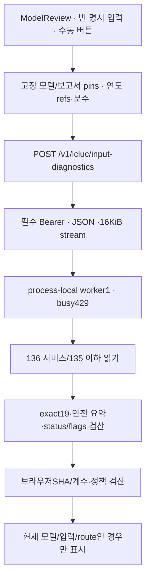

# Gate137 — 인증된 수동 연차 진단 API와 모델 화면 연결

| 필드 | 값 |
|---|---|
| updated_at | 2026-10-18 05:42:27 KST — 137 최종 API/UI·전체 회귀·실제 HTTP/browser·보존 반영 |
| source_commit | 기준 bec226ec460ca2497e092e34c21c64bd9ab0da99 + 137 작업파일 raw SHA (게시 전 검증 시점; 후속 Git 게시에서 같은 바이트 보존을 별도 확인); 인증 연결과 실행 승인 구분 |
| evidence_paths | `backend/app/annual_diagnostics_api.py`; `backend/app/main.py`; `tests/test_annual_diagnostics_api.py`; `frontend/src/AnnualInputDiagnostics.tsx`; `frontend/src/annualInputDiagnosticsAdapter.ts`; `frontend/src/annualInputDiagnosticsClient.ts`; `frontend/src/annual-input-diagnostics.css`; `frontend/src/ModelReview.tsx`; `evidence/integration/diagnostic-api-agent-20261018-focused-final3.log`; `evidence/integration/annual-input-diagnostics-ui-front-20261018.log`; `evidence/integration/annual-input-diagnostics-ui-build-final2-20261018.log`; `docs/implementation/137_annual_diagnostics_api_ui.md`; `evidence/integration/diagnostic-api-live-http-20261018.json`; `evidence/integration/diagnostic-api-browser-20261018.json`; `evidence/integration/diagnostic-api-operating-inventory-20261018.json`; `evidence/integration/diagnostic-api-live-integrity-20261018.json`; `evidence/integration/diagnostic-api-compat-tests-final2-20261018.log`; `evidence/integration/diagnostic-api-compat-tests-final-20261018.log`; `evidence/integration/diagnostic-api-compat-test-update-20261018.json`; `evidence/integration/diagnostic-api-live-integrity-final-20261018.json`; `evidence/integration/diagnostic-api-root-full-backend-20261018.log`; `scripts/collect_samples.py`; `scripts/collect_training_grid.py`; `evidence/integration/diagnostic-api-root-full-backend-final2-20261018.log`; `evidence/integration/diagnostic-api-final-processes-20261018.json` |
| confidence | 완료 API/UI·API11/보존시험36/전체1359(1358 PASS·기존1 SKIP)·front271/build112·실제 브라우저6체크/보존 확인 |
| status | TESTED_SYNTHETIC 실제 임시 HTTP/UI 진단 연결 확인; 운영 Draft 핀 미확보 BLOCKED·품질/과학/실행 미승인 |

## 쉬운 설명

136의 내부 창구를 웹 API와 모델 검토 화면에 연결했다. 사용자가 연도별 고정 참조와 최소 비율을 직접 입력하고 버튼을 눌러야 읽는다. 운영 Draft 모델에는 필요한 고정 버전·보고서 지문이 없어 버튼을 사용할 수 없다. 없던 값을 데이터 버전이나 latest로 추정하지 않는다. 접속 인증을 통과해도 자료의 품질이나 모델 실행을 승인한 것은 아니다.

## 이론적 배경

자료 읽기 진단도 모델·파일을 읽는 비용이 있다. 필수 인증·body16KiB·프로세스별 작업1개로 잘못된 입력과 겹치는 진단을 제한한다. 응답은136의 작은 요약만 노출하고 브라우저가 요청 지문·계수·정책·9개false를 다시 확인한다. 늦은 응답은 사용자가 이미 다른 모델이나 입력을 보고 있다면 버린다.

HTTP 연결과 서버 작업의 생명주기는 다르다. 화면의 ‘응답 표시 중단’이나 브라우저 이동은 표시/전송을 중단할 수 있지만 이미 시작한 파일 진단을 되돌리거나 즉시 취소하지 않는다. 작업 slot은 실제 threadpool worker가 끝날 때 해제한다. 이 slot은 프로세스 로컬이고 여러 서버를 아우르는 전역 lock이 아니다.

## 구조

## API·입력 → 처리 → 출력

새 `POST /v1/lcluc/input-diagnostics`는 exact6의 명시 요청을 application/json으로 받는다. `GEOAI_API_TOKEN` 설정이 필수이며 없으면503·잘못된 Bearer는401이다. 실제main은 기존 전역 인증이 먼저 실행되므로 기존401 detail 형태도 남고UI가 안전한 인증 안내로 처리한다. 비ASCII Authorization 비교는 양항을 UTF-8 bytes로 바꿔 TypeError500 경계를 보완했다. 기존 optional 인증·health/ready 예외·ASCII 결과를 바꾸거나 새 진단을 인증에서 제외하지 않는다.

Content-Length와실제stream 누계 모두16KiB를 검사하며 넘으면413,media오류415다. worker가 점유 중이면 queue 없이429 DIAGNOSTIC_BUSY/Retry-After1이다. threadpool 안의 Store factory·136·출력 검산이 끝나는finally에서slot을 해제한다. asyncio.shield로 HTTP 취소 중에도 실제 worker의 slot은 유지한다. CPU/RSS/시간 hardcap이나 전역 스케줄러는 아니다.

요약 결과는 정책 충족/미달/source차단200,INVALID_REQUEST422,OUTPUT_INVALID503이다. HTTP 자체 오류는exact3 schema_version/scope/error와고정code만 반환한다. 모든 route 응답은no-store/nosniff이며 원경로·token·예외원문을 넣지 않는다. 출력은 serialization전에builtin타입·depth8/node512/dict32/list6/text256/int53와schema/상태·flags·계수·issue를검사하고16KiB로제한한다. 정책 산술은136이 재계산하며 route는 추가안전구조를 확인한다.

## UI 동작과 현재 운영 상태

ModelReview의 ‘연차 입력 진단’은 접힌 독립 패널이다. 선택 모델의 명시 버전·checkpointSHA·training reportSHA가 있어야 한다. policy 분자/분모와 연차참조 textarea는 기본빈값이며 자동채움·자동조회·자동재시도가 없다. 실제artifact존재는 조회 전 미확인이다. 운영legacy Draft의 핀 부재를0측정이나자료없음확정으로 바꾸지 않는다.

client는 sessionStorage의 token을 Bearer로 보내되 문서·로그에 노출하지 않는다. JSON응답도 stream16KiB·strict UTF8/duplicate/float검사를 거친다. adapter는canonical 요청SHA,요청과같은연도순서,counts합·정수교차곱·상태·9개false를 검사해 표시한다. INVALID_REQUEST는지문null이며 나머지응답은현재요청지문과결합한다. 이 지문은 서명·기관 인증이 아니다.

입력·모델·route/hash/popstate·unmount의identity와generation이바뀌면이전결과/늦은응답을버린다. 응답 표시 중단은서버작업취소·rollback이아니다. NOT_CHECKED 계수는‘미관측’으로 보이며0으로 표시하지 않는다. 충족·미달 모두품질/과학/실행 승인과분리하며화면아이콘은기존SVG스타일이다.

## 코드·시험 근거

API source/main 최소배선·tests와 UI panel/adapter/client/CSS·ModelReview 최소연결을 읽었다. API집중 최종11 PASS/6.292초·프론트전체271 PASS/25.678583초(신규10포함)·build112modules/13.48초의 완료 인계를 확인한다. 실제 임시HTTP·브라우저6체크·최종전체1359건/1358 PASS/기존1 SKIP·484.770초와 API/UI 교차 읽기 결과를 확인했다. 묶음 시험을 단순 합산하지 않는다.

이전136의 내부 미연결은 당시 상태이며 이번137에서 수동HTTP/UI연결을 구현했다. 실제137동작과 과거136/120121의 검증 수치는 구분한다. mainAST는고정bec226ec기준으로두배선노드와지정한UTF8비교호출만허용해기존route/인증정책보존을 검사한다. 운영새Job·Registry등록·수집·학습·추론·배포·승인쓰기는 수행하지 않는다.

## 실제 HTTP 연결과 운영의 구분

Root의 임시 actual main 서버18037은 별도 TempStore·학습하지 않은CPU checkpoint를 사용했다. 구성한 각128/128의 이진 마스크에서 정책 충족/미달200,invalid422·oversize413과missing/wrong token401을 확인했다. 모델 forward·학습·운영 등록은0이다. 이것은 실제 HTTP로 수행한 합성자료 진단이며 실제 과학 정확도나 운영 자료 준비성 검증이 아니다.

기존 main의 선행global401은 detail형태와 Cache-Control 미설정 상태를 그대로 유지한다. 새 route가 만든200/422/413 응답의 no-store와 모든401의 캐시정책을 혼동하지 않는다. 운영8002는 OpenAPI 경로 존재와token미설정503 AUTH_CONFIGURATION_REQUIRED/no-store만 관측했으며 운영 token을 읽거나 성공진단을 호출하지 않았다. 임시token의 인증 성공을 운영기관 권한 확보로 소개하지 않는다. 실제 main에서 공백 token도 truthy이면 선행global401이 먼저 나올 수 있다. router 단독의 공백 token503과 전체 앱의 선행 인증을 구분하며 이 정책은 바꾸지 않았다.

## 실제 브라우저와 운영 핀 미확보

Root 브라우저 JSON의6개 확인은 모두 통과했다. 임시 actual main/SQLite/GTiff/미훈련CPU checkpoint에서 기본 빈 정책·참조의 disabled,1/2 충족의128/128 계수와 요청 SHA,입력 수정의 이전 결과 폐기,정책 미달의 전행 계수/SHA,메뉴 이동·뒤로가기의 결과 폐기를 확인했다. 실제 운영5174 Draft는 필수 핀 미확보로 disabled였으며 운영 진단 성공을 만들지 않았다.

관측 console 오류·uncaught JavaScript 오류는0이고 원래 사용자 탭을 보존했다. 실제 합성자료로 수행한 브라우저 확인이며 독립 과학 성능이나 운영 승인 시험은 아니다. 이번 근거에 없는 모바일·강제 지연/취소 주입·운영 인증 성공을 관측했다고 주장하지 않는다. 교차 읽기에서 FEFF 같은 극단 공백 문자의 JS trim은 서버보다 엄격하게 거부할 수 있음을 구분한다. 이는 실제 운영 입력을 성공시킨 근거가 아니다.05:12 KST 운영 count는DatasetVersion0·legacy datasets6/models1·전체14다.

## 최초 전체 회귀 실패와 보존시험 호환 보완

첫 전체 backend 실행은 실제1358건 중1354 PASS/3 FAIL/기존 Windows symlink1 SKIP·490.787초로 종료했다. 종료 전2개만 관측했던 보존 guard 실패는 최종3개로 정정한다. 기존 provenance/model-version/Workflow model-record의 AST guard가 승인된 router import/include·UTF-8 auth 비교 변경을 허용하지 않은 것이었다. 첫 full 로그를 그대로 보존하고 통과로 바꾸지 않는다. 제품 소스 수정 없이 고정 baseline과 정확한 변경 지점만 허용하도록 기존 시험3개를 보완한다. 함수 전체를 무시해 통과시키지 않는다. 관련 보존시험 보완의 이전20건/4.608초/2FAIL 로그와 최종36 PASS/6.983초·exit0 로그를 구분했다. 최종 보완은 예상 밖 compare 인자·중복 변경을 거부하는 부정 회귀를 포함하고 deepcopy한 AST만 정규화해 실제UTF8인증 실행은 보존한다. 원본 시험3개 사본·SHA·LF형식 보존과 제품 추가변경0을 근거로 확인했다. 전체 재실행은 별도 final2 로그에서1359건/1358 PASS/기존 Windows symlink1 SKIP·484.770초·exit0으로 확인했다. 새 부정 회귀를 포함한 실제 발견 수이며 앞 시험에 산술 합산한 추정이 아니다.

05:28 보존 JSON은 이 시험 보완 전의 중간 관측이다. 시험 보완 뒤05:33 검사에서 기존 변경은 main/ModelReview와 보존시험3개로5개, 나머지302개 불변을 확인했다. 이는 전체 재실행 종료 전의 검사였고 종료 뒤05:41 재검사에서 같은 보존 범위를 다시 확인했다. 중간의305개 불변을 전체 작업의 최종 범위로 주장하지 않는다.

## 보존 범위

시험 보완 전05:28 Root 중간 보존 근거에서 보호141개·이전 증거1235개 파일·catalog14행 canonical SHA·예약136314880바이트는 불변이다. 기존 소스307개 중 main.py의 승인된 배선/UTF8 비교와 ModelReview.tsx의 연결2개만 의도적으로 달랐고 나머지305개는 그대로다. 전체 기존 소스가 모두 불변이라고 표현하지 않는다. 기존 실행·모델·수집기와 운영 Registry·Job 본문을 바꾸지 않았으며 운영 수집·등록·학습·추론·배포·Workflow dispatch는0이다.

## 최종 전체·프론트·보존·운영 관측

최종 backend 재실행은1359건/1358 PASS/기존 Windows symlink1 SKIP·484.770초·exit0이다. 첫 full1358건/3FAIL,보존시험 보완 중20건/2FAIL,최종 보존시험36PASS를 각각 원로그에 남겼다. API 집중11/6.292초·보존시험36/6.983초·전체 회귀는 중복 묶음으로 합산하지 않는다. 시험 본문 시간은 시작/import 지연·서비스 SLA와 다르다.

프론트전체271 PASS/25.678583초에 신규10개가 포함됐고 build112모듈/13.48초로 완료했다. 기존 chunk 경고는 로그에 보존했으며 실패로 바꾸지 않는다. 실제 HTTP와 브라우저 근거는 임시 자료의 검증과 운영 핀 미확보 관측으로 나누어 읽는다.136 내부 서비스의 과거 미연결 설명은 당시 범위이며137에서 수동 API/UI 연결을 완료했다.

전체 종료 뒤 최종 검사에서 보호141·이전 증거1235파일·catalog14 SHA·예약136314880바이트가 불변이었다. 기존 소스307개 중 main·ModelReview·보존시험3개만 승인 범위로 변경됐고 나머지302개는 불변이다. 중간05:28의 허용2/불변305는 최종 변경 범위와 구분한다. 운영 DatasetVersion0·legacy datasets6/models1이며 수집·등록·훈련·추론·배포·Workflow dispatch0이다.

05:41 프로세스 관측은 수집·학습 패턴0과 API/Vite/Ollama 유지,보고 예약 ACTIVE/10분을 구분한다. 패턴 관측은 모든 시스템 활동의 완전 증명이 아니며 서버PID만으로 새 기능의 실적용을 인증하지 않는다. 실제 기능은 별도 HTTP/browser 증거 범위에서만 확인했다. 원래 사용자 탭을 보존했고 임시 서버/탭 정리는 Root가 담당한다.

## 한계와 후속

인증은 접근 조건이며 기관ACL·모델/자료승인이아니다. 프로세스로컬worker1·body제한·응답검사는Storepredecode/Torch/GDAL·여러파일비원자성/TOCTOU·CPU/RSS/시간문제를전부해결하지않는다. 여러서버전역작업관리·실제per_scene실행·독립정확도·다른5실행기·staging/UAT는미완료다. 임시mock승인·미훈련CPU checkpoint의시험과운영Draft/versions0·후보4차단을혼동하지않는다.

## 발표 대본

### 1분

“이제 모델 검토 화면에서 사용자가 고정된 연차 자료와 최소 비율을 직접 입력해 진단할 수 있습니다. 버튼을 눌러야 읽고, 인증과 요청 크기·동시 작업을 제한합니다. 결과는 경로를 제외한 요약이며 브라우저가 요청과 숫자를 다시 확인합니다. 다만 현재 운영 Draft 모델은 필수 고정값이 없어 사용할 수 없다고 표시합니다. 화면에서 표시를 멈춰도 이미 시작한 서버 읽기가 즉시 취소되는 것은 아닙니다. 진단 충족은 품질 합격이나 모델 실행 승인이 아닙니다.”

### 5분

첫1분은 내부136에서수동API/UI로연결된범위를설명한다. 다음1분은운영핀미확보와빈정책·참조입력을보여준다. 세번째1분은인증/16KiB/worker1·429를설명한다. 네번째1분은SHA·counts·정책재검산과입력변경시이전결과폐기를보여준다. 마지막1분은표시중단과서버취소의차이·9false·운영실행후속을정리한다.

### 10분 확장

‘명시적 수동조회’,‘접근과작업제한’,‘요약 재검산’,‘늦은응답방어’,‘승인까지남은일’다섯장에HTTP오류2분·실제운영/임시자료구분1분·Q&A2분을더한다.

## Q&A

Q. 이제136이 화면에 연결됐나? A.137의 수동 POST와 ModelReview 패널에 연결했다. 실제 운영 핀과 승인은 별도다.

Q. 인증되면 실행 가능한가? A. 진단 접근만 허용하며 execution_authorized=false다.

Q. 화면을 닫으면 서버 읽기도 멈추나? A. 보장하지 않는다. 실제 worker 종료까지 slot을 유지한다.

Q. 작업1개면 모든 서버 전체1개인가? A. 프로세스 로컬이며 다중 서버 전역 lock이 아니다.

Q. 운영 Draft 버튼이 왜 비활성인가? A. 명시 모델 버전·checkpoint/report SHA가 없어 추정하지 않는다.

## 근거 바로 열기

[구현 설명](../../implementation/137_annual_diagnostics_api_ui.md) · [API](../../../backend/app/annual_diagnostics_api.py) · [수동 패널](../../../frontend/src/AnnualInputDiagnostics.tsx)

## 다음 읽기 설계 — 품질 report 생산자의 공백 (PLANNED)

실제 수집 코드에는 마스크 쓰기가 있지만 새 소비 계약의 producer 완료를 뜻하지 않는다. collect_samples.py는 SCL/배열 nodata를 조합하고, collect_training_grid.py는 AOI·label!=0까지 결합해 각각nodata0 마스크를 쓴다.133은 명시 binary_validity와nodataNone/all_valid를 요구하므로 기존 마스크를 그대로 승인하거나 의미를 소급 선언하지 않는다. 두 코드에서 명시 LCLUC_QUALITY_MASK_EVIDENCE/source.mask_semantics 생산과 실제6밴드 description 설정은 확인하지 못했다. 운영 header는 열지 않아 현재 운영 파일이 어떤지 확정하지 않는다.

다음138 후보는 caller가 고정한 manifest에서 exact5 보고서 바이트/SHA와 미등록manifest/ref 초안만 만드는 순수 준비 함수다. Store·파일쓰기·운영등록 없이131 소비계약과 임시 호환을 검증하고 RAW/STAGED를 유지한다. 자동VALIDATED·QA·실제producer전체완료를 주장하지 않는다. 아직 설계만 있으며 구현·실행은0이다.

[최종 전체 회귀](../../../evidence/integration/diagnostic-api-root-full-backend-final2-20261018.log) · [첫 실패 보존](../../../evidence/integration/diagnostic-api-root-full-backend-20261018.log) · [실제 HTTP](../../../evidence/integration/diagnostic-api-live-http-20261018.json) · [실제 브라우저](../../../evidence/integration/diagnostic-api-browser-20261018.json) · [최종 보존](../../../evidence/integration/diagnostic-api-live-integrity-final-20261018.json)
