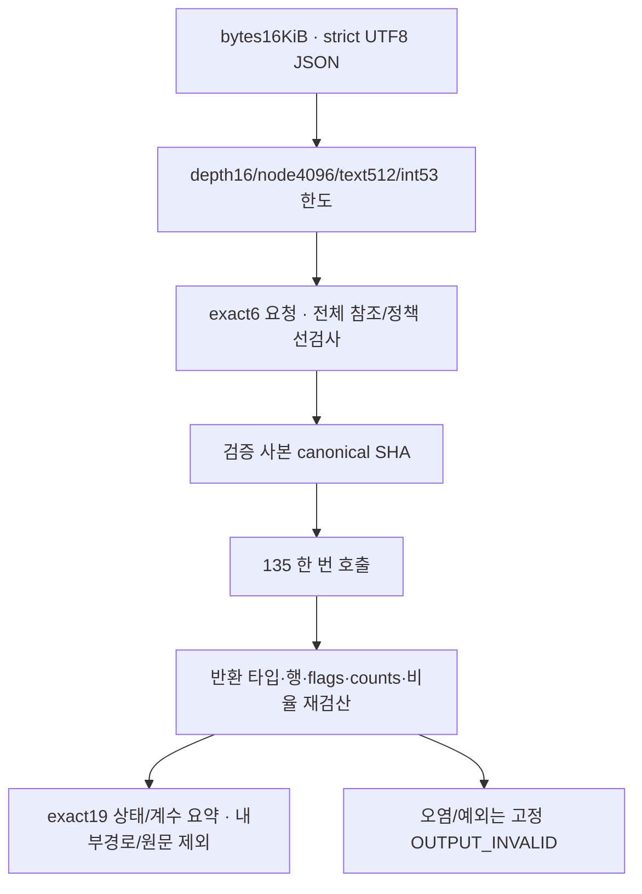

# Gate136 — 제한된 연차 요청과 내부 기록을 제외한 안전 요약

| 필드 | 값 |
|---|---|
| updated_at | 2026-10-18 05:08:24 KST — 136 최종 관련·독립·Temp 안전 요약·보존 반영 |
| source_commit | 기준 4c14031cbc46384423dd4761d1bec01ea8e2222e + 136 작업파일 SHA (미커밋); 라우터·실행 gate 변경 없음 |
| evidence_paths | `backend/app/annual_diagnostics_service.py`; `tests/test_annual_diagnostics_service.py`; `docs/implementation/136_annual_diagnostics_service.md`; `contracts/internal/lcluc-annual-diagnostics-request.schema.json`; `contracts/internal/lcluc-annual-diagnostics-response.schema.json`; `evidence/integration/diagnostic-service-agent-20261018-focused-final.log`; `evidence/integration/diagnostic-service-agent-20261018-focused-final2.log`; `evidence/integration/diagnostic-service-runtime-20261018.json`; `evidence/integration/diagnostic-service-runtime-final-20261018.log`; `evidence/integration/diagnostic-service-live-integrity-20261018.json`; `evidence/integration/diagnostic-service-operating-inventory-20261018.json`; `evidence/integration/diagnostic-service-root-related-final-20261018.log`; `evidence/integration/diagnostic-service-root-related-20261018.log`; `evidence/integration/diagnostic-service-runtime-20261018.log`; `evidence/integration/diagnostic-service-independent-20261018.json`; `evidence/integration/diagnostic-service-independent-20261018.log` |
| confidence | 재동결 소스·집중11/관련28/독립7·실제 Temp7시나리오·보존 확인; 안전 요약과 인증/승인 구분 |
| status | TESTED_SYNTHETIC 내부 요청·안전 요약 서비스; 공개 API/UI·품질·기관·과학·실행 승인 BLOCKED |

## 쉬운 설명

135의 결과는 여러 내부 관측을 함께 담는다.136은 요청서를 엄격하게 확인한 뒤 필요한 숫자와 상태만 꺼내 주는 창구다. 파일 경로·등록 명세·모델 내부 기록은 내보내지 않는다. 아직 웹 API나 화면은 아니며, 그 연결에 사용할 내부 서비스 함수까지만 구현했다. 안전한 요약을 만들었다고 입력 자료의 품질·권한·실행을 승인하는 것은 아니다.

## 이론적 배경

구조가 맞는 JSON과 사용할 수 있는 요청은 다르다. 중복 키·초대형 정수·깊은 중첩·소수 표현을 명시적으로 차단하고 고정6키와 기존 참조/정책 계약을 확인해야 한다. 응답도 하위 결과를 그대로 복사하지 않고 작은 허용 필드만 구성한다. 계수와 비율 판정을 다시 계산해 오염된 결과를 요약 성공으로 표시하지 않는다.

요청 SHA는 검증된 값의 canonical UTF-8 fingerprint다. 공백·키 순서는 달라도 값이 같으면 지문이 같다. raw 전송 바이트 SHA·전자서명·사용자 인증·권한·멱등 실행 token은 아니다. Python sort_keys/compact 규칙이며 범용 RFC8785 인증으로 표현하지 않는다.

## 구조

## 코드·입력 → 처리 → 출력

`read_annual_diagnostic_service(store,request_json:bytes)`는 최대16KiB의 실제 bytes를 받는다. UTF-8 strict decode·문자열 escape를 고려한 깊이16 선검사 뒤 중복 키·모든 float 문법(1.0/1e0)·비유한 수를 거부한다. 정수는 변환 전 최대16자리·절댓값2^53−1이고 tree4096노드·문자열512자·lone surrogate 부재를 검사한다. 이는 새 내부 소비 정책이며 기존 parser나 원기관 schema를 바꾸지 않는다.

요청은 schema_version1/capability landcover.input_diagnostics/model_ref/training_report_sha256/requested_years/policy의 exact6다. 기존134/135의 전체 요청·정책 선검사 후 복사하므로 잘못된 마지막 행도 Store 전에 거부한다. 임의 경로·caller manifest·실행 명령·기본 정책은 받지 않는다. invalid 요청은 request_sha256=null·INVALID_REQUEST이며 내부135를 호출하지 않는다.

검증된 사본에 ensure_ascii=False/sort_keys=True/allow_nan=False/compact separators를 적용해 SHA를 만든다.135는 한 번만 호출한다. 추가 Store/model/file/pixel I/O는0이지만 하위135/134의 실제 모델·파일·마스크 읽기는 있다. 정상2/6연도 get13/37·모델load1은 그대로다.

## 응답 재검산과 개인정보 경계

135 exact20의 schema/scope/정책 사본·호출counter exactint1·9개 정확한False·성공flags exactbool을 확인한다. 요청 순서의 연도/행 형식·counts·policy_met·상태와 첫 미달 issue를 검사하고 정수 교차곱을 다시 계산한다. type오염·불일치·예외는 원문 경로나 예외를 반사하지 않고 OUTPUT_INVALID다.

원 nested 진단·Registry binding·artifact URI·checkpoint manifest·경로를 요약에 싣지 않는다. source 오류는 ANNUAL/COUNTS stage와 고정 SOURCE_BLOCKED·요청에 속한 year 또는null로 바꾼다. 원 오류 code/field는 노출하지 않는다. 이 요약 제한이 기존 Store 출처 인증이나 전체 서버 보안을 대신하지는 않는다.

exact19는 schema/scope/status/request_sha256/blocking_stage/issue/per_year_observations/caller_policy_evaluated/caller_policy_met/artifact_bytes_verified와9개 미승인 flags다. 행은 exact4 year/status/counts/policy_met이며 배열은 없다. status는 INVALID_REQUEST/OUTPUT_INVALID/SOURCE_BLOCKED/CALLER_POLICY_MET_UNVERIFIED/CALLER_POLICY_NOT_MET다. blocking_stage는 REQUEST/OUTPUT/ANNUAL/COUNTS/POLICY 또는null이다. issue는 고정 code·year만 가진다.

정책 충족만 전체met/artifacttrue이며 미달은 전행 결과와evaluatedtrue를 반환한다. source 오류나 출력 오염은false다. OUTPUT_INVALID는 요청 지문만 유지하고 행을 비워 부분 투영을 성공처럼 내보내지 않는다. NOT_CHECKED가 하위 파일을 읽지 않았다는 뜻은 아니다. 공식 QA·마스크 의미·AOI·기관·과학·실행·state_dict·Workflow9개false를 유지한다.

## 내부 JSON Schema와 runtime 차이

새 request/response 파일은 Draft2020-12 내부 계약이며 GMAIS 공식기관 schema가 아니다. JSON Schema integer는 수학적 정수1.0을 수용할 수 있지만 runtime은float 문법을 거부한다. schema만으로 bytes/depth/node/duplicate·연도 순서·역할 중복·계수 합·정수 정책 일관성·canonical 지문을 보장하지 않는다. schema 통과와 전체 runtime 수용이 동등하다고 말하지 않는다.

## 재동결 보완과 시험 환경 이력

반환 검토 중136 내부에서 core 전달 인자를 검증용 사본과 다시 분리했다. 하위 함수가 인자를 바꾸어도 요청 지문과 재검산 기준은 보존된다. scope와 행 status는 정확한 builtin str인지 비교 전에 검사하여 str 하위클래스의 equality callback이나 민감문자열을 응답에 흘리지 않는다. 기존135 아래의 제품 코드는 변경하지 않았다.

escape·따옴표·backslash·괄호의 깊이 검사 회귀를 추가했다. 초기 담당/Root의 느린 PowerShell 시험2세션은 Ctrl+C로 종료1·결과 미완료였고 담당PS focused.log는 생성되지 않았다. 담당 첫cmd 환경 set 인용 오류는 ModuleNotFoundError1이며 실제 focused-final.log를 보존했다. 통과 근거는 별도 focused-final2.log다. Root 초기 runtime/related의0바이트 로그는 완료 증거가 아니며 그대로 남긴다. 이 실행 환경/중단 이력과 제품 보완 검토를 분리한다. 최종 소스 SHA는709e011bc7abbd050b316e8ac5586a2f9421ed2019a7ca66f31e9090db65f98e다.

## 실제 임시 서비스 대조·집중·보존

최종 집중11 PASS/64.474초·exit0을 확인했다. 시험 본문 시간과 프로세스 시작/import 지연은 구분하며 이 수치를 서비스 지연 SLA로 발표하지 않는다. Root 실제 Temp7시나리오는 경계 충족·둘째 연도 미달·all-zero 기준0/양수·잘못된 정책·부모255·등록명세 변경이다. 정상/정책 미달은get19/model load1/mask read3,invalid는I/O0,source차단은get16/mask read2였다. canonical 지문과 내부경로 비노출·요약 상태·DB/전체파일 불변을 확인했다. 미훈련CPU checkpoint의 임시 관측이며 image 픽셀·훈련·추론·운영 접근은0이다.

보호141개·기존 소스305개·이전 증거1215개·catalog14행 canonical SHA·예약136314880바이트를 보존했다. 운영 DatasetVersion0·legacy datasets6/models1이며 운영 수집·등록·훈련·추론·배포·Workflow dispatch0이다. 기존제품 변경 없이 제한된 내부 서비스 시험과 보존으로 마감하며 이번 전체backend/front/build/browser를 재실행하지 않는다.

## 검증 근거와 후속

완료 소스·시험 코드는 실제 임시2/6연도 통합과 명시적으로 만든 모의135 오염 사례를 구분한다. strict transport·전입력 선검사·정책 재검산·private issue 제거·canonical 지문·schema/runtime 차이를 시험한다. 최종 집중11 PASS/64.474초·관련28 PASS/119.021초·독립7 PASS/0 SKIP/88.681709초·Temp7·보존 근거를 확인했다. 집중/관련/독립의 반복 묶음은 합산하지 않는다. 독립 source/test/두 schema 동결 SHA가 일치했고 기존 tracked source 차이는0이다. 실제2/6연도 임시 자료와 모의135 오염·privacy·변조 사례는 구분한다. 반복 묶음은 합산하지 않는다.

136은 라우터/main/API/UI와 미연결이다. HTTP 인증·상태코드·동시성/worker·취소·화면 연결은137 후속이다. 이번은 새 내부 함수와 계약 추가로 기존제품을 바꾸지 않아 전체 backend/front/build/browser 재실행은 하지 않는다.120/121의1184 backend/261 frontend는 이전 근거다. 실제 자료·원장·모델·예약을 보존하고 운영 등록·수집·학습·추론·배포를 수행하지 않는다.

Store predecode·Torch ambient policy·GDAL CPU/RSS/시간·순차 비원자 snapshot/TOCTOU 한계는 남는다. 요청 크기 제한과 응답 필터가 하위 I/O/메모리/시간 hardcap이나 OS sandbox를 뜻하지 않는다.

## 발표 대본

### 1분

“연차 진단을 호출할 내부 창구를 만들었습니다. 요청의 크기와 구조를 먼저 확인하고, 고정된 참조와 사용자가 정한 기준만 받습니다. 진단 뒤에는 숫자와 상태를 다시 검산해 필요한 요약만 내보냅니다. 파일 경로와 등록 원문은 제외합니다. 요청 지문도 남기지만 이것이 서명이나 사용자 인증은 아닙니다. 아직 웹 API와 화면을 연결한 것은 아니며, 품질 합격과 실제 실행 승인은 계속 별도입니다.”

### 5분

첫1분은 창구와 내부 서류 비유로 요청 제한과 요약을 설명한다. 다음1분은16KiB·정수 전용·전체 선검사와 exact6를 보여준다. 세 번째1분은135 한 번 호출 뒤 counts와 정책의 재검산을 설명한다. 네 번째1분은 private 경로 대신 고정 code/year만 남기는 예와 출력오염 차단을 보여준다. 마지막1분은 요청 지문·인증의 차이와API/UI·동시성 후속을 정리한다.

### 10분 확장

‘제한된 요청’,‘같은 값의 지문’,‘정책 재검산’,‘안전 요약’,‘공개 연결 전 남은 일’ 다섯 장에 중복키/float 사례1분·schema/runtime 차이1분·하위 I/O와 자원 한계1분·Q&A2분을 더한다.

## Q&A

Q.이제 API를 쓸 수 있나? A.내부 함수까지 구현했으며 HTTP 라우터와 화면은 후속이다.

Q.요청 SHA면 인증된 요청인가? A.검증된 값의 지문이며 서명이나 권한 인증은 아니다.

Q.왜1.0을 schema는 받고 runtime은 거부하나? A.schema의 수학적 integer와 정수 전용 transport 정책이 다르다.

Q.원 오류를 그대로 보여주나? A.고정 code/year·단계만 내보내며 내부 경로/원문은 제외한다.

Q.요약을 만들면 추가 파일 읽기가 없나? A.요약 서비스의 추가량은0이나 하위135/134의 실제 읽기는 수행한다.

## 근거 바로 열기

[구현 설명](../../implementation/136_annual_diagnostics_service.md) · [소스](../../../backend/app/annual_diagnostics_service.py) · [내부 요청 계약](../../../contracts/internal/lcluc-annual-diagnostics-request.schema.json) · [내부 응답 계약](../../../contracts/internal/lcluc-annual-diagnostics-response.schema.json)

[집중 최종11개](../../../evidence/integration/diagnostic-service-agent-20261018-focused-final2.log) · [관련 회귀](../../../evidence/integration/diagnostic-service-root-related-final-20261018.log) · [독립 검토](../../../evidence/integration/diagnostic-service-independent-20261018.json) · [Temp 서비스 대조](../../../evidence/integration/diagnostic-service-runtime-20261018.json) · [보존](../../../evidence/integration/diagnostic-service-live-integrity-20261018.json)
