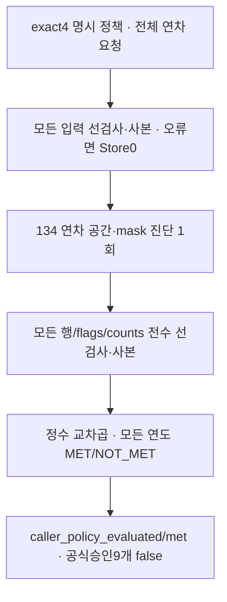

# Gate135 — 사용자가 명시한 최소 유효 비율의 연차 계산

| 필드 | 값 |
|---|---|
| updated_at | 2026-10-18 04:45:57 KST — 135 최종 관련·독립·Temp 명시 비율·보존 반영 |
| source_commit | 기준 9a14fc62f7dd5dda6b1df8b2b0b241a17a12f28d + 135 작업파일 SHA (미커밋); 실행 gate 변경 없음 |
| evidence_paths | `backend/app/ml/annual_mask_policy.py`; `tests/test_annual_mask_policy.py`; `docs/implementation/135_annual_mask_policy.md`; `evidence/integration/annual-mask-policy-agent-20261018-focused.log`; `evidence/integration/mask-policy-root-related-20261018.log`; `evidence/integration/mask-policy-runtime-20261018.json`; `evidence/integration/mask-policy-live-integrity-20261018.json`; `evidence/integration/mask-policy-operating-inventory-20261018.json`; `evidence/integration/mask-policy-independent-20261018.json`; `evidence/integration/mask-policy-independent-20261018.log` |
| confidence | 완료 소스·집중8/관련26/독립7·실제 Temp7시나리오·보존 확인; 호출자 기준 계산과 공식 QA/승인 구분 |
| status | TESTED_SYNTHETIC 호출자 명시 비율의 정수 평가; 공식 QA·기관·과학·실행 승인 BLOCKED |

## 쉬운 설명

134는 여러 연도 마스크의0·1 개수를 관측했지만 “얼마나 많아야 충분한가”는 정하지 않았다.135는 호출자가 분수로 명시한 기준을 받아 연도마다 계산한다. 예를 들어 절반 이상이라는 기준은 분자1·분모2다. 출석률을 계산하는 것과 실제 출석 확인의 진실성, 기관의 합격 기준 채택은 서로 다른 일이다. 이번은 호출자가 선택한 수학적 기준의 충족 여부만 관측한다.

## 이론적 배경

비율은 나누어 소수로 반올림하는 대신 정수 곱으로 비교한다.

`valid_pixels × denominator >= total_pixels × numerator`

유효1/전체3이면 기준1/3은 충족하지만333334/1000000은 미달이다. 정책에 임의 기본값을 넣지 않고 명시한 분자0~분모,분모1~1000000의 실제 정수만 받는다. bool·float·숫자 문자열을 변환해 받지 않는다. all-zero도 기준0에서는 충족하고 양수 기준에서는 미달이다. 따라서 충족은 공식 QA나 최소 학습 자료 충분성을 보장하지 않는다.

## 구조

## 코드·입력 → 처리 → 출력

`inspect_annual_mask_policy(store,model_ref,training_report_sha256,requested_years,policy)`는 exact4 `schema_version,minimum_valid_numerator,minimum_valid_denominator,comparison`을 받는다. schema1·comparison greater_than_or_equal이어야 한다. 모든2~6연도 요청과 정책을 I/O 전에 검증해 사본으로 만들며 잘못된 마지막 행도134 호출 전에 거부한다. 정책이 없으면 기준을 추정하지 않는다.

134를 한 번 호출하고 전체 성공의 실제 bool True flags·요청 순서/연도·원 exact5 행·133 상태/flags를 확인한다. 모든 counts가 exact3 정수이고 total1~1024²·valid/invalid0~total·합이total인지 먼저 검산한다. 뒤 행이 오염됐으면 앞 행만 평가 완료로 남기지 않고 모든 정책 행은 NOT_CHECKED다.

계수가 전부 검증되면 모든 연도를 정수식으로 평가한다. 첫 미달 연도는 issue에 남지만 뒤 연도도 계산한다. 추가 Store.get·파일 열기·모델 load·픽셀 읽기는0이며 전체 함수가 I/O0인 것은 아니다.134에서 모델/파일과 마스크 배열을 실제로 읽는다. 정상N행의 모델load1/get1+6N회는 그대로다.

## 출력과 상태 해석

exact20의 parent_annual_observation은 원134 결과다. policy와 평가 counts는 별도 사본이다. per_year_observations는 exact4 year/status/counts/policy_met이고 미평가 counts·policy_met는null이다. 전체 상태는 INVALID_INPUT/ANNUAL_DIAGNOSTICS_BLOCKED/POLICY_INPUT_BLOCKED/CALLER_POLICY_NOT_MET/CALLER_POLICY_MET_UNVERIFIED다.

모든 계수 선검사와 전행 평가를 마치면 caller_policy_evaluated=true다. 모든 연도가 충족해야 caller_policy_met=true이며 상위 artifact_bytes_verified도true다. 미달 때 상위 artifact flag가false라고 하위 파일 변조로 역추론하지 않는다. nested134의 bytes 성공은 원형 이력으로 남는다.

정책 NOT_CHECKED는 정책 계산이 없다는 뜻이다. counts 오염을 발견하기 전134의 전체 영상·마스크 읽기가 끝났을 수 있다. 정책 미달도 읽기와 전행 계산이 끝난 결과다. 항상false인9개는 품질 보고서·마스크·의미·실제AOI·기관·과학·실행·state_dict·Workflow다. 호출자 기준 계산과 공식 정책 채택을 구분한다.

## 시험 근거

집중8 PASS/5.938초를 읽었다. 실제 임시 등록·미훈련CPU checkpoint·2/6연도 통합과 순수 모의 parent 경계 시험을 구분한다. 선검사I/O0·정수 경계·all-zero·전행 평가·계수 오염·연도/flags 타입·detached 사본·안전 오류를 검증했다. 최종 관련26 PASS/42.071초·독립7 PASS/0 SKIP/28.670307초·실제 Temp7 및 보존 근거를 확인했다. 반복 묶음은 합산하지 않는다.

## 실제 임시 자료 대조·관련 회귀·보존

Root 관련26 PASS/42.071초·exit0을 읽었다. 신규135의8개+134의9개+133의9개이며 집중/독립과 합산하지 않는다. 실제 Temp7시나리오에서3년 경계 충족·두 번째 연도 미달·all-zero 기준0과양수 기준을 비교했다. 정상과 미달 모두 model load1/get19/mask read3회였고, 둘째 미달에도 행 결과는 MET/NOT_MET/MET로 전행 계산됐다. 잘못된 정책은 모든 I/O0이었다.

둘째 mask255와 단계 간 manifest 변경은 parent 차단으로 get16/mask read2회·정책 전행 NOT_CHECKED였다. 기존134의 부분 관측은 원형으로 남았다. DB와 전체 파일은 reader 중 불변이며 image 픽셀·훈련·추론·운영 자료 접근은0이다. 임시 모델은 학습하지 않은CPU checkpoint다.

보호141개·기존 소스303개·이전 증거1200개 파일·catalog14행 canonical SHA·예약136314880바이트를 보존했다.04:41 KST URI mode=ro 운영 조회는 DatasetVersion0·legacy datasets6/models1이다. 운영 수집·등록·학습·추론·배포·Workflow dispatch는0이다. 최종 독립7 PASS/0 SKIP/28.670307초·exit0과 source/test 동결 일치를 확인했다. 실제2/6년 임시 자료의0.5 마스크와500001/1000000 기준 미달은 실제 읽기 사례다. 정수1/3 등의 경계는 명시적으로 만든 모의 counts 시험이며 실제 측정값으로 소개하지 않는다. 기존 tracked source 차이는0이고 새 제품 지적은 없었다.

## 한계와 후속

134와의 내부 읽기 연결은 구현됐지만115 실제 per_scene 실행·API/UI는 미연결이다. 임의 비율은 기관 정책이 아니며 마스크 정답·구름/SCL 의미·독립 라벨·클래스 부족·과학 정확도·자료 충분성·승인을 검증하지 않는다. 기존 원본과 후보4차단·Draft·외부5실행기 미확보를 바꾸지 않는다.

Store 원문 predecode·Torch ambient policy·GDAL CPU/RSS/시간·mapped drive·순차 다중 파일 비원자성/TOCTOU 한계를 상속한다. 정책 계산 자체가 추가I/O를 만들지 않는다는 사실을 전체 함수의 무I/O나 자원 hardcap으로 표현하지 않는다. 기존 제품이 불변인 내부 함수라 이번 전체backend/front/build/browser 재실행은 없으며120/121의1184 backend·261 frontend는 이전 근거다.

## 발표 대본

### 1분

“여러 연도의 마스크를 센 다음, 사용자가 직접 지정한 최소 비율을 계산하는 기능을 연결했습니다. 절반 이상처럼 분자와 분모로 기준을 받고 소수 반올림 없이 정수로 비교합니다. 한 연도가 미달해도 뒤 연도까지 계산하고 결과를 보여줍니다. 다만 사용자가 정한 숫자를 충족한 것과 기관의 품질 합격은 다릅니다. 마스크가 실제 구름이나 유효영역을 정확히 뜻하는지, 학습 자료가 충분한지는 별도입니다. 실제 모델 실행과 화면 연결도 아직 하지 않았습니다.”

### 5분

첫1분은 출석률 계산 비유로 명시 기준과 기관 합격을 구분한다. 다음1분은 분자/분모 exact4와 기본값이 없는 이유를 말한다. 세 번째1분은1/3과333334/1000000 경계를 보여준다. 네 번째1분은 모든 계수 선검사와 모든 연도 평가,미달에도 남는134 읽기 이력을 설명한다. 마지막1분은 all-zero 기준0 사례와9개 미승인 flags·실행/UI 후속을 정리한다.

### 10분 확장

‘마스크 개수 이후’,‘정수 분수 기준’,‘전체 계수 선검사’,‘계산과 파일 이력’,‘공식 승인까지의 거리’ 다섯 장에 bool/count 오염 사례2분·추가I/O0 범위1분·Q&A2분을 더한다.

## Q&A

Q.공식 최소 유효율을 정했나? A.아니다. 호출자가 명시한 기준을 계산하며 임의 기본값이 없다.

Q.미달이면 파일을 안읽었나? A.134의 읽기 뒤 계산하므로 이미 읽기가 끝났을 수 있다.

Q.상위 bytesfalse는 변조인가? A.이 함수 전체에는 정책 충족도 포함한다. nested134 bytes 관측을 따로 본다.

Q.전부0인데 충족할 수 있나? A.명시 분자가0이면 가능하지만 품질 승인은 아니다.

Q.뒤 계수가 잘못되면 앞 연도만 충족으로 남나? A.모든 계수를 먼저 검산해 정책 부분 평가를 남기지 않는다.

## 근거 바로 열기

[구현 설명](../../implementation/135_annual_mask_policy.md) · [소스](../../../backend/app/ml/annual_mask_policy.py) · [집중시험](../../../evidence/integration/annual-mask-policy-agent-20261018-focused.log)

[관련 회귀](../../../evidence/integration/mask-policy-root-related-20261018.log) · [독립 검토](../../../evidence/integration/mask-policy-independent-20261018.json) · [실제 Temp 정책 대조](../../../evidence/integration/mask-policy-runtime-20261018.json) · [보존](../../../evidence/integration/mask-policy-live-integrity-20261018.json)
