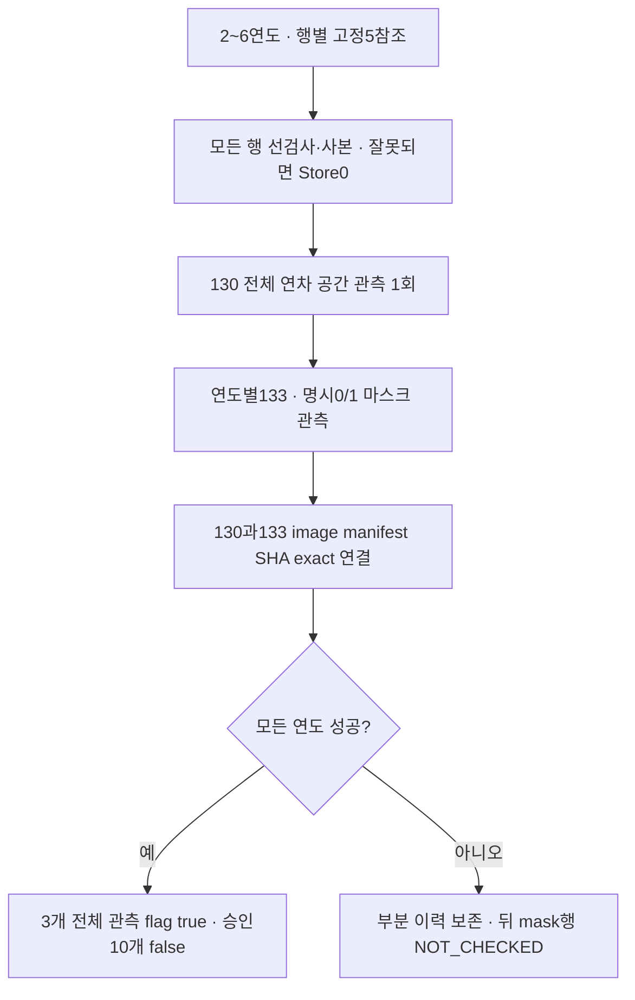

# Gate134 — 연차 공간 관측과 명시 마스크의 같은 등록 선언 연결

| 필드 | 값 |
|---|---|
| updated_at | 2026-10-18 04:37:16 KST — 134 최종 관련·독립·Temp 연차 연결·보존 반영 |
| source_commit | 기준 c8ce70a082705fe270806515efbea94a9f4ed07c + 134 작업파일 SHA (미커밋); 실행 gate 변경 없음 |
| evidence_paths | `backend/app/ml/annual_quality_mask_diagnostics.py`; `tests/test_annual_quality_mask_diagnostics.py`; `docs/implementation/134_annual_quality_mask_diagnostics.md`; `evidence/integration/annual-mask-agent-20261018-focused-final.log`; `evidence/integration/annual-mask-agent-20261018-focused.log`; `evidence/integration/annual-mask-root-related-20261018.log`; `evidence/integration/annual-mask-runtime-20261018.json`; `evidence/integration/annual-mask-live-integrity-20261018.json`; `evidence/integration/annual-mask-operating-inventory-20261018.json`; `evidence/integration/annual-mask-independent-20261018.json`; `evidence/integration/annual-mask-independent-20261018.log` |
| confidence | 완료 소스·집중9/관련28/독립7·실제 Temp7시나리오·보존 확인; 연차 진단 연결과 품질/실행 승인 구분 |
| status | TESTED_SYNTHETIC 연차 공간·이진 마스크 관측 결합; 품질·기관·과학·실행 승인 BLOCKED |

## 쉬운 설명

130은 여러 연도의 영상·정규화·기간·격자·등록 범위를 읽었다.133은 한 영상의 명시 마스크가 실제0과1인지 확인했다.134는 두 검사를 연도별로 이어 붙이되, 두 단계가 같은 영상의 등록 명세를 읽었는지도 확인한다. 같은 사진이라도 서류가 검사 도중 바뀌었다면 같은 묶음으로 승인하지 않는 방식이다. 이 연결은 품질 승인이나 모델 실행이 아닌 내부 읽기 진단이다.

## 이론적 배경

파일 SHA는 파일 바이트의 지문이고 manifest SHA는 등록 메타데이터 명세의 지문이다. 파일이 같아도 기간·영역·출처·품질 보고서 경로가 달라질 수 있다. 두 단계가 관측한 manifest digest까지 비교하면 서로 다른 등록 사본을 한 성공으로 합치는 것을 막을 수 있다. 두 digest는 정상 형식의 소문자 hex64자리여야 하며 양쪽null이 같다는 이유로 통과하지 않는다. 이것은 순차 관측의 연결이지 동시 원자 snapshot이나 기관 인증은 아니다.

## 구조

## 코드·입력 → 처리 → 출력

`inspect_annual_quality_mask_diagnostics(store,model_ref,training_report_sha256,requested_years)`는 정확한 list2~6행을 받는다. 각 행은 year/image_ref/evidence_ref/metadata_ref/quality_report_ref/mask_ref의 정확히6키다. 모든 참조를 I/O 전에 복사·검증한다. 앞4키 projection은127의 연도1900~2200·정확한int·오름차순·고유 연도·고정 모델 및 역할 참조 검사를 재사용한다. image/quality_report/mask의 등록 키는 행 안에서 서로 달라야 한다. 다섯 참조를 전부 무조건 다른 키로 강제하는 규칙은 아니다.

선검사 성공 뒤130을 한 번 호출한다.130 전체가 성공해야 각 연도의133으로 들어간다. 모델은 전체 묶음에서 한 번만 load하며 정상N행은 Store.get1+6N회다.130 단계의 image manifest SHA를133/132/131의 정확한 image binding 하나와 비교한다. 추가 Registry 조회로 digest를 만들거나 누락된 값을 역채우지 않는다.

첫 mask 또는 manifest 연결 실패에서 멈춘다. 실패 행도 checked_rows와 mask_observation_calls에 포함된다.130이 먼저 모든 영상을 읽었으므로 뒤 mask행 NOT_CHECKED는 그 영상 파일이 한 번도 읽히지 않았다는 뜻이 아니다. 같은 이유로 mask 개수가 남아 있어도 연결 실패면 전체 성공이 아니다. 정상 마스크 배열 읽기는N회이며 영상 픽셀은 읽지 않는다. 모델 파일·영상·문서 바이트를 실제로 읽고 해시하므로 전체I/O0으로 설명하지 않는다.

## 결과와 미검증 범위

exact22 출력은 원130 annual_spatial_observation과 요청 순서의 mask_observations를 보존한다. 각 행은 year/status/mask_observation/registry_manifest_join_verified/issue의 exact5다. 상위 상태는 INVALID_INPUT/ANNUAL_SPATIAL_BLOCKED/MASK_BLOCKED/ANNUAL_QUALITY_MASK_MATCHED_UNVERIFIED이며 모든130/133/연결이 성공해야 artifact_bytes_verified·mask_values_verified·registry_manifest_join_verified가true다.

부분 nested133 성공과 counts는 당시 관측이다. 이어 manifest 연결이 실패해도 삭제하지 않으며 전체 flag는false다. 품질 보고서·마스크 정답·의미·최소 유효율·실제AOI·기관·과학·실행·state_dict·Workflow10개는 항상false다. all-zero 마스크도 값 형식 진단에 성공할 수 있다. 요청 연도와 등록 기간이 일치해도 실제 취득연도나 기관 출처를 인증하지 않는다.

## 시험 근거

최종 집중9 PASS/33.800초를 확인했다. 초기8 PASS/28.923초 이후 잘못된 digest가 양쪽 같아도 거부하는 회귀를 추가했으며 실패를 은폐한 재실행이 아니다. 실제 임시 GeoTIFF·등록 참조·미훈련CPU checkpoint로2/6행,1+6N get,전체 입력 선검사,중간 실패,같은 파일 지문을 둔 metadata 변경·누락/중복 binding·입력 사본·무쓰기를 검사했다. 최종 관련28 PASS/69.773초·독립7 PASS/0 SKIP/24.295825초 및 Root Temp7·보존 근거를 확인했다. 반복 묶음은 합산하지 않는다.

## 관련 회귀·실제 임시 파일 대조·보존

최종 관련28 PASS/69.773초·exit0은 신규134의9개+130의10개+133의9개다. 집중9/33.800초와 반복·중복 합산하지 않는다. 독립 최종7 PASS/0 SKIP/24.295825초·exit0을 확인했으며 source/test 동결 SHA와 기존 tracked source가 일치했다. 독립 시험은 별도 임시 자료로 전체 선검사·연결·부분 이력·무쓰기를 확인한 합성 검증이다.

Root 실제 Temp7시나리오에서3년 정상 및 all-zero는 미훈련CPU checkpoint load1회·get19회·mask read3회를 관측했다. 두 번째 mask의255·선언 누락·격자 shift는 get16회/checked_rows2/뒤 mask행 NOT_CHECKED였다.255에서는 mask read2회, 선언 누락과shift에서는1회로 차단 위치가 다르다. 공간 범위 실패는 get10회/mask read0이었다. 모든 사례의 image 픽셀·훈련·추론은0이며 DB/파일은 reader 중 불변이었다.

영상 파일 SHA를 유지한 채 두 단계 사이 source.institution만 바꾼 사례는2022년 REGISTRY_IMAGE_MANIFEST_CHANGED였다. get16회였고 nested133의 성공 counts는 남았지만 상위 연결/전체 flag는false였다. 실제 운영 자료가 아니라 별도로 만든 임시 자료의 한계 검증이다.

보호141개·기존 소스301개·이전 증거1184개 파일·catalog14행 canonical SHA·예약136314880바이트를 보존했다. 이전 증거 파일1184개는120/121의 역사적 backend 시험1184건과 별도 집계다.04:31 KST URI mode=ro 운영 count는 DatasetVersion0·legacy datasets6/models1이며 운영 수집·등록·훈련·추론·배포·Workflow dispatch0이다.

## 한계와 후속

130 연차 읽기와133 마스크 진단의 내부 연결은 이번 구현 범위다. 실제 QA·최소 유효율 정책·모델115 per_scene 실행·API/UI는 연결하지 않았다. 여러 record/파일의 순차 읽기·Store 원문 predecode·Torch ambient policy·GDAL/native parser의 CPU/RSS/시간·mapped drive·TOCTOU 한계가 남는다. 부분 관측을 트랜잭션이나 샌드박스로 소개하지 않는다.

기존제품을 바꾸지 않은 새 내부 함수이므로 이번 전체backend/front/build/browser 재실행은 하지 않는다.120/121의1184 backend·261 frontend는 이전 근거다. 운영 등록·원본 보정·수집·학습·추론·배포·정산/환불·재개·승인으로 자동 연결하지 않는다. 원본 준비도와 후보4차단·Draft·독립 라벨 및 외부5실행기 미확보는 그대로다.

## 발표 대본

### 1분

“이제 여러 연도의 공간 진단과 각 연도의 마스크 값 진단을 한 흐름으로 연결했습니다. 먼저 전체 연도 요청을 검사하고, 영상과 정규화·기간·공간이 맞는지 읽은 뒤0과1 마스크를 셉니다. 그 사이 영상 파일이 같더라도 등록 서류가 바뀌었다면 차단합니다. 중간에 실패하면 앞선 관측은 남기지만 전체 성공으로 보지 않습니다. 이 연결이 마스크의 정답이나 품질 합격을 뜻하지는 않습니다. 실제 실행과 운영 승인은 여전히 별도입니다.”

### 5분

첫1분은 사진과 서류의 지문을 구분한다. 다음1분은 모든 연도를 먼저 검사하고130을 한 번 호출하는 이유를 설명한다. 세 번째1분은 각133과 manifest 연결을 보여준다. 네 번째1분은 앞 행 성공·중간 실패·뒤 mask행 미검사 예를 들어 NOT_CHECKED가 모든 영상I/O0은 아니라고 설명한다. 마지막1분은 all-zero·최소 유효율·10개 미승인 flag와 실행/APIUI 후속을 정리한다.

### 10분 확장

‘여러 연도 연결’, ‘파일 지문과 등록 명세 지문’, ‘동일 manifest 연결’, ‘부분 이력과 중단’, ‘승인까지 남은 거리’ 다섯 장을 사용한다. null digest·metadata만 변조한 사례에2분,1+6N get과 비원자 한계에1분,질의응답에2분을 더한다.

## Q&A

Q.마스크 검사가 연차 배치와 연결됐나? A.130의 읽기 진단 뒤133을 연결했다. 실제 모델 실행이나 공개API/UI 연결은 아니다.

Q.파일 지문이 같으면 왜 차단하나? A.두 단계의 영상 등록 manifest가 다를 수 있어 그 지문도 비교한다.

Q.뒤 행NOT_CHECKED면 영상도 안읽었나? A.아니다. 앞선130에서 전체 영상 파일 관측이 이미 끝났을 수 있다.

Q.counts가 있는데 전체false면 오류인가? A.값을 센 뒤 manifest 연결에서 실패할 수 있어 부분 이력으로 남긴다.

Q.연결 성공이면 품질 합격인가? A.최소 유효율·mask 정답·QA·과학·실행 승인은10개false로 구분한다.

## 근거 바로 열기

[구현 설명](../../implementation/134_annual_quality_mask_diagnostics.md) · [소스](../../../backend/app/ml/annual_quality_mask_diagnostics.py) · [최종 집중시험](../../../evidence/integration/annual-mask-agent-20261018-focused-final.log)

[관련 회귀](../../../evidence/integration/annual-mask-root-related-20261018.log) · [독립 검토](../../../evidence/integration/annual-mask-independent-20261018.json) · [실제 Temp 연결](../../../evidence/integration/annual-mask-runtime-20261018.json) · [보존](../../../evidence/integration/annual-mask-live-integrity-20261018.json)
