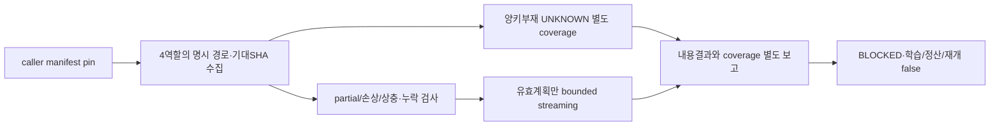

# Gate Auxiliary Content 20261017 — 명시 보조자산 SHA와 부분 커버리지

| 필드 | 값 |
|---|---|
| updated_at | 2026-10-17 23:36 KST — Git 상태 메타데이터 정정; 본문은 해당 Gate 기준 |
| source_commit | Git 연결됨; 문서 작성 시 변경분 미커밋, evidence snapshot SHA로 추적 (원격 기준 d483d25) |
| evidence_paths | `backend/app/data/recovery_auxiliary_content.py`; `scripts/inspect_recovery_auxiliary_content.py`; `tests/test_recovery_auxiliary_content.py`; `docs/implementation/50_recovery_auxiliary_content_validation.md`; `evidence/integration/recovery-auxiliary-content-tests-20261017.log`; `evidence/integration/recovery-auxiliary-content-independent-20261017.log`; `evidence/integration/recovery-auxiliary-content-live-final-20261017.json`; `evidence/integration/recovery-auxiliary-content-full-tests-20261017.log`; `evidence/integration/recovery-auxiliary-content-live-integrity-20261017.json` |
| confidence | 코드·합성시험·실제 명시aux SHA 순차 대조; 미기재/의미/품질/권한 미검증 |
| status | VERIFIED_REAL: 명시2,855 byteSHA 부분coverage; TESTED_SYNTHETIC: 14시험; 학습/실행 BLOCKED |

## 쉬운 설명

사진 파일에 이어 정답표·품질표·경계표의 지문을 비교하는 단계다. 기록된 표가 모두 맞더라도, 목록에 처음부터 없는 표는 검사했다고 할 수 없다. **알고 있는 파일의 일치**와 **전체 목록의 완전성**을 따로 보고한다. 없는 경로나 지문을 추측해 채우지 않는다.

## 이론과 상태 구분

네 역할은 patch_label, patch_quality, source_quality, boundary다. 경로 키와 기대SHA 키가 둘 다 없으면 UNKNOWN_REFERENCE_ABSENT이며 명시된 다른 파일 검사를 막지 않는다. 한쪽만 있거나 null/잘못된 타입·SHA면 손상된 계획이므로 PLAN_INVALID와 streaming0으로 처리한다. 파일 자체가 없는 FILE_MISSING도 미기재 참조와 구분한다.

| 내용검사 / coverage | 뜻 |
|---|---|
| RECORDED_SHA_MATCH / COMPLETE_REFERENCES | 계획된 역할 참조가 완전하고 모든 기대SHA와 맞음 |
| RECORDED_AVAILABLE_SHA_MATCH_PARTIAL / INCOMPLETE_REFERENCES | 명시 파일은 맞지만 일부 역할 참조를 모름 |
| NO_RECORDED_REFERENCES | 명시 대상0개·read0. 빈 검사를 SHA 성공으로 보지 않음 |
| NOT_STARTED_PLAN_REJECTED / PLAN_INVALID | partial/손상/상충/파일누락으로 전체 streaming을 시작하지 않음 |

이 결과는 byte 일치다. label의 클래스 의미·quality 적합성·boundary 공식 승인·픽셀/공간 독립성·모델 정확도를 증명하지 않는다. boundary를 해시했다고 기관의 사용권한을 확보한 것도 아니다.

## 코드·자료 동작

`recovery_auxiliary_content.py:inspect_recovery_auxiliary_content(data_root, expected_manifest_sha256, max_local_bytes=64MiB)`와 내부 CLI가 구현이다. patch label은 `label_path/patch_sha256.label`, patch quality는 `quality_mask_path/patch_sha256.quality`, source quality와 boundary는 source_window의 명시 경로/SHA 쌍을 사용한다.

고정 manifest를 caller SHA로 pin하고 strict JSON을 읽는다. root 안 일반 로컬 파일로 제한하며 같은 canonical 경로는 다중 역할/행을 합쳐 한 번만 읽는다. 계획 전체의 형식·상충·누락과 stat 크기 합을 먼저 확인한다. 예산은 정확한 정수1..64MiB다. 기존 image 코어 `_stream_sha`를 변경 없이 재사용하며 최대1MiB unbuffered chunk, 실제 반환byte 누계, 조기EOF/성장·fdstat/stat·target·manifest 재검사를 상속한다. 정확 예산 경계에서는 추가 EOF probe 없이 fstat/stat을 쓴다.

byte 예산은 대상 보조파일에서 반환받은 byte이며 JSON·filesystem metadata·OS 디스크 I/O 총량이 아니다. 순차 관측이고 원자적 snapshot/OS lock 보장은 없다. GDAL/픽셀 decoder·네트워크·sidecar 쓰기를 사용하지 않는다. CLI는 CP949 ASCII escape/UTF-8 새 evidence 출력·덮어쓰기 금지를 따른다.

## 시험과 최종 실제 근거

관련14 PASS/3.996초·독립14 PASS/3.534초의 보존 로그를 읽었다. 작은 byte fixture로 네 역할·부분/빈 coverage·손상계획 hash0·canonical 다중역할/상충·예산·실제 SHA불일치·stale/target·strict JSON·출력보호를 검사했다. 실제 보조파일을 이 합성시험에서 읽지는 않았다. 이번 문서 작업에서도 재시험/streaming을 실행하지 않았다.

실제 최종 CP949 CLI exit0에서 patch label1,384+patch quality1,384+source quality86+boundary1=고유2,855파일 모두 MATCH, 계획=실제12,719,583B/예산67,108,864B·issue0이었다. 내용결과는 RECORDED_AVAILABLE_SHA_MATCH_PARTIAL, coverage는 INCOMPLETE_REFERENCES이며 전체 BLOCKED다. source quality/boundary의 명시 행은 각각1,304이며 고유파일과 구분한다. UNKNOWN은 역할별80·총160이다. 같은digest의 다른경로그룹175는 byte 반복 진단이며 누출/장면독립성 판정이나 삭제/재분할 근거로 사용하지 않았다. legacy80행은 source quality/boundary 역할별80 UNKNOWN이며 source quality5개가 덜 기재됐다고 임의 경로/SHA를 추정하지 않는다. 최종 전체 `scripts/test.ps1`은 **432건 중431 PASS·1 SKIP/103.139초/종료0**다. SKIP은 기존 OS symlink 생성 권한이며 deterministic 경계 시험은 통과했다. 관련14 PASS/3.996초·독립14 PASS/3.534초는 전체432에 중복 합산하지 않는다. 보호132참조와 기존 계약11SHA는 불변이고 이전 추적 코드/데이터/계약 변경0이다.2,855보조파일 stat/처음16바이트와1,471부모 파일목록의 관측 변화도0이다. 전체aux SHA 확인 범위는 명시된2,855파일의 순차 읽기이며 원자적 snapshot은 아니다.

## 한계·UI·전체 개발

기존 image1,475와 새 명시 aux2,855를 합친4,330은 과거4,335파일 fresh 전체감사가 아니다. role별 행 수·고유 파일 수·내용 일치와 coverage를 구분한다. 기존 header/image 검사 flag는 해당 모듈과 시점의 범위대로 유지한다.

항상 BLOCKED·exactly-once UNKNOWN·실행/정산/자동재개/학습/과학 승인false·환불0이다. 기존 ML5 blocker·원본 적격1,111/계획후보1,095·baseline Draft·terminal없는2건·예약136,314,880B는 그대로다. 공개API/화면 계약 없는 내부CLI라 UI 수정·실행frontend 반영·브라우저 재검사는 불필요하다. 전체 개발과10분 보고는 계속한다.

## 발표 1분

“사진 파일의 지문에 이어 정답표·품질표·경계표의 명시된 지문을 확인하는 도구를 추가했습니다. 파일이 맞는지와 목록이 완전한지를 따로 표시합니다. 오래된 자료에서 경로와 지문 키가 둘 다 없으면 모른다고 남기고, 한쪽만 있거나 잘못된 값이면 검사 계획을 거부합니다. 없는 경로를 추정하지 않습니다. 실제 명시2,855파일이 모두 맞았지만 UNKNOWN160이 남아 부분검증입니다. 전체432건 중431개가 통과하고 기존 권한 제약1개를 건너뛰었습니다. 파일 지문이 맞아도 정답의 의미·품질 적합성·공식 경계나 과학 성능 승인은 아니므로 학습과 정산·재개는 계속 차단합니다.”

## 발표 5분·10분

1. **0~1분:** 사진에 딸린 표의 비유와 목록 완전성/내용 일치 구분을 말한다.
2. **1~2분:** 네 역할과 양키부재 UNKNOWN·partial/명시null INVALID 차이를 설명한다.
3. **2~3분:** 고정 manifest·전수계획·canonical1회·64MiB/실제byte 예산을 설명한다.
4. **3~4분:** 관련14/독립14와 실제2,855 MATCH·부분coverage·전체432건431 PASS·1 SKIP를 구분하고 role별 행/고유 파일을 보여준다.
5. **4~5분:** 의미/품질/권한 미검증과 BLOCKED·UI불필요·4,330≠4,335전체감사를 말한다.

10분은 빈검사 NO_RECORDED_REFERENCES, 손상계획 streaming0, partial 상태의 실제불일치, stat/descriptor/target 변경, 동일digest 진단과 기하 독립성 차이를 덧붙인다.

## Q&A

**명시 파일이 모두 맞으면 전체 완료인가?** coverage가 불완전하면 부분 성공이며 UNKNOWN을 남긴다.

**양키부재와 null은 같은가?** 전자는 레거시 미기재 UNKNOWN, 후자는 명시 손상 INVALID다.

**미기재5개는 기본 경로로 찾나?** 추정하지 않는다. 명시되지 않은 경로/SHA를 검증 완료로 만들지 않는다.

**boundary SHA면 공식 경계 승인인가?** byte 일치이며 행정/사용권한 승인이 아니다.

**이번에4,335개를 모두 재검사했나?** image1,475와 명시 aux2,855의 범위이며 과거 전체목록 fresh 감사와 다르다.

## 다음 갱신

최종 실제 JSON·전체 회귀·보호 근거를 받아 새 Gate와 데이터/ML/구조/용어·발표/FAQ·시연·INDEX·CHANGELOG를 함께 확정했다. 다음 검증은 완료 코드와 근거를 받은 별도 Gate로 구분한다.
