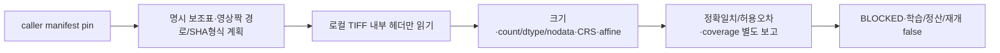

# Gate Auxiliary Headers 20261017 — 라벨·품질표와 영상의 격자 대조

| 필드 | 값 |
|---|---|
| updated_at | 2026-10-17 23:36 KST — Git 상태 메타데이터 정정; 본문은 해당 Gate 기준 |
| source_commit | d474d5bce6c2a6c4bd8ba141c9256d15f6004631 (108까지 구현 검토 기준; 이 메타데이터 정리는 후속 문서 커밋) |
| evidence_paths | `backend/app/data/recovery_auxiliary_headers.py`; `scripts/inspect_recovery_auxiliary_headers.py`; `tests/test_recovery_auxiliary_headers.py`; `evidence/integration/recovery-auxiliary-headers-tests-20261017.log`; `docs/implementation/51_recovery_auxiliary_headers_validation.md`; `evidence/integration/recovery-auxiliary-headers-independent-20261017.log`; `evidence/integration/recovery-auxiliary-headers-live-final-20261017.json`; `evidence/integration/recovery-auxiliary-headers-full-tests-20261017.log`; `evidence/integration/recovery-auxiliary-headers-live-integrity-20261017.json` |
| confidence | 코드·합성시험·실제 보조/영상짝 헤더; 내용SHA/픽셀/전체readiness 미검증 |
| status | VERIFIED_REAL: 명시4329헤더/4072정합·부분coverage; TESTED_SYNTHETIC: 14시험; 학습/실행 BLOCKED |

## 쉬운 설명

사진과 그 위에 얹는 정답표·품질표가 같은 크기와 좌표 격자를 사용하는지 확인한다. 표의 주소와 지문이 맞는 것에 이어 실제 TIFF 내부 크기·좌표표를 읽는다. 격자가 맞아도 정답의 의미와 품질 판정이 옳다는 뜻은 아니다.

## 이론과 계약

patch label/quality는 patch image에, source quality는 source image에 맞아야 한다. 생성 `collect_samples/materialize_patches` 계약에 따라 보조표는1밴드·uint8·nodata0이어야 하며 영상짝과 dimensions/CRS/affine을 대조한다. patch 보조표는256×256도 확인한다.

정확한 affine6계수 일치(`affine_exact_match`, role별`exact_affine_rows`)와 abs1e-7·rel1e-12 허용오차 안의 일치는 별도다. 허용오차 통과는 readiness의 정확 transform 조건 전체 통과나 센서 위치 정확도 승인으로 설명하지 않는다. `readiness_full_gate_revalidated=false`다.

## 코드와 검사 경계

`recovery_auxiliary_headers.py:inspect_recovery_auxiliary_headers(data_root, expected_manifest_sha256, max_unique_headers=10000)`와 CLI가 구현이다. 고정 manifest를 caller SHA로 pin하고 strict JSON을 읽는다. source/patch image·patch label/quality는 명시쌍이 필요하며 source quality 양키부재만 선택적 UNKNOWN이다. boundary는 OUT_OF_SCOPE다. 손상/partial·상충·파일누락 계획은 header open0으로 진단한다.1..10,000의 정확한 정수 고유헤더 예산을 먼저 확인한다.

명시 image와 auxiliary 경로의 기대SHA는 형식/상충만 검사한다(`recorded_sha_status=FORMAT_AND_CONFLICT_ONLY`). 실제 파일 내용SHA를 다시 계산하지 않으며 이전 content companion의 SHA 관측과 구분한다. canonical 경로별 헤더를 한 번 읽고 논리target·stat·manifest를 전후 대조한다. 원자적 snapshot이나 전체 byte 보존 증명은 아니다.

로컬 root 안 일반 TIFF만 허용하며 첫8바이트 signature 확인·GTiff 읽기모드·INTERNAL georef·PAM NO·EMPTY_DIR·PROJ_NETWORK OFF·VRT Python NO를 사용한다. TIFF directory/내부 좌표 metadata byte는 읽지만 픽셀 배열·통계·GDAL contentSHA는 사용하지 않는다.

## 합성시험과 최종 실제 근거

관련14 PASS/5.580초·독립14 PASS/9.720초의 보존 로그를 읽었다. 최종 실제 CP949 CLI exit0에서 명시 보조TIFF2,854+영상짝1,475의 고유4,329개가 모두 VALID_HEADER였다.4,072개 역할별 pairing은 모두 HEADER_ALIGNMENT_MATCH·affine_exact_match=true였다. patch label/quality는 각각1,384행 일치/정확일치, sourcequality는1,304행 일치/정확일치(고유86파일)다. issue0이지만 KNOWN_HEADERS_MATCH_PARTIAL·INCOMPLETE_REFERENCES·BLOCKED이며 sourcequality80 UNKNOWN·boundary OUT_OF_SCOPE다. 최종 전체 `scripts/test.ps1`은 **446건 중445 PASS·1 SKIP/116.342초/종료0**다. SKIP은 기존 OS symlink 생성 권한이며 deterministic 경계 시험은 통과했다. 관련14 PASS/5.580초·독립14 PASS/9.720초는 전체446에 중복 합산하지 않는다. 보호132참조와 기존 계약12SHA는 불변이며 이전 추적 코드/데이터/계약 변경0이다.4,329파일 stat/처음16바이트 및1,475부모목록 관측도 불변이었다. 전체 rasterSHA 재검증false·원자적 snapshotfalse이며 이번 문서 작업은 보존 근거를 읽었고 재실행하지 않았다. sourcequality80행 UNKNOWN·boundary범위밖을 보존한다. 이번 문서 작업에서 시험·실제 TIFF 열기를 실행하지 않았다.

## 한계·승인·UI

전체상태는 BLOCKED다. 라벨 의미·QA 적합성·픽셀 값·정확 클래스/성능·경계 승인·기하/장면 독립성·현재 contentSHA와 readiness 전체를 재검증하지 않는다. 기존5 blocker·적격1,111/계획후보1,095·baseline Draft·terminal없는2건/예약136,314,880B를 유지한다. exactly-once UNKNOWN·학습/실행/정산/자동재개/과학 승인false·환불0이다.

공개API/화면 계약 없는 내부 CLI라 UI 수정·실행frontend 반영·브라우저 재검사는 불필요하다. 전체 개발과10분 보고는 계속하며 단일 Gate를 프로젝트 전체 완료로 보지 않는다.

## 발표 1분

“정답표와 품질표가 사진 위에 정확한 격자로 놓이는지 확인하는 도구를 추가했습니다. 실제 TIFF 안의 크기·밴드·자료형·nodata와 좌표계를 읽어 영상짝과 비교합니다. 좌표 변환은 완전히 같은 경우와 작은 수치 허용오차 안의 경우를 따로 기록합니다. 이것을 전체 학습 준비도 통과로 바꾸지는 않습니다. 실제4,329헤더가 유효했고4,072개 표와 영상짝의 정합·정확한 좌표계수 일치가 확인됐습니다. 미기재 source품질표80행이 있어 부분검증입니다. 품질표가 같은 격자에 놓였다고 품질 판정이나 라벨 의미가 옳다는 뜻은 아니므로 학습·정산·자동재개는 계속 차단합니다.”

## 발표 5분·10분

1. **0~1분:** 사진 위에 표를 얹는 비유와 byte지문 다음 단계임을 말한다.
2. **1~2분:** patch label/quality·source quality의 영상짝과1밴드/uint8/nodata0 계약을 설명한다.
3. **2~3분:** exact affine과 tolerance의 차이·readiness 전체 미재검증을 설명한다.
4. **3~4분:** 실제/독립/전체 근거가 확정된 범위만 제시하고 sourcequality UNKNOWN·boundary OUT_OF_SCOPE를 말한다.
5. **4~5분:** 픽셀/의미/QA/내용SHA/과학 승인 미검증·BLOCKED·UI 불필요를 설명한다.

10분은 manifest pin·전체계획/header0·고유예산·TIFF 사전제한·stat/target 변경 감지, 이전 content검증과 모듈별flag 차이를 덧붙인다.

## Q&A

**격자가 맞으면 정답이 맞나?** 위치 계약과 라벨 의미/품질은 별개다.

**허용오차 일치면 exact도 통과인가?** 별도이며 exact flag/행 수를 읽어야 한다. readiness 전체 통과가 아니다.

**SHA도 다시 계산했나?** 기대SHA 형식/상충만 확인했고 현재 내용SHA는 재해시하지 않았다.

**boundary도 검사하나?** 이번 TIFF header범위 밖이다. sourcequality 미기재80행도 UNKNOWN이다.

**다음 화면이 생겼나?** 내부CLI이며 API/화면 계약 변화가 없어 UI 변경은 불필요하다.

## 이후 갱신

최종 전체/보호 근거를 받아 기능해설·구조/용어·발표/FAQ·시연·INDEX·CHANGELOG를 함께 확정했다. 후속 검증은 별도 Gate로 범위를 구분한다.

## 다음 작업의 현재 상태

다음 boundary JSON 구조/출처 진단은 **PLANNED**이며 아직 구현/검증 결과가 아니다. 공식 경계 승인이나 기하 독립성 보장을 뜻하지 않으며 legacy미기재80행은 UNKNOWN으로 유지할 계획이다.
