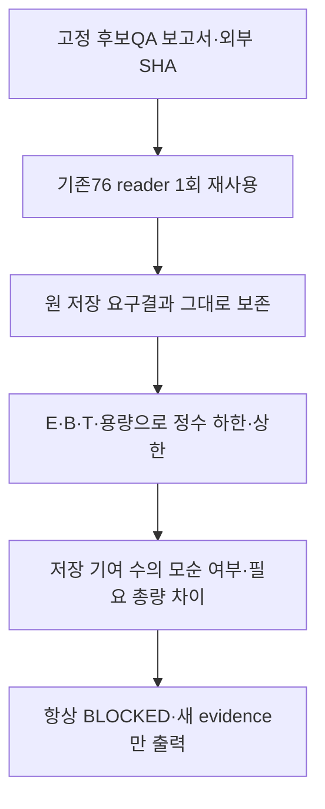

# Gate108 — 나지 총량으로 가능한 기여 패치 수의 범위

| 항목 | 내용 |
|---|---|
| updated_at | 2026-10-17 23:36 KST — 108 최종 근거·Git 상태 반영 |
| source_commit | d474d5bce6c2a6c4bd8ba141c9256d15f6004631 (108까지 구현 검토 기준; 이 메타데이터 정리는 후속 문서 커밋) |
| evidence_paths | `backend/app/ml/bare_patch_feasibility.py`; `scripts/inspect_bare_patch_feasibility.py`; `tests/test_bare_patch_feasibility.py`; `docs/implementation/108_bare_patch_feasibility.md`; `evidence/integration/bare-class-patch-feasibility-focused-20261017.log`; `evidence/integration/bare-class-patch-feasibility-related-20261017.log`; `evidence/integration/bare-class-patch-feasibility-related-corrected-20261017.log`; `evidence/integration/bare-class-patch-feasibility-independent-20261017.log`; `evidence/integration/bare-class-patch-feasibility-independent-review-20261017.json`; `evidence/integration/bare-class-patch-feasibility-live-20261017.json`; `evidence/integration/bare-class-patch-feasibility-live-cli-20261017.log`; `evidence/integration/bare-class-patch-feasibility-live-integrity-20261017.json`; `evidence/integration/bare-class-patch-feasibility-collection-next-review-20261017.json` |
| confidence | 완료 코드·합성 시험·고정 보고서 실제 산술·보존 근거 확인 |
| status | 저장 통계 산술 VERIFIED_REAL 한정·경계모형 TESTED_SYNTHETIC·학습 BLOCKED·후속 PLANNED |

## 쉬운 설명

패치 한 장에 나지 픽셀이256개 이상 있어야 ‘나지 학습에 기여하는 패치’로 센다. 전체에 나지 픽셀이 많아도 여러 장에 얇게 흩어지면 기여 패치가0일 수 있다.108은 저장된 총량만으로 기여 수가 어느 범위에 있을 수 있는지 계산한다. 실제 각 패치의 분포를 복원하거나 재배치를 권하지 않는다.

train의 총량1418은 모형에서 기여0~5개와 양립한다. 실제 저장 기여 수는0이다. 상한5를 실제5개나 학습 준비 완료라고 설명하면 안 된다.

## 이론적 배경

E는 같은 집계에 포함된 적격 패치 수, B는 나지 픽셀 총합, T는 기여 기준, C는 패치 픽셀 용량이다. 현재 T=256, C=256×256=65536이다. 각 패치의 정수 나지 픽셀 수를0..C로 두면 기여 수의 하한L과 상한U는 다음과 같다.

```text
B ≤ k*C + (E-k)*(T-1)
L = max(0, ceil((B-E*(T-1))/(C-T+1)))
U = min(E, floor(B/T))
```

float 오차 없이 정수 ceil로 계산한다. 이는 동일한 적격 집계의 단일 class 용량 모형이다. 마스크·다른 class·지역·기간·라벨 품질·비율·독립성 등 실제 QA 제약을 만족한다는 충분조건이 아니다.

기여 패치R=5개에 필요한 총량은 적어도R*T=1280이다. max(0,1280-B)는 이 필요 총량과 저장 총량의 차이다. 미래에 수집할 픽셀·패치·장면 수나 다운로드량이 아니다. 새 자료는 적격 수와 비율 분모도 바꾸므로 수집 지시로 환산하지 않는다.



## 코드·데이터 동작

`build_bare_patch_feasibility(report,reference)`는76 build를1회 호출하고 원 결과를 stored_requirements에 그대로 담는다. pure reference는 caller 선언일 뿐 보고서 바이트 확인이 아니다. `inspect_bare_patch_feasibility(data_root,expected_report_sha256)`는76의 고정 reader를1회 재사용한다. 같은 보고서의 최초 읽기와 최종 대조2회만 수행한다. 후보53MB·원본 manifest·영상·라벨을 추가로 읽거나 assess를 부르지 않는다.

CLI `inspect_bare_patch_feasibility.py`는 외부 SHA로 고정한 보고서를 읽고 선택적으로64KiB 이하의 새 evidence를 만든다. 기존 파일 덮어쓰기·입출력 별칭·Windows 장치/ADS 등을 거부하고 CP949 환경에서도 ASCII 요약을 출력한다. 새 부분 파일은 실패 시 자동 삭제하지 않는다. 기존 report reader의 한도16MiB·depth32를 재사용하며 전체 프로세스 RAM/원자 snapshot 보장은 아니다.

저장 기여 수가 산술 범위 밖이면 모순 진단을 추가하지만76 결과나 readiness gate를 덮어쓰지 않는다.20개 미검증·승인/권고 축은 false다. 현재 픽셀·정확 라벨·적격성·공간/누출·manifest를 재검증하거나 미래 수집량을 추정하지 않았다.

## 실제 저장 통계 결과

| split | 적격 패치E | 나지 총B | 저장 기여 수 | 가능한 범위L..U |5개를 위한 필요총량 차이 |76의 총량256 바닥 차이 |
|---|---:|---:|---:|---|---:|---:|
| train |628|1418|0|0..5|0|0|
| val |217|209|0|0..0|1071|47|
| test |250|1025|0|0..4|255|0|

저장 기여0은 모두 범위 안이다. train상한5는 필요조건의 한계이고 실제 기여5가 아니다. val1071과 기존47은 서로 다른 조건의 차이다. test는 이 저장 총량으로 모형상5개가 될 수 없다. 이를 재분배 권고나 미래 추가량으로 말하지 않는다.

후보의 sample_class_coverage·label_first_preview 통계를 최종 QA의 eligible row/mask/label 분포로 연결한 증거가 없어 사용하지 않았다. 코드8과 모델 class7의 의미 대응만으로 per-patch 분포를 인증하지 않는다.

## 시험·실제 관측·보존 근거

- 집중12 PASS/4.474초·수정 명령의 관련66 PASS/24.207초·독립26 PASS/10.286초다. 별도29,001개 정수 분포·1,015개 집계 모형의 완전 열거 일치는 추가 단위시험 수가 아니다.
- 초기 관련 명령은 존재하지 않는 모듈 이름2개 때문에 import 오류였다. 제품/시험 수정 없이 명령만 바로잡았고 초기 로그를 보존했다.
- 실제 CLI1회 exit0의9230B 결과를 Root가 생산 helper 없이 독립 산술로 대조했다. 범위0..5/0/0..4·기여0·필요총량 차이0/1071/255와 기존 바닥0/47/0이 같다. VERIFIED_REAL은 저장 JSON 산술에 한정되며 현재 영상·새 QA 검증이 아니다.
- 보호141·이전 증거791·기존 코드·catalog14는 불변이다. 운영 등록·Job·수집·새 QA·학습·배포는 없다. 원본·분할·모델·원장/lock·예약136314880B·후보QA4차단·학습 BLOCKED를 유지한다.
- 새 독립 미연결 기능이라 이번 전체 backend·프론트·build·브라우저는 재실행하지 않았다. 이전1069건/1068 PASS/1 SKIP/354.650초는107의 역사 근거다.

## 한계·다음과 Git 현재성

새 API/UI 계약과 호출 경로가 없어 직접 화면 변경은 없다. 수집 복구의 다음 제안은 저장 원장과 상태를 읽은 PLANNED 검토이며 정산·환불·재시작·수집 승인이 아니다. terminal2쌍 부재와 예약을 유지한다. 정확히 한 번 적용은 UNKNOWN이며 특정 crash를 입증한 것도 아니다.

Git 원격 기준 d483d25에 연결됐지만 이번 변경분은 문서 작성 시 미커밋이다. 원격 commit이108 코드를 포함한다고 말하지 않는다. Root가 이후 선별 commit/push를 수행하며 이 문서는 실행 전 완료를 주장하지 않는다. source_commit의 과거 .git 부재 현재형 표기는 정정하고 본문 역사 수치는 보존했다.

## 발표 대본

### 1분

“나지 픽셀이 전체에 있어도 한 패치에256개가 모이지 않으면 기여 패치로 세지 않습니다. 이번에는 저장 총량만으로 기여 패치 수의 가능한 범위를 계산했습니다. train은0개에서5개까지 가능하지만 실제 저장값은0입니다. val은0개, test는최대4개입니다. 기준5개를 위한 필요 총량 차이는 val1071, test255지만 앞으로 모을 픽셀 수라는 뜻은 아닙니다. 영상이나 라벨을 다시 검사하지 않았고 실제 분포도 복원하지 않았습니다. 독립 산술과 시험으로 계산을 확인했으며 학습 차단은 유지합니다.”

### 5분 순서

첫1분은 여러 접시에 얇게 나뉜 재료와 기여 기준의 비유를 설명한다. 두 번째1분은 E·B·T·C와 하한/상한을 설명한다. 세 번째1분은 표의 저장0과 가능한 상한을 구분한다. 네 번째1분은76 바닥47과108 필요총량1071의 차이를 설명한다. 마지막1분은 실제 저장통계 산술·합성모형·미래수집량 미추정·학습 차단을 나눈다.

### 10분 확장과 슬라이드

기여 패치 의미, 정수 경계, 세 split표, 독립 증거, 충분조건과 승인 경계의 다섯 장으로 구성한다. 5분 설명 뒤 하한 유도와 작은 용량 완전열거를2분, reader2회/원결과 보존을1분, QA분포 부재와 미래분모 변화를1분, 질문을1분 배정한다.

## Q&A

Q. train에1418픽셀이면5패치 아닌가? A. 총량의 상한만5다. 실제 저장 기여는0이며 분포를 모른다.

Q. val47만 더하면 되나? A.47은 총량256 바닥의 차이다. 기여5개 필요총량 차이1071·비율·품질 등과 다르다.

Q.1071픽셀을 수집하라는 뜻인가? A. 아니다. 같은 저장 집계의 필요조건 차이이며 새 자료의 분모와 품질도 달라진다.

Q. 실제 각 패치를 확인했나? A. 고정 보고서 JSON만 읽었다. 최종 per-patch 분포 증거는 복원하지 않았다.

Q. exit0과 범위 내이면 학습 가능한가? A. 계산 완료이며 충분한 QA나 과학·운영 승인은 아니다. 항상 BLOCKED다.

## 근거 연결

[구현 계약](../../implementation/108_bare_patch_feasibility.md), [완료 코드](../../../backend/app/ml/bare_patch_feasibility.py), [독립 검토](../../../evidence/integration/bare-class-patch-feasibility-independent-review-20261017.json)를 읽는다.
