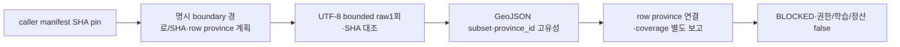

# Gate Boundary Structure 20261017 — 명시 경계 JSON 구조와 지역키 연결

| 필드 | 값 |
|---|---|
| updated_at | 2026-10-17 23:36 KST — Git 상태 메타데이터 정정; 본문은 해당 Gate 기준 |
| source_commit | d474d5bce6c2a6c4bd8ba141c9256d15f6004631 (108까지 구현 검토 기준; 이 메타데이터 정리는 후속 문서 커밋) |
| evidence_paths | `backend/app/data/recovery_boundary.py`; `scripts/inspect_recovery_boundary.py`; `tests/test_recovery_boundary.py`; `evidence/integration/recovery-boundary-tests-20261017.log`; `docs/implementation/52_recovery_boundary_validation.md`; `evidence/integration/recovery-boundary-independent-20261017.log`; `evidence/integration/recovery-boundary-live-final-20261017.json`; `evidence/integration/recovery-boundary-full-tests-20261017.log`; `evidence/integration/recovery-boundary-live-integrity-20261017.json` |
| confidence | 코드·합성시험·실제 명시경계 SHA/구조/지역키; topology/공식권한 미검증 |
| status | VERIFIED_REAL: 명시1경계/1304지역키·부분coverage; TESTED_SYNTHETIC: 16시험; 실행/학습 BLOCKED |

## 쉬운 설명

지역별 지도표의 파일 지문과 서식을 확인하고 자료의 지역명이 표의 고유키에 연결되는지 확인한다. 표가 잘 읽히고 이름이 연결되는 것과 공식 행정경계·권한·지리학적 정확성이 인정되는 것은 별개다. 오래된 자료의 경계 주소가 없으면 모른다고 남긴다.

## 이론과 검사 범위

고정 manifest의 명시 boundary_path/boundary_sha256만 읽는다. 같은 파일을 여러 행이 참조해도 canonical 경로별 한 번 읽은 동일 raw byte로 SHA와 JSON 구조를 검사한다. 지역 연결은 실제 소비키인 `properties.province_id`의 고유성과 row.province의 정확한 연결이다. 공식 지역명 목록이나 행정구역 코드를 외부에서 보완하지 않는다. UNIQUE_PROVINCE_MATCH만으로 전체 FeatureCollection 구조가 유효하다고 결론내리지 않는다. 다른 feature나 root CRS 선언의 문제를 files 구조상태·전체 issues로 함께 확인한다.

지원 구조는 비어 있지 않은 FeatureCollection·Feature의 Polygon/MultiPolygon 부분집합이다. 위치는 bool이 아닌 유한2D 숫자이며 lon[-180,180]/lat[-90,90], ring은4개 이상 위치·첫/끝 동일을 요구한다. 명시crs 선언은 지원하지 않는다. ring이 닫혔다고 자기교차·구멍/위상·유효면적·공식 범위를 검증한 것은 아니다.

## 코드·예산·안정성

`recovery_boundary.py:inspect_recovery_boundary(data_root, expected_manifest_sha256, **limits)`와 내부 CLI가 구현이다. 양키부재는 UNKNOWN이며 partial·명시null·손상SHA·canonical상충·파일누락 계획은 boundary읽기0이다. 모든 참조 미기재는 NO_RECORDED_REFERENCES로 빈검사를 성공으로 보지 않는다.

상한은 boundary총4MiB·파일16개·feature128·vertex100,000·JSON depth32다. manifest는 별도64MiB상한으로 처음/종료2회 읽어 SHA를 고정한다. boundary byte예산과 manifest I/O는 구분한다. strict UTF-8 문자 scan으로 parse 전에 깊이를 제한하고 escaped quote를 처리한다. UTF-16/32·BOM·NUL을 거부하며 duplicate key/NaN/비유한 수를 거부한다. 짧거나 잘못된 ring의 position도 vertex상한에 포함해 우회를 막는다.

로컬 root 안 일반 파일만 허용하고 remote/UNC/VSI·이탈을 거부한다. unbuffered bounded read·descriptor/stat·논리target·manifest SHA를 전후 확인하지만 여러 파일의 원자적 snapshot/OS lock은 아니다. 경계raw는 한 번 읽고 그 byte로 지문/JSON을 처리하며 GDAL/픽셀/네트워크를 사용하지 않는다. CP949 stdout은 ASCII escape, 새 evidence파일은 UTF-8·덮어쓰기 금지다.

## 시험과 최종 실제 근거

관련16 PASS/2.365초·독립16 PASS/2.304초의 보존 로그를 읽었다. 최종 실제/전체/보호 근거를 아래와 같이 연결했다. 검토에서 UTF-16/32와 escaped quote로 depth 제한을 우회할 수 있던 경로를 재현해 UTF-8 문자 scan으로 보완했고, invalid 짧은 ring을 통해 vertex예산을 피할 수 있던 공백도 수정했다. 초기 시험수는 보완 전 이력으로 구분한다.

실제 최종 CP949 CLI exit0에서 명시1,304행의 고유1파일/482,365B를 한 번 읽었다. 기대/관측SHA `de7722bfa88ddff3e12137d271c28717c23b3077a87b7dc36c66d1d8c522c909`가 맞고6feature/17,940position·STRUCTURE_MATCH·issue0이었다.1,304행 모두 UNIQUE_PROVINCE_MATCH지만 legacy80 UNKNOWN으로 KNOWN_STRUCTURE_MATCH_PARTIAL/INCOMPLETE_REFERENCES·BLOCKED다. 공식/topology/자기교차/raster포함/독립성은 미검증이며 최종 전체 `scripts/test.ps1`은 **462건 중461 PASS·1 SKIP/107.796초/종료0**다. SKIP은 기존 OS symlink 생성 권한이고 deterministic 경계 시험은 통과했다. 관련16 PASS/2.365초·독립16 PASS/2.304초는 전체462에 중복 합산하지 않는다. 보호132참조의 SHA·존재와 기존 계약13SHA는 불변이며 이전 추적 코드/데이터/계약 변경0이다. boundary1파일 stat/처음16바이트와1부모목록 관측변화도0이다. raw/SHA·구조·키연결의 순차읽기 범위이며 원자적 snapshot은 아니다. 이해자료 작성에서는 보존 근거를 읽었고 재실행하지 않았다. 이번 문서 작성은 읽기/설명이며 시험·실자료 조사를 실행하지 않았다.

## 한계·UI·승인

topology/self-intersection·공식ADM1/기관권한·raster pixel포함·독립기하·과학 성능은 미검증이다. boundary JSON의 구조와 키가 맞아도 사용승인·공식 AOI·정답 품질·지역별 모델 적격성이 아니다.

기존5 ML blocker·적격1,111/계획후보1,095·baseline Draft·terminal없는2건/예약136,314,880B·exactly-once UNKNOWN을 유지한다. BLOCKED·학습/실행/정산/자동재개/과학 승인false·환불0이다. 공개API/화면 계약 없는 내부CLI라 UI 수정·실행frontend 반영·브라우저 재검사는 불필요하다. 전체 개발과10분 보고는 계속한다.

## 발표 1분

“명시된 경계파일의 지문과 JSON 서식을 읽고 각 자료의 지역명이 고유 province키에 연결되는지 확인하는 기능을 추가했습니다. 좌표는 유한한2차원 경도·위도 범위, 닫힌 ring 같은 제한된 구조를 확인합니다. 파일 크기와 깊이·feature·좌표 수를 제한하고 잘못된 인코딩으로 그 제한을 우회하지 못하도록 보완했습니다. 실제 경계1파일의 지문과6feature/17,940개 위치 구조가 맞았고1,304행이 지역키에 연결됐습니다. 미기재80행으로 부분검증입니다. 이 검사는 공식 경계나 기관 사용승인이 아니며 자기교차·raster포함·공간 독립성도 확인하지 않습니다. 오래된80행은 UNKNOWN으로 남기고 학습·정산·재개는 계속 차단합니다.”

## 발표 5분·10분

1. **0~1분:** 지도표 서식/지역키 비유와 공식 승인과의 차이를 소개한다.
2. **1~2분:** pinned manifest·양키부재 UNKNOWN/손상계획 읽기0·고유파일1회읽기를 설명한다.
3. **2~3분:** FeatureCollection·Polygon/MultiPolygon·2D좌표/ring 조건과 엄격한 제한을 말한다.
4. **3~4분:** 최종 관련/독립/실제/전체/보호 근거가 확정된 범위만 제시하고 legacy80 UNKNOWN을 말한다.
5. **4~5분:** topology/공식ADM1/권한/raster포함·독립성 미검증·BLOCKED·UI불필요를 설명한다.

10분은 UTF-16/32·escaped quote depth 우회와 invalid ring vertex상한 보완, raw SHA와 JSON 동일byte, manifest별도2read·원자 snapshot 한계, 고유 province_id/누락·모호성 진단을 덧붙인다.

## Q&A

**STRUCTURE_MATCH면 공식 경계인가?** 제한된 JSON 구조와 키 연결만 맞으며 공식 지위/권한은 미검증이다.

**닫힌 ring이면 지리적으로 유효한가?** 자기교차/위상/면적을 검사하지 않아 그런 결론을 내리지 않는다.

**좌표범위면 raster가 경계 안에 있나?** pixel포함·raster footprint는 검사하지 않았다.

**legacy80은 기본 경계를 붙이나?** 추정하지 않고 UNKNOWN으로 남긴다.

**화면이 바뀌었나?** 내부CLI로 API/화면 계약이 없어 UI 변경은 불필요하다.

## 이후 갱신

문서52·최종 독립/실제/전체/보호 근거를 받아 Gate와 기능해설/구조/용어·대본/FAQ/시연·INDEX·CHANGELOG를 함께 확정했다. 다음 검증은 별도 Gate로 범위를 구분한다.

## 다음 작업의 현재 상태

다음 경계도형 topology 진단(`.is_valid` 등)은 **PLANNED** 별도 단위이며 현재 검증 결과가 아니다. geometry 자동보정·공식/기관 승인·기하 독립성 보장을 뜻하지 않으며 기존분할·원본과 UNKNOWN80을 유지한다.
