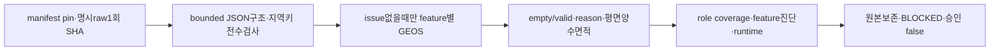

# Gate Boundary Topology 20261017 — feature별 평면 도형 유효성 진단

| 필드 | 값 |
|---|---|
| updated_at | 2026-10-17 23:36 KST — Git 상태 메타데이터 정정; 본문은 해당 Gate 기준 |
| source_commit | d474d5bce6c2a6c4bd8ba141c9256d15f6004631 (108까지 구현 검토 기준; 이 메타데이터 정리는 후속 문서 커밋) |
| evidence_paths | `backend/app/data/recovery_boundary_topology.py`; `scripts/inspect_recovery_boundary_topology.py`; `tests/test_recovery_boundary_topology.py`; `evidence/integration/recovery-boundary-topology-tests-20261017.log`; `docs/implementation/53_recovery_boundary_topology_validation.md`; `evidence/integration/recovery-boundary-topology-independent-20261017.log`; `evidence/integration/recovery-boundary-topology-live-final-20261017.json`; `evidence/integration/recovery-boundary-topology-full-tests-20261017.log`; `evidence/integration/recovery-boundary-topology-live-integrity-20261017.json` |
| confidence | 코드·합성시험·실제6feature GEOS진단/runtime; 공식/교차feature/독립성미검증 |
| status | VERIFIED_REAL: 6feature topology·부분coverage; TESTED_SYNTHETIC: 13시험; 학습/실행 BLOCKED |

## 쉬운 설명

지도표의 서식과 지역명이 맞는지 확인한 다음, 각 도형의 선이 스스로 꼬이거나 구멍이 잘못 놓였는지 기하 엔진으로 점검한다. 문제를 발견해도 원본을 자동으로 펴거나 고치지 않는다. 도형 하나의 유효성과 공식 행정경계·여러 지역 간 중첩·영상/모델 승인은 구분한다.

## 이론과 상태

고정 manifest·명시boundary raw/SHA·제한된UTF-8 JSON구조·지역키가 모두 통과해야 GEOS 진단을 시작한다. 앞 단계에 issue가 하나라도 있으면 shape시도0·NOT_CHECKED_INPUT_ISSUES다. 계획거부·대상0·엔진없음도 성공으로 처리하지 않는다. 시도0은 shape/위상진단0이지 library import/버전조회도 없었다는 뜻은 아니다.

feature별 `shape`를 만든 뒤 `is_empty`, `is_valid`, `explain_validity`와 finite positive area를 읽는다. 비어 있지 않고 유효하며 면적이 유한/양수이면 VALID_TOPOLOGY, 아니면 INVALID_TOPOLOGY다. 자기교차·바깥구멍·MultiPolygon 안 구성원의 부적절 중첩 등을 진단하지만 **서로 다른 feature 간 중첩은 검사하지 않는다**.

면적은 경위도 숫자를 평면으로 다룬 degree² 진단값이다. km²/측지면적·실제 면적·행정통계로 사용하지 않는다. 경위도 지구곡면/날짜변경선의 모든 해석을 검증하는 기능도 아니다. 버전·엔진예외·가능 여부를 기록하며 엔진예외는 UNKNOWN_ENGINE_ERROR, 엔진없음은 NOT_CHECKED_ENGINE_UNAVAILABLE다. 버전값이 없으면 추측하지 않고 UNKNOWN이다.

## 코드·입력·안정성

`recovery_boundary_topology.inspect_recovery_boundary_topology(data_root, expected_manifest_sha256, **limits)`와 내부CLI가 구현이다. boundary 코어의 bounded raw reader·strictUTF8/depth·FeatureCollection subset를 변경 없이 재사용한다. legacy80행 양키부재는 UNKNOWN으로 보존하고 경로/기대SHA를 추정하지 않는다.

boundary총4MiB/16파일/128feature/100,000position/depth32와 manifest별도64MiB/처음·종료2read를 유지한다. 같은canonical파일 raw1회로 SHA/구조/GEOS입력을 연결하고 logicaltarget·stat·manifest를 전후 대조한다. 원자 snapshot/OSlock은 아니며 입력크기 상한도 GEOS 연산의 hard CPU시간 제한을 보장하지 않는다.

`buffer`, `make_valid`, 자동repair·reprojection·geometry쓰기 없이 원본을 유지한다. 픽셀/raster포함·네트워크·수집/학습을 실행하지 않는다. CLI는 CP949 ASCII escape·UTF-8 새 evidence 출력·기존파일 덮어쓰기 금지다.

## 시험과 최종 실제근거

관련13 PASS/1.829초·독립13 PASS/1.809초의 보존 로그를 읽었다. 추가상충SHA/설명함수예외 합성확인은 전체총수에 합산하지 않는다. 최종 전체 `scripts/test.ps1`은 **475건 중474 PASS·1 SKIP/103.359초/종료0**다. SKIP은 기존 OS symlink 생성 권한이며 deterministic 경계 시험은 통과했다. 관련13 PASS/1.829초·독립13 PASS/1.809초와 추가상충SHA/설명함수예외 합성확인을 전체475에 중복 합산하지 않는다. 보호132참조와 기존 계약14SHA는 불변이며 이전 추적 코드/데이터/계약 변경0이다. boundary1파일 stat/처음16바이트와1부모목록 관측변화도0이다. 순차진단이며 원자적 snapshot은 아니다. 이해자료 작성은 보존 근거를 읽었고 재실행하지 않았다. fixture는 도형 유효/자기교차/바깥구멍/MultiPolygon중첩·engine예외/없음·버전UNKNOWN·선행issue때shape0·원본보존/변경제한을 검증한다. 실제 최종 CP949 CLI exit0에서 경계1파일482,365B의 SHA가 일치하고6feature/17,940position·1,304지역링크 issue0이었다. 실행관측은 Shapely2.1.2/GEOS3.13.1이며6시도 모두 VALID_TOPOLOGY·비어있지 않음·is_valid=true·유한양수 평면면적이었다. legacy80 UNKNOWN으로 KNOWN_TOPOLOGY_VALID_PARTIAL/INCOMPLETE_REFERENCES·BLOCKED다. repair/reproject·교차feature중첩·공식권한/inside/독립성 확인은false다. 면적숫자를사업상 실제면적으로 제시하지 않는다. 이해자료 작성에서는 시험·실자료조사를 실행하지 않았다.

## 한계·승인·UI

topologyvalid는 공식ADM1·기관권한·교차feature중첩·raster pixel포함·기하/장면 독립성·과학 성능 승인이 아니다. 기존구조 companion의 topologyfalse는 당시/모듈범위 그대로이며 새진단과 구분한다.

항상 BLOCKED·exactly-once UNKNOWN·학습/실행/정산/자동재개/과학 승인false·환불0이다. 기존5 ML blocker·적격1,111/계획후보1,095·baseline Draft·terminal없는2건/예약136,314,880B는 유지한다. 공개API/화면 계약 없는 내부CLI라 UI수정·실행frontend반영·브라우저 재검사는 불필요하다. 전체개발과10분보고는 계속한다.

## 발표 1분

“경계파일의 지문과 서식에 이어 도형별 평면 유효성을 진단하는 기능을 추가했습니다. 앞선 명세·구조·지역키가 모두 맞을 때만 GEOS엔진으로 각 도형의 빈값·자기교차 같은 유효성 문제와 양수면적을 확인합니다. 면적은 degree제곱의 내부진단이며 실제 제곱킬로미터가 아닙니다. 도형을 자동보정하거나 재투영하지 않습니다. 실제 Shapely2.1.2/GEOS3.13.1에서6도형이 유효했지만 오래된80행 미기재로 부분검증입니다. 개별도형 유효성은 공식경계·기관권한이나 지역간중첩·영상포함·공간독립성 승인이 아니므로 학습과정산·재개는 계속 차단합니다.”

## 발표 5분·10분

1. **0~1분:** 지도표의 꼬인 선 점검 비유와 자동수정없음을 소개한다.
2. **1~2분:** pin/raw1회·전수구조/지역issue없어야 GEOS시도·legacy80 UNKNOWN을 설명한다.
3. **2~3분:** is_valid/empty/reason·평면degree²와 측지면적 차이를 말한다.
4. **3~4분:** 최종 독립/실제/runtime/전체/보호가 확정된 범위만 제시하고 UNKNOWN/NOT_CHECKED를 구분한다.
5. **4~5분:** 공식성/교차feature중첩/raster포함·독립성 미검증과 BLOCKED·UI불필요·전체개발지속을 말한다.

10분은 selfcross/outsidehole/MultiPolygon중첩 사례·선행오류shape0·엔진예외/버전UNKNOWN·bounded입력과CPU시간 차이·수리없는원본보존을 덧붙인다.

## Q&A

**is_valid면 공식 경계인가?** 도형엔진의 평면규칙 결과이며 공식 지위/권한과 다르다.

**면적을 km²로 발표하나?** degree² 진단값이므로 실제 면적으로 발표하지 않는다.

**겹치는 지역도 찾나?** 한feature의 내부위상과 서로 다른feature간중첩은 별개이며 후자는 미검사다.

**도형을 고쳐주나?** buffer/make_valid/재투영/쓰기 없이 진단만 한다.

**엔진이 없거나 실패하면?** NOT_CHECKED/UNKNOWN으로 남기고 성공을 추정하지 않는다.

## 이후 갱신

문서53·독립/실제/runtime/전체/보호 최종근거를 받아 기능해설·구조/용어·발표/FAQ/시연·INDEX·CHANGELOG를 함께 확정했다. 이후범위는 별도 Gate로 구분한다.

## 다음 작업의 현재 상태

다음 서로다른 feature 경계 교차진단은 **PLANNED** 별도 단위다. 접촉과 면적중첩을 구분하고 입력/쌍예산을 제한하며 자동수선하지 않는 계획이다. 현재 그 검증 결과나 공식/독립성 승인으로 표현하지 않는다.
