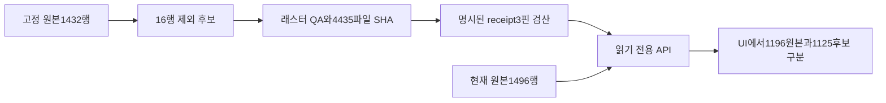

# 161 — 추가수집과 검증후보의 UI승계

| 필드 | 값 |
|---|---|
| updated_at | 2026-10-18 10:54 KST |
| source_commit | 1c97f5973b71e1e8234cdb41494c0ba6ca0a25b6 + 161 receipt/UI evidence follow-up |
| evidence_paths | `evidence/integration/priority-collection-round4-final-20261018.json`; `evidence/integration/priority-collection-independent-round4-20261018.json`; `evidence/integration/priority-ml-next-20261018-final-verification.json`; `evidence/integration/priority-ml-next-ui-round4-20261018.json`; `evidence/integration/priority-ml-next-ui-round4-20261018.png`; `evidence/integration/priority-collection-round5-launch-20261018.json` |
| confidence | 실제 수집·고정 후보 QA·실제 UI 확인. 독립 정확도와 운영 승인은 미확인 |
| status | VERIFIED_REAL scoped evidence / BLOCKED bare balance and targeted execution / round5 started, completion unverified |

- 상태: VERIFIED_REAL(완료수집·고정후보nativeQA·실제GET/UI),BLOCKED(나지균형·독립정답·표적집행),PLANNED(5차완료관측)
- 기준시각:2026-10-18 10:54 KST
- 코드근거:scripts/collect_training_priority.py,backend/app/collection_priority_status.py,evidence/integration/priority-ml-next-ui-promote-20261018.py
- 데이터근거:evidence/integration/priority-collection-round4-final-20261018.json,evidence/integration/priority-ml-next-ui-receipt-20261018.json
- 시험근거:evidence/integration/priority-collection-independent-round4-20261018.json,evidence/integration/priority-ml-next-20261018-final-verification.json,evidence/integration/priority-ml-next-ui-round4-20261018.json

## 쉬운 설명

창고에는 적격자료1196개가있고,같은장면누출을제외해별도로검증한묶음은1125개다. 새자료가들어왔다고검증묶음이자동으로늘지는않는다. 화면은둘의개수와시점을따로보여준다.

## 이론적 배경

고정분할을지키려면같은위성장면의훈련·검증공유를피해야한다. 수량1200은초기목표일뿐이며클래스별대표성과공간독립성·현장정확도를대체하지않는다. ESRI는약한참조라벨이다. 나지는분할별최소256픽셀·비율0.5%·패치당256픽셀이상기여5개가각각필요하다.

## 코드·데이터 동작

4차는반텐2025두창에서32적격을추가해셀부족151→97로줄였다. 새후보는1432행시점원본에서반텐16행을제외한1125개다. 완료QA의source/candidate/report3SHA·분할수·차단4를검산하고이전receipt/pointer를보존한후명시pointer만원자교체했다. 기존GET이실제UI에반영하며학습/등록/배포는실행하지않는다. 현재1496행의추가55적격은이후QA대상이다.

## 테스트 증거와 한계

4차32패치actualraster/SHA검사12.7664229초·기존1464행/pending2보존을확인했다.1125후보4435파일SHA불일치0·source identity 교차분할0이다. 브라우저01:52:31.145480Z에1196/1125·차단4·시점경고가표시됐다. 검증분할원본나지600픽셀·기여1개지만비율/기여기준미달이다. connectivity 부가진단NOT_CAPTURED_BUDGET·독립정답미확보·표적집행차단을유지한다. viewport캡처성공/전체페이지캡처timeout을구분한다. 기존backend48/frontend288/build120은소스검증이력이며이번pointer승계에서새전체회귀를실행했다고주장하지않는다.

## 발표 스크립트

“부족한지역·연도부터수집하여적격자료가1122개에서1196개로늘었습니다. 검증분할나지도209에서600픽셀로늘었지만한패치만충분히포함해아직기준에못미칩니다. 검증을마친1125개후보를화면에연결했고최신원본과별도로표시해학습가능하다는오해를막았습니다.”

## Q&A

- 1200개면학습완료인가? 아니다. 클래스균형·누출·독립평가가별도로필요하다.
- 1196과1125차이는실패인가? 시점과검증범위가다르다. 원본추가자료55개와누출제외16개차이가있다.
- 동일장면을삭제했나? 원본은보존하고새후보에서16행만제외했다.
- 나지표적수집이완료됐나? 로컬후보검사만완료했고집행가드가미연결이다.
- 다음수집은? 동자바2021두창이시작됐으며완료성과는추가관측한다.

## 실제 구조와 입력·출력

입력은 이미 확보한 로컬 source/candidate/QA JSON과 실제 래스터 파일이다. 영상 좌표계와 격자는 기존 QA로 검증했으며, UI 승계에서 재투영이나 다운로드를 수행하지 않는다. 출력은 수치·시점·SHA·차단 상태와 이를 설명하는 화면이다. `candidate_quality`는 허용된 data 경로와3개 지문을 검사하고 불일치하면 미확인으로 표시한다.

## 5분 발표 구성

1분: 수집 창고와 검증 묶음의 차이를 설명한다. 2분: 셀 부족151→97과 나지209→600픽셀의 실제 변화를 보여준다. 3분: 누출16행 제외와4435파일 검사를 설명한다. 4분: 화면의1196/1125 및 차단4·시점 경고를 읽는다. 5분: 나지 균형·독립 정답·표적 집행 가드와 다음 수집 관측을 남은 작업으로 설명한다.

발표 슬라이드 제목: ‘부족 지역 우선 확보’, ‘동일 장면 누출 제외’, ‘원본과 검증 후보의 구분’, ‘나지 품질과 남은 승인’. 전체 개발 완료나 독립 정확도 인증으로 표현하지 않는다.

최종 감사 산출물 정정: 최초4차 감사의 패치별 실제검사 assertion은32적격/391나지였지만 JSON요약에 이전회차23/148상수가 남아 마감검산에서 차단됐다. 최초JSON/script를 summary-initial로 보존하고 요약을 실제 observations에서 계산하도록 수정했다. 재검사는10.2128606초/exit0이며32/391을 확인했다. 수집 원본·원장·품질판정 변경은0이다. 이는 제품수집 오류가 아닌 감사 helper의요약 오류다. 근거:evidence/integration/priority-collection-independent-round4-summary-initial-20261018.json,priority-collection-independent-round4-20261018.json,priority-collection-independent-round4-final-20261018.log.
