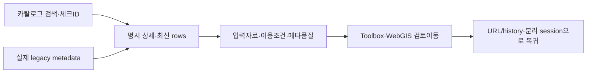

# Gate Catalog Insights 20261017 — 자료 찾기 다음의 검토와 복귀

| 필드 | 값 |
|---|---|
| updated_at | 2026-10-17 23:36 KST — Git 상태 메타데이터 정정; 본문은 해당 Gate 기준 |
| source_commit | d474d5bce6c2a6c4bd8ba141c9256d15f6004631 (108까지 구현 검토 기준; 이 메타데이터 정리는 후속 문서 커밋) |
| evidence_paths | `docs/implementation/42_catalog_insights_navigation.md`; `docs/implementation/43_catalog_insight_data_contract.md`; `frontend/src/CatalogInsights.tsx`; `frontend/src/catalogNavigation.ts`; `evidence/integration/catalog-insights-navigation-tests-20261017.log`; `evidence/integration/catalog-navigation-independent-ui-tests-20261017.log`; `evidence/integration/catalog-insights-navigation-build-20261017.log`; `evidence/integration/catalog-insights-browser-20261017.json`; `evidence/integration/catalog-insights-live-20261017.json` |
| confidence | 코드·UI단위/독립시험·실제이동/복귀·API/DB읽기계약; 과학/권한승인아님 |
| status | VERIFIED_REAL: 로컬5뷰/복귀·읽기자료; TESTED_SYNTHETIC: adapter; 실행 BLOCKED |

## 한 문장·1분 비유

자료목록에서 책을 찾은 뒤 대출조건·서지기록·활용도구·지도를 확인하고 원래 선택으로 돌아오는 흐름을 만들었다. 전역7개메뉴는 유지하고 카탈로그 안에 검색과 다섯 검토목적을 둔다. 찾고 이동할 수 있다는 것이 사용권한·모델실행 허가는 아니다.

## 왜·이론·5분 흐름

사용자의`UI/catalogu_insite` PNG5개(1448×1086)를참조해실제DOM/SVG/표/MapLibre로입력자료·이용조건·메타품질·Toolbox·WebGIS화면을만들었다. 원본전체PNG나128/108/20건·82점·99.2%AOI·준비율을실적처럼복제하지않는다.

## 코드·URL·상태

`CatalogInsights.tsx`,`catalogNavigation.ts`,App/PlatformShell/DataCatalogReference가구현이다. hash slug는inputs/terms/metadata/toolbox/webgis이고상세는`?dataset=명시ID`다. 허용step/model/tab만해석하고invalidroute는catalogreplace다. 상세객체를저장하지않고최신성공rows로ID를찾으며없는ID는query를제거한다. 대기/오류를별도로표시하고오래된객체를현재자료로채우지않는다.

검색초안/적용필터/체크ID는catalogsession,모델/참조지역은insightsession으로분리한다. 명시상세ID가우선이고없으면유효한체크선택정확히1개만문맥으로전달한다.0/복수선택에서첫자료를임의선정하지않는다. Workspace는선택모델화면이동이며자료자동주입·호환성판정·Job실행이아니다.

앱이전은검증된버전표식/safe-depth가있을때만내부history를사용하고직접진입/오염표식은catalogreplace다. browserback/forward·reload/hash직접진입을지원한다. 이동은전역결과/오류/busy를지우고요청세대+시작URL이맞는응답만표시한다. 서버작업취소/저장결과삭제가아니다. Registryrefresh도세대를확인한다.

저장소차단시catalog페이지간보존은보장하지않는다. insight모델/지역은같은앱의허용목록검증메모리fallback을쓰지만차단환경reload보존은보장하지않는다.

## 실제 자료 계약과 한계

독립읽기에서API6행=legacyDB6행·dataset_versions0행이다.6행모두명시access/quality/provider/time_range가없고일부version또는SHA만있다. 결측을조합해불변등록/계보요청/권한승인을만들지않는다. SEE_COLLECTION_TERMS는약관검토지시다. 모델LCLUC Draft·외부5 interface-only·학습5blocker도유지한다.

공개2017년6주ADM1/ODbL참조경계는공식사업AOI나Datasetfootprint가아니다. 메타기록존재율은과학품질/권한/공간적합성과다르다. 원본다운로드·기관ACL·모델별입력매핑·AOI/기간적합성·독립과학/운영승인은후속이다.

## 시험·실제 브라우저

UI49/49 PASS/477.5108ms·독립49 PASS/545.371ms·build69modules/18.53초다.500kB JS chunk경고는남는다. 이번backend수정없어직전321건320PASS/1SKIP회귀를다시실행하지않았다. 이전중간45/46/47시험과build수치는이력이다.

실제5174→API8002에서5뷰·검색6→1선택1상세→browserback검색1선택1→forward/reload상세·앱이전복귀,metadataCTA/1선택context를확인했다. Climate왕복초기화문제를발견/수정한뒤Climate·Gorontalo유지,forward/reload·WebGIS왕복을확인했다. 없는IDqueryreplace·invalidroute/직접첫진입이전catalogfallback도확인했다. metadata/WebGIS mobile요청390×844/실측390×845·폭375<390,QA2탭consoleerror0이다.

이해에이전트는로컬코드/문서/로그/QAJSON/metadataPNG만읽었고브라우저조작은하지않았다. 실브라우저검증주체는Root다.

## 발표·10분 확장·Q&A

30초: “같은자료의조건·품질·도구·공간을다섯하위화면에서검토하고검색/선택으로복귀할수있습니다. 실제사용권한과모델실행은별도입니다.”

5분은검색→상세→5검토→모델/지도→복귀,10분은최신rows/분리session·historyguard·URL/응답경합·실제6행결측계약을확장한다.

Q1. 전역메뉴가늘었나? A.7개는유지한다.

Q2. 뒤로가면선택이사라지나? A. 정상저장환경의왕복/새로고침을검증했다.

Q3. Climate초기화는? A. 문제를발견해수정후복원확인했다.

Q4. 모델에자동주입하나? A. 검토문맥/이동이지실행이아니다.

Q5.6개자료사용승인인가? A. 결측있는legacy등록이며권한/과학/AOI승인아니다.

[DEMO](../presentations/DEMO_STORY.md)의최신카탈로그복귀절을사용한다. 코드/사용법/시험/독립자료계약·UI실행/브라우저·이해자료를같이갱신하고전체개발·10분보고는유지한다.

### 최종 보존·검증 범위

`catalog-insights-live-20261017.json`에서 보호5개파일·기존2Job·참조PNG5개의SHA불변과신규실행기록0을확인했다. 직전snapshot이추적한backendPython21파일도같았으며이번단위는frontend/문서변경이라backend321회귀를다시실행하지않았다. UI49PASS·독립49PASS/build69modules18.53초와실제브라우저QA를이번근거로구분한다. QA임시2탭을닫고원래사용자LCLUC선택화면/viewport를복원했다는Root인계를받았다.

원본PNG의목적/배치를참조한DOM화면이며fullpage캡처높이·뷰포트가다르므로픽셀완전동일성을주장하지않는다. 권한·품질·AOI·모델준비/실행·과학/운영승인도이번화면검증의성과로바꾸지않는다.
