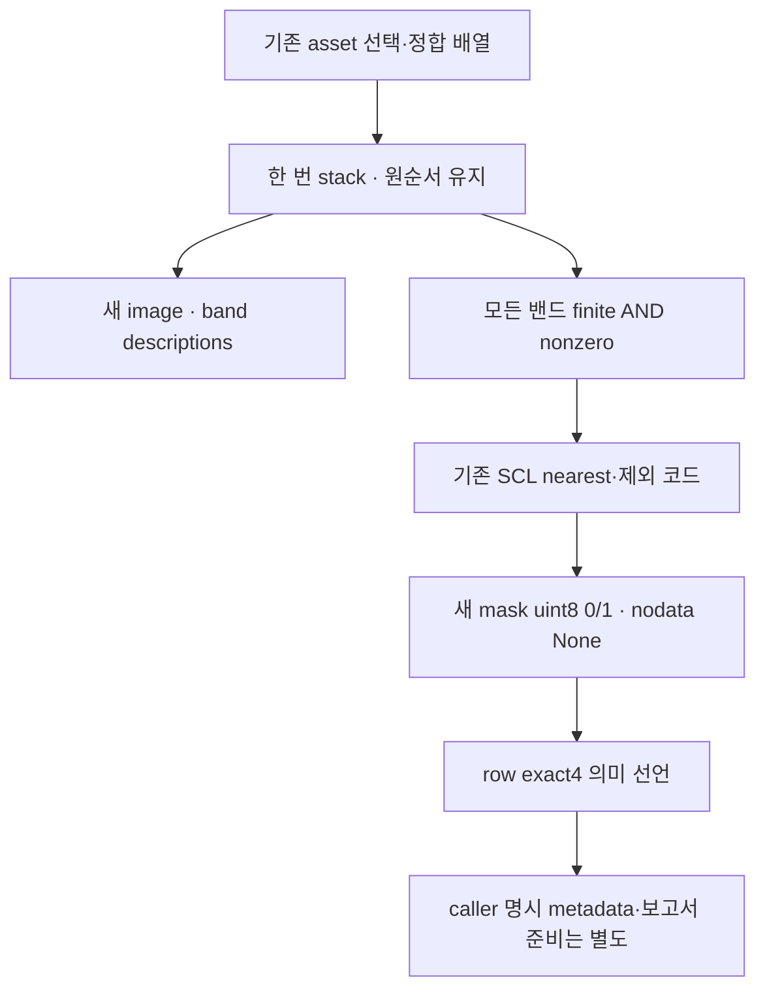

# Gate144 — 새 수집 영상의 밴드 설명과 품질 mask 선언

| 필드 | 값 |
|---|---|
| updated_at | 2026-10-18 07:10:20 KST — 144 전체 최종·Git 보완 보존 감사 확정 |
| source_commit | 기준 bd03292ea12f642839c96b753b752061725ef8d2 + 144 검증 작업파일 raw SHA (게시 전 검증 시점; 후속 Git 게시의 바이트 보존은 별도 확인) |
| evidence_paths | `scripts/collect_samples.py`; `tests/test_collection_raster_declarations.py`; `docs/implementation/144_collection_raster_declarations.md`; `evidence/integration/collection-raster-declarations-agent-20261018.log`; `evidence/integration/collection-raster-declarations-agent-initial-20261018.log`; `evidence/integration/collection-raster-declarations-independent-20261018.py`; `evidence/integration/collection-raster-declarations-independent-20261018.json`; `evidence/integration/collection-raster-declarations-independent-20261018.log`; `evidence/integration/collection-raster-declarations-root-related-20261018.log`; `evidence/integration/collection-raster-declarations-source-scope-20261018.json`; `evidence/integration/collection-raster-declarations-full-20261018.log`; `evidence/integration/collection-raster-declarations-operating-inventory-20261018.json`; `evidence/integration/collection-raster-declarations-live-integrity-final-20261018.json`; `evidence/integration/collection-raster-declarations-live-integrity-initial-20261018.json`; `evidence/integration/collection-raster-declarations-source-scope-20261018.py` |
| confidence | 집중 7 PASS/3.086초·관련 155 PASS/1 SKIP/69.832초·독립 7 PASS/4.4893717초·전체 1425 PASS/1 SKIP/296.344초; Temp/Mock/운영 미실행 구분 |
| status | TESTED_SYNTHETIC 새 산출물 선언·Temp 소비; 운영 수집 0·QA/과학/실행 승인 BLOCKED |

## 쉬운 설명

새로 저장하는 영상에 밴드 이름을 순서대로 적고 scene 품질 mask에 0과 1의 뜻을 명시했다. 포장 상자에 내용물 이름과 취급 표시를 붙이는 것과 비슷하다. 표시가 생겼다고 내용물의 물리 정체·기관 품질·모델 정확도가 인증된 것은 아니다. 기존 파일은 다시 쓰거나 누락 선언을 역채우지 않는다.

## 이론적 배경

래스터는 같은 숫자 배열이라도 밴드 순서와 nodata 해석이 다르면 다르게 소비된다. description은 요청 asset의 명시 이름을 보존한다. 알 수 없는 이름을 추정하거나 순서가 다른 자료를 소비 통과 목적으로 재배열하지 않는다.

mask의 0은 ‘invalid로 계산된 값’이다. nodata=0이면 저장값 0이 결측 처리될 수 있으므로 새 scene mask는 nodata=None으로 쓰고 0/1을 모두 명시 값으로 읽게 한다. GDAL all_valid는 숨겨진 nodata mask가 없다는 관측이며 모든 scene 픽셀이 유효하거나 QA가 통과했다는 뜻이 아니다.

## 구조

## 코드·입력 → 처리 → 출력

`scripts/collect_samples.py`의 collect_windows만 의도한 작은 producer 변경이다. 알려진 alias는 blue/green/red/nir/swir16/swir22를 B02/B03/B04/B08/B11/B12로 기록하고 이미 물리 이름인 asset과 unknown은 그대로 둔다. image 배열의 기존 순서와 DN·nodata=0을 유지한다. stack은 한 번 만들며 실제 image description에 같은 순서를 기록한다.

유효 조건은 `np.all(np.isfinite(stack) & (stack != 0), axis=0)`다. 어느 밴드든 0·NaN·±Inf면 invalid다. 기존 SCL nearest 정합과 0/1/3/8/9/10/11 제외 조건은 유지한다. SCL이 없으면 cloud 미검증·quality_unverified를 유지하며 finite/nonzero만으로 구름 검증을 주장하지 않는다.

새 scene quality-mask.tif는 count1·uint8·0/1·nodata=None·description binary_validity다. 새 row.quality_mask_semantics는 schema_version1/kind binary_validity/valid_value1/invalid_value0 exact4다. GMAIS source.mask_semantics manifest나 보고서·Registry를 자동 생성하는 것은 아니다.

raw crop·기존 SCL/label nodata·SWIR bilinear·범주 nearest·threshold·후보 선택·예산·원장·retry·resume 정책은 바꾸지 않는다. reflectance_conversion_verified와 scale_offset_applied는 false다. 비유한 위치가 새 valid에서 제외되면 기존 downstream valid 적용 코드에 따라 새 label 값도 0이 될 수 있다. 모든 새 label 바이트가 이전과 동일하다고 과장하지 않는다.

## 기존 산출물과 별도 mask의 경계

기존 SHA 확인 뒤 skip되는 image/label과 saved row는 그대로다. description 부재·예전 nodata0 mask·누락 의미 선언을 자동 변환하지 않는다. 해당 자료가 새 consumer에서 차단되면 검토된 새 자료/버전 준비가 필요하다.

collect_training_grid의 label!=0 및 AOI 결합 mask는 이번에 수정하지 않았다. 이를 순수 image quality mask로 재분류하거나 의미를 소급 선언하지 않는다. 별도 caller가 metadata·manifest·source.mask_semantics를 명시하고 저장·등록·소비 단계를 호출해야 하며 수집기의 자동 등록은 없다.

## 시험 근거와 상태

집중 최종 7 PASS/3.086초, 독립 7 PASS/0 SKIP/4.4893717초다. 초기 집중 7건 중 6 PASS/1 ERROR/4.672초는 시험이 UTF-8 파일을 기본 cp949로 읽은 구성 오류였고 read_text 인코딩만 교정했다. 제품 소스를 그 오류 때문에 바꾸지 않았다. 초기·최종·관련·독립을 합산하지 않는다. Root 관련 최종은 156건 중 155 PASS/1 SKIP/69.832초다. SKIP은 기존 test_collection_recovery의 실제 symlink 권한 제한이며 집중·독립의 SKIP 0과 구분한다. 전체 backend 최종은 1426건 중 1425 PASS/1 SKIP/296.344초다.

실제 신규 Temp GTiff를 쓰고 header·pixel·SHA를 읽었다. STAC 검색과 COG 읽기는 명시 Mock이며 네트워크 수집은 0이다. 집중 유효/무효/전체는 5/11/16, 독립 소비 fixture는 9/7/16으로 서로 다르다. 별도 baseline 격리 실행 비교에서는 이전 nonzero만의 15/16이 새 finite/nonzero의 12/16으로 바뀌었고 raw crop 여섯 개 바이트는 같았다.

독립은 Planetary Computer와 EarthSearch 순서·unknown 보존을 확인했고 permuted 영상은 129 고정 순서 검사에서 거부했다. 별도 caller setup으로 새 파일 → 140 저장 → 141 점검 → 142 Temp report 등록 → 131/133 읽기 소비를 확인했다. 자동 collector 등록이나 실제 운영 자료 검증은 아니다. 제품 상태는 TESTED_SYNTHETIC이며 운영 수집·Registry 등록·학습·추론은 실행하지 않았다.

## 한계와 다음 작업

새 description은 물리 밴드·분광 반응·반사도 보정·정규화 적합성·출처 기관 권위를 인증하지 않는다. binary mask의 계산 선언은 독립적인 cloud/품질 정답·기관 QA·과학 정확도·모델 실행 승인이 아니다. 독립 라벨·연차별 자료 확보와 기존 모델/후보 차단을 유지한다.

기존 producer를 수정했으므로 Root가 전체 backend 회귀를 실행했고 1425 PASS/1 SKIP을 확인했다. API/main/UI는 바꾸지 않아 이번 frontend/build/browser는 재실행하지 않는다. 다음 145는 grid patch의 band description 전파와 label 지원 mask·순수 image quality 구분을 읽고 검토하는 후보(PLANNED)이며 운영 수집 재개는 별도다. 전체 프로젝트는 미완료다.

## 발표 대본

### 1분

“새 영상에 밴드 이름을 순서대로 기록하고, 비유한 수와 0인 위치를 mask에서 유효하지 않다고 표시합니다. 0과 1을 결측으로 숨기지 않고 명시 값으로 저장합니다. 기존 자료는 수정하거나 선언을 역채우지 않습니다. 실제 파일은 임시 자료에서 검증했고 외부 검색·영상 읽기는 모의 응답이었습니다. 기관 품질이나 모델 실행을 승인한 것은 아닙니다.”

### 5분

‘이름과 순서’, ‘유한값 조건’, ‘SCL과 nodata’, ‘기존 자료 보존’, ‘시험과 승인 경계’를 각각 1분씩 설명한다. 유효 픽셀 계수는 fixture별로 나누고 전체 회귀 숫자는 확정된 최종 로그만 사용한다.

### 10분 확장

원순서와 소비자 거부 반례 1분, NaN/Inf 비교 1분, caller의 명시 저장/등록/소비 단계 1분, 질의응답 2분을 더한다. 운영에서 새 다운로드를 실행하는 시연으로 바꾸지 않는다.

## Q&A

Q. 기존 mask도 새 방식으로 고치나? A. 기존 SHA skip 산출물과 row는 그대로 보존한다.

Q. 모르는 밴드를 B02로 바꾸나? A. 이름을 그대로 두고 소비자가 고정 계약을 검사한다.

Q. finite/nonzero이면 cloud 검증인가? A. 아니다. 기존 SCL이 없으면 cloud 미검증 상태를 유지한다.

Q. all_valid면 mask가 모두 1인가? A. 기본 GDAL flag이며 실제 값은 0과 1을 모두 가질 수 있다.

Q. 수집기에서 Registry까지 자동 완료됐나? A. 시험 caller의 별도 명시 setup이며 운영 등록은 없다.

Q. 전체 회귀는 끝났나? A. 1426건 중 1425 PASS/1 SKIP으로 완료했고 제외는 기존 Windows symlink 권한 제한이다.

## 근거 바로 열기

[구현 설명](../../implementation/144_collection_raster_declarations.md) · [수집 코드](../../../scripts/collect_samples.py) · [독립 근거](../../../evidence/integration/collection-raster-declarations-independent-20261018.json)

정확한 세 선언 편집만 baseline raw source에 적용하면 최종 소스와 같았고 collect_windows 외 top-level AST와 LF를 보존했다. 이는 제품 동작 전체의 추상적 동등성을 주장하는 것이 아니라 명시한 범위 검사다.

144 전체 backend 최종은 1426건 중 1425 PASS/기존 Windows symlink 권한 1 SKIP/296.344초/exit 0이다. 첫 실행에서 완료했으며 초기 전체 실패나 재실행은 없다. 집중 7 PASS/3.086초·관련 156건 중 155 PASS/1 SKIP/69.832초·독립 7 PASS/0 SKIP/4.4893717초와 중복 합산하지 않는다. 이번 최신 backend 전체는 144이며 137의 1358 PASS/1 SKIP은 이전 이력이다. frontend 최신 137의 271 PASS는 그대로이고 이번 frontend/build/browser는 재실행하지 않았다.

144 최종 보존 감사는 보호 참조 141개·이전 증거 1381개·catalog 14행 SHA·운영 DatasetVersion 0·예약 136314880B 불변을 확인했다. 소스는 총 327개 중 허용된 collect_samples.py 한 개만 변경했고 나머지 326개는 불변이다. 기존 snapshot의 326개에는 수집기가 없었으므로 Git bd03292e의 고정 원문 한 개를 추가해 범위를 보완했다. 초기 326개 불변 JSON은 별도 보존했으며 이를 전체 소스 변경 0으로 소개하지 않는다. 현재 코드로 과거 baseline을 역산한 것이 아니다.

동결 소스 raw SHA는 `a78d0293736780e70402b85714f38964c2ef09e1253cf7453e292ca9a2551c98`, 집중 시험 raw SHA는 `469ff453b37a91a4f6d7cf890e5721b9c0aeec31df2a28b215c1017e9f8c821e`다.
