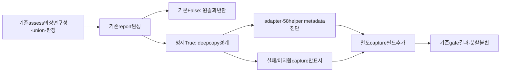

# Gate Connectivity Adapter 20261017 — 기본 off의 선택적 assess 진단 연결

| 필드 | 값 |
|---|---|
| updated_at | 2026-10-17 23:36 KST — Git 상태 메타데이터 정정; 본문은 해당 Gate 기준 |
| source_commit | d474d5bce6c2a6c4bd8ba141c9256d15f6004631 (108까지 구현 검토 기준; 이 메타데이터 정리는 후속 문서 커밋) |
| evidence_paths | `backend/app/ml/readiness.py`; `backend/app/ml/readiness_connectivity_adapter.py`; `tests/test_readiness_connectivity_adapter.py`; `docs/implementation/60_readiness_connectivity_adapter_validation.md`; `evidence/integration/readiness-connectivity-adapter-related-20261017.log`; `evidence/integration/readiness-connectivity-adapter-independent-20261017.log`; `evidence/integration/readiness-connectivity-adapter-ast-parity-20261017.json`; `evidence/integration/readiness-connectivity-adapter-live-saved-state-20261017.json`; `evidence/integration/readiness-connectivity-adapter-full-tests-20261017.log`; `evidence/integration/readiness-connectivity-adapter-live-integrity-20261017.json` |
| confidence | 코드·합성on/off동등성·정적AST·실제저장report불변/부재; 실자료assess미실행 |
| status | TESTED_SYNTHETIC: 17시험·별도graph대조; VERIFIED_REAL: 저장상태·정적코드대조; 실자료학습 BLOCKED |

## 쉬운 설명

검사관의 판정을 끝낸 뒤, 요청할 때만 별도의 메모작성자에게 복사본을 주어 연결이유를 기록하게 한다. 메모가 실패하거나 지원하지않는 형식이어도 원판정표를 고치지 않는다. 기본은 메모작성 off이며 이번에 실제창고 전체검사를 다시실행하지 않았다.

## 실제 연결과 판정 경계

`assess(..., connectivity_diagnostics=False)`에 정확한bool 옵션을 추가했다. 기본False는 adapter import/call·추가결과key가 없다. True는 원report를 만든뒤 try안에서 scenes/policy/province_groups/inputs를deepcopy하고 `capture_readiness_connectivity`에 전달해 별도 `connectivity_diagnostics`를 추가한다. copy/import/capture실패·입력변조후예외도 원report/payload/정책/참조에 영향을주지않도록 격리했다.

기존token/bbox union·blocker순서·고정분할·통계·prepared_payload를 진단재계산으로 대체하지않는다. child진단은항상BLOCKED/승인false지만 outergate는합성/약한라벨실험에서ready일수있다. childBLOCKED를새gate차단으로해석하지않고 capture_status부터읽는다.

## 장면 범위와 변환

adapter는 **eligible_patches=0도포함해 assess가append한scenes 전체를원래순서로** 투영한다. patch_count>0필터·목록자르기·재배정은없다. scene_count와supplied_eligible_patch_sum을구분하고 내부scene순번은원본manifest index/역사scene index가아니다.58helper의인터페이스이름이eligible라고실제범위를적격patchsubset으로바꾸지않는다.

gate의truthiness/str규칙에맞춰 str/int/유한float/bool/None scalar를지원한다. falsygroup은빈문자열로투영해 두token역할을skip하고bbox는유지한다. scene_id는항상str로None→'None',숫자123→'123'이다. list/dict·긴문자열/지원밖좌표는추정하지않고NOT_CAPTURED다.

기본required_provinces순서와고정6주4/1/1 mapping일때만지원한다. custom/역순policy는원gate를계속처리하고진단만미포착한다. scene/pair예산초과는전체미포착이며장면목록을잘라성공으로만들지않는다. 저장edge절단은전체union완료와별도다. 이미assess가계산한manifest참조를복사할뿐 추가파일/픽셀/GEOS·내용SHA검증·출처인증은없다.

## Capture 상태

| 상태 | 뜻 |
|---|---|
| CAPTURED_COMPONENTS_MATCH | 모든지원장면의helper연결map이gate와일치. 품질/학습승인은아님 |
| CAPTURED_COMPONENT_MISMATCH | 진단결과가달라도gate를수정하거나blocker를추가하지않음 |
| NOT_CAPTURED_UNSUPPORTED_POLICY/METADATA | 지원밖정책/순서/입력. 원판정은유지 |
| NOT_CAPTURED_BUDGET | 전수진단한도초과. 임의부분목록성공금지 |
| FAILED_DIAGNOSTIC/FAILED_ADAPTER_BOUNDARY | adapter/helper/copy/import실패를별도기록 |

## 시험·실제저장상태·코드비교

관련17 PASS/4.605초·독립17 PASS/4.435초의보존로그를읽었다. off미호출·on에서진단필드외원report typed동일·0patch tokenbridge·scalar변환/falsygroup·custom/역순policy·copy/helper변조후raise격리·budget/예외·추가I/O없음을합성검증했다. 별도graph oracle200사례는시험총수에추가하지않는다.

AST비교는 새keyword·정확bool guard·선택적반환블록만제거하면원assess와나머지모듈AST/default_policy가같음을기록했다. readiness코드의 raw bytes SHA는 `42945e3d864a0e63dab4d3100355bcd3506eecf2ada8bc654d573521ea1fdff2`에서`90b6b3a82c734c481c1477828c1630061ad495034cd38e950523e3a7a35fb4dc`로의도변경됐다. Root는초기proof가LF정규화텍스트지문을rawSHA와혼용한부분을정정했다. 줄바꿈을정규화한텍스트SHA와파일그대로의bytesSHA는다르며 코드freeze후의추가변경이나AST동등성변화로해석하지않는다. 이는정적코드범위증거이며 과거생성코드·과학성능인증은아니다.56/57저장보고서의역사SHA를현재값으로덮어쓰지않으며 현재재실행성공으로확장하지않는다.

실제saved-state읽기에서저장reportSHA동일·prepared_payloadnull·새diagnostics없음·5blocker/patch628·233·250을확인했다. 역사적union scene수와실제0patchscene존재는UNKNOWN_NOT_PERSISTED다. 실제전체자료assess/on진단을이번에재실행하지않았다. 최종 전체 `scripts/test.ps1`은 **589건 중588 PASS·1 SKIP/164.510초/종료0**다. SKIP은 기존 Windows symlink 생성 권한이며 deterministic 경계 시험은 통과했다. 관련17 PASS/4.605초·독립17 PASS/4.435초·별도graph200합성사례는 전체589에 중복 합산하지 않는다. 보호132참조·기존21진단계약SHA·저장readiness는 불변이다. 기존추적파일 중 의도한 변경은 readiness.py만이며 원본assess/나머지module/default_policy AST는 선택적진입·반환을제외하고 같았다. 실제저장보고서를 재생성하지 않았으며 이해자료 작성은 보존근거를읽고 재실행하지 않았다. 이해자료작성은재시험/실자료조사를실행하지않았다.

## 한계·UI·후속

내부선택hook구현과실자료재평가·영속저장·CLI/API/UI옵션노출은다르다.59envelope도이번에강제로연결하지않았다. assess실행중최종reportSHA가없으므로가짜provenance를만들지않는다.58/59의미통합기록은당시범위이고이번에내부선택hook만추가된것이다.

기존실자료5 blocker·저장적격patch1,111/계획후보1,095·baseline Draft·terminal없는2건/예약136,314,880B·exactly-once UNKNOWN을유지한다. 진단자체학습/실행/정산/자동재개/과학승인false·환불0이다. 공개사용자흐름/화면계약이없어 UI변경·브라우저재검사는불필요하다. 전체개발/10분보고는계속한다.

## 발표 1분

“기존준비도 판정을 바꾸지않고 요청할 때만 연결근거를 별도로 관측하는 내부옵션을 추가했습니다. 기본은꺼져있고 켤때는 원판정이 끝난뒤 장면과정책의 복사본을 메모작성자에게 전달합니다. 메모가 실패해도 원판정·분할·통계를 고치지않습니다.0patch장면도 실제판정에참여하면 빠뜨리지않고, 장면수와패치합계를 구분합니다. 합성자료에서 기본/off와on의 원결과동일성과 오류격리를 검증했습니다. 실제과거자료의 준비도는 다시실행하지않아 저장장면수와원인은여전히모릅니다. CLI·API·화면과저장기능도아직연결하지않았고 기존학습차단은유지합니다.”

## 발표 5분·10분

1. **0~1분:** 판정후복사본으로메모작성·기본off 비유를소개한다.
2. **1~2분:** True만별도필드·deepcopy격리·childBLOCKED와outergate의차이를설명한다.
3. **2~3분:**0patch포함전체scenes/원순서·scalar/빈group·unsupported/budget를말한다.
4. **3~4분:** 관련17/독립17·별도200사례·AST·실제saved-state와최종전체/보호를구분한다.
5. **4~5분:** 실자료assess미실행·역사sceneUNKNOWN·저장/CLI/API/UI미연결·기존차단유지·개발지속을말한다.

10분은0patch bridge합성사례·관측실패와gate차단차이·반전policy순서·변조후raisecopy격리·코드SHA변경과역사보고서보존·향후CLI옵션을덧붙인다.

## Q&A

**기본실행결과가바뀌나?** False에서새필드/adapter호출없이기존결과를유지한다.

**진단BLOCKED면원gate도추가차단인가?** 진단은승인권한이없어child상태와outer판정은별개다.

**0patchscene를제외하나?** 기존append된전체scenes를순서대로포함하며임의필터하지않는다.

**실자료원인을이제찾았나?** 실자료assess를재실행하지않아역사scene/원인은미확인이다.

**사용자버튼/CLI에서쓸수있나?** 내부Python옵션만있고CLI/API/UI·저장/envelope연결은후속이다.

## 이후 갱신

최종전체/보호근거를받아기능해설·구조/용어·대본/FAQ/시연·INDEX·CHANGELOG를함께확정했다. 다음기존CLI의기본off옵션/출력계약검토·노출또는요청시59envelope연결검토는PLANNED이며 실자료재평가는별도다.

## 다음 작업의 현재 상태

다음 `scripts/run_experiment.py`의 기본off diagnosticflag·요약출력은 **PLANNED**다. 진단요청시 새출력경로로 기존report/입력 덮어쓰기를 막고 학습execute의 기본동작을 바꾸지 않는 합성검증을 계획한다. 현재 CLI노출·자동활성화·실자료gate 재평가는 수행하지 않았다.59envelope 연결은 요청시 별도검토다.
