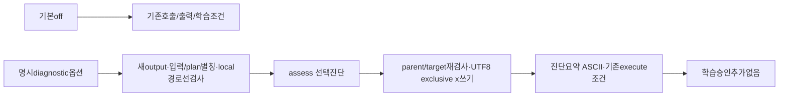

# Gate Connectivity CLI 20261017 — 기본 off 진단옵션과 새 readiness 출력 보호

| 필드 | 값 |
|---|---|
| updated_at | 2026-10-17 23:36 KST — Git 상태 메타데이터 정정; 본문은 해당 Gate 기준 |
| source_commit | d474d5bce6c2a6c4bd8ba141c9256d15f6004631 (108까지 구현 검토 기준; 이 메타데이터 정리는 후속 문서 커밋) |
| evidence_paths | `scripts/run_experiment.py`; `tests/test_readiness_connectivity_cli.py`; `docs/implementation/61_readiness_connectivity_cli_validation.md`; `evidence/integration/readiness-connectivity-cli-related-20261017.log`; `evidence/integration/readiness-connectivity-cli-independent-20261017.log`; `evidence/integration/readiness-connectivity-cli-live-help-20261017.json`; `evidence/integration/readiness-connectivity-cli-ast-parity-20261017.json`; `evidence/integration/readiness-connectivity-cli-full-tests-20261017.log`; `evidence/integration/readiness-connectivity-cli-live-integrity-20261017.json` |
| confidence | 코드·합성path/쓰기/실행경계검증·실제help; 실자료readiness/학습미실행 |
| status | TESTED_SYNTHETIC: 19시험·별도14path; VERIFIED_REAL: help노출·정적AST; 실자료학습 BLOCKED |

## 쉬운 설명

검사 메모옵션을 명령줄에 노출하되, 요청한 사람은 새공책의 이름을 명시해야 한다. 이미 쓰인 공책이나 입력자료 위에 기록하지 않는다. 이옵션은 학습승인 도장이 아니며 기존실행조건을 우회하지 않는다.

## 기본 off와 명시 요청

`run(..., *, connectivity_diagnostics=False)`와 CLI `--connectivity-diagnostics`가 구현이다. off는 기존assess호출형·요약4키·readiness write동작·execute체인을 그대로 유지한다. 기존off가 readiness파일을기록하는동작까지 바꾼것은 아니다.

True는명시 `--readiness-output` 새파일이필수이며 assess에True를전달한다. `--write-default-plan` 동시요청은읽기/쓰기/assess전에거부한다. 출력상대경로는DATA root기준, manifest/plan상대경로는cwd기준이다. 새옵션 자체는ready/execute/run-id/resume 등 기존학습조건을추가승인하지않는다. ready여도execute=False면학습하지않고, 명시execute=True와기존조건을만족하면 원래경로로진행할수있다.

## 새 출력 보호와 한계

assess전 canonical DATA root내 새경로인지확인하고 기존file/dir/link·brokenlink·manifest/plan별칭·root이탈/원격/UNC·Windows ADS/device·끝점/공백별칭을거부한다. finalsymlink는exists보다먼저확인한다. parent target과가장가까운기존directory identity를저장해 assess후/부모생성후재검사하고 UTF-8 `open('x')`로 새파일만생성한다.

다른writer가중간에만든파일을덮어쓰지않는다. 쓰기중실패로부분새파일/디렉터리가생기면조사흔적으로남기며자동삭제/재시도덮어쓰기를하지않는다. 최종parent검사와open사이의모든OS악성retarget을막는fdtransaction/원자적FS·snapshot보장은아니다.

## 요약과 실행후 보고서 구분

True때만 capture_status·scene_count·eligible_patch_count·training_authorization=false를ASCII요약에추가한다. 없는진단은NOT_REPORTED, 미지상태는UNKNOWN_CAPTURE_STATUS, 알수없는계수는null이다. scene수와patch합을혼동하지않는다. main의기존stdout UTF8재설정은유지되며 ASCII요약을 CP949고정출력이라고표현하지않는다.

명시execute로기존학습경로를통과한뒤 반환하는최종experiment report에는diagnostics를자동전파하지않는다. 요약이NOT_REPORTED/null일수있고 진단원문은별도readiness-output에있다. 이번시험은실제학습을실행하지않았다.

## 시험·실제help·정적근거

관련19 PASS/4.770초·독립19 PASS/5.636초의보존로그를읽었다. 기본off호출/4키·True전달·경로선거부·writer경쟁·parent/target변경·부분파일보존·지원bool·진단권한분리·subprocess UTF8/ASCII/새출력·기존blocked execute종료2와모델미생성을합성검증했다.

별도14개Windows path preflight에서 ADS/CON초기통과를재현한뒤보완해모두거부했고 실제장치/ADS쓰기는없었다. 별도실험은시험총수에추가하지않는다. AST비교는원래execute gate이후 training/resume/infer tail이같음을기록하며새output/요약은별도시험근거다.

Root의실제 `--help`1회는exit0·새flag노출을확인했고 source자료/실자료assess/학습은0이다. help stdout은기존reconfigure에따른UTF8이며 CP949환경변수가출력을강제로CP949로고정한것은아니다. 최종 전체 `scripts/test.ps1`은 **608건 중607 PASS·1 SKIP/207.921초/종료0**다. SKIP은 기존 Windows symlink 생성 권한이며 deterministic 경계 시험은 통과했다. 관련19 PASS/4.770초·독립19 PASS/5.636초·별도14개 Windows path preflight는 전체608에 중복 합산하지 않는다. 보호132참조·기존23계약SHA·저장readiness는 불변이고 이전snapshot에 추적된 코드·데이터·계약의 변경0을 확인했다. run_experiment.py는 이전snapshot 추적대상에 없었으므로 별도명시preflight baseline의 raw0e3ae0...→현재a1b372... 변경으로 증명했다. 이를 전체workspace변경0이나 oldtracked변경1로 표현하지 않는다. script/test freezeSHA와 기존execute gate이후training/resume/infer tail AST는 같았다. 이해자료 작성은 보존근거를읽고 재실행하지 않았다. 이해자료작성은재시험/실자료CLI를실행하지않았다.

## 한계·기존 상태·UI

CLI옵션노출은실자료진단/학습·API/UI활성화·59envelope연결과다르다. 실제저장report/5 blocker·patch1,111(628·233·250)·역사scene수/원인UNKNOWN·baseline Draft·계획후보1,095·terminal없는2건/예약136,314,880B·exactly-once UNKNOWN·환불0을유지한다. 진단은과학/정산/자동재개/실행권한을추가하지않는다.

공개API/프론트상태/버튼계약이없어UI변경·브라우저재검사는불필요하다. 전체개발과10분보고는계속한다.

## 발표 1분

“요청할 때만 연결메모를 남기는 옵션을 명령줄에 노출했습니다. 기본은꺼져있고 진단을요청하면 새readiness파일을명시해야합니다. 이미있는파일과 입력·계획의별칭, Windows장치나ADS경로는 검사전에거부하고 새파일은exclusive모드로씁니다. 실패한새파일은흔적으로보존하며 원자적파일시스템보장은아닙니다. 진단요약은 장면수와patch합·모르는상태를구분하고 학습승인이아니라고표시합니다. 실제로는help노출만확인했고 전체자료준비도나학습을실행하지않았습니다. 기존execute조건·다섯차단과원본보고서를유지하며 화면/API나envelope저장은아직연결하지않았습니다.”

## 발표 5분·10분

1. **0~1분:** 메모옵션·새공책비유와기본off를소개한다.
2. **1~2분:** 명시output·planwrite충돌·경로선검사·exclusive새쓰기를설명한다.
3. **2~3분:** 부분파일보존/원자성한계·scene/patch·NOT_REPORTED와학습권한분리를말한다.
4. **3~4분:** 관련19/독립19·별도14path·실제help/AST·최종전체/보호를구분한다.
5. **4~5분:** 실자료미실행·execute기존체인·최종experiment와readiness분리·UI불필요·개발지속을설명한다.

10분은WinADS/device·parentidentity/race·cwd/root상대경로차이·stdoutUTF8vsASCII·blocked진단exit0/명시blockedexecute2·future실자료범위를덧붙인다.

## Q&A

**옵션을켜면학습하나?** 기존ready/execute/run-id등을그대로따르며 진단자체가승인하지않는다.

**기존readiness를덮어쓰나?** True는명시새파일만허용한다. off기존write동작은유지한다.

**실패한부분파일은지우나?** 자동삭제하지않고흔적으로남겨다음에는다른새경로가필요하다.

**최종experiment요약에진단없으면실패인가?** 진단은별도readiness파일이며자동전파하지않아NOT_REPORTED일수있다. 성공으로도추정하지않는다.

**실제자료를이번에재평가했나?** 실제help만확인했으며 실자료assess/학습은실행하지않았다.

## 이후 갱신

최종전체/보호근거를받아기능해설·구조/용어·대본/FAQ/시연·INDEX·CHANGELOG를함께확정했다. 다음새출력보호/입력SHA/자원계획확인후학습없는실자료진단범위결정또는envelope연결검토는PLANNED이며 자동실행/승인이아니다.

## 다음 작업의 현재 상태

다음 새출력 보호·입력SHA·자원계획을 확인한 뒤 학습없는 실자료 readiness진단 범위를 정하거나 읽기진단 envelope연결을 검토하는 작업은 **PLANNED**다. 현재 실자료재평가를 수행/자동승인한 것이 아니며 기존보고서를 덮어쓰거나 과거원인을 추정하지 않는다.
