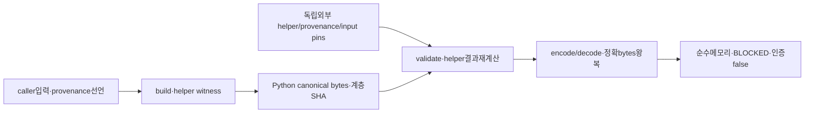

# Gate Connectivity Envelope 20261017 — 향후 witness를 묶는 순수 bytes 계약

| 필드 | 값 |
|---|---|
| updated_at | 2026-10-17 23:36 KST — Git 상태 메타데이터 정정; 본문은 해당 Gate 기준 |
| source_commit | d474d5bce6c2a6c4bd8ba141c9256d15f6004631 (108까지 구현 검토 기준; 이 메타데이터 정리는 후속 문서 커밋) |
| evidence_paths | `backend/app/data/readiness_connectivity_envelope.py`; `tests/test_readiness_connectivity_envelope.py`; `docs/implementation/59_readiness_connectivity_envelope_validation.md`; `evidence/integration/readiness-connectivity-envelope-related-20261017.log`; `evidence/integration/readiness-connectivity-envelope-independent-20261017.log`; `evidence/integration/readiness-connectivity-envelope-live-absence-20261017.json`; `evidence/integration/readiness-connectivity-envelope-live-validation-20261017.json`; `evidence/integration/readiness-connectivity-envelope-full-tests-20261017.log`; `evidence/integration/readiness-connectivity-envelope-live-integrity-20261017.json`; `backend/app/ml/readiness.py` |
| confidence | 순수bytes프로토콜·합성검증·실제부재입력왕복; 출처/실행코드/적격성인증아님 |
| status | TESTED_SYNTHETIC: 18시험·별도signedzero; VERIFIED_REAL: None입력bytes왕복; 학습/실행 BLOCKED |

## 쉬운 설명

향후 장면목록과 연결이유를 한봉투에 넣고 내용과 순서가 바뀌지 않았는지 대조하는 규칙이다. 봉투의 지문은 출처서명이나 적격성 도장이 아니다. 봉투를 만드는 순수기능만 있으며 파일·DB에 보관하거나 기존준비도에 연결하지 않았다.

## 이론과 신뢰 경계

input·provenance·witness와 봉투전체의SHA를 계산하되, 검증자는 봉투밖에서 독립적으로 신뢰한 expected helper/provenance/inputSHA를 제공해야한다. 공격자가 봉투를고치고 내부SHA를모두다시계산해도 외부pin·helper재계산과다르면 거부한다. 봉투자체에서expected를꺼내되돌려주면 독립신뢰기준이없어 보호가사라진다.

helperSHA는caller선언과외부pin의일치만확인한다. 실행코드파일을읽어인증하지않으며 source report/manifest/referenceSHA도실제파일·eligibility를인증하지않는다. provenance_verified/executing_helper_code_verified/eligibility_verified는모두false다.

## 함수·정확성·한도

`build_readiness_connectivity_envelope`, `validate_readiness_connectivity_envelope`, `encode_readiness_connectivity_envelope`, `decode_readiness_connectivity_envelope`가구현이다. 입력을복사하고validate/encode/decode는같은입력으로58helper전체결과를재계산해typed/canonical정확대조한다. None/빈목록·장면순서·literal문자열·int/float/bool·signedzero를구분하고 unknown/missing schema키를거부한다. edge절단도원래limits와결과에묶이며 전체union구분을유지한다.

canonical규약은Python sort_keys·compact separators·ensure_ascii=False·allow_nan=False의UTF-8이다. **RFC8785나타언어서로다른serializer의동일hash보장은아니다.** decode는동일의미여도공백/개행/key순서/escape가다른noncanonicalbytes를거부한다.

최대16MiB bytes·depth32·node300,000·문자열4,096codepoint·numberlexeme64자다. build/validate/encode는serialize/큰helper작업전tree예산을검사하고 decode는UTF8/parse전byte/lexical제한후다시canonical을검사한다. UTF16/32·BOM/NUL·duplicatekey/NaN/비유한·surrogate·cycle/비JSON객체를거부한다. 이한도는helper계산전체의peak메모리/CPU시간보장이아니다.

## 시험과 실제부재입력 왕복

관련18 PASS/0.224초·최종독립18 PASS/0.217초의보존로그를읽었다. 초기0.209와문서초안0.222는최종근거로쓰지않는다. 외부pin·rehashed변조·None/empty/순서/typed입력·절단·canonical/strictparse·한도·원본불변/fileopen trap을검사했다. 별도signedzero fixture는 -0.0왕복을보존하고 witness를+0.0으로바꿔selfhash를갱신해도helper정확대조가거부함을확인했다. 별도실험은시험총수에추가하지않는다.

Root는고정SHA저장report의payloadnull을확인하고 None/None/defaultlimits입력을독립구성해expected_input pin을먼저계산했다. build→encode→decode→재encode의3,385bytes가동일했다. 실제eligible장면은쓰지않았고 UNKNOWN_NOT_PERSISTED·기존5blocker·적격1,111을유지했다. Root가새evidence raw/audit파일을쓴것은모듈의영속저장기능이아니다. raw전체파일SHA와자기envelope_sha256필드가제외된bodySHA는대상이달라같다고가정하지않는다. 최종 전체 `scripts/test.ps1`은 **572건 중571 PASS·1 SKIP/158.325초/종료0**다. SKIP은 기존 Windows symlink 생성 권한이며 deterministic 경계 시험은 통과했다. 관련18 PASS/0.224초·최종독립18 PASS/0.217초·별도signedzero 변조거부 실험은 전체572에 중복 합산하지 않는다. 이전0.209초와 문서초안0.222초는 최종근거로 사용하지 않는다. 보호132참조·기존20계약SHA·저장readiness SHA는 불변이고 이전 추적 코드·데이터·계약 변경0이다. 저장5 blocker 원형/적격계수와 신규core/test freeze SHA도 같았다. 이해자료 작성은 보존 근거를 읽었고 재실행하지 않았다. 이해자료작성은재시험/실자료조사를실행하지않았다.

## 한계·승인·UI

파일/DB/CLI/API/UI·readiness.assess통합·출처서명·실행코드identity·적격scene신원/판정·과거원인복원은구현하지않았다. 원본분할·gate/policy·원장/lock/모델과terminal없는2건/예약136,314,880B·기존5ML blocker·계획후보1,095·baseline Draft를유지한다. BLOCKED·exactly-once UNKNOWN·환불0·학습/실행/정산/자동재개/과학승인false다. 새UI적용대상없음·전체개발/10분보고계속을명시한다.

## 발표 1분

“향후장면목록과 연결이유를 같은봉투로 묶어 바뀌지않았는지 검증할 bytes규칙을 추가했습니다. 검증자는 봉투밖에서 신뢰한 helper·출처선언·입력지문을 주어야하며 내부지문만 다시계산한 변조는 helper재계산과 비교합니다. 이것은 출처서명이나 실제코드·적격성 인증은 아닙니다. 실제과거보고서에는 장면근거가없어 None입력의 봉투3,385바이트가 같은bytes로 왕복하는것만 확인했습니다. 파일을보관한것은Root의증거기록이며 모듈은메모리규칙만 제공합니다. 기존준비도·API·화면에통합하지않았고 과거원인UNKNOWN과 학습차단을유지합니다.”

## 발표 5분·10분

1. **0~1분:** 지문봉투와서명/도장의차이를소개한다.
2. **1~2분:** 독립외부세pin·입력순서/typedidentity·helper재계산을설명한다.
3. **2~3분:** Python canonical≠RFC8785·parse전한도·변조거부를말한다.
4. **3~4분:** 관련18/독립18·별도signedzero와실제None3,385bytes왕복·최종전체/보호를구분한다.
5. **4~5분:** 출처/실행코드/적격성인증false·영속저장/assess/UI미통합·BLOCKED·개발지속을설명한다.

10분은 selfhashvs외부pin·배열순서/lastowner·signedzero·raw파일SHA와bodydigest·None vsnullreference·메모리/CPU한계·후속adapter계약을덧붙인다.

## Q&A

**SHA가같으면출처가인증되나?** 선언/독립pin일치이며 실제파일·서명·적격성은인증하지않는다.

**helperSHA면실행코드가맞나?** 코드파일을읽지않아executing_helper_code_verified=false다.

**expectedpin을봉투에서꺼내면되나?** 독립신뢰기준이사라지므로caller가밖에서공급해야한다.

**왜같은JSON의공백차이도거부하나?** 이버전은정확한Python canonicalbytes프로토콜이며일반JSON동등성규약이아니다.

**이제DB저장/실제gate연결됐나?** 순수bytes기능만있으며Root증거파일작성과모듈영속저장/통합은다르다.

## 이후 갱신

최종전체/보호근거를받아기능해설·구조/용어·대본/FAQ/시연·INDEX·CHANGELOG를함께확정했다. 다음assess의실제장면구성/연결지점·provenance매핑검토와판정동등성을유지하는최소선택적adapter설계/합성검증은PLANNED이며실자료gate재평가는아니다.

## 다음 작업의 현재 상태

다음 실제assess의 장면구성/연결지점과 provenance매핑 검토 후 판정동등성을 유지하는 최소선택적 연결adapter 설계·합성검증은 **PLANNED**다. 현재기존gate 통합·실자료준비도 재평가는 수행하지 않았고 과거원인을 소급추정하지 않는다.

## 보완: 저장 패치 통계와 연결 참여 scene 수의 구분

`backend/app/ml/readiness.py`의 patch 집계·scene 추가·연결 코드를 읽어 범위를 명확히 했다. `patch_count`는0에서 시작하고 적격 조건을 만족한 patch만 증가한다. 이후 `scenes.append(..., eligible_patches=patch_count)`는 patch_count>0을 추가 조건으로 두지 않으며 token/bbox union은 구성된 scenes 전체를 순회한다.

따라서 저장628·233·250, 합계1,111은 **적격 patch 통계**다. 이를 연결 참여 scene 수가1,111이라는 증거로 사용하지 않는다. prepared_payload=null로 역사적 scene 목록·개수와 실제0패치 scene의 존재 여부는 미확인이다. 코드는0패치 scene이 포함될 가능성을 허용하지만 이번 문서 작업이 실제로 그런 장면을 발견한 것은 아니다. 기존차단의 token/bbox 실제원인도 UNKNOWN_NOT_PERSISTED로 유지한다.

후속 선택적 adapter는 실제 assess의 장면구성·연결지점을 먼저 확인해야 한다. `eligible_patches>0` 필터를 임의로 추가하면 기존union 참여집합을 바꾸어 판정동등성을 훼손할 수 있다. 현재helper/envelope는 caller가 공급한 목록만 진단하며 과거목록을 복원하지 않는다. adapter통합·실자료재평가와0패치실재 여부판정은 이번 보완에서 수행하지 않았다.
