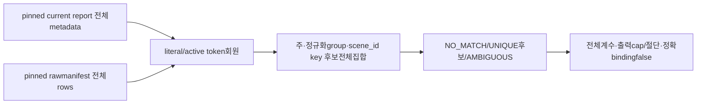

# Gate Connectivity Lineage 20261017 — 고정 JSON의 토큰 회원과 원본 후보집합

| 필드 | 값 |
|---|---|
| updated_at | 2026-10-17 23:36 KST — Git 상태 메타데이터 정정; 본문은 해당 Gate 기준 |
| source_commit | Git 연결됨; 문서 작성 시 변경분 미커밋, evidence snapshot SHA로 추적 (원격 기준 d483d25) |
| evidence_paths | `backend/app/data/readiness_connectivity_lineage.py`; `scripts/inspect_readiness_connectivity_lineage.py`; `tests/test_readiness_connectivity_lineage.py`; `docs/implementation/63_readiness_connectivity_lineage_validation.md`; `evidence/integration/readiness-connectivity-lineage-related-20261017.log`; `evidence/integration/readiness-connectivity-lineage-independent-20261017.log`; `evidence/integration/readiness-connectivity-lineage-live-20261017.json`; `evidence/integration/readiness-connectivity-lineage-live-cli-20261017.log`; `evidence/integration/readiness-connectivity-lineage-full-tests-20261017.log`; `evidence/integration/readiness-connectivity-lineage-live-integrity-20261017.json` |
| confidence | 코드·합성시험·현재고정JSON회원/후보조회; 정확원본행/파일진실 미검증 |
| status | TESTED_SYNTHETIC: 16시험·별도8변조; VERIFIED_REAL: 현재JSON후보집합; 학습/실행 BLOCKED |

## 쉬운 설명

검사표에 적힌 제품표식이 원본목록의 어느항목들과 맞는지 전부 찾아 후보목록을 만든다. 같은표식의 항목이 여러개면 첫항목이나 같은번호를 답으로 고르지 않는다. 후보가 하나여도 실제물건/파일을 대조한 인증은 아니다.

## 이론·일치 수준

caller의 literal token을 고정report 전체projected scene와 원본aggregate 전체raw row에서 조회한다. 키 `(province, normalized_source_group, normalized_scene_id)`가 같은 모든원본후보를 모은다. 내부scene순번·행수·정렬이 같다는 이유로 rawrow identity로 승격하지 않는다.

| 후보상태 | 뜻 |
|---|---|
| NO_MATCH | 같은metadata key 후보가없음 |
| UNIQUE_METADATA_CANDIDATE | 후보1개지만파일/원본행의정확인증은false |
| AMBIGUOUS_MATCH_SET | 여러후보를모두남기고하나를임의선택하지않음 |

현재실제query는report/raw literal·active회원각28개(Banten16/WestJava12)다. 후보link400개와고유rawrow28개를 구분하고 모든28report장면이 AMBIGUOUS_MATCH_SET이다. output저장link400개·truncationfalse·rawunknown0이며 exact_row_binding_verified=false다.28회원의경우Banten16×16+WestJava12×12=400의후보연결이며400개파일/장면을찾았다는뜻은아니다.

## 코드·읽기 경계·회원 의미

`inspect_readiness_connectivity_lineage(data_root, expected_report_sha256, expected_manifest_sha256, token, report_path=None, max_candidates=1000, max_members=2000)`와 내부CLI가 구현이다. report16MiB·manifest64MiB·depth32·strictUTF8/duplicate/비유한거부로두입력을 최초/최종boundedread한다. source만들기/assess/helper·GEOS·raster/header/이미지stat/hash·113source manifest추적은없다.

readiness의missing-key fallback과scalartruthiness/str의미를재사용한다. 명시None은키부재와다르고 falsygroup은두token역할을skip한다. literal로문자열이맞아도active token참여가아닐수있어두수를분리한다. 미지원rawmetadata는UNKNOWN으로계수하고완전회원/부재를추정하지않는다.

report의schema/typed계수·정책·manifest참조·capture/limits·승인false·witness계수/절단정합을확인하지만 모든witness event/union을재생하지않는다. source image_path·patch_sha256는원본JSON의선언문자열로만출력하며 원격처럼보이는값도접근하지않는다. 경로/SHA형식이맞아도 DECLARED_NOT_FILE_VERIFIED다.

전체회원/후보연결수는출력cap전에계산한다. max_members/report회원저장·max_candidates/link/rawdetail한도로출력이잘려도전체계수를유지하고 output_truncated를별도표시한다. 같은key indexcache와목록길이로전체수를계산해불필요한대형후보복사를피한다. cap은hard CPU/peak memory보장이아니다.

## 시험·실제 CLI

관련16 PASS/4.983초·독립16 PASS/5.564초의보존로그를읽었다. ambiguous/unique/no-match·같은index선택금지·fallback/explicitnull/falsy·crossrole/scalar·rawunknown·cap전전체수/대형keycache·typedreport계약·strictJSON/경로/변경·선언파일비검증/assess-helper trap·새output보호를합성검증했다. 별도8개변조거부는시험총수에추가하지않는다.

Root의실제CLI1회는exit0·OBSERVED_METADATA_MEMBERSHIP이며 57,548bytes·SHA `cff1fb4b566cb8d9be4625df253411d3776ae1f0e485854798ac36673aac2a8e` 새evidence를생성했다. 현재report에 per-scene imagepath/hash가없어원본단일행을확정할수없다는관측이다. 기존잘린witnessprefix가아닌전체projected/rawrow조회이며 source파일/정확제품진실·역사원인을인증하지않는다. 최종 전체 `scripts/test.ps1`은 **624건 중 623 PASS·1 SKIP/176.415초/종료0**다. SKIP은 기존 Windows symlink 생성 권한 제약이며 deterministic 경계 시험은 통과했다. 관련16 PASS/4.983초·독립16 PASS/5.564초와 별도8개 변조 거부 실험은 전체624에 중복 합산하지 않는다. 보호133참조(새 실자료 보고서 포함)·기존24계약SHA·입력 manifest/current report 핀이 불변이고 이전 snapshot 추적 코드·데이터·계약의 변경0을 확인했다. 저장된 다섯 차단과 패치628/233/250은 그대로다. 이 단위는 두 JSON의 후보 조회이며 영상·assess를 재실행하지 않았다. 이해자료작성은검사/CLI를재실행하지않았다.

## 한계·보존·UI

exactrowbinding·파일/제품진실·적격성·과거원인복원·정확geometry/픽셀독립성·0patch삭제후결과는검사하지않았다. 원본sceneindex를rawrowindex로바꾸거나후보첫행을정답으로쓰지않는다. 기존현재관측의28회원/양쪽positivepatch·5차단·적격patch1,111·계획후보1,095·baseline Draft·terminal없는2건/예약136,314,880B는유지한다. BLOCKED·exactly-once UNKNOWN·환불0·학습/실행/정산/자동재개/과학승인false다.

CLI는evidence아래DATA밖새파일exclusive x UTF8·ASCII요약·ADS/device/별칭/target재검사를사용하고 부분새파일은보존한다. 원자적FS보장은아니다. 공개API/UI계약이없어화면변경·브라우저재검사는불필요하다. 전체개발/10분보고는계속한다.

## 발표 1분

“현재검사표의 공유제품토큰을 원본목록 전체와 비교해 가능한행을 찾는 도구를 추가했습니다. 같은토큰은 양쪽문서에28회원이 있었지만 후보연결은400개이고 고유원본행은28개입니다. 모든장면이 여러후보를가져 단일원본행을 확정하지않았습니다. 내부번호와 원본번호가같거나 순서와수가같아도 신원으로추정하지않습니다. 경로와지문은 선언문자열일뿐 실제이미지를 다시읽지않았고 준비도도 재실행하지않았습니다. 앞으로이미확인된경로·지문단서를 전달할계약을 검토하되 현재후보를 인증된행으로바꾸거나 장면삭제·정책변경·학습승인을하지않습니다.”

## 발표 5분·10분

1. **0~1분:** 제품표식후보목록비유·정답임의선택금지를소개한다.
2. **1~2분:** 두JSON pin·literal/active/falsy와metadata key를설명한다.
3. **2~3분:**28회원/400link/고유28·모두ambiguous·내부index≠rawidentity를말한다.
4. **3~4분:** 관련16/독립16·별도8변조·실제CLI/최종전체·보호근거를구분한다.
5. **4~5분:** sourceIO/assess-helper0·정확인증false·5차단/원본유지·UI불필요·다음identity계약을말한다.

10분은missingkey/explicitnull·UNIQUE후보도미인증·cap전계수/출력절단·113manifest미추적·witness계수검사와event재생차이를덧붙인다.

## Q&A

**원본28행을확정했나?**28개고유후보행이있지만 report28장면각각은여러후보로모호하다.

**후보1개면인증인가?** UNIQUE_METADATA_CANDIDATE도정확binding/파일진실은false다.

**400은원본파일수인가?** report회원각각의후보길이합이며고유raw행수와다르다.

**영상hash도검증했나?** 두JSON만읽고 후보경로/SHA는선언값으로만출력했다.

**다음에는무엇을하나?** 이미assess가확인한imagepath/hash를추가IO없이전달할versioned계약설계/합성검증을계획한다. 현재미구현이다.

## 이후 갱신

최종 전체/보존근거를 읽고 기능해설·구조/용어·대본/FAQ/시연·INDEX·CHANGELOG를 함께 갱신했다. 다음선택adapter sourceidentity/하위호환trace계약은PLANNED이며실자료재assess·정책/분할변경은없다.
