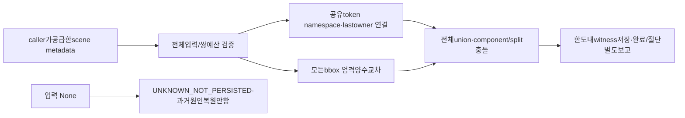

# Gate Connectivity Witness 20261017 — 향후 공급 metadata의 연결 근거 순수진단

| 필드 | 값 |
|---|---|
| updated_at | 2026-10-17 23:36 KST — Git 상태 메타데이터 정정; 본문은 해당 Gate 기준 |
| source_commit | d474d5bce6c2a6c4bd8ba141c9256d15f6004631 (108까지 구현 검토 기준; 이 메타데이터 정리는 후속 문서 커밋) |
| evidence_paths | `backend/app/data/readiness_connectivity_witness.py`; `tests/test_readiness_connectivity_witness.py`; `docs/implementation/58_readiness_connectivity_witness_validation.md`; `evidence/integration/readiness-connectivity-witness-related-20261017.log`; `evidence/integration/readiness-connectivity-witness-independent-20261017.log`; `evidence/integration/readiness-connectivity-witness-live-absence-20261017.json`; `evidence/integration/readiness-connectivity-witness-full-tests-20261017.log`; `evidence/integration/readiness-connectivity-witness-live-integrity-20261017.json` |
| confidence | 순수helper·합성metadata 검증; 실제저장근거부재만확인·과거원인미복원 |
| status | TESTED_SYNTHETIC: 16시험·별도BFS대조; VERIFIED_REAL: 저장witness부재; 학습/실행 BLOCKED |

## 쉬운 설명

앞으로 검사표를 만들 때 “어떤 장면의 어떤표식이 같았고 어느사각형이 겹쳐 연결됐는지” 메모를 남길 수 있는 도구다. 검사할 장면목록이 저장되지않았다면 빈공책을 채워 과거이유를 꾸미지 않는다. 공급자가 준목록을 계산할뿐 그장면이 실제로 적격인지 승인하지 않는다.

## 이론과 현재규칙

source_group·scene_id는 같은문자열namespace를사용한다. 두역할에prefix를붙이지않고 입력순서대로 token의lastowner를갱신한다. 같은행의두token이같아도 두번째no-op연결과역할갱신은기록한다. 빈source_group은 두token역할을모두skip하지만 bbox검사에는계속참여한다.

모든 j<i bbox쌍은 두축교차길이가엄격히양수일때연결하며 점/선접촉은제외한다. 같은split주도연결하므로 transitive경로가고정split충돌을만들수있다. component root는사전순작은주이름이며 split배정을바꾸지않는다. 이는직사각형metadata규칙이고정확한기하독립성검사가아니다.

## 함수·입력·한도

`diagnose_readiness_connectivity(eligible_scenes, province_splits=None, max_scenes=2000, max_bbox_pairs=1000000, max_witness_edges=10000)`가구현이다. 이helper는 파일IO·raster/경계·GEOS·네트워크·readiness.assess를하지않고 CLI/API/UI도만들지않았다.

명시리스트는caller가고정6주4/1/1 mapping과 유일한비음수signed64-bit scene_index·province·literal source_group/scene_id·유한양수면적경위도bbox를제공해야한다. scene_index는caller식별자이며원본manifest index로복원한것이아니다. eligibility는 CALLER_ASSERTED_NOT_VERIFIED다. 입력전체검증/분리복사와 전수nC2예산검사 뒤연결을시작하며 원본입력을변경하지않는다.

scene상한2,000·bbox쌍상한2,000,000(기본1,000,000)·저장edge상한10,000/0허용이다. 저장edge가한도에도달해도lastowner·모든bbox·전체union/충돌계산은계속한다. union_complete와witness_edges_truncated를별도로읽어야하며 일부저장edge로전체경로를복원했다고하지않는다. 입력상한도 hard CPU시간보장은아니다.

## None·빈목록·불완전token

None은근거부재로 UNKNOWN_NOT_PERSISTED·union_complete=false·component/계획/충돌값null이다. 빈리스트는명시0scene으로 NO_SUPPLIED_ELIGIBLE_SCENES·계산완료이지만 전체분리를주장하지않는다. 빈group은SOURCE_GROUP_MISSING·token불완전으로남기며 bbox는유지한다. conflict없음요약은 None/빈목록/불완전token에서true로추정하지않는다.

## 시험과 실제부재 근거

관련16 PASS/0.006초·독립16 PASS/0.007초의보존로그를읽었다. namespace/lastowner·동일행no-op·빈group/bbox·공백literal·접촉/미세양수·within/transitive·fixedconflictevents·저장0/절단에도union동일·예산/타입/입력불변·fileopen trap을검사했다. 별도BFS oracle300고정seed사례/3,917이벤트도일치했으며 정규시험수/전체회귀에더하지않는다.

Root는고정SHA의실제저장readiness에서 prepared_payloadnull·eligible scene/witness미저장을읽고 helper(None)를1회연결했다. 결과는 UNKNOWN_NOT_PERSISTED·union_complete=false이며 기존5 blocker와적격1,111/628·233·250은보존됐다. 실제적격scene를공급하거나 과거token/bbox원인을재현한검사가아니다. 최종 전체 `scripts/test.ps1`은 **554건 중553 PASS·1 SKIP/197.097초/종료0**다. SKIP은 기존 Windows symlink 생성 권한이며 deterministic 경계 시험은 통과했다. 관련16 PASS/0.006초·독립16 PASS/0.007초·별도BFS300사례/3,917이벤트 실험은 전체554에 중복 합산하지 않는다. 보호132참조·기존19계약SHA·저장readiness SHA는 불변이고 이전 추적 코드·데이터·계약 변경0이다. 저장5 blocker의 순서/내용과 적격계수는 그대로이며 신규core/test의 freeze SHA도 일치했다. 이해자료 작성은 보존 근거를 읽었고 재실행하지 않았다. 이해자료작성은재시험/실자료조사를실행하지않았다.

## 한계·승인·UI

이번helper는 callermetadata진단이며 적격성신원/provenance·실제원본scene index·저장report통합·과거원인복원·학습누출해결·전체기하분리를승인하지않는다. 기존assess/gate/policy에통합하지않았고 미래입력/보존연결은PLANNED다.

기존5차단·원본적격1,111/계획후보1,095·baseline Draft·terminal없는2건/예약136,314,880B·exactly-once UNKNOWN을유지한다. BLOCKED·학습/실행/정산/자동재개/과학승인false·환불0이다. 새로운API/CLI/UI연결이없는순수함수라 UI적용대상이없다. 전체개발과10분보고는계속한다.

## 발표 1분

“앞으로 장면목록이 명시적으로 공급될 때 원본표식과 사각형겹침의 연결이유를 기록하는 순수도구를 추가했습니다. 표식의 같은문자열과 bbox의엄격한양수교차로 주연결을 계산하고 이유를남깁니다. 기록저장한도에 도달해도 전체연결계산은 끝까지 합니다. 공급자가 적격이라고 준목록이지 도구가 적격성을 승인한 것은 아닙니다. 실제과거보고서에는 장면상세가없어 helper에None을연결했고 모른다는결과를확인했습니다. 빈목록과 근거부재는구분하며 과거원인을채워넣지않습니다. 기존준비도에통합하거나 새API/화면을만들지않았고 학습·정산·재개차단을유지합니다.”

## 발표 5분·10분

1. **0~1분:** 향후검사이유메모와과거빈공책비유를말한다.
2. **1~2분:** sharednamespace/lastowner·빈group양역할skip/bbox유지·transitive규칙을설명한다.
3. **2~3분:** None/empty와 callerasserted입력·전체검증/쌍예산·계산완료/저장절단차이를말한다.
4. **3~4분:** 관련16/독립16·별도BFS300사례와 실제부재/helper(None)확인범위를구분한다.
5. **4~5분:** assess미통합·적격provenance미검증·과거원인미복원·BLOCKED·UI대상없음·개발지속을설명한다.

10분은 scene_index/eligible_position차이·고정충돌event순서·no-op와union변경수·저장0이어도전체계산·bbox접촉vs양수·증거연결계약후속을덧붙인다.

## Q&A

**과거차단원인을복원했나?** 저장scene가없어None/UNKNOWN을확인했으며복원하지않았다.

**입력이적격이면승인된자료인가?** caller주장일뿐helper는eligibility_verified=false다.

**edge저장한도면검사도멈추나?** 전체union은계속하고저장근거만절단되며두상태를분리한다.

**빈group이면bbox도없어지나?** 두token역할만skip하고bbox참여는유지한다.

**새화면이나gate통합이있나?** 순수helper만있으며 CLI/API/UI·assess통합은없다.

## 이후 갱신

최종전체/보호근거를받아기능해설·구조/용어·대본/FAQ/시연·INDEX·CHANGELOG를함께확정했다. 별도통합설계·입력provenance/eligibleidentity·저장계약과실제gate통합/재평가는PLANNED후속으로구분한다.

이 단위의 “witness 저장 한도”는 반환할 메모리 결과 목록에 남기는 edge수의 한도다. 파일·DB에 영속 저장하는 기능은 없으며 향후 저장report 통합계약은 별도 PLANNED다.

## 다음 작업의 현재 상태

다음 별도연결 통합설계·입력provenance/eligibleidentity·보고서 영속보존 계약은 **PLANNED**다. 기존assess/gate 실제통합·적격성 재평가는 아직 수행하지 않았고 과거저장보고서의 원인을 소급추정하지 않는다.
