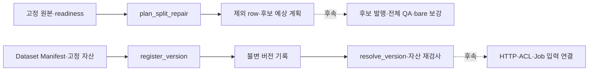

# Gate CONTINUOUS 20261017 — 원본을 보존하는 계획과 버전 코어

| 필드 | 값 |
|---|---|
| updated_at | 2026-10-17 23:36 KST — Git 상태 메타데이터 정정; 본문은 해당 Gate 기준 |
| source_commit | d474d5bce6c2a6c4bd8ba141c9256d15f6004631 (108까지 구현 검토 기준; 이 메타데이터 정리는 후속 문서 커밋) |
| evidence_paths | `docs/implementation/25_ml_split_repair_plan.md`; `evidence/integration/ml-split-repair-plan-20261017.json`; `docs/implementation/26_dataset_version_registry_core.md`; `evidence/integration/dataset-versions-tests-20261017.log`; `docs/implementation/24_collection_recovery_plan.md`; `evidence/integration/continuous-tests-20261017.log`; `evidence/integration/collection-recovery-plans/validation-20261017T003037618057Z.json`; `evidence/integration/collection-recovery-plans/integrity-20261017T003101447624Z.json` |
| confidence | 코드·실제 계획 메타데이터·기존 단위시험 근거 대조; 후보 전체 QA·운영 검증 미수행 |
| status | TESTED_SYNTHETIC: 계획기·Registry 코어 시험; VERIFIED_REAL: 계획 메타데이터만; 학습 BLOCKED |

## 한 문장과 1분 설명

원본 장부를 지우지 않고 중복 시험문항의 제외 후보를 표시하는 계획기와, 자료 접수증의 동일 버전 교체를 막는 등록 코어를 만들었다. 계획한 후보가 실제 새 재고로 발행됐거나 운영 연결·학습 승인이 완료된 것은 아니다.

## 5분: 입력 → 처리 → 출력

ML은 고정 원본/readiness SHA와 province split을 입력받아 scene/source_group/영상 SHA가 연결한 component를 찾는다. 사전 test→val→train 순서로 보존 split을 정하고 새 후보에서 제외할 row index를 출력한다. 점수나 라벨분포로 유리한 평가자료를 고르지 않으며 split을 다시 배정하지 않는다. 실제 계획은 validation16행 제외, 원본 적격1,111 대비 후보 예상1,095다. train/val/test는 실제628/233/250, 후보 예상628/217/250이다. 기본 실행은 plan evidence만 생성했으며 파생 manifest는 발행하지 않았다.

Dataset 코어는 GMAIS 원문 schema와 고정 id/version/artifact SHA·lineage 참조를 검사한다. 동일 버전 교체는 막고 같은 내용은 멱등 반환하며 조회 때 파일을 재검사한다. 보고서가 있는 VALIDATED 품질도 과학적 승인이나 배포 승인을 부여하지 않는다.

## 구조와 실제 코드

| 역할 | 실제 파일·함수 | 확인한 범위 |
|---|---|---|
| split 계획 | `backend/app/ml/split_planning.py:plan_split_repair`, `write_plan` | 입력 SHA·전이적 identity·고정선택·덮어쓰기 방지 |
| CLI | `scripts/plan_training_split_repair.py` | 기본 계획 JSON 출력; 원본 수정·학습 아님 |
| 자료 버전 | `backend/app/dataset_registry.py:register_version`, `resolve_version` | SQLite 트랜잭션·같은 버전 교체 거부·자산 재검사 |

## 시험과 한계

계획기8 PASS/0.290초는 임시 JSON 회귀시험이다. 실제 manifest의 계획 JSON은 실메타데이터 검사에 한정하며4,335개 파일 재감사나 기하 중첩 검증이 아니다. 남은 source identity 충돌0 표시는 해당 식별자 동치관계만 뜻한다. bare 기여 패치 상한은 모든 split0으로 여전히 부족하다. 기존 readiness·원본 manifest·실자료 학습 BLOCKED를 변경하지 않았다.

Dataset10 PASS/1.548초는 임시 fixture의 등록·동시성·손상·자산 변경·승인분리 시험이다. HTTP/기관 ACL/운영 카탈로그·실자료 등록·Job 연결은 없다. lineage 부모 존재 확인과 불변 자산 복제도 후속이다. 두 단위로 전체 G1·ML gate를 완료 처리하지 않는다. 기존197 PASS는 과거 전체시험이고 새 단위시험을 더해 전체 통과 수를 만들지 않는다.

## 발표·10분 확장·Q&A

30초: “원본을 바꾸지 않는 split 복구계획과 Dataset 버전 코어를 추가했습니다. 계획과 코어를 모의 입력으로 시험했지만 새 자료 발행과 운영 연결은 아직입니다. 나지 부족과 전체 공간검증을 해소해야 학습 검토로 넘어갑니다.”

5분은 위 입력→계획/등록→시험→한계를 설명하고, 10분은 전이적 component·validation 감소·동시등록·변경 자산 실패 사례를 각각1분씩 추가한다. 슬라이드: 원본 보존 / 후보와 실제 재고 / 버전 접수증 / 남은 승인.

Q1. 실제 자료가1,095개로 줄었나? A. 아니다. 후보 계획의 예상치다.

Q2. 누출과 bare가 해결됐나? A. 식별자 충돌의 선택 계획일 뿐 기하 QA·클래스 재검사가 남고 bare는 여전히 부족하다.

Q3. Registry는 운영 API인가? A. 내부 Python 코어이며 HTTP/기관 ACL·Job 연결 전이다.

Q4. 파일을 바꿀 수 없나? A. 버전 기록 교체를 막고 해시를 재검사한다. 자산 자체 불변 저장 복제는 후속이다.

Q5. 다음은? A. 복구 근거 인계와 새 후보 발행 검토·전체 QA·bare 보강, 운영 Registry 연결의 별도 gate다.

## 시연과 다음 갱신

[시연 문서](../presentations/DEMO_STORY.md)의 기존 읽기 경로에 계획 JSON·Registry 시험 로그 설명을 덧붙인다. 계획을 실제 적용하거나 학습을 실행하는 시연은 하지 않는다. Root가 전체 회귀·수집 복구 완료 근거를 전달하면 이 Gate와 영향 문서만 후속 갱신하며 이력과 증거 종류를 보존한다.

### Registry 독립 검토 후 보완

`resolve_version`에 요청 dataset ID/version과 저장 manifest의 ID/version·저장 key를 비교하는 검사를 추가했다. 다른 버전의 유효 manifest가 잘못된 요청의 결과로 해석되는 문제를 막기 위한 수정이다. `tests/test_dataset_registry_versions.py:test_valid_manifest_from_other_version_cannot_replace_requested_identity`가 추가되어 시험 정의는11개다. 앞서 기록한10 PASS는 수정 전 시험 이력이며, 수정 후 `dataset-versions-tests-20261017.log`를 읽어11 PASS/1.335초를 확인했다. 최종 전체 통합 실행 결과는 별도 인계 대기다.

## 최종 인계 반영 — 수집 복구계획과 전체시험

`backend/app/data/recovery.py:build_recovery_plan`, `validate_recovery_plan`과 CLI는 읽기 전용 복구계획을 생성·검증한다. 같은 snapshot이면 동일 ID를 재사용하고 stale/변조·경로이탈은 거부한다. 실제 검증은 VALID_BLOCKED·execution_authorized=false, 보호15개 참조의 전후 snapshot 동일이다. pending2건 예약136,314,880B를 전액 보존했으며 terminal/source 결과 부족으로 실제 적용은 BLOCKED다. 적용 coordinator·환불·lock삭제·수집 재시작은 이번 구현 범위가 아니다. 절차·시각·한계는 [데이터 설명](../01_DATA_PIPELINE.md)의 마지막 절을 읽는다.

Dataset 신원 검사 수정 후 단위시험은11 PASS/1.335초다. 수집 복구 단위시험은15건 중14 PASS·1 SKIP이며 실제 symlink 생성권한 부족이 skip 사유다. deterministic mock 경계시험은 통과했다. `scripts/test.ps1`의 최종 로그는225건/60.950초/OK(skipped=1), 즉224 PASS·1 SKIP다. 이전 전체197 PASS·초기Dataset10 PASS는 개발 이력이며 최신 수치에 더하지 않는다. 앞선 최종시험/수집근거 대기 문구는 이 절의 결과로 대체한다.

Root가 `geoai-2` ACTIVE·10분 RRULE 설정 확인을 전달했다. 지속개발 정책은 `CONTINUOUS_DEVELOPMENT.md`·`AGENTS.md`에 있다. 예약 설정과 실제 작업 프로세스·매 주기의 전달 성공을 구분한다. 자료 원본1,111과 후보 예상1,095, bare 미해결·실자료 학습 BLOCKED, 외부5 미구현·Workflow PLAN_ONLY·운영 인수 미완료는 변함없다.
