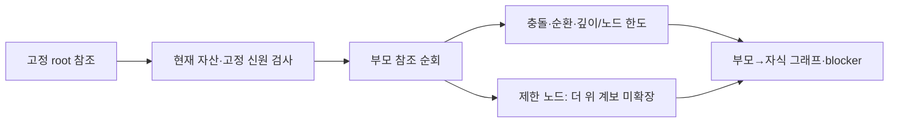

# Gate Dataset Lineage 20261017 — 현재 파일과 고정 출처 관계 읽기

| 필드 | 값 |
|---|---|
| updated_at | 2026-10-17 23:36 KST — Git 상태 메타데이터 정정; 본문은 해당 Gate 기준 |
| source_commit | d474d5bce6c2a6c4bd8ba141c9256d15f6004631 (108까지 구현 검토 기준; 이 메타데이터 정리는 후속 문서 커밋) |
| evidence_paths | `backend/app/dataset_lineage.py`; `docs/implementation/35_dataset_lineage_verification.md`; `evidence/integration/dataset-lineage-tests-20261017.log`; `evidence/integration/dataset-lineage-full-tests-20261017.log`; `evidence/integration/dataset-lineage-synthetic-20261017.json` |
| confidence | 코드·합성계보·시험로그 대조; 운영자료 계보 인수 미검증 |
| status | TESTED_SYNTHETIC: 계보코어; IMPLEMENTED_UNVERIFIED: 운영자료/API연계; 실행 BLOCKED |

## 한 문장·1분 설명

가족관계도에서 부모와 조상의 신분증 번호를 따라 확인하듯, 자료의 고정 ID/version/자산SHA를 따라 현재 파일과 출처 관계를 읽는다. 관계와 파일이 맞는 것은 자료 사용권한이나 과학적 정답을 뜻하지 않는다.

## 왜·이론·5분 흐름

root만 해시가 맞아도 부모가 없거나 바뀌면 추적성이 끊긴다. `verify_dataset_lineage(store,id,version,artifact_sha,max_depth=32,max_nodes=256)`는 기존resolve_version으로 각 고유참조를 확인하고 부모→자식edge를 반환한다. 같은ID의 다른고정버전은 허용하되 같은ID/version의 상충SHA,동적참조,순환,깊이/노드한도를 차단한다. 공유부모·diamond는 중복조회하지 않고 깊은다른경로의한도는 재검사한다.

## 코드·응답·예외

실제파일은`backend/app/dataset_lineage.py`,함수는`verify_dataset_lineage`다. 입력SHA는canonical manifest해시가아닌자산바이트SHA다. scope는DATASET_LINEAGE_INTEGRITY_ONLY다. `current_assets_revalidated`는resolve를한번이상시도했는지이며모든조상성공표시가아니다. `expanded`는부모참조순회표시다. 전체판정은lineage_integrity_verified와blockers를읽는다.

기본한도는root깊이0/최대32,고유노드256이며허용범위는깊이0~64/노드1~1024다. bool·범위밖한도를거부한다. 제한자료는LINEAGE_ACL_NOT_IMPLEMENTED를남기고상위계보를조회·출력하지않아비공개조상ID도숨긴다. 내부예외·원문manifest·URI/path는반환하지않는다. RAW품질을모델사용가능으로판정하지않으며권한·실행·과학승인은항상false다.

## 시험·한계·UI 직접변경 없음의 이유

임시SQLite와합성로컬파일의13 PASS/5.842초,독립재실행13 PASS/3.317초를기록했다. 최신전체287건/103.726초/OK(skipped=1)=286 PASS·1 SKIP다. 기존OSsymlink권한1SKIP·mock경계PASS를구분하며이전274건과합산하지않는다. 합성JSON은TESTED_SYNTHETIC_ONLY다. 누락/hash/dynamic/cycle/limit/diamond/제한조상비노출과원본DB·파일불변을시험했다.

새HTTPAPI나실자료Registry/기존응답을변경하지않는내부코어라이번단위의직접UI변경은없다. API·Job/Workflow연결이나화면상태계약이추가되면별도인계한다. 순차파일시점검사는전체그래프의원자적snapshot·불변저장·서명출처와다르며운영자료계보인수·기관ACL·실행직전고정·독립과학검증은후속이다.

## 발표·10분 확장·Q&A

30초: “자료의고정계보와현재파일을읽어누락과변경을찾습니다. 임시자료로시험한내부코어이며운영자료등록·API/권한/과학승인은아닙니다.”

5분은root→부모→현재파일→차단/반환을설명한다.10분은diamond공유부모·다른깊이경로·비공개조상숨김·시점검사한계를확장한다. 슬라이드: 고정출처 / 현재파일 / 공유조상과한도 / 운영연계전문턱.

Q1. true면모든조상성공? A. current_assets_revalidated는시도표시이고전체판정은별도다.

Q2. 제한자료권한도검증? A. ACL미연결차단이며상위계보를확장하지않는다.

Q3. RAW자료는학습가능? A. 계보무결성은사용적합성/승인이아니다.

Q4. 화면에왜안보이나? A. API변경없는내부코어다.

Q5. 다음은? A. 승인된운영계보/API연계·실행직전불변입력·권한과과학검증의별도근거다.

실제시연은합성증거와문서35를읽는범위다. 운영자료를등록하거나새수집/학습을실행하지않는다. PNG대시보드·카탈로그는별도UI단위이며완료근거인계후설명을추가한다.
