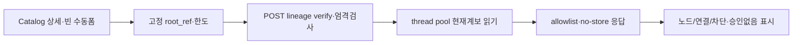

# Gate Dataset Lineage API·UI 20261017 — 현재 계보의 읽기 진단 창구

| 필드 | 값 |
|---|---|
| updated_at | 2026-10-17 23:36 KST — Git 상태 메타데이터 정정; 본문은 해당 Gate 기준 |
| source_commit | d474d5bce6c2a6c4bd8ba141c9256d15f6004631 (108까지 구현 검토 기준; 이 메타데이터 정리는 후속 문서 커밋) |
| evidence_paths | `backend/app/dataset_lineage_api.py`; `docs/implementation/36_dataset_lineage_api_plan.md`; `docs/implementation/37_dataset_lineage_ui.md`; `evidence/integration/dataset-lineage-api-independent-tests-20261017.log`; `evidence/integration/dataset-lineage-api-full-tests-20261017.log`; `evidence/integration/dataset-lineage-ui-build-20261017.log`; `evidence/integration/dataset-lineage-api-live-20261017.json` |
| confidence | 코드·fixture시험·실제미등록/입력차단UI; 성공운영계보미검증 |
| status | TESTED_SYNTHETIC: 성공계보/API계약; VERIFIED_REAL: 로컬미등록/오류·UI; 실제실행 BLOCKED |

## 한 문장·1분 비유

자료의고정된부모관계를현재파일과대조하는검사창구를API와화면에연결했다. 과거점검표를읽는Job조회와달리현재를검사하되,검사시도나접수성공이사용허가·과학승인은아니다.

## 왜·이론·5분 흐름

본문으로root_ref와한도를받기위해POST를쓰는읽기진단이다. 기존legacy datasets6행과불변dataset_versions는별개여서추정버전/SHA로자동변환·등록하지않는다. 실제고정ID/version/자산SHA를직접넣고현재계보코어를호출한다.

## 코드·계약·예외

`backend/app/dataset_lineage_api.py:create_dataset_lineage_router`와main.py의`POST /v1/datasets/lineage/verify`,UI `DatasetLineageDiagnostics.tsx`,`lineageVerificationAdapter.ts`가구현이다. 확장은greenblue.dataset-lineage-verification.rfc1/INTERNAL_REVIEW,upstream:false다. 원문OpenAPI를바꾸지않는다.

추가필드/형태/SHA/bool/한도오류는자산조회전400,고정미등록/계보차단은200/BLOCKED,예측못한자원/응답모순은503으로막는다. 기존token인증을상속하지만기관ACL승인이아니다. 응답은고정allowlist로제한하고raw manifest·URI/path/자격정보/내부예외를숨긴다. 제한노드상위조상을조회·출력하지않지만존재/등급의운영노출정책은별도다.

매요청현재자산검사를thread pool에서수행하고UTC시작/종료를검사구간으로준다. UI는KST표시를구분한다. 모든200/400/503은no-store이며이전성공을재생하지않는다. 순차검사라원자적전체snapshot이나실행직전불변성은아니다. current_assets_revalidated는시도여부이고전체성공은lineage판정/blocker를읽는다. 양쪽권한·실행·과학승인은false다.

## UI·실제브라우저

상세의접기영역은빈폼이며추정값을채우지않는다. latest/current/미확인/잘못된SHA·한도는버튼을막는다. 입력편집·상세전환·닫기·이탈은이전결과/요청세대를무효화한다. root신원·계약·승인false·진단한도/방향/네트워크쓰기0을검사하고늦은응답을막는다.

실제5174동일출처proxy→API8002에서baseline상세의빈폼,명시미등록참조의BLOCKED/DATASET_VERSION_NOT_FOUND,KST/시도≠성공/승인없음을확인했다. latest편집은결과제거+버튼비활성,고정1복원재조회도확인했다. desktop1440×1000/mobile390×844·mobile dialog351/document375<390이다. 성공계보는fixture이며실제운영자료성공을만들지않았다.

## 시험·보존·한계

관련API11 PASS/3.668초·독립11 PASS/4.302초,전체298건/88.188초/OK(skipped=1)=297 PASS·1 SKIP다. UI25/25 PASS/341.057ms·build60modules/22.09초다. 기존OSsymlink권한1SKIP와mock경계PASS를구별하며이전287건등과합산하지않는다.

Catalog/원장/manifest/readiness/upstreamOpenAPI의5SHA전후같음·기존표준Job2·신규실행0이다. 운영계보인수·기관ACL·서명감사·실행직전고정·성능/보안·독립과학/운영승인은후속이다. API는쓰기등록·Job/Trace큐를만들지않는다.

## 발표·10분 확장·Q&A

30초: “계보검사를API와화면에연결했지만기존목록을자동등록하지않습니다. 실제미등록차단과입력오류를확인했으며성공계보는임시시험범위입니다.”

5분은수동고정참조→요청검사→현재읽기→UI차단과한계,10분은POST읽기/no-store·과거Job기록차이·순차시점·legacy분리·제한정보노출정책을확장한다.

Q1.POST는쓰기인가? A.읽기진단이다.

Q2.카탈로그6개검증완료인가? A.별개Registry이며자동등록하지않는다.

Q3.200/시도true면성공인가? A.진단과전체판정은다르다.

Q4.현재성공운영계보를봤나? A.fixture성공·실제미등록UI를구분한다.

Q5.권한과실행은? A.false이며후속gate다.

[시연](../presentations/DEMO_STORY.md)의최신계보절과desktop/mobile기록을사용한다. 코드·API/사용법·시험·인계·UI·이해자료를같이갱신했으며단일읽기진단완료로전체개발/보고를중지하지않는다.
